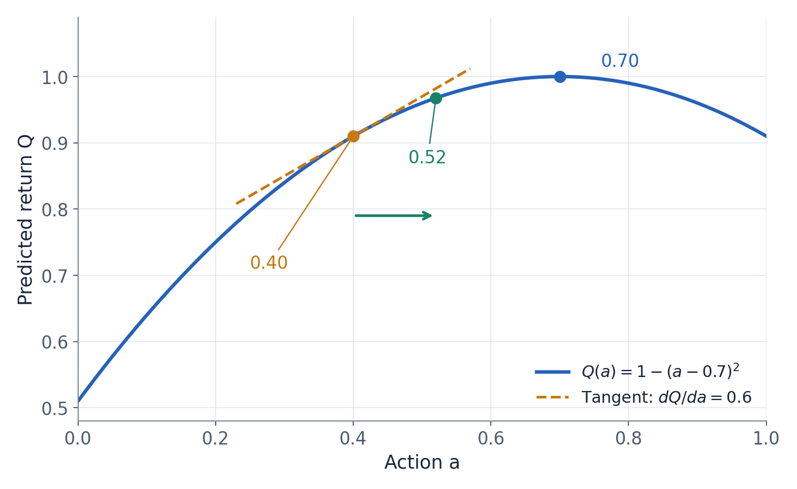

# 大话强化学习算法 DDPG

一辆赛车刚驶出弯道，当前油门是 40%。如果把它加到 41%，这圈会跑得更快，还是会因为轮胎打滑而更慢？

对人类车手来说，这个问题可以靠经验和试探回答。对强化学习来说，它藏着连续控制的核心困难：动作不是“左、右、停”这样的几个选项，而是一个范围里任意精细的数。油门、方向盘和刹车组合起来，候选动作就更多了。

DDPG 给出的办法是让两个网络分工：Actor 直接提出动作，Critic 估计动作的长期价值，再利用价值对动作的变化率，告诉 Actor 应该怎样调整。这也是“连续 Actor 通过 Critic 的动作导数学习”这句话所描述的一种典型计算方式。[1][2]

这篇文章从油门例子出发，把这句话拆成一次能亲手算完的更新。文中的小网络、分数和学习率都是教学假设，不代表真实赛车环境的数值。

## 1 油门有无数种选择 怎样找到更好的动作

先把赛车问题翻译成强化学习语言。

状态 $s$ 可以包含车速、与赛道边界的距离、车辆朝向和轮胎状态。动作 $a$ 可以是油门，也可以是方向盘、油门、刹车组成的向量。环境接收动作后，返回奖励 $r$ 和下一状态 $s'$。

奖励只评价当前这一步，决策却需要考虑后果。猛踩油门可能立刻获得更高速度，也可能在几步之后冲出赛道。因此，我们关心的是从现在开始、按照某个策略继续行动时的折扣累计回报：

$$
G_t=r_t+\gamma r_{t+1}+\gamma^2r_{t+2}+\cdots
$$

其中 $\gamma$ 是折扣因子。动作价值 $Q^\mu(s,a)$ 表示：先在状态 $s$ 执行动作 $a$，之后跟随策略 $\mu$，预期能得到多少这样的回报。

对于离散动作，可以分别评价几个候选动作，再选其中较好的。连续动作很难靠穷举解决。即使油门只保留两位小数，同时加入转向和制动，组合数量也会迅速增加。DDPG 让 Actor 学习一个直接映射，避开每次决策都在动作空间中搜索大量候选点的问题。[2]

这并不意味着 Actor 从一开始就知道正确答案。它必须有人指导，而这个指导者就是 Critic。

## 2 Actor 提动作 Critic 估价值

DDPG 的全称是 Deep Deterministic Policy Gradient。这里的 deterministic 指确定性策略：给定同一个状态和同一组参数，Actor 输出同一个建议动作。

Actor 的计算是：

$$
a_\theta=\mu_\theta(s)
$$

$\theta$ 是 Actor 的参数。Critic 则接收状态和动作，输出一个标量：

$$
Q_\phi(s,a)
$$

$\phi$ 是 Critic 的参数。把 Actor 的输出接到 Critic 的动作输入上，得到：

$$
Q_\phi(s,\mu_\theta(s))
$$

这就是 Actor 需要提高的分数。Critic 估计的是长期价值，所以这个分数通常不等于当前奖励，也不是对动作合法性的简单判断。

可以把固定状态下的 $Q_\phi(s,a)$ 想成一条起伏的曲线：横轴是油门，纵轴是预测回报。Actor 先落在曲线上的某个位置，再根据当前位置的斜率调整自己。

但这张曲线来自学习，可能画错。Actor 优化的是 Critic 的估计，真实赛道表现还需要通过环境反馈验证。这个局限正是后来 TD3 等算法重点处理的问题。

## 3 动作导数究竟在说什么

固定当前状态和 Critic 参数，考虑：

$$
\frac{\partial Q_\phi(s,a)}{\partial a}
$$

它回答的是：动作发生一个很小的变化时，Critic 预测的回报会怎样变化？

例如导数为 $0.6$，动作增加 $\Delta a=0.01$ 时，局部线性近似给出：

$$
\Delta Q\approx0.6\times0.01=0.006
$$

这是一条关于当前附近的建议。如果导数为正，稍微增大动作可能提高预测值；如果为负，稍微减小动作可能提高预测值。对于多个动作维度，Critic 提供的是一个梯度向量，分别描述改变转向、油门、刹车的局部影响。

这里的“动作导数”不是油门随时间变化的速度 $da/dt$，也不是 Critic 参数的梯度 $\partial Q/\partial\phi$。求导的对象是动作输入。

Critic 通常只需输出 Q 值。只要网络计算可微，自动微分就能沿着运算图得到动作梯度，不必再训练一个专门输出导数的网络。[1][3]

接下来还差一段连接：Critic 告诉我们动作应该怎样变，但真正可以修改的是 Actor 的参数。

## 4 用链式法则算出 Actor 怎样学习

在一次 Actor 更新中，固定回放中的状态分布和 Critic 参数，使用下面这个可计算的代理目标：

$$
J_{\mathcal D}(\theta)=
\mathbb E_{s\sim\mathcal D}
\left[Q_\phi(s,\mu_\theta(s))\right]
$$

其中 $\mathcal D$ 表示经验回放中的状态分布。它推动 Actor 在这些状态上提高 Critic 的预测价值；真实回报是否改善，还取决于价值近似和数据覆盖，不能把任意回放分布上的更新直接当成真实长期回报的精确梯度。

对于固定状态 $s$，记单样本目标为 $J_s(\theta)=Q_\phi(s,\mu_\theta(s))$。链式法则把它的梯度分成两部分：

$$
\nabla_\theta J_s
=
\left.
\nabla_aQ_\phi(s,a)
\right|_{a=\mu_\theta(s)}
\nabla_\theta\mu_\theta(s)
$$

第一部分说明“动作往哪里变会提高分数”，第二部分说明“参数怎样变会使动作那样变化”。它们连接起来，才成为 Actor 参数的更新方向。[1]

现在做一次手算。把状态简化成一个数，Actor 简化成一个乘法：

$$
s=2,\qquad a_\theta=\theta s,\qquad \theta=0.2
$$

因此当前动作是：

$$
a_\theta=0.2\times2=0.4
$$

假设固定状态下的 Critic 曲线为：

$$
Q(s,a)=1-(a-0.7)^2
$$

当前分数是：

$$
Q(s,0.4)=1-0.3^2=0.91
$$

先求 Critic 对动作的导数：

$$
\frac{\partial Q}{\partial a}
=-2(a-0.7)
$$

在 $a=0.4$ 处，它等于 $0.6$。再求 Actor 的导数：

$$
\frac{\partial a}{\partial\theta}=s=2
$$

因此：

$$
\frac{\partial J_s}{\partial\theta}=0.6\times2=1.2
$$

使用学习率 $\eta=0.05$ 做梯度上升：

$$
\theta_{\mathrm{new}}
=0.2+0.05\times1.2
=0.26
$$

Actor 的新输出变为：

$$
a_{\mathrm{new}}=0.26\times2=0.52
$$

再次代入 Critic：

$$
Q(s,0.52)=1-(0.52-0.7)^2=0.9676
$$

这次更新提高了预测分数。变化发生在参数 $\theta$ 上，动作随网络参数变化而改变，并不是直接把某条历史记录中的油门改成了 52%。

这个例子恰好使用简单的抛物线和较小步长。真实网络的曲面更复杂，一步走得太远可能越过好区域，多个状态的梯度也可能相互影响。链式法则提供局部方向，不保证每次有限步长更新都改善真实回报。

为什么不直接记住“这个状态踩 52% 油门”，还要训练一个网络？因为下一次车辆可能以不同速度、不同朝向进入弯道。Actor 要学的是一条能根据状态生成动作的规则。修改共享参数后，它在许多状态下的输出都可能改变，批次学习会综合这些状态提出的要求。

这也说明，单个样本的建议不等于整个网络下一次更新的全部结果。如果另一个状态要求降低油门，两条样本的梯度需要共同作用。手算时把状态和参数缩成一个数，是为了看清一条梯度路径；真实训练还要解决不同状态之间的协调与泛化。

图 1 固定状态下的教学价值曲线。橙色虚线表示动作 0.40 处的局部斜率，绿色点表示参数更新后生成的动作 0.52。曲线来自文中的假设函数，不是实际赛车测量。

## 5 Critic 的分数从哪里学出来

如果 Critic 自己也不知道答案，它又怎么指导 Actor？

它从实际经历中学习。经验记录包含：

$$
(s,a_{\mathrm{data}},r,s',b)
$$

$a_{\mathrm{data}}$ 是当时真正执行过的动作，$b=1$ 表示任务真正终止。利用下一状态的估计，可以构造一步学习目标：

$$
y=
r+\gamma(1-b)
Q_{\bar\phi}
\left(s',\mu_{\bar\theta}(s')\right)
$$

横线表示目标网络。Critic 用平方误差拟合这个目标：

$$
L_Q(\phi)=
\mathbb E
\left[
\left(Q_\phi(s,a_{\mathrm{data}})-y\right)^2
\right]
$$

这就是把“当前实际获得的奖励”和“后续价值的估计”接起来。由于未来部分也来自估计，这种学习称为自举。[2][3]

另设一个独立的 Critic 教学样本：即时奖励为 $0.4$，下一状态动作价值估计为 $1$，$\gamma=0.9$，且没有终止。那么：

$$
y=0.4+0.9\times1=1.3
$$

若当前预测为 $0.9$，平方误差为：

$$
L_Q=(0.9-1.3)^2=0.16
$$

把目标视为固定值时，对当前预测的导数是：

$$
\frac{\partial L_Q}{\partial Q}=2(0.9-1.3)=-0.8
$$

梯度下降会推动这条样本的预测升高，实际更新仍然通过网络导数作用到参数 $\phi$ 上。如果是真正终止状态，未来项归零，目标只剩本次奖励。

因此，Critic 既接受真实奖励的约束，又依赖自己对未来的估计。训练误差变小只说明它更贴近当前目标；如果目标有偏差，低损失仍可能伴随错误价值。

## 6 经验回放和目标网络分别解决什么问题

赛车连续两帧的状态通常非常相似。如果网络总按相邻顺序学习，训练数据会高度相关。经验回放把经历存起来，再抽取小批次训练，让旧经历可以重复利用，也减少批次内的时间相关性。

这使 DDPG 能够使用不同历史策略收集的数据。训练 Critic 时，仍然要尊重这条经历实际执行的动作；奖励和下一状态是那个动作产生的，不能随意换成当前 Actor 喜欢的动作。[2]

Actor 更新则不同。它从回放中取状态，再由当前 Actor 重新提出动作。两者的分工可以直接列出来：

| 计算目的 | 使用的动作 |
|---|---|
| 拟合当前 Critic | 历史实际动作 $a_{\mathrm{data}}$ |
| 更新 Actor | 当前动作 $\mu_\theta(s)$ |
| 构造未来目标 | 目标 Actor 的动作 $\mu_{\bar\theta}(s')$ |

目标网络解决的是另一个问题：如果产生目标的网络变化太快，Critic 就会持续追赶一个剧烈移动的答案。DDPG 用缓慢更新的副本生成目标，例如：

$$
\bar\phi\leftarrow(1-\tau)\bar\phi+\tau\phi
$$

其中 $\tau$ 是较小的更新系数，Actor 的目标参数也类似地更新。这提供了一个变化更平缓的参照，但并不把参照变成真实答案。目标网络与经验回放已经属于 DDPG，不能把它们当成 TD3 才加入的机制。[2][3]

## 7 反向传播时 哪些东西应该保持固定

理解计算图，比背住一条 Actor loss 更有用。

训练 Critic 时，历史动作固定，目标值也固定，优化的是当前 Critic 参数。否则网络可能通过移动目标来降低损失，失去本来希望实现的拟合意义。

训练 Actor 时，状态固定，Critic 参数固定，但 Actor 输出的动作必须留在计算图里。梯度需要穿过 Critic 的动作输入，才能回到 Actor。

“冻结 Critic 参数”和“禁止整个 Critic 计算求导”不是同一个操作。前者表示这一步不改变 $\phi$；后者可能把 Actor 需要的 $\partial Q/\partial a$ 一起切断。在实际自动微分实现中，Actor 更新时保留这条路径非常关键。[3]

同样，不需要对真实赛车模拟器求导。环境负责提供经历，Critic 学习可微的价值近似，Actor 再通过这个近似求导。碰撞、换挡和离散的奖励逻辑不会因为不便求导就自动排除这种学习方式，但价值近似能否学好仍然取决于数据和状态信息。

## 8 这条梯度什么时候可能误导 Actor

设三个油门的真实长期表现和 Critic 预测如下。这里的“真实”只用于构造一个能看清问题的教学场景：

| 油门 | 假设真实回报 | Critic 预测 |
|---|---:|---:|
| 30% | 8 | 8.2 |
| 50% | 9 | 8.8 |
| 80% | 7 | 12 |

Actor 看不到第二列。如果探索让它接近 80% 附近，或局部优化路径把它带入这片高估区域，它就可能被虚假的高值吸引，哪怕真实表现更差。这张表展示高估的风险，并不意味着动作梯度会穷举这些点或必然找到全局最高值。错误还可能通过自举目标传播到其他状态。

所以，Actor 的优化能力越强，也可能越擅长利用 Critic 的错误。DDPG 的后续改进不能只考虑“怎样更快沿坡走”，还要考虑“这条坡是否可信”。TD3 正是从函数近似误差与高估的问题切入。[4]

导数为零也不能直接解释成“找到最佳油门”。当前位置可能是局部峰值、谷底、平坦区，或者网络饱和造成的弱梯度。对于动作边界，某些参数化方式也可能削弱梯度。判断策略是否进步，最终仍要回到实际回报与行为。

确定性策略同样不意味着训练时完全不探索。DDPG 可以在执行建议动作时加入探索噪声。建议动作本身的确定性，与收集数据时是否随机，是两个层面的问题。

## 9 连续动作一定要通过动作导数学吗

不一定。连续动作描述的是动作空间，梯度估计方法则是另一项算法选择。

DDPG 的路径是：当前 Actor 生成动作，Critic 评价它，动作梯度回到 Actor。TD3 主要改善这条路径中价值学习的可靠性。

PPO 常见的做法是把曾经采样并执行的动作固定下来，根据优势估计，提高或降低它在新策略下的概率密度，再用概率比裁剪等目标控制更新激励。它通常不需要计算 Critic 对动作的导数。[5]

SAC 虽然也使用随机策略，但常见连续动作实现通过重参数化，让动作保留对策略参数的导数，因此仍会利用 Critic 的动作梯度，同时考虑熵项。TQC 在这条路线中进一步使用回报分位数和目标截断。[6][7]

这也解释了为什么“Actor 输出高斯分布”不能单独决定算法是不是 PPO：策略如何表达动作，与策略怎样学习，是两个需要分别回答的问题。

## 10 从 DDPG 出发 怎样读懂后面的算法

读完 DDPG，可以用三个检查点检验自己是否理解了它。

第一，能否区分“Critic 学习价值”和“Actor 利用价值学习”？前者拟合奖励与未来估计构成的目标，后者改变动作以提高预测价值。

第二，能否沿着状态、动作、分数、参数画出梯度路径？历史动作属于 Critic 拟合的数据；Actor 更新时使用的是当前网络生成的动作。

第三，能否区分预测改善与真实改善？Critic 的坡度只是学习出来的局部建议，目标网络和经验回放提供稳定条件，但不能消除全部估计误差。

这三个问题会贯穿本系列。五篇文章分别是[《大话强化学习算法 DDPG》](01-大话强化学习算法-DDPG.md)[《大话强化学习算法 PPO》](02-大话强化学习算法-PPO.md)[《大话强化学习算法 TD3》](03-大话强化学习算法-TD3.md)[《大话强化学习算法 SAC》](04-大话强化学习算法-SAC.md)[《大话强化学习算法 TQC》](05-大话强化学习算法-TQC.md)。

可以先沿 DDPG → TD3 → SAC → TQC 阅读，观察价值学习与 Actor 更新怎样逐步变化；再把 PPO 作为并行路线对照。这样既能理解各自解决的问题，也能避免把这些算法误认为一条简单的“越新越好”的替代链。

## 参考资料

1. Silver 等，Deterministic Policy Gradient Algorithms，确定性策略梯度与链式求导：[原论文](https://proceedings.mlr.press/v32/silver14.pdf)。
2. Lillicrap 等，Continuous Control with Deep Reinforcement Learning，DDPG、经验回放与目标网络：[原论文](https://arxiv.org/abs/1509.02971)。
3. OpenAI Spinning Up，DDPG 的目标、梯度与实现：[算法说明](https://spinningup.openai.com/en/latest/algorithms/ddpg.html)，[PyTorch 实现](https://spinningup.openai.com/en/latest/_modules/spinup/algos/pytorch/ddpg/ddpg.html)。
4. Fujimoto 等，Addressing Function Approximation Error in Actor-Critic Methods，Actor–Critic 高估与 TD3：[原论文](https://proceedings.mlr.press/v80/fujimoto18a/fujimoto18a.pdf)。
5. Schulman 等，Proximal Policy Optimization Algorithms：[原论文](https://arxiv.org/abs/1707.06347)。
6. Haarnoja 等，Soft Actor-Critic Algorithms and Applications：[原论文](https://arxiv.org/pdf/1812.05905)。
7. Kuznetsov 等，Controlling Overestimation Bias with Truncated Mixture of Continuous Distributional Quantile Critics：[原论文](https://proceedings.mlr.press/v119/kuznetsov20a/kuznetsov20a.pdf)。

[1]: https://proceedings.mlr.press/v32/silver14.pdf
[2]: https://arxiv.org/abs/1509.02971
[3]: https://spinningup.openai.com/en/latest/algorithms/ddpg.html
[4]: https://proceedings.mlr.press/v80/fujimoto18a/fujimoto18a.pdf
[5]: https://arxiv.org/abs/1707.06347
[6]: https://arxiv.org/pdf/1812.05905
[7]: https://proceedings.mlr.press/v119/kuznetsov20a/kuznetsov20a.pdf
