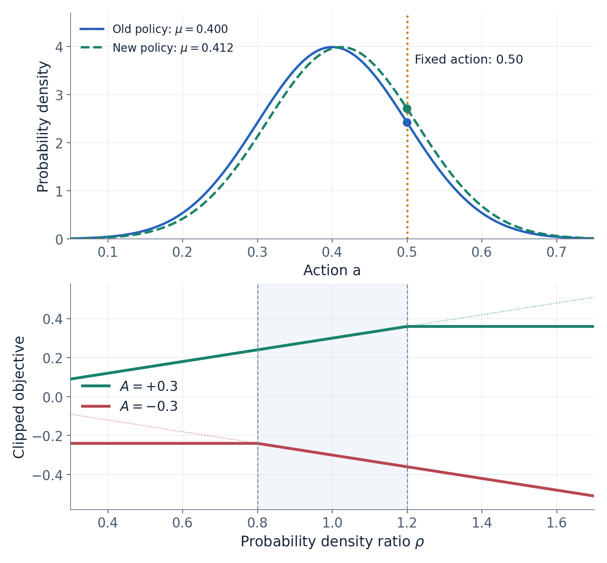

# 大话强化学习算法 PPO

赛车刚刚驶出弯道。智能体看着车速、方向盘角度和轮胎状态，尝试了 50% 油门。车没有失控，出弯速度也不错。接下来，它应该怎样从这次经历中学习？

一种做法，是让 Critic 画出“油门大小—预计回报”的曲线，再告诉 Actor 油门应该往哪个方向调整。DDPG 采用了这样的思路。PPO 则可以从另一个问题出发：**这次尝试比原本预期的好多少？如果表现较好，下次遇到类似状态时，能不能让这附近的动作更容易出现？**

这里讨论的是常用的 PPO-Clip。它使用优势估计评价已经执行过的动作，通过新旧策略的动作密度比更新策略，再利用裁剪目标减弱过度更新的动力。它也可以采用 Actor–Critic 结构，但通常不需要计算 Critic 对动作的导数。[1]

## 一 从决定油门大小，到决定油门怎样分布

如果 Actor 直接输出一个数，比如 0.4，那么在同一个状态下，它每次都会建议相同的动作。随机策略多做了一步：Actor 输出一个分布，再从分布中采样动作。

以一维高斯策略为例：

$$
\pi_\theta(a\mid s)=\mathcal N\bigl(\mu_\theta(s),\sigma_\theta^2(s)\bigr)
$$

这里，状态是 $s$，动作是 $a$，Actor 的参数是 $\theta$。均值 $\mu$ 决定动作主要集中在哪，标准差 $\sigma$ 决定分散程度。连续动作 PPO 常用这种表示，因为采样和计算对数密度都方便。[4]

假设 Actor 输出均值 0.4、标准差 0.1。这不表示车辆必然执行 40% 油门。一次采样可能得到 0.5，另一次可能得到 0.33。训练时，**分布的均值、真正执行的动作、更新后的分布**是三个需要分清的对象。

为了手算，后文使用普通高斯，暂不进行动作边界变换。真实油门有合法范围，策略表示、实际执行动作和记录的密度必须采用一致的处理方式。这里的状态也会压缩成一个标量，便于展示梯度；它不对应某个具体的赛车物理量。

我们还需要澄清一个容易被“概率”二字掩盖的细节：连续动作的 $\pi(a\mid s)$ 是概率密度。某个精确数值点的概率为零，密度本身却可以大于 1。说“让动作 0.5 更容易出现”，通常是指增加 0.5 附近一个很小区间的概率，而不是把某个点的概率从 20% 改到 30%。

## 二 Critic 先给出预期，优势再评价这次尝试

PPO 的 Critic 常用状态价值函数：

$$
V_\phi(s)=\mathbb E[G_t\mid s_t=s]
$$

其中 $\phi$ 是 Critic 参数，$G_t$ 是从当前时刻开始的折扣累计回报。它回答的是：“处于这个状态，继续按当前策略行动，通常能拿到多少回报？”这个预期构成评价动作的基线。[2][3]

为什么不能只看即时奖励？假设某种油门选择获得了正奖励，但它发生在一条很容易提速的直道上。其他常见动作也许能获得更多奖励。反过来，在一次已经很危险的侧滑中，一个让即时奖励仍为负的动作，可能已经明显减少了损失。奖励的正负，无法单独说明这次动作是否优于策略原来的表现。

优势函数比较的正是这两者：

$$
A^\pi(s,a)=Q^\pi(s,a)-V^\pi(s)
$$

实际训练没有精确的优势，通常使用估计值 $\hat A$。先从最简单的一步估计开始。设这次经历没有真正终止，观测到：

$$
r=0.4,\qquad \gamma=0.9,\qquad V_{\mathrm{old}}(s)=1,\qquad V_{\mathrm{old}}(s')=1
$$

即时奖励加上对未来的估计，构成一个学习目标：

$$
y=r+\gamma V_{\mathrm{old}}(s')=0.4+0.9\times1=1.3
$$

于是：

$$
\hat A=y-V_{\mathrm{old}}(s)=1.3-1=0.3
$$

这个数的含义是：根据这次经历提供的证据，这次尝试比原本预期的好 0.3。它仍然是有噪声的估计，一次好运也可能得到正优势，因此实际算法会聚合很多样本。

一般写法会加入真正终止标记 $b$：

$$
\delta=r+\gamma(1-b)V_{\mathrm{old}}(s')-V_{\mathrm{old}}(s)
$$

其中 $b=1$ 表示任务真正终止，此时没有后续价值可接。接下来的 Actor 手算就用 $\hat A=\delta=0.3$；后面再讨论如何把多步经历合起来。

## 三 动作已经做过了，策略还能更新什么

车辆刚才已经执行了 0.5 油门。更新网络不可能把这段历史改成 0.52。PPO 更新的是策略对这个历史动作的评价：同样的状态、同样的动作，在新策略下的密度能否提高？

把采集这批数据时的策略记为 $\pi_{\mathrm{old}}$，正在训练的策略记为 $\pi_\theta$。两者的密度比为：

$$
\rho(\theta)=\frac{\pi_\theta(a_{\mathrm{old}}\mid s)}{\pi_{\mathrm{old}}(a_{\mathrm{old}}\mid s)}
$$

如果 $\rho=1.1$，说明新策略在这个固定动作处的密度，是采集数据时的 1.1 倍。分母保存了采集策略的尺度，因此一批数据反复用于更新时，仍可以比较策略偏移了多少。实现中通常保存旧的对数密度，再计算：[1][3]

$$
\rho=\exp\bigl(\log\pi_\theta(a_{\mathrm{old}}\mid s)-\log\pi_{\mathrm{old}}(a_{\mathrm{old}}\mid s)\bigr)
$$

比值还有一层统计意义。固定状态，如果数据来自旧策略，那么给每个动作乘上这个比值，可以把对旧动作分布的平均转换为对新动作分布的平均：

$$
\mathbb E_{a\sim\pi_{\mathrm{old}}}[\rho(a)g(a)]=\mathbb E_{a\sim\pi_\theta}[g(a)]
$$

这个关系要求旧策略覆盖需要比较的动作。PPO 借用了这样的加权思想，但实际仍用旧策略收集的状态和优势来构造代理目标；不能把它直接当成新策略真实长期回报的精确公式。

暂时不加入裁剪，一条样本的目标是最大化：

$$
J(\theta)=\rho(\theta)\hat A
$$

优势为正时，提高密度比能提高目标；优势为负时，降低密度比能提高目标。这里“提高目标”采用梯度上升的说法，代码通常把负号放到损失前面，再用梯度下降。

在这批数据的策略更新中，历史动作、旧对数密度和已经算好的优势都作为固定量参与计算。可变的是当前策略的参数。Critic 可以在另一个损失下继续训练，但不能让 Actor 通过修改优势标签来“提高成绩”。

## 四 从均值 0.4 到 0.412，手算一次 Actor 更新

设简化状态 $s=2$，均值由一个参数控制：

$$
\mu_\theta(s)=\theta s,\qquad \theta_{\mathrm{old}}=0.2,\qquad\sigma=0.1
$$

旧均值为 0.4。这次实际采样并执行的动作是：

$$
a_{\mathrm{old}}=0.5
$$

前一节已经得到它的优势估计为 0.3。为便于观察，暂时固定标准差，不做优势标准化，也不加入熵项。

真实策略的标准差也可以学习，它同样通过历史动作的对数密度对相应参数求导。这里固定标准差，只是为了把均值的一次更新完整算出来。

高斯密度的对数为：

$$
\log\pi_\theta(a\mid s)=-\log\sigma-\frac12\log(2\pi)-\frac{(a-\mu_\theta(s))^2}{2\sigma^2}
$$

固定历史动作，对均值求导：

$$
\frac{\partial\log\pi}{\partial\mu}=\frac{a-\mu}{\sigma^2}=\frac{0.5-0.4}{0.1^2}=10
$$

均值对参数的导数为：

$$
\frac{\partial\mu}{\partial\theta}=s=2
$$

因此：

$$
\frac{\partial\log\pi}{\partial\theta}=10\times2=20
$$

刚开始更新时，新旧策略相同，密度比等于 1。但是，**函数在当前点的值等于 1，不代表它对参数的导数等于 0**。分母是已经保存的常量，分子会随参数变化：

$$
\frac{\partial\rho}{\partial\theta}=\rho\frac{\partial\log\pi_\theta}{\partial\theta}
$$

所以当前目标的导数为：

$$
\frac{\partial J}{\partial\theta}=\hat A\rho\frac{\partial\log\pi_\theta}{\partial\theta}=0.3\times1\times20=6
$$

取学习率 $\eta=0.001$，做一次梯度上升：

$$
\theta_{\mathrm{new}}=0.2+0.001\times6=0.206
$$

于是：

$$
\mu_{\mathrm{new}}=0.206\times2=0.412
$$

我们还可以检查这一步到底改变了什么。旧策略在动作 0.5 处的密度约为 2.419707，新策略在相同位置的密度约为 2.708640，因此：

$$
\rho_{\mathrm{new}}\approx\frac{2.708640}{2.419707}=1.119408
$$

分布的中心往这次表现较好的动作靠近，该动作附近的密度增加了。下一次车辆仍会从新分布采样，并不会被要求执行 0.412。

这个方向也并非永远是“加大油门”。假如表现较好的历史动作位于旧均值左侧，同样的公式会推动均值降低。实际训练还会让许多样本共同影响参数，所以不能要求每条正优势样本的密度在每个批次更新后都单独增加。

## 五 为什么改好了还要限制，裁剪到底裁掉什么

现在出现了新问题：一批数据可以反复训练很多次。如果 Actor 过分相信其中几次表现不错的动作，可能让策略变化过大；而优势估计本身又有误差。PPO-Clip 为此使用下面的目标：[1]

$$
J_{\mathrm{clip}}=\min\left(\rho\hat A,\operatorname{clip}(\rho,1-\varepsilon,1+\varepsilon)\hat A\right)
$$

设 $\varepsilon=0.2$，裁剪范围是 $[0.8,1.2]$。最外层的最小值不能省略；它让算法选择两个候选值中更保守的一个。

### 正优势的动作，不再无限提高密度

当 $\hat A>0$，目标可以简化为：

$$
J_{\mathrm{clip}}=\hat A\min(\rho,1+\varepsilon)
$$

优势为 0.3 时，密度比从 1 增加到 1.1，目标从 0.3 增加到 0.33；增加到 1.2，目标达到 0.36。之后继续提高密度比，这条样本的裁剪目标都保持在 0.36。

### 负优势的动作，不再无限压低密度

当 $\hat A<0$，目标可以简化为：

$$
J_{\mathrm{clip}}=\hat A\max(\rho,1-\varepsilon)
$$

优势为 -0.3 时，密度比从 1 降到 0.8，目标由 -0.3 提高到 -0.24。继续降低到 0.6，这条样本的目标仍为 -0.24。

| 密度比 $\rho$ | 正优势 $\hat A=0.3$ 的目标 | 负优势 $\hat A=-0.3$ 的目标 |
|---:|---:|---:|
| 0.6 | 0.18 | -0.24 |
| 0.8 | 0.24 | -0.24 |
| 1.0 | 0.30 | -0.30 |
| 1.2 | 0.36 | -0.36 |
| 1.4 | 0.36 | -0.42 |

这张表也能纠正两个常见误解。

**越界不一定没有梯度。**正优势动作的密度被降得过低，仍然需要提高；负优势动作的密度被抬得过高，仍然需要降低。这些方向上的纠正没有被裁剪掉。

**裁剪不是密度比的硬边界。**它改变的是目标函数提供的更新激励，没有把最终参数投影回某个合法区域。沿用上一节的初始梯度，如果学习率改为 0.005，一步就会把均值移到 0.46，此时密度比约为 1.522。这个更新完全可能越过 1.2；下一次计算这条正优势样本时，才会落在目标的平台部分。其他样本、熵项或共享参数仍可能继续改变它的密度。

因此，学习率、重复训练次数和批次质量仍然重要，一些实现还会结合 KL 差异进行提前停止。PPO 的裁剪目标提供了实用的抑制机制，不能据此保证每一步策略变化都很小。[3]



图 1 上图固定历史动作 0.50，比较均值更新前后的概率密度；下图分别显示正优势与负优势的裁剪目标。较细的点线表示未裁剪目标，竖虚线表示裁剪阈值。裁剪平台出现在哪一侧，取决于优势的符号。

## 六 Critic 怎样进步，多步经验怎样形成 GAE

Actor 的学习依赖优势，优势又依赖 Critic 的基线。如果基线一直不准，策略就很难区分“动作出色”和“这段路本来就容易”。因此 Critic 也需要学习。[2]

先继续使用前面的一步目标 $y=1.3$。假设简化的 Critic 为：

$$
V_\phi(s)=\phi s,\qquad s=2,\qquad\phi=0.5
$$

当前预测为 1，平方误差为：

$$
L_V=(2\phi-1.3)^2=0.09
$$

对参数求导：

$$
\frac{\partial L_V}{\partial\phi}=2(2\phi-1.3)\times2=-1.2
$$

以学习率 0.05 做梯度下降：

$$
\phi_{\mathrm{new}}=0.5-0.05(-1.2)=0.56
$$

新预测为 1.12，更接近目标。这里更新的是 Critic 参数；Actor 那一步使用的优势标签依然是已经算好的 0.3。

不过，一步估计对下一状态价值的误差比较敏感。能否同时利用后面几步真实发生的经历？GAE，也就是广义优势估计，将一串 TD 残差按距离衰减后相加：[2]

$$
\hat A_t=\delta_t+(\gamma\lambda)\delta_{t+1}+(\gamma\lambda)^2\delta_{t+2}+\cdots
$$

这里 $\lambda$ 决定利用多远的后续残差。取 0 时，只使用当前一步；取值增加，会把更远的经历纳入估计。它在偏差与方差之间提供了调节手段，不是一个越大越好的参数。

看一段三步轨迹，最后一步真正终止：

| 时刻 | 即时奖励 | 旧价值估计 | 下一状态旧价值 | TD 残差 |
|---:|---:|---:|---:|---:|
| 0 | 0.40 | 1.00 | 1.00 | 0.30 |
| 1 | 0.45 | 1.00 | 0.50 | -0.10 |
| 2 | 0.70 | 0.50 | 0.00 | 0.20 |

设 $\gamma=0.9$、$\lambda=0.8$，则 $\gamma\lambda=0.72$。从后往前计算：

$$
\hat A_2=0.2
$$

$$
\hat A_1=-0.1+0.72\times0.2=0.044
$$

$$
\hat A_0=0.3+0.72\times0.044=0.33168
$$

第一步的优势由一步估计的 0.3 变成了 0.33168，因为现在还考虑了后续经历。第二步即时奖励为正，TD 残差却为负；再纳入第三步信息后，GAE 又略微转正。这说明奖励、TD 残差、优势并不是同一个量。

一种常见的 Critic 训练标签是：

$$
\hat R_t=\hat A_t+V_{\mathrm{old}}(s_t)
$$

此时第一步标签为 1.33168。PPO 并不强制只能使用这一种价值目标，例如一些实现让 Actor 使用 GAE，同时让 Critic 拟合折扣奖励回报。[3]

轨迹边界也需要认真处理：真正终止时不接后续价值；外部时间截断时可能仍需价值自举，但优势递推不能跨越环境重置，把两个不连续片段接在一起。计算标签时使用的旧价值，应与采集和优势估计流程保持一致。

## 七 把这些计算接成一次完整训练

现在可以看到两个网络怎样分工：Actor 决定怎样尝试，Critic 估计通常能得到什么；实际经历帮助形成优势，优势再指引 Actor 调整动作密度。

一轮典型 PPO 训练按下面的顺序进行：[1][3]

1. 用当前策略与环境交互，记录状态、实际动作、奖励、旧对数密度和价值估计。
2. 处理终止与截断边界，计算优势和价值训练标签。
3. 固定这批历史动作、旧对数密度和优势，在小批次上重新计算新策略的密度比。
4. 最大化裁剪目标，同时通过价值损失训练 Critic；按需要加入熵项。
5. 对这批数据进行若干轮更新，然后用新策略收集下一批经历。

其中 Actor 的核心计算可以压缩成几行伪代码：

```text
new_log_prob = current_policy.log_prob(old_action, state)
ratio = exp(new_log_prob - old_log_prob)
objective = min(ratio * advantage,
                clip(ratio, 1-epsilon, 1+epsilon) * advantage)
actor_loss = -mean(objective)
```

真正值得检查的是变量含义：`old_action` 是采集时的动作，`old_log_prob` 是采集策略留下的固定记录。假如每次训练都重新用当前策略计算“旧密度”，分子分母会一起变化，密度比便失去了原来的参照。

PPO 会多次使用同一批样本，但标准流程通常不会把很久以前的大量轨迹持续混在一起训练。它与 DDPG、TD3、SAC、TQC 常用的长期经验回放，在数据使用方式上有所不同。这也是比较算法时除了损失函数，还必须关注的一部分。[1][7]

## 八 高斯只有一个峰，多个好动作怎么办

假设前方有障碍物，左绕和右绕都能通过，而直行会撞上去。用方向动作表示，左绕在 -0.6 附近，右绕在 +0.6 附近。此时，一个状态下确实存在两个比较好的动作区域。

未经非线性变换的普通高斯在固定状态下只有一个峰。增大标准差可以覆盖更宽的范围，却不能把中间低价值区域挖掉。增加协方差可以描述不同动作维度之间的关系，也不会把普通高斯变成几个分离的峰。实际策略若经过非线性变换，输出密度的峰形可能改变，因此“高斯只有单峰”应限定到这里讨论的普通高斯。

但 PPO 没有规定 Actor 必须采用这种分布。它需要能够采样动作、计算相同历史动作的新旧密度，并对当前密度的参数求导。可以把策略写成混合高斯：[5][6]

$$
\pi_\theta(a\mid s)=\sum_{k=1}^{K}w_k(s)\mathcal N\bigl(a;\mu_k(s),\sigma_k^2(s)\bigr),\qquad \sum_kw_k(s)=1
$$

Actor 输出每个分量的权重、均值和标准差。比如：

$$
\pi(a\mid s)=0.5\mathcal N(-0.6,0.1^2)+0.5\mathcal N(0.6,0.1^2)
$$

它可以在左右两侧形成峰，并让中间区域的密度很低。采样时先选择一个分量，再从对应分量采样动作。

### 换成混合高斯，PPO 的目标需要改吗

仍然固定一次历史动作 $a_{\mathrm{old}}=0.6$，设优势为 0.3。为观察权重变化的作用，暂时固定两个分量的均值和标准差，只改变右侧权重。

| 右侧分量权重 | 动作 0.6 处的密度约值 | 相对旧策略的密度比 | 裁剪目标 |
|---:|---:|---:|---:|
| 0.50 | 1.9947 | 1.0 | 0.30 |
| 0.55 | 2.1942 | 1.1 | 0.33 |
| 0.70 | 2.7926 | 1.4 | 0.36 |

左侧分量在 0.6 处的贡献极小，所以这里的密度比近似等于右侧权重的比例。权重是为了展示目标变化而设定的候选值，并不是优势为 0.3 就会自动把权重更新到 0.55。

算法仍然比较新旧密度，仍然使用相同的裁剪目标。改变的是策略如何表示动作分布。

### 密度必须算整个混合分布

标准的边缘动作策略应当先把各个分量的加权密度相加，再取对数：

$$
\log\pi(a\mid s)=\operatorname{logsumexp}_k\left(\log w_k+\log\mathcal N_k(a)\right)
$$

不能因为采样时选中了某个分量，就只计算那个高斯分量的密度。PyTorch 的 `MixtureSameFamily.log_prob` 采用的就是全混合密度计算。[5]

PPO 更新时固定已经采到的动作，并不要求把梯度穿过“选择哪个分量”的离散抽样步骤。只要对固定动作的混合对数密度可微，混合权重、均值和标准差就可以通过它获得梯度。

### 多峰表达能力，不等于自动保留多个峰

单高斯不一定被迫停在两条路线的中间，它可能直接学会只从一侧绕行。对于只追求期望回报的任务，保留所有同样优秀的动作也未必是必要条件。采用混合高斯后，训练仍可能让某些权重接近零，或者让多个分量重合。数据覆盖和探索方式仍然影响能否发现并保留多个方案。

推理时也要小心。上述左右对称分布的整体均值是 0，恰好指向障碍物。多峰策略不能不加判断地使用整个分布的均值作为动作，可以采样，或设计明确的分量选择规则。混合分布的熵计算通常也比单高斯复杂，不能把原来的熵公式机械照搬。[5][6]

## 九 同样有 Actor–Critic，为什么 PPO 与 SAC 的梯度不同

“Actor–Critic”说明策略学习与价值估计相互配合，但没有规定它们只能通过一种方式传递学习信号。

DDPG 的 Actor 直接输出动作，然后利用 Critic 的动作坡度：

$$
\nabla_\theta J=\frac{\partial Q(s,a)}{\partial a}\frac{\partial\mu_\theta(s)}{\partial\theta}
$$

TD3 保留了这条路径，并改进目标构造和更新节奏。SAC 与 TQC 的常见连续动作实现虽然输出随机策略，也可以用重参数化把动作写成 $a_\theta=f_\theta(s,\xi)$：固定本次噪声 $\xi$，让动作随参数变化，再通过 Critic 的动作导数反传，同时考虑熵项。[7][8][9]

PPO 则固定历史动作，在未进入裁剪平台的分支上，典型梯度是：

$$
\nabla_\theta J=\hat A\rho\nabla_\theta\log\pi_\theta(a_{\mathrm{old}}\mid s)
$$

| 比较点 | PPO | SAC 的常见连续动作实现 |
|---|---|---|
| Actor 更新时固定什么 | 已经执行过的动作 | 本次重参数化噪声 |
| 动作随参数参与求导吗 | 历史动作固定 | 当前生成的动作可微 |
| 价值提供什么 | 优势估计的基线 | 当前动作的价值和动作坡度 |
| 核心目标包含什么 | 优势、密度比、裁剪 | 动作价值与熵项 |

所以，看到两个算法都使用高斯 Actor，仍然不能认为它们的计算原理相同。策略分布的形式，与策略更新所采用的梯度估计，是两个不同的选择。

## 十 把常见追问放回同一条学习过程

**优势为正，是否一定意味着动作绝对优秀？**它只表示相对当前基线的估计优势。基线可能不准，轨迹也有随机性。一个总体表现不好的策略，仍然可以从“比自己平时好一点”的动作中逐渐进步。

**PPO 不算动作导数，Critic 是不是就不重要了？**Critic 的误差会影响优势估计，进而影响哪些动作被鼓励。它在这里通过评价基线影响策略学习，而不是直接提供动作方向的坡度。优势估计的质量仍然重要。[2]

**有了裁剪，能否把学习率和训练轮数随意调大？**不能。裁剪是逐样本目标中的一个机制，多条样本会共享网络参数，策略仍可能偏移过多。它既不把动作数值限制在某个区间，也不保证新旧策略的整体差异始终有界。[1][3]

**换成多峰策略，是不是就解决了探索问题？**它增加了表达多个方案的能力，但没有替你生成证据。如果车辆从未尝试过安全的右绕路线，右侧分量不会凭空知道那条路线值得保留。表达能力、经验覆盖和学习目标需要配合。

回到最开始那次 50% 油门的尝试：PPO 先利用经历判断它相对原先预期的表现，再保持这个历史动作不动，让当前策略重新计算它的密度。优势决定鼓励还是抑制，密度比衡量相对变化，裁剪减弱过度调整的动力。下一批新的驾驶经历又会检验更新后的策略，使整个过程继续向前。

本系列另外四篇分别是[《大话强化学习算法 DDPG》](01-大话强化学习算法-DDPG.md)[《大话强化学习算法 TD3》](03-大话强化学习算法-TD3.md)[《大话强化学习算法 SAC》](04-大话强化学习算法-SAC.md)[《大话强化学习算法 TQC》](05-大话强化学习算法-TQC.md)。沿着 DDPG、TD3、SAC、TQC 阅读，可以观察动作梯度方法怎样改进价值学习；把 PPO 作为并行路线对照，则能更清楚地理解：同样的连续动作问题，可以用不同的学习信号来调整策略。

## 参考资料

1. Schulman et al. [Proximal Policy Optimization Algorithms](https://arxiv.org/abs/1707.06347)。PPO 的代理目标、裁剪目标与批次更新。
2. Schulman et al. [High-Dimensional Continuous Control Using Generalized Advantage Estimation](https://arxiv.org/abs/1506.02438)。优势基线、TD 残差与 GAE。
3. OpenAI. [Spinning Up PPO 实现](https://github.com/openai/spinningup/blob/master/spinup/algos/pytorch/ppo/ppo.py)。旧对数密度、GAE、裁剪损失、价值损失与更新流程。
4. OpenAI. [Spinning Up PPO Actor–Critic 定义](https://github.com/openai/spinningup/blob/master/spinup/algos/pytorch/ppo/core.py)。高斯 Actor、动作对数密度与状态价值网络。
5. PyTorch. [MixtureSameFamily 源码](https://github.com/pytorch/pytorch/blob/main/torch/distributions/mixture_same_family.py)。混合分布采样、均值与完整混合对数密度。
6. Bishop. [Mixture Density Networks](https://www.microsoft.com/en-us/research/publication/mixture-density-networks/)。用神经网络表示条件混合密度。
7. Haarnoja et al. [Soft Actor-Critic Algorithms and Applications](https://arxiv.org/abs/1812.05905)。随机策略、重参数化与最大熵目标。
8. Fujimoto et al. [Addressing Function Approximation Error in Actor-Critic Methods](https://proceedings.mlr.press/v80/fujimoto18a.html)。TD3 的 Critic 与策略更新。
9. Kuznetsov et al. [Controlling Overestimation Bias with Truncated Mixture of Continuous Distributional Quantile Critics](https://proceedings.mlr.press/v119/kuznetsov20a.html)。TQC 的分布式 Critic 与 Actor 目标。

[1]: https://arxiv.org/abs/1707.06347
[2]: https://arxiv.org/abs/1506.02438
[3]: https://github.com/openai/spinningup/blob/master/spinup/algos/pytorch/ppo/ppo.py
[4]: https://github.com/openai/spinningup/blob/master/spinup/algos/pytorch/ppo/core.py
[5]: https://github.com/pytorch/pytorch/blob/main/torch/distributions/mixture_same_family.py
[6]: https://www.microsoft.com/en-us/research/publication/mixture-density-networks/
[7]: https://arxiv.org/abs/1812.05905
[8]: https://proceedings.mlr.press/v80/fujimoto18a.html
[9]: https://proceedings.mlr.press/v119/kuznetsov20a.html
