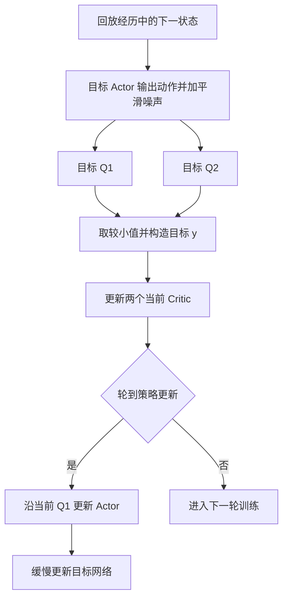

# 大话强化学习算法 TD3

假设赛车的 Actor 已经很会听 Critic 的建议：哪个油门的预测回报高，它就往哪里调整。训练一段时间后，Critic 给出的分数不断升高，赛车却越来越容易打滑。

问题可能不在 Actor 没有认真学习，而在它太认真了。Critic 对某一片动作区域高估了，Actor 便反复寻找并利用这片高估区域。预测里的“捷径”，到了赛道上成了事故。

TD3 研究的正是这种问题：当价值函数由神经网络近似时，怎样减少估计误差对策略的伤害？它保留 DDPG 的确定性 Actor 和动作梯度更新，重点修改 Critic 的学习目标与更新节奏。[1]

本篇使用油门例子逐步推演两个 Critic、目标动作平滑和延迟更新。所有小表格与手算数值均为教学假设。

## 1 Critic 犯了一个错 为什么 Actor 会把它放大

先看一组假想数据：

| 油门 | 假设真实长期回报 | Critic 预测 |
|---|---:|---:|
| 30% | 8 | 8.2 |
| 50% | 9 | 8.8 |
| 80% | 7 | 12 |

Actor 只能看到 Critic 的预测。如果探索让策略接近 80% 附近，或局部优化路径把它带入这片高估区域，它就可能被虚假的高值吸引，并进一步利用这个错误。表中三个点不会让局部动作梯度自动变成全局搜索；这里展示的是策略一旦接近错误高值区域可能受到的误导。

更麻烦的是 Critic 的训练目标也依赖未来价值估计。如果下一状态的价值被高估，偏差会通过学习目标传回当前状态。局部错误就可能沿着时间逐步传播。

这与“网络大一点就一定更准确”不是同一个问题。即使平均误差不大，Actor 也会主动寻找预测很高的区域，恰好把注意力放到某些错误上。TD3 原论文讨论了函数近似误差、自举与策略改进之间的这种相互影响。[1]

因此，改进 Actor–Critic 不能只盯着 Actor 的优化能力，还要控制它依据的价值信号。

## 2 先保留 DDPG 的训练骨架

DDPG 的 Actor 直接输出动作：

$$
a_\theta=\mu_\theta(s)
$$

Critic 输入状态和动作，输出长期价值估计：

$$
Q_\phi(s,a)
$$

对于一个固定状态，Actor 利用动作方向上的导数形成单样本梯度：

$$
g_s(\theta)
=
\nabla_aQ_\phi(s,a_\theta)
\nabla_\theta\mu_\theta(s)
$$

Critic 则利用回放经历 $(s,a_{\mathrm{data}},r,s',b)$ 学习。这里 $b=1$ 表示任务真正终止，历史动作 $a_{\mathrm{data}}$ 是产生奖励与下一状态的动作。

TD3 沿用经验回放和缓慢更新的目标网络。它没有把 Actor 改成概率比更新，也不需要对赛车环境求导。它主要增加三项机制：用双 Critic 构造较保守的目标，在目标动作附近加入平滑噪声，并降低 Actor 的更新频率。[1][2]

接下来分别看这三项机制修改了哪一步计算。

## 3 两个 Critic 怎样减少高估

TD3 同时训练：

$$
Q_{\phi_1}(s,a),\qquad Q_{\phi_2}(s,a)
$$

还有它们的目标副本：

$$
Q_{\bar\phi_1},\qquad Q_{\bar\phi_2}
$$

对同一个下一状态与下一动作，构造目标时取较小值：

$$
y=
r+\gamma(1-b)
\min_{i=1,2}
Q_{\bar\phi_i}(s',a')
$$

两个当前 Critic 都向这个目标拟合：

$$
L_{Q_i}
=
\mathbb E
\left[
\left(Q_{\phi_i}(s,a_{\mathrm{data}})-y\right)^2
\right]
$$

这叫 clipped double-Q learning。这里的“clipped”由两个估计的最小值实现，不是 PPO 那种新旧策略密度比裁剪。[1][2]

假设真正的下一步价值是 10，而两个网络估计为 12 和 10.5。取较小值比直接相信 12 更接近真值。它避免由一个过高估计单独决定目标。

但是，如果两个估计是 10.2 和 6，取最小值就会离真值更远。双 Critic 控制的是高估倾向，不保证每条样本上的误差都变小。

两个网络也不是两个掌握独立事实的专家。它们通常使用同一个回放池、相同的目标构造，因此误差可能相关。两个都高估时，最小值仍会高估；其中一个严重低估时，目标也可能过于悲观。

这一机制的价值在于给过度乐观增加约束，代价是可能引入一定的低估。

## 4 为什么要在目标动作附近加噪声

考虑某个下一状态下，Critic 画出的油门曲线：

| 油门 | 假想预测值 |
|---|---:|
| 79% | 5 |
| 80% | 12 |
| 81% | 5 |

如果 80% 附近的尖峰来自拟合错误，Actor 很可能被它吸引。目标动作平滑希望削弱对这种狭窄尖峰的依赖。

目标 Actor 先给出建议动作，再加入被限制幅度的噪声：

$$
\xi\sim\mathcal N(0,\sigma_{\mathrm{target}}^2)
$$

$$
a'=
\operatorname{clip}
\left(
\mu_{\bar\theta}(s')
+
\operatorname{clip}(\xi,-c,c),
a_{\min},a_{\max}
\right)
$$

内层裁剪限制噪声，外层裁剪保证动作合法。然后两个目标 Critic 都评价同一个 $a'$。[2]

一次更新可能评价 79.6%，下一次可能评价 80.3%。通过这种目标构造，学习信号覆盖建议动作周围的区域，减少只依赖单个狭窄高点的情况。

这里有两个需要区分的地方。第一，这份噪声加在训练目标中的下一动作上，与车辆真正执行动作时用于探索的噪声是不同机制。第二，标准 TD3 通常对每条训练样本采一次目标噪声，并不是每次都显式计算多个邻近动作再求平均。可以用“关注附近区域”理解它，但不要把教学比喻误写成另一套计算流程。

平滑也并不意味着所有尖峰都是错误。有些任务确实要求精确控制。因此噪声尺度会影响所学目标的性质，不能无限增大。

## 5 Critic 先学 Actor 再跟着调整

假设 Critic 刚学到一批新数据，价值曲线还在剧烈变化，Actor 就立刻沿着这条曲线移动。Actor 一变，未来应该评价的策略也发生变化，Critic 又开始追赶新的目标。

TD3 通过延迟策略更新，减轻这种紧密耦合。常见安排是每次训练更新两个 Critic，每两次 Critic 更新才更新一次 Actor，并更新目标网络。[1][2]

| 更新轮次 | 两个 Critic | Actor 与目标网络 |
|---|---|---|
| 1 | 更新 | 暂不更新 |
| 2 | 更新 | 更新 |
| 3 | 更新 | 暂不更新 |
| 4 | 更新 | 更新 |

这个“2”是常用设置，不是定义 TD3 的数学定律。延迟的目的，是让价值估计在被 Actor 利用之前有更多学习机会，而不是等待 Critic 完全准确。对于大型神经网络，后者通常没有可直接判定的完成时刻。

目标网络继续缓慢跟随当前网络，例如：

$$
\bar\phi_i
\leftarrow
(1-\tau)\bar\phi_i+\tau\phi_i
$$

Actor 的目标参数同样处理。注意，目标网络本身是 DDPG 已有的机制；TD3 在已有基础上改变了目标构造和更新节奏。

图 1 TD3 的三个改动落在不同位置：噪声加入下一动作，最小值用于 Critic 目标，延迟条件控制 Actor 与目标网络的更新。图省略环境采集阶段，突出一次训练中的依赖关系。

## 6 把一次 Critic 更新完整算出来

从回放中抽到一条非终止经历，设：

$$
r=1,\qquad \gamma=0.9,\qquad b=0
$$

下一状态的目标 Actor 输出：

$$
\mu_{\bar\theta}(s')=0.50
$$

这次平滑噪声为 $0.03$，且未触及裁剪边界，于是：

$$
a'=0.53
$$

两个目标 Critic 对同一个动作的估计为：

$$
Q_{\bar\phi_1}(s',0.53)=6
$$

$$
Q_{\bar\phi_2}(s',0.53)=8
$$

目标因此为：

$$
y=1+0.9\min(6,8)=6.4
$$

当前两个 Critic 对历史状态、历史实际动作的预测分别是：

$$
Q_{\phi_1}(s,a_{\mathrm{data}})=5,\qquad
Q_{\phi_2}(s,a_{\mathrm{data}})=7
$$

对应平方误差：

$$
L_{Q_1}=(5-6.4)^2=1.96
$$

$$
L_{Q_2}=(7-6.4)^2=0.36
$$

把目标当作常量，对两个预测值的导数分别为：

$$
\frac{\partial L_{Q_1}}{\partial Q_1}=-2.8,\qquad
\frac{\partial L_{Q_2}}{\partial Q_2}=1.2
$$

因此这条样本倾向于把第一个预测推高、第二个预测压低。实际参数更新还要乘上 Q 对各自参数的导数，并与批次中其他样本的梯度一起聚合。

两个 Critic 的任务始终相同：拟合 6.4。它们不会因为名字叫 $Q_1$ 和 $Q_2$，就分别被训练成“高分网络”和“低分网络”。作者实现中的目标与损失也采用这一流程。[3]

## 7 Actor 的更新为什么仍然只看 Q1

TD3 有一个经常被误写的细节：标准算法在构造 Critic 目标时取双 Q 的最小值，更新 Actor 时通常最大化第一个当前 Critic：

$$
J_{\mathrm{actor}}(\theta)
=
\mathbb E_s
\left[
Q_{\phi_1}(s,\mu_\theta(s))
\right]
$$

这里固定回放中的状态分布和当前 Critic，优化的是可计算的代理目标。其梯度为：

$$
\nabla_\theta J_{\mathrm{actor}}
=
\mathbb E_s\left[
\nabla_aQ_{\phi_1}(s,a_\theta)
\nabla_\theta\mu_\theta(s)
\right]
$$

这是标准 TD3 的具体设计，不能因为有两个 Critic，就自动把 Actor 目标也替换成二者的最小值。[1][3]

再单独做一个 Actor 手算例子。设：

$$
s=2,\qquad a_\theta=\theta s,\qquad \theta=0.2
$$

当前动作是 $0.4$。在这个固定状态附近，假设：

$$
Q_1(s,a)=C-(a-0.7)^2
$$

$C$ 不影响动作方向的导数，因此：

$$
\frac{\partial Q_1}{\partial a}=0.6,\qquad
\frac{\partial a}{\partial\theta}=2
$$

Actor 参数梯度为：

$$
\frac{\partial J}{\partial\theta}=1.2
$$

用学习率 $\eta=0.05$ 做梯度上升：

$$
\theta_{\mathrm{new}}=0.26,\qquad
a_{\mathrm{new}}=0.52
$$

它与 DDPG 的手算路径一致。TD3 的主要改动在于，让提供这个梯度的 Critic 通过不同目标和更新节奏学习。

这一段只为说明 Actor 的局部计算，和上一节任意给出的 Critic 预测值是两个独立教学场景。实际一次训练会把 Critic 学习、延迟条件、Actor 更新及目标网络更新串联起来。

把它放进训练循环，就是先收集并保存经历，再抽取回放批次；对每条样本生成带平滑噪声的下一动作，计算固定目标，更新两个当前 Critic。随后检查是否轮到 Actor 更新。如果轮到，就在这些回放状态上重新生成当前动作，沿 Q1 求导，并让目标网络缓慢跟随。

这里有三个不同的动作位置：Critic 拟合历史实际动作，Actor 更新使用当前建议动作，未来目标使用目标 Actor 加噪声的动作。把它们混用，会改变正在学习的问题。例如，拿当前建议动作替换历史动作，却沿用历史奖励和下一状态，就破坏了经历本来的因果对应。

## 8 怎样判断 Critic 真的更准确

最容易观察的是训练损失，但损失小不能独自证明价值准确。Critic 可能非常贴近一个带偏差的自举目标。

如果模拟器可以恢复同一个完整状态，可以设计更直接的检查：先冻结策略，在固定状态执行指定的第一个动作，之后始终跟随这个固定策略，累计实际折扣回报。环境或策略存在随机性时，重复多次得到平均值，再与对应的 Q 估计比较。

这里必须保持策略、奖励定义和折扣因子一致。另一种旧策略的一次回报，不等于当前策略的真实 Q。对较长任务，有限评估长度本身也会带来截断误差，所以这个实验提供的是估计，而不是自动得到精确真值。

对 Actor 来说，还应该检查附近动作的排序。例如，Critic 是否正确判断 40%、45%、50% 油门哪个更好？绝对分数有一些偏移而排序稳定，仍可能提供有用方向；局部排序相反则会直接误导策略。

此外，TD3 的训练目标含有平滑和取最小值的设计，与不加探索噪声的冻结策略的精确价值并不完全相同。评估时测到的偏差，既可能包含拟合误差，也可能反映这些保守目标的影响。因此应同时观察价值偏差、动作排序和最终驾驶回报。

甚至“数值误差很小”也不保证导数准确。考虑一个自构例子：

$$
\widehat Q(a)=Q(a)+0.01\sin(100a)
$$

它的价值误差最多为 $0.01$，但导数误差是：

$$
\frac{d\widehat Q}{da}-\frac{dQ}{da}
=\cos(100a)
$$

最大幅度可达到 1。一个很小但变化很快的波纹，就可能明显改变局部坡度。这个数学例子说明，检查 Critic 时要考虑它如何被 Actor 使用。

## 9 哪些基础问题不能靠双 Critic 解决

如果奖励错配到另一帧动作上，两个 Critic 会一起学习错误对应关系。如果状态缺少决定未来的重要信息，增加网络数量也不能凭空补出这些信息。赛车中看似相同的车速和位置，可能因为轮胎状态不同而需要不同油门。

首先应检查经历是否对齐：状态来自哪个时刻，实际执行的动作是否经过限幅或延迟，奖励与下一状态是否属于同一次转移。Critic 应学习真正发生的动作及其后果。

其次要区分任务终止和外部截断。真正终止时，未来项应归零；如果只是收集数据达到步数上限，而任务还会继续，通常仍需要自举。对于本来就有固定结束时刻的任务，剩余时间还可能属于状态信息。[4]

数据覆盖也很关键。Actor 可能提出回放中很少出现的动作，Critic 对它的评分更多依赖函数外推。双网络的最小值能够增加一定约束，却不能代替对相关状态和动作的观察。

这些检查直接决定学习目标是否有意义。只有在数据、状态与任务边界合理时，讨论网络结构、更新频率和噪声尺度才更容易得到可解释的结果。

## 10 TD3 与 PPO SAC TQC 怎样关联

TD3 与 DDPG 的关系最直接：两者都让确定性 Actor 沿 Critic 的动作梯度学习，TD3 通过三项机制改善函数近似误差带来的问题。

SAC 使用随机策略，并把熵纳入目标。它的常见连续动作实现通过重参数化保留动作梯度；与标准 TD3 不同，现代双 Q SAC 在 Actor 目标中也使用两个 Q 的最小值。[5]

TQC 沿用 SAC 的策略学习框架，让 Critic 输出回报分位数，并在构造目标时对全体目标输出排序、截掉最高的一部分。Actor 则使用当前 Critic 全部分位数的平均值。因此，TQC 不能简单记成“更多 Critic 再取一个最小值”。[6]

PPO 是另一条值得对照的路线。它通常根据优势估计调整历史动作的概率密度，通过新旧密度比及裁剪目标更新策略，不要求使用这里的动作价值导数。[7]

| 算法 | 与本篇最相关的差别 |
|---|---|
| DDPG | 一个 Critic 提供动作梯度 |
| TD3 | 双 Critic 目标、目标动作平滑、延迟策略更新 |
| SAC | 随机策略、熵目标、重参数化动作梯度 |
| TQC | 回报分位数与目标截断，Actor 取当前输出均值 |
| PPO | 优势加权的概率密度更新与裁剪目标 |

本系列五篇为[《大话强化学习算法 DDPG》](01-大话强化学习算法-DDPG.md)[《大话强化学习算法 PPO》](02-大话强化学习算法-PPO.md)[《大话强化学习算法 TD3》](03-大话强化学习算法-TD3.md)[《大话强化学习算法 SAC》](04-大话强化学习算法-SAC.md)[《大话强化学习算法 TQC》](05-大话强化学习算法-TQC.md)。可以沿 DDPG → TD3 → SAC → TQC 理解价值学习路线的变化，再把 PPO 放在旁边比较。

读完 TD3，应当能回答三个实际问题：最小值取在哪里，噪声加在哪里，哪一步需要延迟。把这三个位置找对，TD3 的名字和公式就会变成一套清楚的计算流程。

## 参考资料

1. Fujimoto 等，Addressing Function Approximation Error in Actor-Critic Methods，TD3 原始算法、误差分析与更新规则：[原论文](https://proceedings.mlr.press/v80/fujimoto18a/fujimoto18a.pdf)。
2. OpenAI Spinning Up，Twin Delayed DDPG，三项机制与动作平滑公式：[算法说明](https://spinningup.openai.com/en/latest/algorithms/td3.html)。
3. Fujimoto，TD3 作者提供的 PyTorch 实现：[TD3.py](https://github.com/sfujim/TD3/blob/master/TD3.py)。
4. Farama Foundation，Gymnasium 对任务终止和时间截断的说明：[Handling Time Limits](https://gymnasium.farama.org/tutorials/gymnasium_basics/handling_time_limits/)。
5. Haarnoja 等，Soft Actor-Critic Algorithms and Applications：[原论文](https://arxiv.org/pdf/1812.05905)。
6. Kuznetsov 等，Controlling Overestimation Bias with Truncated Mixture of Continuous Distributional Quantile Critics：[原论文](https://proceedings.mlr.press/v119/kuznetsov20a/kuznetsov20a.pdf)。
7. Schulman 等，Proximal Policy Optimization Algorithms：[原论文](https://arxiv.org/abs/1707.06347)。

[1]: https://proceedings.mlr.press/v80/fujimoto18a/fujimoto18a.pdf
[2]: https://spinningup.openai.com/en/latest/algorithms/td3.html
[3]: https://github.com/sfujim/TD3/blob/master/TD3.py
[4]: https://gymnasium.farama.org/tutorials/gymnasium_basics/handling_time_limits/
[5]: https://arxiv.org/pdf/1812.05905
[6]: https://proceedings.mlr.press/v119/kuznetsov20a/kuznetsov20a.pdf
[7]: https://arxiv.org/abs/1707.06347
