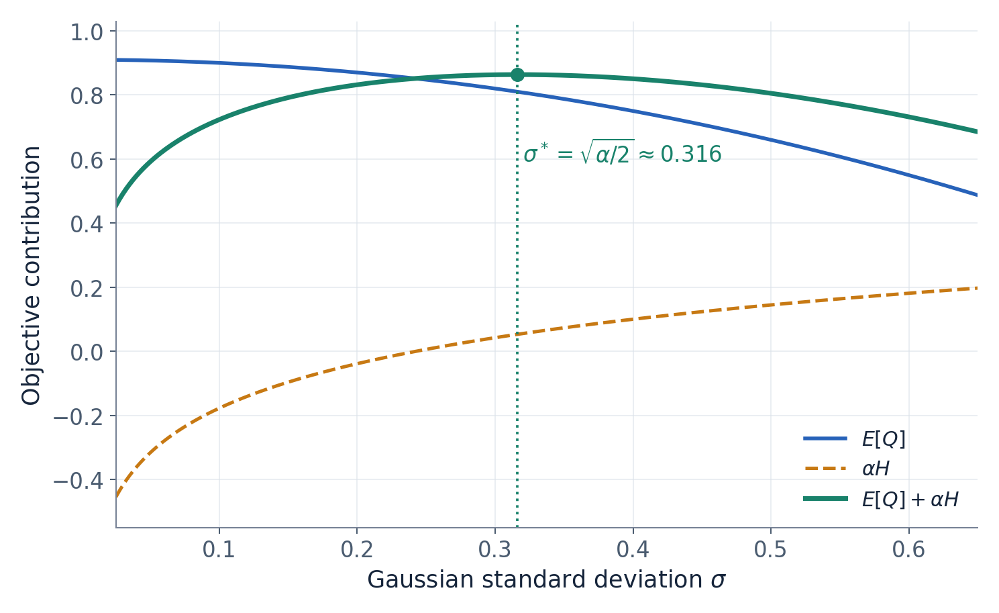

# 大话强化学习算法 SAC

赛车驶出弯道时，智能体已经知道：油门太小，出弯慢；油门太大，可能打滑。假如它刚发现 40% 油门表现不错，就把以后所有动作都锁在附近，会发生什么？它也许稳定地跑完了这一段，却一直没有发现 60% 油门更快。

给动作加点噪声，当然可以帮助探索。但新的问题随之出现：噪声该多大？什么时候应该收敛到一个动作，什么时候应该继续尝试？能不能让策略自己学习这些选择？

SAC，也就是 Soft Actor-Critic，把“动作往哪里集中”和“动作保留多少随机性”放进同一个优化问题。它学习动作分布，同时利用 Critic 的动作导数提高回报。理解这两件事怎样一起发生，就理解了 SAC 的核心。

## 1 从确定动作走向可以学习的动作分布

DDPG 和 TD3 的 Actor 通常直接给出一个动作，比如“油门设为 0.4”。训练时可以在它外面叠加探索噪声，但确定性 Actor 本身主要学习那个中心动作。

SAC 的 Actor 则可以输出一组分布参数。例如，对当前状态输出均值 0.4、标准差 0.1，随后从这个分布中抽取动作。均值决定通常往哪里踩，标准差决定尝试的范围。策略改进时，这两部分都可以学习。[1][3]

这里的状态是车辆速度、位置、朝向等观测的集合；动作可以同时包含油门、刹车和转向。为了能手算，我们先只看一个连续动作。后面把状态写成数字 2，也只是把复杂状态压缩成教学变量，不表示车辆真实状态只有一个数。

“随机策略”不等于“不知道该怎么开”。假设一个弯道容许较宽的油门范围，策略可以保持一定分散；假设另一个位置稍有偏差就会出界，价值学习会推动策略更集中。随机性的大小需要与行动后果一起考虑，不能只看分布宽不宽。

还要分清训练与评估。训练时采样有助于收集不同经历；某些实现评估时会把高斯均值经过 tanh 与缩放，得到一个确定动作。它不一定等于变换后分布的整体均值。这个评估规则是额外选择，不能据此说 SAC 在训练中也只输出一个固定动作。[3]

## 2 SAC 中究竟有哪些可学习的对象

这里讨论常见的现代连续动作 SAC：一个随机 Actor、两个当前 Critic、两个目标 Critic，以及可以自动调整的温度参数。它不需要额外训练一个独立的 V 网络，计算目标动作时使用当前 Actor，也不依赖目标 Actor。早期 SAC 版本曾使用额外的 V 网络，因此不同资料中的网络数量可能不一样。[1]

用 θ 表示 Actor 参数，φ₁、φ₂ 表示两个 Critic 参数。高斯 Actor 经常输出均值和对数标准差：

$$
\mu_\theta(s),\qquad \ell_\theta(s)=\log\sigma_\theta(s),\qquad \sigma_\theta(s)=e^{\ell_\theta(s)}.
$$

取指数能保证标准差为正。两个 Critic 各自接收状态和动作，输出一个标量：

$$
Q_{\phi_1}(s,a),\qquad Q_{\phi_2}(s,a).
$$

它们学习同一种价值，并不是一个专门负责乐观、一个专门负责悲观。目标 Critic 是当前 Critic 的缓慢移动副本，参数用横线表示。它们提供相对稳定的训练目标，而当前网络负责接受梯度更新。

温度 α 决定策略有多重视熵。它可以固定，也可以训练。把 α 叫作温度，只是在描述优化目标中分布的集中程度，并不是物理温度。

这几个对象的分工可以这样看：

| 对象 | 输入和输出 | 学习任务 |
|---|---|---|
| Actor | 状态 → 动作分布参数 | 生成价值较高、随机性适当的动作 |
| 两个当前 Critic | 状态和动作 → soft Q | 学习包含未来熵项的价值 |
| 两个目标 Critic | 下一状态和下一动作 → 目标价值 | 为当前 Critic 提供缓慢变化的目标 |
| 温度 α | 熵与目标熵的偏差 | 调整熵在策略目标中的权重 |

## 3 为什么要把熵放进目标

先想一个固定状态。两个动作的预期表现几乎相同，策略是否有必要立刻把全部密度集中到其中一个？在价值估计还不充分时，保留多种选择可能让后续数据提供更多信息。

SAC 把这种偏好写进目标。策略熵定义为：

$$
\mathcal H(\pi(\cdot|s))=-\mathbb E_{a\sim\pi}[\log\pi(a|s)].
$$

Actor 希望提高动作价值，同时提高熵。使用双 Critic 时，常见目标为：

$$
J_{\mathrm{actor}}(\theta)=\mathbb E\left[\min_{i=1,2}Q_{\phi_i}(s,a)-\alpha\log\pi_\theta(a|s)\right].
$$

代码一般最小化它的相反数。式中的第一项让动作趋向高价值区域，第二项鼓励分布保留随机性。这两种作用需要权衡：如果把分布摊得太开会采到很多差动作，第一项就会付出代价。[1][2]

这里容易产生两个误会。第一，熵大不等于车辆一定探索到新地点。它描述的是给定状态下动作分布的分散程度；动作是否带来新状态，还取决于环境动力学。第二，连续动作使用概率密度，密度可以超过 1，因此 log π 可以为正，微分熵也可以为负。单次采样得到的负对数密度，不是始终为正的额外奖励。

SAC 的 Q 还改变了价值口径。对固定策略和温度，可以把它理解为当前奖励，加上未来奖励以及未来熵相关项的折扣和：

$$
Q^\pi_\alpha(s_t,a_t)=\mathbb E\left[r_t+\sum_{k=1}^{\infty}\gamma^k\left(r_{t+k}-\alpha\log\pi(a_{t+k}|s_{t+k})\right)\mid s_t,a_t\right].
$$

因此，SAC 的 Q 比 TD3 的 Q 大，并不意味着赛车一定跑得更快。比较策略，应当看同一环境评价标准下的真实表现；比较价值估计，也要先对齐价值定义。

奖励尺度也会影响这份权衡。假设把所有环境奖励乘以十，而 α 保持不变，价值部分相对于熵项就变得更重要。虽然动作和赛道都没变，优化问题的权重已经改变。自动温度调整可以响应熵与目标之间的偏差，但仍需关注奖励设计、目标熵和学习速度之间的配合，不能把它理解为对所有数值尺度问题都自动免疫。

## 4 Critic 如何从一次驾驶经历中学习

经验回放保存的是实际发生过的转移：

$$
(s,a_{\mathrm{data}},r,s',b).
$$

其中 a_data 是历史动作，b 表示任务是否真正终止。Critic 要学习的是“当时在 s 执行这个动作”的价值，所以训练输入使用这条真实动作，不能随意替换成 Actor 现在喜欢的动作。

为了估计后续表现，在下一状态 s′ 从当前策略采样 a′，然后让两个目标 Critic 评价同一个 a′。学习目标是：

$$
y=r+\gamma(1-b)\left[\min_iQ_{\bar\phi_i}(s',a')-\alpha\log\pi_\theta(a'|s')\right],\qquad a'\sim\pi_\theta(\cdot|s').
$$

两个当前 Critic 都通过平方误差向这个目标靠近。计算目标时停止梯度，不把 Critic 的误差沿着 y 再传回 Actor 或目标网络。[2]

现在给出一组教学数字。转移未终止，即 b=0；即时奖励为 1，折扣 γ=0.9。两个目标 Critic 给出的值是 6 和 8，α=0.2，下一动作的对数密度为 −0.5。

先取较小的价值，再加入熵相关项：

$$
\min(6,8)=6,\qquad -\alpha\log\pi=-0.2\times(-0.5)=0.1.
$$

于是：

$$
y=1+0.9(6+0.1)=6.49.
$$

如果当前两个 Critic 对历史状态动作分别预测 5 和 7，它们的平方误差是：

$$
L_{Q_1}=(5-6.49)^2=2.2201,\qquad L_{Q_2}=(7-6.49)^2=0.2601.
$$

这条样本推动第一个预测升高、第二个预测降低。两者都在拟合同一个目标，没有谁被指定必须保持更高或更低。

为什么取较小值，而不是平均一下？因为 Actor 会主动寻找高分，偶然的乐观误差容易被策略利用，随后又进入下一轮学习目标。取较小值削弱了这种倾向。但它不能判断哪一个网络正确：如果较小的预测本身严重低估，目标也会偏低。两个 Critic 又共享相似的数据，所以它们可能同时犯相似错误。双 Q 是一种控制估计偏差的办法，并不是两名独立裁判共同签字就能证明分数真实。[5]

如果这次转移真正结束了任务，未来项应为零，目标就只剩奖励。外部采样时间限制造成的截断则不能一概当成真正终止，仍需根据环境语义保留后续价值估计。[8]

## 5 动作既然随机抽取 为什么还能沿动作求导

“从分布里抽一个数”听起来像一次不可控制的抽奖。但高斯采样可以改写为：

$$
a_\theta=\mu_\theta(s)+\sigma_\theta(s)\xi,\qquad \xi\sim\mathcal N(0,1).
$$

这叫重参数化。先从固定标准高斯取出随机数 ξ，再用 Actor 的均值和标准差对它变换。在这一次反向传播中固定 ξ，动作仍然随 θ 连续变化。

因此，价值部分能够沿下面的路径求导：

$$
\frac{\partial Q_{\min}(s,a_\theta)}{\partial\theta}=\frac{\partial Q_{\min}}{\partial a}\frac{\partial a_\theta}{\partial\theta}.
$$

这与 DDPG 的动作梯度有直接联系。SAC 并没有因为使用随机策略就放弃 Critic 的动作斜率，而是通过可微采样把这条路径保留下来。[1]

与 PPO 对照更容易看清。PPO 更新时固定已经执行过的动作，询问新策略是否应该提高它的密度。SAC 的常见更新固定的是噪声 ξ，当前动作 aθ 可以随参数变化，于是能询问“把当前生成的动作稍微移动，Critic 的评分会怎样”。两者都出现 log π，但梯度路径不同。

Actor 更新期间，Critic 参数按固定的评价函数处理，不过对动作输入的导数仍要保留。把整个 Q 计算放进无梯度区域，会一并切断 Actor 所需的价值梯度。

这里还可以追问：Actor 在训练时生成的新动作，是否必须立刻拿到环境中执行，才能知道怎样更新？不必。该次更新先由已经学到的 Critic 提供可微评分，因此可以在同一批回放状态上进行优化。真正执行动作、获取新的奖励和下一状态，是数据收集阶段的工作。正因为策略能够依靠预测评分做许多次更新，Critic 的误差也可能被反复利用；训练损失下降不能替代对真实驾驶表现的评价。

真实油门有边界，常见做法是先得到高斯变量 u，再执行 tanh 变换和范围缩放。这个变换也要参与梯度，对数密度还要包含相应的雅可比修正。不能把实际执行的有界动作与未经变换高斯的密度随意混用。[3]

## 6 手算一次均值和标准差的更新

下面是独立的 Actor 教学例子。固定状态 s=2，均值 μ=θs，初始 θ=0.2，标准差 σ=0.1，温度 α=0.2。为突出计算路径，暂时省略 tanh，并把均值参数 θ 与对数标准差参数 ℓ 视为独立参数。

这次抽到 ξ=1，因此：

$$
\mu=0.4,\qquad a=0.4+0.1\times1=0.5.
$$

假设附近的两个固定 Critic 为：

$$
Q_1(a)=1-(a-0.7)^2,\qquad Q_2(a)=Q_1(a)+0.1.
$$

于是最小值由 Q₁ 给出，当前 Q_min=0.96。高斯对数密度为：

$$
\log\pi(a)=-\log\sigma-\frac12\log(2\pi)-\frac{(a-\mu)^2}{2\sigma^2}\approx0.88364656.
$$

本次样本目标是：

$$
J=0.96-0.2\times0.88364656\approx0.78327069.
$$

先算均值如何移动。Critic 的动作导数为 −2(a−0.7)=0.4，而动作对 θ 的导数为 s=2。还要检查熵项：把 a=μ+σξ 代入 log π，得到：

$$
\log\pi(\mu+\sigma\xi)=-\log\sigma-\frac12\log(2\pi)-\frac12\xi^2.
$$

对于这个未经变换的普通高斯，固定 ξ 和 σ 后，上式对均值的总导数为零。因此：

$$
\frac{\partial J}{\partial\theta}=0.4\times2=0.8.
$$

学习率 η=0.01，做梯度上升：

$$
\theta_{\mathrm{new}}=0.2+0.01\times0.8=0.208,\qquad \mu_{\mathrm{new}}=0.416.
$$

再算分散程度。用 ℓ=log σ，由于动作对 ℓ 的导数为 σξ=0.1，而熵项对 ℓ 的贡献为 α，得到：

$$
\frac{\partial J}{\partial\ell}=\frac{\partial Q_{\min}}{\partial a}\sigma\xi+\alpha=0.4\times0.1+0.2=0.24.
$$

同样学习率下：

$$
\sigma_{\mathrm{new}}=0.1e^{0.01\times0.24}\approx0.10024029.
$$

这次更新把分布中心从 0.4 移到 0.416，标准差略微增大。下次实际动作会重新采样，不保证等于 0.416；使用 tanh 后，熵项对均值的作用也不能继续套用这里的零导数结论。

## 7 为什么标准差不会一直增大

刚才一次样本的标准差梯度为正，很容易让人担心：只要奖励熵，分布是不是越散越好？要回答这个问题，应当看整个分布的期望，而不只看一个抽样结果。

在刚才的二次价值曲线和普通高斯假设下，可以精确计算：

$$
\mathbb E[Q(a)]=1-(\mu-0.7)^2-\sigma^2.
$$

即使均值已经对准 0.7，标准差增大也会让更多动作偏离高点，平均价值下降。加入高斯熵后：

$$
J(\mu,\sigma)=1-(\mu-0.7)^2-\sigma^2+\frac\alpha2\log(2\pi e\sigma^2).
$$

其中 −σ² 惩罚过度分散，后面的对数项鼓励保留随机性。在这个特定例子中，最优均值为 0.7，最优标准差满足 σ²=α/2。这个结果只属于当前二次 Q 和无界普通高斯，真实环境不具备同样的简式，但它直观说明了两股力量如何平衡。

从赛车角度看，如果较大范围的油门都表现不错，保留分散程度的代价较小；如果高分动作只在很窄的区间里，分散会迅速损失价值。SAC 把这种取舍放进了可学习的目标，而不是预先规定所有状态必须使用相同程度的动作随机性。

图 1 在文中的二次 Q、未经 tanh 变换的普通高斯、固定均值 0.4 与温度 0.2 下，标准差增大会降低平均动作价值，同时提高熵项。图中计算的是整个分布的期望，不是上一节的单次采样值；绿色曲线的峰值体现二者的权衡。

## 8 温度如何根据目标熵自动调整

固定 α 需要手工权衡回报与熵。常见 SAC 进一步指定目标熵，并训练温度。设当前平均策略熵为 H，目标为 H_target，一种温度目标是：

$$
L_\alpha=\mathbb E[-\alpha(\log\pi(a|s)+H_{\mathrm{target}})]=\alpha(H-H_{\mathrm{target}}).
$$

这一更新中把策略的 log π 按常量处理，所以对 α 的梯度为 H−H_target。若熵低于目标，梯度下降会增大 α，让下一轮策略更新更加重视熵；若熵高于目标，α 会降低。[1][4]

为了保证温度为正，可以优化 β=log α。把 α=e^β 代入上式后，梯度会多出 α 因子。有些实现使用关于 β 的代理损失，保留相同调节方向，但不保留这个因子。因此，看到两个项目的温度损失写法不同，应先比较它们实际对哪个变量求导，不能只比较公式表面是否一样。

目标熵仍然是一个需要选择的量，自动温度调整并没有取消全部超参数。它约束的是访问状态上的平均水平，也不要求每个状态都有完全相同的熵。对连续分布，目标熵可以是负数，这与前面所说的微分熵定义一致。

例如，目标熵设为 −1，当前估计为 −1.2，那么 H−H_target=−0.2。虽然两个数都是负数，当前熵依然低于目标；梯度下降会提高 α。若当前估计变成 −0.8，偏差就是正的，α 会降低。比较的是数值大小，而不是看到负号就认为熵的定义或更新方向有问题。

## 9 如果几个动作都好 SAC 能保留几个波峰吗

假设前方障碍物左右两侧都能通过，向左和向右各有一段高价值区域，正中间却很差。SAC 的最大熵目标本身允许这种多峰偏好。固定 Q，在不限制策略分布族且能够归一化时，理想分布满足：

$$
\pi^*(a|s)\propto\exp\left(\frac{Q(s,a)}\alpha\right).
$$

Q 有多个高峰，理想动作分布也可以具有多个高峰。[1]

实际算法必须选择能计算和训练的策略族。普通高斯在给定状态下只有一个峰，因此它可能集中到其中一侧，或用较宽的分布覆盖更大范围；并不必然学成两侧动作的平均。经过非线性变换的密度形状还可能改变，不能把所有有界高斯策略都简单等同于原始单峰曲线。

换成混合高斯、更灵活的可逆变换分布，都涉及新的实现选择。PPO 固定历史动作计算密度，使用混合分布较直接；SAC 常见更新还依赖动作的可微采样。如果混合策略通过离散选择一个分量，直接沿普通采样路径求导可能遗漏分量选择的影响，需要枚举、其他梯度估计或不同的可微构造。

同样，熵奖励不保证所有好模式都会一直保留。训练数据、策略族、价值误差都会影响结果。若推理时使用多峰分布的整体均值，也可能得到位于两个峰之间的差动作，执行规则必须与分布含义相配。

## 10 把 SAC 放回整个算法家族

TD3 与 SAC 都使用经验回放，都借助 Critic 的动作斜率改进 Actor。关键差别是：TD3 主要优化一个确定动作；SAC 优化可采样的动作分布，并同时考虑熵。标准 TD3 的 Actor 通常使用 Q₁，现代双 Q SAC 的 Actor 使用两个当前 Q 的最小值。[2][5]

PPO 也能使用高斯 Actor，但它主要通过历史动作的优势和新旧密度比学习。是否使用高斯，不能用来判断一个算法属于哪条梯度路线。真正需要看的是：更新时固定的是什么，梯度经过哪些计算。[7]

TQC 则沿用 SAC 的随机策略与熵机制，把两个标量 Q 扩展为多组回报分位数，并在构造 Critic 目标时截断最高的一部分。它重点改进价值表示和高估控制，并不自动改变 Actor 的动作分布形状。[6]

一次常见 SAC 训练循环由此变得清晰：采集经历并放入回放；从回放抽取状态动作；用下一状态、当前策略和目标 Critic 构造学习目标；更新两个当前 Critic；在回放状态上重新生成动作，更新 Actor；按需要更新温度；再缓慢更新目标 Critic。历史动作负责提供真实经验，当前动作负责寻找改进方向，两者不能混用。

如果 α 逐渐变小，SAC 是否就等于 TD3？也不能直接这样说。熵权重变小并不自动让标准差归零，而两种算法的 Actor 价值聚合、目标动作平滑和延迟更新安排仍然不同。它们之间存在共同的确定性策略梯度思想，但不能只把一个超参数设为零，就把所有训练步骤视为相同。

当你在代码里看到 Actor 的损失写成“α 乘 log probability，再减去 Q”，可以先把它翻译成一句具体的话：把生成的动作推向更高价值的位置，同时学习应该保留多少分散程度。这个解释同时保留了 SAC 的随机性与动作梯度，两部分缺一不可。

## 参考资料

1. [Haarnoja 等：Soft Actor-Critic Algorithms and Applications](https://arxiv.org/abs/1812.05905)，现代 SAC、重参数化、自动温度与最大熵策略推导。
2. [OpenAI Spinning Up：SAC 训练代码](https://github.com/openai/spinningup/blob/master/spinup/algos/pytorch/sac/sac.py)，双 Q 目标、Actor 损失和经验回放。
3. [OpenAI Spinning Up：SAC Actor 与 Critic 实现](https://github.com/openai/spinningup/blob/master/spinup/algos/pytorch/sac/core.py)，重参数化高斯、tanh 变换和密度修正。
4. [SAC 作者实现：温度更新](https://github.com/rail-berkeley/softlearning/blob/master/softlearning/algorithms/sac.py)，关于 log α 的实际梯度路径。
5. [Fujimoto 等：Addressing Function Approximation Error in Actor-Critic Methods](https://proceedings.mlr.press/v80/fujimoto18a.html)，TD3 的双 Critic 与延迟更新。
6. [Kuznetsov 等：Controlling Overestimation Bias with Truncated Mixture of Continuous Distributional Quantile Critics](https://proceedings.mlr.press/v119/kuznetsov20a.html)，TQC 的价值分布与截断机制。
7. [Schulman 等：Proximal Policy Optimization Algorithms](https://arxiv.org/abs/1707.06347)，优势、策略概率比和裁剪目标。
8. [Gymnasium：Handling Time Limits](https://gymnasium.farama.org/tutorials/gymnasium_basics/handling_time_limits/)，任务终止与外部时间截断的区别。

系列文章包括[《大话强化学习算法 DDPG》](01-大话强化学习算法-DDPG.md)[《大话强化学习算法 PPO》](02-大话强化学习算法-PPO.md)[《大话强化学习算法 TD3》](03-大话强化学习算法-TD3.md)[《大话强化学习算法 SAC》](04-大话强化学习算法-SAC.md)[《大话强化学习算法 TQC》](05-大话强化学习算法-TQC.md)。沿价值梯度路线可按 DDPG、TD3、SAC、TQC 阅读；PPO 作为概率比更新路线，与这几篇对照阅读。

[1]: https://arxiv.org/abs/1812.05905
[2]: https://github.com/openai/spinningup/blob/master/spinup/algos/pytorch/sac/sac.py
[3]: https://github.com/openai/spinningup/blob/master/spinup/algos/pytorch/sac/core.py
[4]: https://github.com/rail-berkeley/softlearning/blob/master/softlearning/algorithms/sac.py
[5]: https://proceedings.mlr.press/v80/fujimoto18a.html
[6]: https://proceedings.mlr.press/v119/kuznetsov20a.html
[7]: https://arxiv.org/abs/1707.06347
[8]: https://gymnasium.farama.org/tutorials/gymnasium_basics/handling_time_limits/
