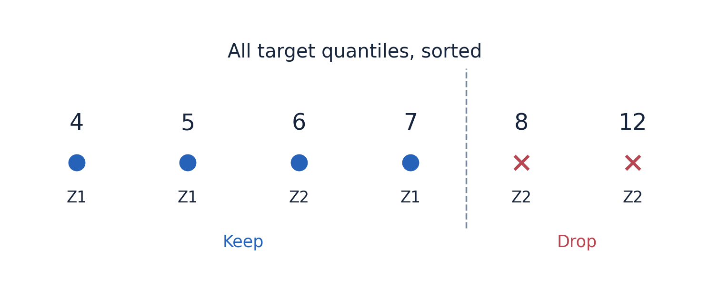

# 大话强化学习算法 TQC

假设赛车智能体正在选择一个超车动作。Critic 给出很高的分数，Actor 便不断把动作往那里推。几轮训练后，赛车却更容易撞车了。问题可能不是 Actor 没有认真学习，恰恰是它太认真地利用了一个错误高分。

TD3 用两个 Critic 的较小值减少这种乐观倾向，SAC 把双 Q 与随机策略结合起来。接下来还可以追问：一个 Critic 只给一个平均分，是否丢掉了太多信息？如果让它预测一组回报位置，能不能更细致地控制高估？

TQC，即 Truncated Quantile Critics，沿着这个问题继续向前。它用分位数表示回报分布，把多个目标 Critic 的预测合并后截掉最高的一部分，再据此学习。理解它的关键有两处：分清“动作分布”和“回报分布”，分清“构造 Critic 目标”和“更新 Actor”。

## 1 同样平均得六分 两种动作可能很不一样

设一个动作每次都得到累计回报 6，另一个动作有一半机会得到 0，另一半机会得到 12。它们的平均值相同，但结果的分散程度完全不同。

普通 Q 函数主要回答期望是多少：

$$
Q(s,a)=\mathbb E[G\mid s,a].
$$

其中 G 是未来累计回报。分布式价值学习则进一步描述 G 可能落在哪里。环境转移、奖励和后续策略中的随机性，都可能让相同状态动作之后出现不同回报。[1]

这个例子并不意味着期望回报目标一定应该选择稳定的动作。如果任务只关心期望，这两个动作可以同样好。引入分布表示，首先是为了提供更丰富的学习对象；如何使用这些信息，还取决于算法的目标和处理方式。

对赛车来说，平均分会把顺利超车、被迫减速和碰撞等结果混合起来。分布表示能保留不同回报位置的信息。TQC 进一步利用这种表示，把“整份价值估计应该保守多少”变成可以通过截断数量调节的操作。

这里描述的分布是固定状态和动作后，后续回报的分布。它与“左转和右转各有一个概率峰”的动作分布不同。前者属于 Critic 对结果的预测，后者属于 Actor 对行为的选择。

## 2 分位数 Critic 到底输出哪些数

假设一个 Critic 输出 M 个数，而不是一个标量：

$$
Z_{\phi_n}(s,a)=[z_{n,1}(s,a),z_{n,2}(s,a),\ldots,z_{n,M}(s,a)].
$$

第 n 个 Critic 的第 m 个输出，学习固定分位水平对应的回报位置。常见分位水平为：

$$
\tau_m=\frac{m-\frac12}{M},\qquad m=1,\ldots,M.
$$

取 M=3，三个水平就是 1/6、1/2、5/6，可以分别理解为较低、中间、较高的回报位置。分位水平是预先指定的，网络学习的是这些位置应该对应多少回报。[1][2]

分位数的含义可以借助中位数理解：中位数描述分布中间的位置，不是把所有数相加再平均得到的位置。更低的分位水平关注较低回报区域，更高的分位水平关注较高回报区域。实际网络和光滑损失给出的只是近似，并不保证每个输出已经精确校准。

把每个预测位置看成一个等权的分布原子，就得到一个离散近似。其平均值可以用来构造相应的价值估计：

$$
\widehat Q_n(s,a)=\frac1M\sum_{m=1}^{M}z_{n,m}(s,a).
$$

不过，这些数不是 M 个动作，不是 M 条预先固定的轨迹，也不是“真实 Q 有多少概率位于这个区间”的模型置信区间。回报自身的随机性与模型估计错误，是两个不同概念；一个分位数向量不能自动把它们分离。

TQC 会同时训练 N 个这样的 Critic。多个网络提供多组分布近似，而每个网络内的多个头提供回报位置。增加网络数量与增加分位头数量不是同一种操作，虽然都会增加总输出数。

## 3 先保留 SAC 的骨架 再改变价值学习

TQC 的常见形式建立在 SAC 上：Actor 仍然是随机策略，仍然可以输出高斯参数并通过重参数化采样，仍然权衡价值和熵。它也使用经验回放和缓慢更新的目标 Critic。[2][3]

统一用 θ 表示 Actor 参数，φ 表示 Critic 参数，α 表示熵权重，γ 表示折扣。回放中的一条经历为：

$$
(s,a_{\mathrm{data}},r,s',b),
$$

其中 b 是真正终止标记。训练 Critic 时，当前输入仍然是实际发生过的状态和动作。只有这样，奖励与下一状态才对应正在学习的那个决策。

标准双 Q SAC 在下一状态采样一个动作，再用两个目标 Q 的最小值构造标量目标。TQC 改为让目标网络输出多个回报位置，合并、截断后构造一组目标。这个变化发生在价值学习端，并不需要把 Actor 改成多峰动作分布。

还有一个价值定义上的细节。SAC 的未来价值包含熵相关项，TQC 又对目标分布进行截断。因此，TQC 学习的是经过这些机制处理的软回报分布近似，不能直接称为原始环境奖励回报的精确真实分布。拿它与实际比赛回报比较时，需要意识到两者的口径差异。

## 4 手算一次目标分布的生成

下面用两个 Critic、每个三个分位头，把整个目标计算走一遍。网络数量和输出值都是教学设置。

首先，在下一状态 s′ 从当前 Actor 采样同一个动作 a′。两个目标 Critic 分别输出：

$$
Z_{\bar\phi_1}(s',a')=[4,5,7],\qquad Z_{\bar\phi_2}(s',a')=[6,8,12].
$$

接着，把六个位置合并，并按照数值从小到大排序：

$$
[4,5,6,7,8,12].
$$

假设本次总共丢弃最大的 D=2 个位置，保留的数量为 K=NM−D=4。保留下来的是：

$$
[4,5,6,7].
$$

8 和 12 都来自第二个 Critic。这直接说明了 TQC 的截断方式：先汇总所有预测，再删除全局最高的一部分。如果某个网络给出特别高的估计，被删除的多个值可以都来自这个网络。[2][3]

有些实现用“每个网络的丢弃数”作为超参数，但它用于计算总丢弃数量 D=N×d；实际排序截断仍在合并后的集合上进行，并不要求真的从每个网络各删 d 个。

之后才加入即时奖励、折扣与熵相关项。设转移未终止，且：

$$
r=1,\qquad\gamma=0.9,\qquad\alpha=0.2,\qquad\log\pi_\theta(a'|s')=-0.5.
$$

于是 −α log π=0.1。对每个保留位置 z_(j)，分别构造：

$$
y_j=r+\gamma(1-b)\left[z_{(j)}-\alpha\log\pi_\theta(a'|s')\right].
$$

对应的四个目标是：

$$
Y=[4.69,5.59,6.49,7.39].
$$

它们的平均值为 6.04。不过，接下来的训练会保留整个目标集合，而不是先平均成 6.04，再让所有输出都做相同的均方误差回归。不同分位头需要学习不同位置，损失函数也必须体现这种区别。

构造目标的整个过程不反向传播梯度。下一动作、目标网络输出和排序截断结果，在当前 Critic 更新中都作为固定学习目标使用。如果任务真正终止，未来项归零，所有目标都退化为当前奖励；外部时间截断则需按环境语义处理，不能机械地视为终止。[3][8]

图 1 全部目标分位数合并排序后，删除最高的两个值 8 和 12，它们都来自第二个 Critic。横向等间距只表示排序顺序，不表示数值距离；Z1 和 Z2 标记输出来源。

## 5 为什么几个分位头不会都学成同一个均值

假设三个输出都对同一批目标做普通平方误差回归。它们受到的训练要求相同，很自然会都靠近均值。要让一个学习低分位、另一个学习高分位，需要让“预测偏高”和“预测偏低”的代价不同。

定义残差为目标减预测：

$$
u=y-z.
$$

残差为正表示预测偏低，残差为负表示预测偏高。TQC 使用分位数 Huber 损失，先计算阈值为 1 的 Huber 函数：

$$
H_1(u)=\begin{cases}\frac12u^2,&|u|\le1,\\|u|-\frac12,&|u|>1.\end{cases}
$$

再乘上与分位水平有关的非对称权重：

$$
\rho_\tau(u)=|\tau-\mathbf1[u<0]|H_1(u).
$$

这里的指示函数在 u<0 时取 1，否则取 0。高分位头的 τ 较大，因此预测偏低时惩罚较重；低分位头的 τ 较小，因此预测偏高时惩罚较重。不同位置就是这样被区分出来的。[1][4]

用一个实际数字看看。设当前预测 z=5，某个目标 y=5.59，则 u=0.59，属于预测偏低。Huber 值为：

$$
H_1(0.59)=\frac12\times0.59^2=0.17405.
$$

对于低分位头 τ=1/6，损失约为 0.0290083；对于高分位头 τ=5/6，损失约为 0.1450417。同样的低估，高分位头得到的纠正更强。若目标反而低于预测，权重关系就会反过来。

实际训练中，每个当前分位头都与全部 K 个目标比较：

$$
L_{\phi_n}=\frac1{MK}\sum_{m=1}^{M}\sum_{j=1}^{K}\rho_{\tau_m}\left(y_j-z_{n,m}(s,a_{\mathrm{data}})\right).
$$

再对所有 Critic 和批次样本聚合损失。当前每个 Critic 有三个输出，而这里有四个目标，本来也不需要按序号一对一匹配。目标集合代表要学习的分布，每个分位头根据自己的非对称权重，从整个集合中学习对应位置。

Huber 函数在小误差附近使用平方项，在大误差处转成线性增长，使单个大残差不会像平方误差那样产生持续变大的斜率。这是一种优化上的平滑处理，并不意味着网络已经获得了对真实分位数的严格保证。[4]

## 6 Actor 为什么又使用全部分位数

看到“截断分位数 Critic”这个名字，很容易猜测 Actor 也应该先删掉高分位，再根据剩下的值更新。标准 TQC 恰恰没有这么做。

更新 Actor 时，在当前状态 s 重新从当前策略生成动作：

$$
a_\theta=f_\theta(s,\xi).
$$

把这个动作交给所有当前 Critic，随后取全部 NM 个输出的平均值：

$$
\bar Q_\phi(s,a_\theta)=\frac1{NM}\sum_{n=1}^{N}\sum_{m=1}^{M}z_{n,m}(s,a_\theta).
$$

Actor 最大化：

$$
J_{\mathrm{actor}}(\theta)=\mathbb E\left[\bar Q_\phi(s,a_\theta)-\alpha\log\pi_\theta(a_\theta|s)\right].
$$

这里没有再截断，也没有在各个 Critic 的平均值之间取最小值。当前 Critic 已经在被截断的目标上训练，再对 Actor 做同样截断，会进一步加重这种偏向。原论文与常见实现都明确区分这两个阶段。[2][3]

对连续重参数化 Actor，价值梯度仍然沿动作传回：

$$
\frac{\partial\bar Q_\phi}{\partial\theta}=\left(\frac1{NM}\sum_{n,m}\frac{\partial z_{n,m}}{\partial a}\right)\frac{\partial a_\theta}{\partial\theta}.
$$

假设六个输出对动作的斜率分别为 0.2、0.4、0.6、0.3、0.5、0.4，平均斜率就是 0.4。若动作对某个 Actor 参数的导数为 2，价值部分对该参数的梯度就是 0.8。再叠加熵项的梯度，便得到完整更新。

因此，TQC 没有丢掉 DDPG 那条熟悉的链式求导路线。它改变了供 Actor 使用的价值估计怎样产生，而 Actor 仍然可以通过“参数改变动作，动作改变价值”的路径学习。

## 7 一条经验在三个计算阶段分别做什么

TQC 的公式不少，但最容易写错的地方往往不是求导，而是把不同阶段的状态、动作和网络混在一起。可以跟踪同一条回放经历，看它被怎样使用。

| 阶段 | 使用的状态与动作 | 使用的网络和结果 |
|---|---|---|
| 构造 Critic 目标 | 下一状态 s′，当前策略采样的 a′ | 目标 Critic，全局截断后的目标分布 |
| 拟合当前 Critic | 当前状态 s，历史真实动作 a_data | 当前 Critic，全部分位头接受分位数损失 |
| 改进 Actor | 当前状态 s，当前策略新生成的 aθ | 当前 Critic，全部分位数均值加熵项 |

历史动作不一定是当前策略现在会选择的动作，但它仍然提供真实的转移信息。这就是经验回放有价值的地方。Actor 更新则需要评价自己现在生成的动作，而不是把历史动作固定住后直接照搬价值梯度。

目标网络在训练过程中缓慢跟随当前网络，例如使用参数的指数移动平均。这样，当前 Critic 的学习目标不会随着每次梯度更新完全同步跳动。Actor 更新期间，Critic 参数不随 Actor 损失优化，但动作输入的导数必须保留。

温度调整沿用 SAC 的思想：平均熵低于目标时提高 α，高于目标时降低 α。TQC 的分位数结构并没有取消这个机制，也没有改变动作密度必须与实际动作变换一致的要求。[3]

把这些阶段连起来，一轮训练就包括：采样回放、构造截断目标、更新分位数 Critic、重新生成当前动作、更新 Actor 与温度、缓慢更新目标网络。具体实现可以安排不同的更新顺序和频率，但各阶段使用的数据含义必须保持一致。

## 8 截掉最高的一部分 为什么可能更可靠

Actor 不会随机挑一个预测分数来相信，它会主动寻找高分动作。这种选择会放大价值误差的影响：一个偶然被高估的动作，更可能被策略选中，并进一步影响后续的学习目标。

TQC 在目标分布里删除最高的一部分，相当于削弱右侧高值对后续训练的影响。分位表示把这个操作拆成较小的粒度，不必只在“相信整个 Critic”与“换成另一个 Critic”之间选择。[2]

但最高值不必然是错误。超车成功可能确实带来较高回报，高分位只是描述这类结果的位置。TQC 并没有一个判别器告诉它“这个值是假的，所以应该删除”；它是在通过有意引入的保守倾向，抵消其他机制带来的乐观偏差。

因此，删得越多并不代表越准确。截断过弱可能不足以抑制高估，截断过强则可能让策略放弃本来值得尝试的动作。截断比例、网络数量、分位头数量与数据覆盖一起影响结果，没有脱离任务就永远最优的组合。

若把丢弃数量设成零，TQC 也不会严格变回标准双 Q SAC。它仍使用分布式 Critic 和分位数损失，而且价值聚合方式与 SAC 的双 Q 最小值不同。关闭一个改动，并不自动取消算法中的其他改动。

分位数数量增加，也不保证每个位置都更准。它提高了表示的分辨率，同时增加了学习负担。如果训练数据缺少关键状态和动作，再细的分位网格也不能凭空补出真实信息。

## 9 怎样判断 Critic 真的学得更好

最容易观察到的指标是训练损失下降，但这只表示当前预测越来越符合当前训练目标。目标本身来自目标网络和截断操作，所以损失很小，不足以证明它接近真实回报。

一个更有针对性的验证办法，是在可以恢复状态的模拟器中冻结策略，固定起始状态和第一步动作，之后重复执行同一策略，收集多次回报。这样可以查看动作的平均表现、分散程度以及几个候选动作的排序，再与 Critic 的判断对照。

比较时需要对齐折扣、奖励定义、终止条件和后续策略。若拿 TQC 的软价值与只累计环境奖励的回报直接比数值，熵项会造成口径差异；若目标已经包含截断，也不能要求每个预测分位点都无偏地重现原始回报分布。这些条件决定了验证结果究竟能说明什么。

对于 Actor 来说，附近动作的相对排序和局部斜率尤其重要。即使平均值大体正确，若较差动作附近存在错误高峰，策略仍然可能被带偏。可在几个相关状态上扫描小范围油门或转向，比较实际表现趋势与预测趋势，重点寻找“估计越来越高，实际越来越差”的区域。

在训练管线中，也应先检查具体的因果对应：奖励是否来自记录的那个动作，下一状态是否错位，动作缩放是否一致，真正终止与外部截断是否区分，观测是否缺少决定后果的重要信息。TQC 可以调整估计偏差，却不能修复错误的数据语义。

分位头的输出也可能发生交叉，多个 Critic 也可能高度相关。网络数量看起来很多，不等于掌握了同样多份独立证据。因此，更合适的期待是“提供一种更细致的价值学习和偏差控制方式”，而不是“自动得到可信的风险概率”。

## 10 它与 DDPG TD3 SAC PPO 分别怎样关联

DDPG 建立了连续动作 Actor 借助 Q 的动作导数学习的基本路线。TD3 针对这条路线中的估计误差，加入双 Critic 最小目标、延迟策略更新和目标动作平滑。SAC 把 Actor 变成随机策略，并把熵加入价值与策略学习。TQC 则在 SAC 的框架里，进一步改变 Critic 的表示和目标构造。[2][5][6]

这是一条便于理解的联系线，不意味着每个算法只是前一个算法加一个开关。特别是 TD3 的 Actor 通常最大化 Q₁，SAC 的 Actor 使用双 Q 最小值，TQC 的 Actor 使用全部分位数的平均值。不能看到它们都有多个 Critic，就把聚合规则混用。

| 算法 | 典型 Critic | Actor 的价值信号 |
|---|---|---|
| DDPG | 一个标量 Q | Q 的动作梯度 |
| TD3 | 两个标量 Q | 通常是 Q₁ 的动作梯度 |
| SAC | 两个 soft Q | 较小 Q 的动作梯度，并考虑熵 |
| TQC | 多组回报分位数 | 全部当前分位数均值的动作梯度，并考虑熵 |
| PPO | 通常是状态价值 V | 优势与动作密度比，不要求 Q 的动作梯度 |

PPO 属于另一种常见的策略改进方式。它固定已经执行的动作，利用优势估计提高或降低这些动作的密度，再通过裁剪目标约束更新激励。TQC 固定一次重参数化噪声，让当前动作随 Actor 参数变化，从而把价值斜率传回网络。[7]

最后再看“多个好动作”的问题。TQC 预测多个回报分位点，并不会自动生成多个动作波峰。如果希望同一状态下保留左绕与右绕两种行为，需要考虑 Actor 的分布族与执行规则；如果希望描述某个行为之后可能得到哪些回报，才是分布式 Critic 的任务。

理解 TQC 时，只要始终保留两个位置，就不容易混乱：在下一状态构造学习目标时，合并分位数并截断；在当前状态改进 Actor 时，使用已学习的全部分位数均值。前者控制价值学习的偏向，后者提供可微的动作改进方向。

## 参考资料

1. [Dabney 等：Distributional Reinforcement Learning with Quantile Regression](https://arxiv.org/abs/1710.10044)，分布式价值、分位水平与分位回归。
2. [Kuznetsov 等：Controlling Overestimation Bias with Truncated Mixture of Continuous Distributional Quantile Critics](https://proceedings.mlr.press/v119/kuznetsov20a/kuznetsov20a.pdf)，TQC 目标、分位数损失、Actor 目标和截断机制。
3. [Stable Baselines3 Contrib：TQC 实现](https://sb3-contrib.readthedocs.io/en/master/_modules/sb3_contrib/tqc/tqc.html)，全局排序截断、Critic 更新与 Actor 全量均值。
4. [Stable Baselines3 Contrib：分位数 Huber 损失](https://sb3-contrib.readthedocs.io/en/master/_modules/sb3_contrib/common/utils.html)，残差方向、非对称权重和所有目标之间的配对计算。
5. [Fujimoto 等：Addressing Function Approximation Error in Actor-Critic Methods](https://proceedings.mlr.press/v80/fujimoto18a.html)，TD3 的估计误差控制。
6. [Haarnoja 等：Soft Actor-Critic Algorithms and Applications](https://arxiv.org/abs/1812.05905)，SAC 的随机策略、软价值和重参数化梯度。
7. [Schulman 等：Proximal Policy Optimization Algorithms](https://arxiv.org/abs/1707.06347)，PPO 的策略概率比和裁剪目标。
8. [Gymnasium：Handling Time Limits](https://gymnasium.farama.org/tutorials/gymnasium_basics/handling_time_limits/)，任务终止与外部时间截断的区别。

系列文章包括[《大话强化学习算法 DDPG》](01-大话强化学习算法-DDPG.md)[《大话强化学习算法 PPO》](02-大话强化学习算法-PPO.md)[《大话强化学习算法 TD3》](03-大话强化学习算法-TD3.md)[《大话强化学习算法 SAC》](04-大话强化学习算法-SAC.md)[《大话强化学习算法 TQC》](05-大话强化学习算法-TQC.md)。沿价值梯度路线可按 DDPG、TD3、SAC、TQC 阅读；PPO 作为概率比更新路线，与这几篇对照阅读。

[1]: https://arxiv.org/abs/1710.10044
[2]: https://proceedings.mlr.press/v119/kuznetsov20a/kuznetsov20a.pdf
[3]: https://sb3-contrib.readthedocs.io/en/master/_modules/sb3_contrib/tqc/tqc.html
[4]: https://sb3-contrib.readthedocs.io/en/master/_modules/sb3_contrib/common/utils.html
[5]: https://proceedings.mlr.press/v80/fujimoto18a.html
[6]: https://arxiv.org/abs/1812.05905
[7]: https://arxiv.org/abs/1707.06347
[8]: https://gymnasium.farama.org/tutorials/gymnasium_basics/handling_time_limits/
