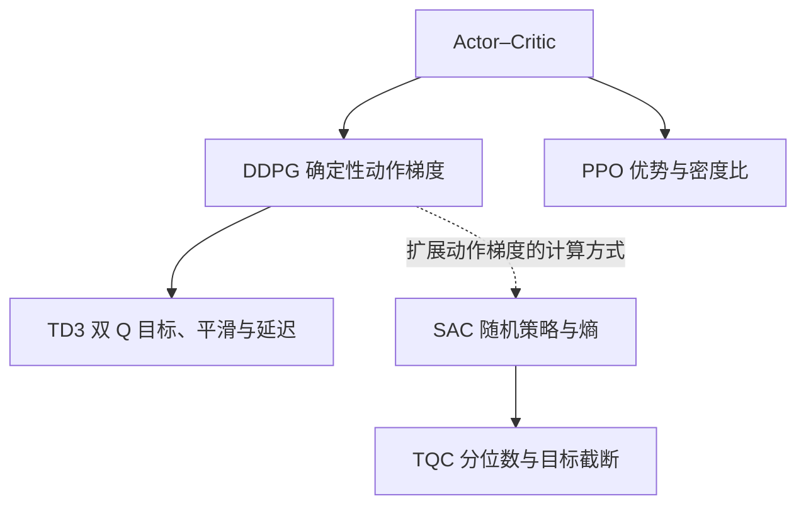

# 大话强化学习算法 系列导读

这五篇文章围绕同一个问题展开：赛车智能体怎样从经验中学会更好的转向、油门与制动？每篇都从具体疑问切入，依次说明直觉、网络分工、计算公式、一轮数字推演、常见误解和算法之间的关系。

## 五篇文章

| 文章 | 要回答的核心问题 |
|---|---|
| [大话强化学习算法 DDPG](01-大话强化学习算法-DDPG.md) | 连续 Actor 怎样通过 Critic 的动作导数学习？ |
| [大话强化学习算法 PPO](02-大话强化学习算法-PPO.md) | 如何根据优势调整动作密度，裁剪为什么不是硬约束，多个好动作能否对应多个波峰？ |
| [大话强化学习算法 TD3](03-大话强化学习算法-TD3.md) | Critic 高估怎样误导 Actor，双 Critic、目标平滑和延迟更新各自改了哪一步？ |
| [大话强化学习算法 SAC](04-大话强化学习算法-SAC.md) | 随机动作怎样参与求导，均值、标准差与熵温度怎样一起学习？ |
| [大话强化学习算法 TQC](05-大话强化学习算法-TQC.md) | 回报分位数怎样学习，目标截断为什么要先合并排序，Actor 为什么又使用全部输出？ |

## 阅读路线

可以先沿 **DDPG → TD3 → SAC → TQC** 阅读，观察动作梯度方法怎样改进价值学习，再把 **PPO** 作为另一条策略更新路线对照。若正在使用 PPO，也可以先读 PPO，再用 DDPG 与 SAC 对照“固定动作求密度梯度”和“固定噪声让动作参与求导”。

下面是教学关系图，强调方法之间的联系，而不是严格的历史时间线。

## 用同一组问题比较算法

| 算法 | 策略的常见形式 | Critic 的常见形式 | Actor 的主要学习信号 | 数据使用 |
|---|---|---|---|---|
| DDPG | 确定性动作 | 一个 Q | Q 的动作梯度 | 经验回放 |
| TD3 | 确定性动作 | 两个 Q | 通常使用 Q₁ 的动作梯度 | 经验回放 |
| SAC | 可重参数化的随机策略 | 两个 soft Q | 较小 Q 的动作梯度，加熵项 | 经验回放 |
| TQC | 可重参数化的随机策略 | 多组回报分位数 | 全部当前分位数均值的动作梯度，加熵项 | 经验回放 |
| PPO | 随机策略 | 通常是状态价值 V | 优势、动作密度比与裁剪目标 | 当前策略收集的批次，多轮更新后再采集 |

这张表对应五篇正文讨论的常见连续动作版本；算法存在不同实现。高斯是常用的策略表示，并不是 PPO、SAC 或 TQC 只能采用的分布。[DDPG](https://arxiv.org/abs/1509.02971)、[PPO](https://arxiv.org/abs/1707.06347)、[TD3](https://proceedings.mlr.press/v80/fujimoto18a.html)、[SAC](https://arxiv.org/abs/1812.05905)、[TQC](https://proceedings.mlr.press/v119/kuznetsov20a.html) 的原论文与实现出处分别列在各篇文末。

## 贯穿五篇的三个区分

**动作分布与回报分布。**Actor 的动作分布描述怎样选择行为；TQC 的回报分布描述固定状态和动作后的结果。多个回报分位数不会自动变成多个动作波峰。

**历史动作与当前动作。**回放中的奖励和下一状态属于当时真正执行的动作。训练 Critic 要保持这个对应关系；DDPG、TD3、SAC、TQC 更新 Actor 时，则在回放状态上生成当前动作。PPO 的策略更新保留历史动作，重新评价它的密度。

**预测改善与真实改善。**Critic 损失下降、预测 Q 上升，都不单独证明真实策略变好。自举目标、状态信息、数据覆盖、动作排序与实际回报，需要放在同一语境里理解。

## 主要符号

| 符号 | 含义 |
|---|---|
| s、s′ | 当前状态、下一状态 |
| a_data | 回放中实际执行过的动作 |
| a_old | PPO 采集批次时记录的动作 |
| θ、φ | Actor 参数、Critic 参数 |
| γ | 奖励折扣因子 |
| b | 真正终止标记；外部截断需按任务语义处理 |
| η | 手算例子中的学习率 |
| μ、σ、ℓ | 高斯均值、标准差、对数标准差 |
| ξ | 重参数化或目标平滑中使用的噪声 |
| α | SAC 和 TQC 的熵温度 |
| ρ、ε | PPO 的密度比、裁剪宽度 |
| λ | GAE 的衰减参数 |
| τ | 目标网络软更新系数；TQC 的 τ_m 则表示分位水平，两者分属不同上下文 |

## 文稿与图示

五篇正文采用 UTF-8 Markdown，公式使用行内数学与 LaTeX 展示公式。配图位于 `assets`，同时提供 PNG 与 SVG；保留此目录结构即可维护相对图片链接。系列导读中的关系图使用 Mermaid。

所有赛车数值、简化网络、价值曲线与梯度更新例子都用于教学，不是某个赛车模拟器的实测结果。为看清计算，手算采用单样本和普通梯度上升或下降；实际训练通常聚合批次并使用优化器。
