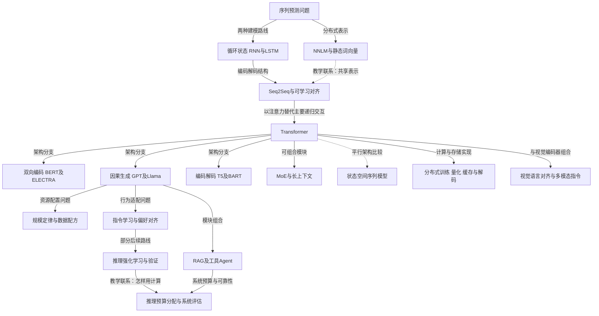

# 大语言模型发展时间线：表示、规模、对齐与推理系统

[论文目录](README.md) · [系列总结](101-系列总结.md)

语言模型并不是从聊天界面开始的。它最初要解决的是一个概率问题：给定前文，下一个词是什么？围绕这个问题形成的表示、优化和计算技术，后来逐步支撑翻译、问答、代码、多模态理解和工具使用。阅读这条时间线时，应始终区分三个层面：模型怎样训练、推理时怎样调用、结果怎样评价。

## 技术地图

图中的实线包括架构分支、模块组合与问题转移，不统一表示“代码直接继承”；虚线明确表示教学联系或平行比较。尤其不能把状态空间模型画成 Transformer 的必然下一代，也不能把日期靠后的方法都当作替代前作。

注意力是一种信息交互运算，Transformer 是包含它的架构；LLM 是规模与用途相关的模型类别。MoE 改变参数如何被激活，LoRA 改变微调时哪些参数可以更新，RAG 改变推理时从哪里取得知识，这三者并不互斥。PPO、GRPO 与 DPO 属于对齐或策略优化路线，也不取代底层语言模型架构。

## 1997—2013：先解决表示共享与长程记忆

| 时间 | 代表论文 | 原有瓶颈 | 新思想及边界 |
|---|---|---|---|
| 1997 | [LSTM](001-lstm.md) | 误差信号沿时间传播时容易衰减 | 为记忆设计可控写入和读出；原论文不是今天所有门控变体的集合 |
| 2003 | [神经概率语言模型](002-nnlm.md) | 离散 n-gram 难以共享相似表达的信息 | 联合学习词向量与条件概率；仍使用有限上下文 |
| 2010 | [RNNLM](003-rnnlm.md) | 固定窗口丢失更早历史 | 用递归状态压缩过去；无限形式上下文不等于可靠长程记忆 |
| 2013 | [word2vec](004-word2vec.md)、[负采样](005-negative-sampling.md) | 高质量词表示训练昂贵 | 简化预测任务、减少输出计算；词向量仍以静态语义为主 |

这组论文把“相似词共享统计规律”和“历史能够影响当前预测”变成可训练机制。两者是不同问题：词向量很好，不代表模型能记住很远的条件；状态持续存在，也不代表梯度足以教会它存什么。

## 2014—2017：从整句压缩到直接访问输入

[Seq2Seq](006-seq2seq.md) 将输入输出长度不同的任务统一为条件生成；[Bahdanau Attention](007-attention.md) 使解码器每一步能够从源序列重新取信息，减轻单向量瓶颈。[Transformer](015-transformer.md) 进一步以注意力为主要序列交互运算，提高训练并行性。

同期，[Adam](009-adam.md)、[Layer Normalization](012-layernorm.md) 改善优化实践；[BPE](011-bpe.md) 让稀有词能够分解为可复用单元；[稀疏 MoE](014-sparse-moe.md) 尝试让参数量增长快于每个样本的计算增长。架构创新与工程条件共同推动规模扩展，不能把全部收益只归因于注意力。

## 2018—2020：预训练成为通用任务接口

| 路线 | 代表论文 | 训练问题 | 迁移方式 |
|---|---|---|---|
| 上下文化特征 | [ELMo](016-elmo.md) | 双向语言建模 | 将上下文表示交给下游模型 |
| 因果生成 | [GPT](017-gpt.md)、[GPT-2](021-gpt2.md)、[GPT-3](035-gpt3.md) | 根据前缀预测后续 | 微调或利用提示中的示例 |
| 双向编码 | [BERT](018-bert.md)、[RoBERTa](023-roberta.md)、[ELECTRA](031-electra.md) | 掩码恢复或替换检测 | 分类、抽取等任务微调 |
| 编码解码 | [T5](027-t5.md)、[BART](028-bart.md) | 文本去噪与统一输入输出 | 文本到文本迁移 |

[规模定律](029-scaling-laws.md) 开始把模型、数据与计算看作可测量的资源分配问题；[Megatron](024-megatron.md) 和 [ZeRO](026-zero.md) 处理大模型训练的设备与内存限制。规模带来能力变化，但实验设计必须说明到底增加了参数、数据、训练步数还是总算力。

知识也开始从参数之外取得：[REALM](030-realm.md) 将检索融入预训练，[DPR](032-dpr.md) 学习稠密检索，[RAG](034-rag.md) 将检索文档作为生成隐变量，[FiD](036-fid.md) 在解码端融合多段材料。检索改善知识访问，却不会自动保证检索正确或引用忠实。

## 2021—2022：高效适配、指令学习与推理提示

[Prefix-Tuning](044-prefix-tuning.md)、[Prompt Tuning](045-prompt-tuning.md) 与 [LoRA](047-lora.md) 研究如何用较少可训练参数适配模型。它们减少的是特定资源，不必然同时减少所有训练显存、推理延迟或数据需求。

[FLAN](050-flan.md) 与 [T0](051-t0.md) 把多任务指令迁移变成训练目标；[InstructGPT](054-instructgpt.md) 通过示范、偏好与强化学习改善指令响应。人类偏好是一个可学习信号，却不能直接等同于事实正确性。

[CoT](053-cot.md) 展示中间推理示例的作用，[Self-Consistency](056-self-consistency.md) 用多次采样与答案聚合，[STaR](055-star.md) 将成功推理用于再训练，[PAL](063-pal.md) 把计算交给程序。这些方法分别改变提示、采样、训练和工具执行，不应笼统称为一种“思维链算法”。

[Chinchilla](057-chinchilla.md) 重新审视计算预算下模型与数据的配比；[FlashAttention](059-flashattention.md) 利用内存层级优化精确注意力；[Speculative Decoding](064-speculative.md) 用廉价草稿减少目标模型串行解码成本。数学运算量与真实速度是两个需要分别测量的指标。

## 2023—2024：模型能力变成系统能力

下表按这一阶段要组合的系统分支组织，因此也回引 CLIP、Flamingo 等更早工作；行内并不是严格的首次发表时间顺序。

| 分支 | 代表论文 | 需要分清的实验对象 |
|---|---|---|
| 开放模型与对齐 | [Llama](068-llama.md)、[Llama 2](078-llama2.md)、[DPO](075-dpo.md) | 基座能力、聊天配方与偏好数据的贡献 |
| 检索与工具 | [Toolformer](067-toolformer.md)、[Self-RAG](082-self-rag.md)、[GraphRAG](090-graphrag.md) | 生成器、检索器、外部语料与索引预算 |
| Agent | [ReAct](060-react.md)、[Reflexion](070-reflexion.md)、[SWE-agent](087-sweagent.md) | 模型参数、界面、记忆、工具与重试次数 |
| 推理服务 | [GPTQ](061-gptq.md)、[QLoRA](074-qlora.md)、[AWQ](076-awq.md)、[vLLM](079-vllm.md) | 量化误差、吞吐、首 token 延迟和显存 |
| 架构 | [Mamba](083-mamba.md)、[Mamba-2](088-mamba2.md)、[Mixtral](084-mixtral.md) | 激活参数、总参数、序列长度与硬件效率 |
| 多模态 | [CLIP](043-clip.md)、[Flamingo](058-flamingo.md)、[BLIP-2](066-blip2.md)、[LLaVA](071-llava.md) | 对齐、桥接模块、视觉输入及指令数据 |

这一阶段最容易出现的误读，是把系统分数提升全部归给底层模型。一次成功可能依赖检索到正确文档、工具执行代码、多个候选中的正确答案被验证器选中。把这些环节拆开，才能复现，也才能判断迁移到新场景是否仍有效。

## 2025—2026：推理学习与计算分配

[DeepSeek-R1](094-r1.md) 与 [DAPO](097-dapo.md) 将验证奖励下的推理训练带到更大规模；[s1](095-s1.md) 研究少量示范与预算控制；[LLaDA](096-llada.md) 探索不同于单向自回归的生成形式。不同路线改变的训练目标与执行方式并不相同。

2026 年的三篇样例把注意力转向系统控制与评价：[验证扩展](098-rubric-verification.md) 研究准则驱动的反馈，[AutoTTS](099-autotts.md) 自动搜索推理预算控制器，[推理扩展评估协议](100-tts-protocol.md) 区分单轨迹、完整候选聚合与前缀搜索。这些工作应结合版本与验证条件阅读，不应仅凭新近发布时间赋予更高证据等级。

## 四次关键接力：旧问题解决后，新瓶颈在哪里？

| 接力 | 前作真正留下的问题 | 下一篇改变的对象 | 仍然没有解决什么 |
|---|---|---|---|
| [Seq2Seq](006-seq2seq.md) → [Attention](007-attention.md) → [Transformer](015-transformer.md) | 固定压缩与递归路径限制输入访问和训练并行 | 逐步读取源状态；进一步改为以注意力为主的层 | 能看到某段输入不保证正确利用；前两篇同在2014年前后出现，应视为问题脉络，不冒称严格发表先后继承 |
| [word2vec](004-word2vec.md) → [ELMo](016-elmo.md) → [BERT](018-bert.md) | 静态词向量无法随语境改变同词表示 | 上下文化特征；双向Transformer预训练 | 这是表示问题的教学接力，不是三个方法共享同一训练目标或代码 |
| [LoRA](047-lora.md) → [QLoRA](074-qlora.md) | 少量更新没有消除冻结基座存储 | 低位宽基座、量化常数压缩与峰值内存管理 | 激活、算子速度和数据质量仍需另测 |
| [GSM8K 验证器](052-gsm8k.md) → [ToT](072-tree-of-thoughts.md) → [推理预算分配](091-test-time-scaling.md) | 正确候选可能稀少，评价器也会选错 | 从完成轨迹筛选到中途搜索，再到按题目分配预算 | 属于问题递进与可组合思路，不代表后一篇无条件优于前一篇 |

同一瓶颈也可以有平行解法。长序列既可减少注意力连接、近似注意力核，也可换用状态空间递推；三者改变的数学对象不同。偏好学习可改标签来源、损失形式或在线采样过程；这些选择可以交叉，不是一条单向升级链。

一个量级检查能帮助读图：LoRA 的“可训练参数少”、GQA 的“KV 头少”、MoE 的“每 token 激活专家少”分别减少不同项。假设总参数、活跃参数、可训练参数分别记作 $N,N_a,N_t$，这三个数即使都以“参数量”为单位，也不应相互替代。冻结模型可能有 $N_t=0$ 却仍要读取和计算大量参数；稀疏模型可能有很大 $N$ 却只使用部分 $N_a$。时间线里的工程路线之所以不断分叉，正是因为它们优化的成本项不同。

## 贯穿时间线的五个问题与判断示范

1. 新论文修改了模型结构、目标函数、数据分布，还是推理调用方式？
   参考判断：[LoRA](047-lora.md)限制可训练更新的参数化，[DPO](075-dpo.md)改变偏好训练目标，[Self-Consistency](056-self-consistency.md)改变推理采样与聚合。先标出被改动的对象，才知道哪些方法可以组合。
2. 新增能力来自学习，还是更多候选、工具与验证？
   参考判断：[ReAct](060-react.md)在冻结模型下引入外部观察，成绩变化属于闭环系统；[STaR](055-star.md)把筛选的推理变成微调数据，才把变化写回权重。固定模型与总推理预算的对照可以区分二者。
3. 成本用参数量、FLOPs、token、延迟还是实际费用衡量？
   参考判断：[GQA](073-gqa.md)直接缩小KV缓存项，[vLLM](079-vllm.md)改善缓存分配与批处理；两者是否降低单请求延迟，要另测负载、输入输出长度和排队。参数比例不能替代服务成本。
4. 评价集测的是任务成功、语言拟合、偏好，还是某种代理指标？
   参考判断：[NNLM](002-nnlm.md)的困惑度测文本概率，[InstructGPT](054-instructgpt.md)的胜率测相对偏好，[SWE-bench](081-swebench.md)用修复与回归测试定义成功。三个百分数或损失没有可直接排序的共同含义。
5. 数据污染、提示调优、答案选择与工具权限是否进入了比较条件？
   参考判断：比较[Codex](048-codex.md)与后续验证器时，先分清隐藏测试是否被用来选答案；比较工具系统时，再固定可访问文件、执行权限和重试次数。测试答案只能用于诊断上界，不能提供给普通部署的选择器。

把这些判断放进自己的实验，继续读[系列总结的三个受控方案](101-系列总结.md)：它们分别隔离数据配比、适配参数与推理资源，而不是沿年份给论文排出统一胜负。
