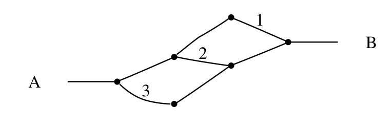
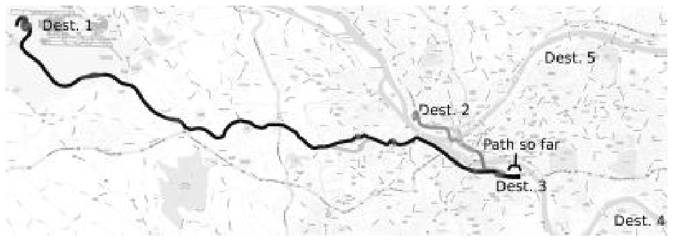
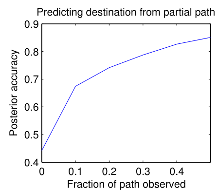

# 第 100 天｜Maximum Entropy IRL：匹配专家特征之后，如何选择行为分布

[系列首页](README.md) · [上一篇](99-apprenticeship-irl.md) · [系列收尾](61-系列收尾.md)

**原论文与版本**：Brian D. Ziebart、Andrew Maas、J. Andrew Bagnell、Anind K. Dey，*Maximum Entropy Inverse Reinforcement Learning*，AAAI 2008，pp.1433–1438。[AAAI官方公告](https://aaaipress.org/Pressroom/Releases/release-08-0710.php)给出的会议日期是2008年7月13–17日，地点Chicago；未核定早于会议的首次预印本公开日期。本文核读[CMU Robotics Institute保存的2008年6页原版](https://publications.ri.cmu.edu/storage/publications/pub_files/2008/7/AAAI2008-bziebart.pdf)，并对照[作者提供的纠错版](https://www.cs.cmu.edu/~bziebart/publications/maxentirl-bziebart.pdf)的Algorithm 1。[作者出版页](https://www.cs.cmu.edu/~bziebart/publications/maximum-entropy-inverse-reinforcement-learning.html)明确说明修正了原算法的off-by-one错误；纠错PDF首页版权栏写2010，不应据此把论文首发年改成2010，也不能将它称为原样2008版。未核实精确的修订发布日期。

### 接住上一章留下的自由度

[上一篇学徒IRL](99-apprenticeship-irl.md)告诉我们：线性奖励下，匹配累计特征就能匹配期望回报。但特征相同的行为可能非常多，混合策略也可能不唯一。假如三条路线具有相同的总成本，模型为什么偏爱其中一条？如果偏爱只是算法初始化或道路分叉结构造成的，它就是数据没有支持的额外判断。

这篇论文把输出从“一个可用策略或策略集合”进一步变成“轨迹上的概率分布”。在满足示范特征约束的分布中，选择熵最大的那个。它使不完美示范能够具有非零概率，也使路线预测、部分轨迹补全和目的地推断进入统一的概率语言。这里的核心不是随便给策略加一点随机性，而是明确整个轨迹空间怎样归一化。

### 五个前置概念

1. **轨迹特征f(τ)**：一条轨迹各步特征的和，描述总长度、转弯次数等累计属性。
2. **最大熵分布**：满足给定约束后，不额外偏爱某个可行结果的分布。
3. **配分函数Z**：对所有允许轨迹的指数权重求和，使概率总和为一。
4. **状态访问频率**：一个轨迹分布平均访问各状态的次数，不必加起来等于一。
5. **因果策略**：每一步只能根据当时已知的信息选动作，不能利用尚未发生的随机结果。

第五点是理解版本边界的钥匙。2008年论文在确定性环境中的最大熵轨迹分布，不能不加说明地替换成后来为随机环境发展出的最大因果熵方法。二者在某些条件下相同，但推导对象和对随机转移的处理不同。

## 一、问题设定：特征告诉我们什么，概率还缺什么

设环境结构已知，先考虑确定性转移；固定起点、终点和一套有限的允许轨迹集合Ω。对τ∈Ω，特征f(τ)=Σ_tφ(s_t)，候选累计奖励为θᵀf(τ)。从m条示范计算平均特征f̄_E。本文先使用有限时域，避免无限条含环路径造成的归一化问题；不同起终点样本应分别条件化，各有自己的Z，而不是共享一个不区分任务的常数。

最大熵问题是

$$\max_{p}\ -\sum_{\tau\in\Omega}p(\tau)\log p(\tau),\quad
\sum_{\tau}p(\tau)=1,\quad
\sum_{\tau}p(\tau)f(\tau)=\bar f_E,\quad p(\tau)\geq0.$$

这不是要求每条轨迹的特征等于专家平均，也不是要求所有路径等概率。若专家平均表明它经常避开昂贵道路，约束本身就支持这种偏好；最大熵只消除约束之外的额外偏好。它同样不是对奖励参数θ求最大熵，随机对象首先是行为轨迹。

可行性值得先检查。若候选路径过滤后，专家特征落在其凸包之外，严格等式约束根本无解。若目标落在边界，最大熵分布可存在，但有限θ未必能表达它，最优参数可能沿某个方向趋于无穷。实践用正则或允许特征误差来缓和这些问题，代价是不能再无条件宣称精确特征匹配。

对于有限Ω，熵对p严格凹，因此可行分布上的最大值有唯一分布解。但这不表示θ唯一。若两个特征总是重复，或某个特征对所有候选轨迹都是相同常数，就会有参数不可识别方向。行为分布唯一与真实奖励可识别是两个不同的问题。

## 二、从约束到指数族，再从似然回到特征匹配

引入归一化乘子c和特征乘子θ，把拉格朗日函数写成

$$\mathcal L(p,\theta,c)=-\sum_\tau p_\tau\log p_\tau
+\theta^\top\left(\sum_\tau p_\tau f_\tau-\bar f_E\right)
+c\left(\sum_\tau p_\tau-1\right).$$

对内部点p_τ求导，得到−log p_τ−1+θᵀf_τ+c=0。整理归一化项后，

$$p_\theta(\tau)=\frac{\exp(\theta^\top f(\tau))}{Z(\theta)},\qquad
Z(\theta)=\sum_{\tau\in\Omega}\exp(\theta^\top f(\tau)).$$

对应原文确定性情形式(2)。两条轨迹的概率比为exp(θᵀ(f₁−f₂))：只比较总奖励差。相同总奖励给出相同概率，而不是因为某条路线中间分叉多，就被额外惩罚。

### 梯度是“示范次数减去模型次数”

固定同一条件Ω时，每条示范平均对数似然为

$$\ell(\theta)=\theta^\top\bar f_E-\log Z(\theta),\qquad
\nabla\ell(\theta)=\bar f_E-\mathbb E_{p_\theta}[f(\tau)].$$

因为∇logZ=Σ_τp_θ(τ)f(τ)。某个特征在专家中比模型中出现得更多，沿梯度上升就增大相应权重；反之降低。模型期望随θ变化，不能把它作为一次性统计永远缓存。多个起终点的情况，是对每个样本条件下的模型期望求平均，再与总体示范平均比较。

继续求导得到

$$\nabla^2\ell(\theta)=-\operatorname{Cov}_{p_\theta}[f(\tau)]\preceq0.$$

所以**对数似然凹，负对数似然凸**。原文相邻文字把待最大化的函数称为convex，阅读时应依据符号澄清，而不是照抄成“最大化凸函数”。有限参数、无正则且达到内部最优时梯度为零，才得到精确特征匹配。加入L₂正则后，条件变成f̄_E−E[f]=λθ；L₁正则也会带来次梯度条件，不再要求每个特征残差严格为零。

匹配得到的回报关系仍依赖线性奖励族，和上一章相同。但最大熵额外给出一个可评价示范似然的分布，因而可以区分“最可能路线预测得好”与“给所有实际路线分配合理概率”这两种指标。不能因为平均似然提高，就宣称识别了人类偏好的因果机制。

## 三、原图2：局部等概率为什么不是全局等概率


<figure id="rl-100-figure-2" class="reading-evidence-figure"><a href="/rl/assets/papers/100-maximum-entropy-irl-figure-2.png" target="_blank" rel="noopener noreferrer"></a><figcaption>原论文图形摘引｜Ziebart等，AAAI 2008原版，PDF第4页Figure 2。<a href="https://publications.ri.cmu.edu/storage/publications/pub_files/2008/7/AAAI2008-bziebart.pdf#page=4">核对原文</a>。完整保留A、B、路径编号与连线，原版权保留。</figcaption></figure>

这张图是路径结构示意，没有数值坐标轴。A到B有三条可行路线，上侧最初的分支以后还能分成1和2，下侧给出3。假设三条总奖励相同，按轨迹全局归一化，各自概率都是1/3。

若在每个分叉局部根据最优后续价值Q*做softmax，因为两条分支的最优价值相同，第一次分叉各取1/2，上方再均分，于是路径1、2、3概率分别为1/4、1/4、1/2。下方并不是更受示范偏爱，只是它后面没有再分叉。这就是文中用来解释label bias的例子。

反过来，全局模型的第一处分支概率应是上方2/3、下方1/3；到了上方再各取1/2，三条路径便全部是1/3。因此“最终实现为局部动作概率”并不是错误，关键是这些局部概率由完整后续路径质量推导，而不是仅看最优后续路径。区别在于sum over paths与max over paths，不能概括成“凡是局部策略都错误”。

这里的路径集合也属于模型的一部分。人为复制一条本来相同的轨迹，会改变计数基准与配分函数，进而改变概率。最大熵从来不是脱离表示的客观无知；必须先讲清楚什么被当作一个结果、哪些路径允许、重复和终止怎样处理。

## 四、有限时域动态规划：不枚举指数多的轨迹

为给出边界完全明确的实现，下面用**确定性、恰好H个动作**的教学版本；不是逐字复刻原Algorithm 1的可变终止写法。令s'=F(s,a)，每步奖励r_θ(s,a)=θᵀφ(s,a)，时刻H到达允许终态时后缀权重Z_H(s)=1，其他状态为0。若不限制终态，全部设为1。动作次数和特征计数都以t=0,…,H−1为准，终态特征需要时另行加入。

反向递推：

$$Z_t(s,a)=\exp(r_\theta(s,a))Z_{t+1}(F(s,a)),\qquad
Z_t(s)=\sum_a Z_t(s,a),\qquad
\pi_t(a\mid s)=\frac{Z_t(s,a)}{Z_t(s)}.$$

Z_t(s)是从当前状态出发的全部合法后缀质量。Z=0表示在剩余时域内无可行终止路径，必须屏蔽，而不是除以零后继续训练。对固定起点s₀，完整配分函数是Z₀(s₀)。概率乘积的后缀因子会望远镜式抵消，留下exp(Σr)/Z₀，证明此策略确实实现目标轨迹分布。

为了防止指数溢出，用V_t=logZ_t，在log域写为

$$V_t(s)=\operatorname{logsumexp}_a\left[r_\theta(s,a)+V_{t+1}(F(s,a))\right].$$

这里logsumexp带来的“软”并不等于任意随机环境下都能直接照搬。我们还没有让自然随机地选择后继状态，确定性假设仍然在F里。

再从d₀(s)=D(s)正向传播：

$$d_{t+1}(s')=\sum_{s,a:\,F(s,a)=s'}d_t(s)\pi_t(a\mid s),\qquad
\mathbb E[f]=\sum_{t=0}^{H-1}\sum_{s,a}d_t(s)\pi_t(a\mid s)\phi(s,a).$$

对固定起点时D为单点分布。对不同起点的数据，保持观测条件分别计算，或者在固定D下对条件期望加权；不能让一个全局Z重新加权本应给定的初态概率。d_t每个时刻的质量为一，但Σ_td_t(s)是期望访问次数，所有状态合计为H；它不是另外一个总和为一的状态分布。

```text
输入：确定性转移F，示范及其起终点条件，特征φ，时域H
初始化θ
重复直到目标和梯度残差稳定：
    对每一类起终点条件：
        设置终端logZ_H为0或负无穷，标明允许终态
        从H-1倒推到0，计算动作log权重与logsumexp
        用相减后指数化得到π_t，检查每个可达状态动作和为1
        从固定初态分布正向传播d_t
        按和示范相同的时间范围累计模型特征
    g ← 示范平均特征 - 各条件模型期望的平均
    θ ← θ + 学习率 × g          # 梯度上升，或使用合适的优化器
    若加正则，更新式和精确匹配判据一起修改
输出：θ，以及在指定条件和时域下的轨迹分布/策略
```

原文Algorithm 1也是后向权重、动作概率、前向访问频率这三个部分；作者纠错版修正了前向传播索引。本文重写成显式时间下标，是为了不把时域边界藏进“迭代N次”。可变长度路径若到终点就结束，应只计一次终止；若用吸收状态补齐到H，需保证补齐只有一种零特征延续，不能每个终止时刻又制造多条重复路径。无限路径和是否收敛还需额外检查，不能只说奖励有折扣就自动保证对任意轨迹计数空间的Z有限。

## 五、独立算例：三个路径的配分函数、梯度和曲率

用一个有限确定性任务，只有三条路径，单维特征分别为f₁=0、f₂=1、f₃=2。设示范平均为1.5。θ=0时，指数权重都是1，Z=3，模型期望为1，梯度为0.5。因此上升方向是增大θ，让高特征路径更常出现。

取θ=log2，三个权重是1、2、4，Z=7：

- 路径概率为(1/7,2/7,4/7)。
- 模型期望为(0+2+8)/7=10/7≈1.428571。
- 平均对数似然为1.5log2−log7≈−0.906189。
- 梯度为1.5−10/7=1/14≈0.071429。
- E[f²]=(2+16)/7=18/7，方差为18/7−100/49=26/49，所以二阶导为−26/49≈−0.530612。

这组数可以同时检查程序的softmax、归一化、前向期望和梯度符号。若代码给出的梯度为−1/14，很可能把负对数似然最小化和对数似然最大化混在一起。

还可以独立求最优解。令x=expθ，要求(x+2x²)/(1+x+x²)=1.5，整理为x²−x−3=0，取正根x=(1+√13)/2≈2.302776，故θ≈0.834115。此时概率约为(0.116204,0.267592,0.616204)，期望恰好1.5。最大熵模型并没有只选择特征最大的第三条路径，也没有要求每条生成轨迹都取1.5这个根本不存在的特征值。

若所有示范都取第三条路径，平均特征是2，有限θ时其余两条仍有正概率，期望严格小于2。要精确达到边界需θ→+∞。加入正则后参数保持有限，残差也会非零。这是“训练不精确匹配”可能完全正常的原因，不能把任何非零梯度都归为实现bug。

## 六、随机动力学：2008年的近似为什么不能叫最大因果熵

原文先讨论一个随机结果配置o：它指定各动作的结果，使环境在给定o后成为确定性环境。严格的条件化表达对所有o求和，每个o有自己的配分函数Z(θ,o)。原文式(3)正是

$$p(\tau\mid\theta,T)=\sum_o P_T(o)\frac{e^{\theta^\top f(\tau)}}{Z(\theta,o)}\mathbf1\{\tau\text{兼容}o\}.$$

这个计算一般不可 tractable。论文进一步假设转移随机性对行为的影响有限，并近似把不同o的配分函数当成相同，于是得到式(4)：

$$p(\tau\mid\theta,T)\approx\frac{e^{\theta^\top f(\tau)}}{Z(\theta,T)}\prod_t T(s_{t+1}\mid s_t,a_t).$$

乘上转移概率不是问题自动解决了。全局按奖励重新加权轨迹，会改变随机结果在条件分布中的权重；从这样的轨迹模型提取动作概率，再回到原始随机环境执行，所得分布未必相同。尤其不能把后向的“转移概率乘以指数后续价值”与前向保持原T的采样，未经证明就拼成精确的特征梯度。

### 一个没有动作选择也能暴露问题的反例

以下是本文独立构造。只有一个动作，环境等概率到达终点x或y，终点特征分别为0和1，θ=log3。真实执行中无论智能体怎样“优化”，x、y概率都只能各为1/2，期望特征始终是1/2。

若直接使用式(4)的全局指数倾斜，两条轨迹的未归一化权重是(1/2)×1和(1/2)×3，归一化后为1/4和3/4，期望变成3/4。这不是一个能在原T下执行的控制策略。问题来自把幸运的自然结果奖励得更高，而不是从示范学会了一个可选动作。

反例也说明式(3)到式(4)的近似在哪里失效。只有一条可行轨迹的结果配置各有不同Z，分别为1和3；在每个配置内归一化以后再按P_T(o)平均，会保留各1/2。忽略这些分母的差异才得到3/4。因而不能把这个近似用于任意随机任务，并沿用确定性情况下的精确似然梯度解释。

### 与后来方法的最小对照

后来的最大因果熵约束动作只依赖过去与当前信息，并保持环境转移机制不由智能体选择。它在有限时域下的常见递推是Q_t(s,a)=r(s,a)+E_T[V_{t+1}(s')]，再以V_t(s)=logΣ_a expQ_t(s,a)获得策略。这里是**先对后续价值求期望，再对动作指数化**；全局轨迹倾斜的后向项涉及E_T[expV]，次序不同。[作者对最大因果熵的说明](https://www.cs.cmu.edu/~bziebart/)明确指出确定性动力学时会退化到2008年的分布。这个对照只用于界定边界，不把后来的保证移植给原论文。

还有一个词义边界：“因果”在这里首先指信息到达顺序与可实施策略约束，不是从示范数据识别社会科学意义上的因果效应。原2008年模型给某条路线更高似然，更不能证明某个道路属性改变会因果地改变人的选择。

## 七、原始出租车实验：路径匹配与概率预测分开评价

原文的主要实证是匹兹堡道路网，建模为确定性MDP：超过30万个状态代表路段，约90万个动作代表路口转移。道路的真实行驶时间当然可能随机，但论文的路线选择图把选定路段后的图转移作为确定性，因此实验不能验证前一节近似对一般随机控制问题的可靠性。

数据来自25位出租车司机、12周、超过3000小时与10万英里行驶。GPS经粒子滤波匹配到道路网，约分成13000次出行；丢弃约30%过短、过度绕圈或噪声过大的行程，其余20%用于训练、80%用于测试，测试集为7403条。这里训练与测试比例不是常见的80/20，不能凭习惯倒写。

特征描述道路类型、速度、车道数量和转弯类别，共22种计数。各次出行终点不同，模型假设奖励权重不随终点改变。实际训练只在一个较小且固定的“合理路径”集合上归一化，而不是穷举道路网中所有指定时域以内的路径。候选集合缩小了计算量、限制环路，也限定了概率模型的支持集；把这项成绩拿来支持任意全路径空间的精确推断是不成立的。

### 原表1的数字怎样读

下列为2008原版PDF第5页Table 1的选列；不是本文复现实验。

| 模型 | 平均路线距离匹配 | 至少90%距离匹配的样本比例 |
|---|---:|---:|
| 按时间最短路线 | 72.38% | 43.12% |
| Maximum Margin Planning | 75.29% | 46.56% |
| Action模型最可能路线 | 77.30% | 50.37% |
| Action学得成本的最短路线 | 77.74% | 50.75% |
| MaxEnt paths | 78.79% | 52.98% |

第一列关心预测路径和真实路线共享多少距离，第二列是超过90%阈值的样本比例，二者不可互换。相对Action最可能路线，MaxEnt提高1.49个百分点和2.61个百分点，而不是提高1.49%和2.61%的相对比例。相对Maximum Margin，分别提高3.50和6.42个百分点。Action(costs)还特意区分了“其概率模型最可能路线”和“使用其学得成本的最低成本路线”，呼应局部归一化可能改变路径排序的问题。

原表还报告Action平均log probability为−7.91、MaxEnt为−6.85。较大值意味着模型对观测路径分配更高几何平均概率，但不应直接说“准确率提高1.06”。更重要的是正文评价段把第三指标写为training set，而表注明确写withheld paths，这两处口径不一致。本文保留原表数字及这个矛盾，不擅自消除它，更不把它扩写成已确认的严格测试集似然结论。原文报告显著性α<0.01，但这里没有重新取得逐样本数据计算显著性或置信区间。

这也不是现代随机种子大规模基准。道路网、司机群体、路径筛选、特征与候选集合共同组成评价条件；没有因此证明对所有城市、司机和交通情境都适用。用固定22维特征得到可观的预测能力，是结构化概率建模的实证价值，不能拔高成无需建模成本的通用奖励恢复。

### 目的地推断为什么是自然扩展

有了每个目的地下的路线分布，可以根据已观察前缀更新目的地后验：p(g|前缀)∝p(前缀|g)p(g)。前缀似然要把所有兼容的后续路线求和，而不只挑一条最短续接。原文用五个候选目的地展示这种推断，先验从训练数据估计，并随已观察路径比例增加评价预测。


<figure id="rl-100-figure-4" class="reading-evidence-figure"><a href="/rl/assets/papers/100-maximum-entropy-irl-figure-4.png" target="_blank" rel="noopener noreferrer"></a><figcaption>原论文图形摘引｜Ziebart等，AAAI 2008原版，PDF第5页Figure 4。<a href="https://publications.ri.cmu.edu/storage/publications/pub_files/2008/7/AAAI2008-bziebart.pdf#page=5">核对原文</a>。保留完整图形、坐标与图例，原版权保留。</figcaption></figure>

原图4把五个目的地放在同一地图上，并标出已经走过的路径。正文指出，已观察路径朝西行驶，对东侧目的地3、4、5是低效率的前缀，因此后验主要集中到1和2，二者之间还受先验影响。它是一个条件预测示例，不是地图上的粗线都具有相同后验，也没有给出足以精确读出各目的地概率的数值图例。


<figure id="rl-100-figure-5" class="reading-evidence-figure"><a href="/rl/assets/papers/100-maximum-entropy-irl-figure-5.png" target="_blank" rel="noopener noreferrer"></a><figcaption>原论文图形摘引｜Ziebart等，AAAI 2008原版，PDF第6页Figure 5。<a href="https://publications.ri.cmu.edu/storage/publications/pub_files/2008/7/AAAI2008-bziebart.pdf#page=6">核对原文</a>。保留完整图形、坐标与图例，原版权保留。</figcaption></figure>

原图5横轴为已观察路径占完整路径的比例，纵轴为Posterior accuracy。在这个五目的地设定中，曲线随观察比例增大而上升；它不是全部城市道路上任意目的地的识别率。图中没有误差条，本文不从曲线像素反推出显著性、逐点精确值或置信区间。该任务的先验来自训练数据，评价使用留出数据，与前述路径似然栏目的文字矛盾应分别处理。

这并不意味着目的地一定可以识别。若两个目的地在已走前缀上同样合理，后验主要由先验决定。若真实目的地根本不在候选集合里，模型仍会在错误候选间归一化并可能显得自信。概率形式让这些条件可以被清楚表达，却不会自动补足漏掉的目标或上下文。

## 八、实现与解释的边界：第100篇不是一个万能终点

复现时应先在极小图上枚举所有路径，与动态规划的Z、访问次数和有限差分梯度逐项对照。其次核验目标条件、终态计数、路径长度和候选过滤是否同时用于训练与评价。最后才在大图使用稀疏转移、log域计算与优化器。只看loss下降，无法发现终点重复计数或模型期望与执行策略不一致。

奖励参数还受到尺度、特征单位和隐含温度影响。公里换成米，最优权重数值会相应变化；这不代表司机偏好发生改变。同样，常量特征在固定长度下不可识别，在可变长度下却可能控制路径长度偏好。解释参数之前必须先问特征究竟怎样累计。

若示范中混有不同司机、目的、天气和交通约束，一个固定奖励向量可能只是群体折中。高熵既可能反映真实随机选择，也可能掩盖未建模的上下文。不能把“随机性很大”自动翻译成人类不理性，也不能把奖励拟合得好当成确定了个人价值观。

与[第23天GAIL](23-gail.md)对照时，可比较手工特征匹配与判别器学习的行为差异；与后来偏好式RL对照时，可比较完整示范与成对偏好标签提供的信息。它们共享“奖励未直接给定”的问题意识，但本篇不据此宣称直接算法继承，更不把训练似然、偏好准确率和下游真实回报混作同一个指标。

从这最后一篇回看整个系列，策略优化、价值估计、模型学习、探索、多智能体和奖励学习解决的是不同层面的不确定性。把某一层的成功当成另一层也已解决，是阅读论文时最常见的过度推断。继续阅读[系列收尾](61-系列收尾.md)，可以把这些方法重新放回各自的假设、信息来源与验证标准中。

## 九、三个追问

<details><summary>追问1：最大熵意味着探索时应该随机走所有路线吗？</summary>

不是。这篇论文在给定示范约束下估计行为分布，熵用于处理解释上的欠确定性。它没有在优化未知任务中的信息收益，也不保证生成每条路线都安全。需要安全约束时，应先在允许的策略或轨迹空间中明确约束，不能期待最大熵自行排除危险行为。

</details>

<details><summary>追问2：只要把转移概率乘进轨迹权重，随机环境就处理完整了吗？</summary>

没有。乘积保留的是一个基准权重，全局奖励倾斜仍可能改变自然结果的条件概率。只有一个动作的反例已说明生成模型分布可能无法执行。必须核对随机结果配置的归一化假设，或采用明确处理因果策略与固定动力学的方法，而不能静默把2008近似替换成后来算法。

</details>

<details><summary>追问3：训练特征恰好匹配，是否证明找到了真实奖励？</summary>

不能。匹配限制的是轨迹统计，奖励仍可能存在冗余和不可识别方向；训练分布之外的行为还可能不受约束。它可以支撑指定线性奖励族中的回报关系和所设概率模型中的似然解释，却不能证明心理动机、因果机制或新环境中的性能。

</details>

## 自测两题

<details><summary>自测1：三条路径特征为0、1、2，θ=log2，示范平均特征为1.5。梯度上升应增大还是减小θ？</summary>

应增大。Z=7，模型期望10/7，梯度1.5−10/7=1/14。若用负对数似然最小化，梯度符号相反，但参数更新方向相同。忽略Z的导数会错误地一直沿1.5增大参数。

</details>

<details><summary>自测2：模型A在每个分叉上均匀选动作，模型B在全部等奖励路径上均匀选路径。它们一定相同吗？</summary>

不一定。原图2中A的路径概率为1/4、1/4、1/2，B则各为1/3。B也能由局部策略实现，但第一处分叉需按后缀路径质量选上方2/3、下方1/3。差别不是有没有局部动作概率，而是这些概率是否经过全局后缀信息校准。

</details>

**一句话带走**：最大熵IRL把“足以解释示范”变成一个可计算的轨迹分布；它增加了概率建模原则，却没有取消特征、动力学、路径空间和可识别性的边界。

[系列首页](README.md) · [上一篇](99-apprenticeship-irl.md) · [系列收尾](61-系列收尾.md)
