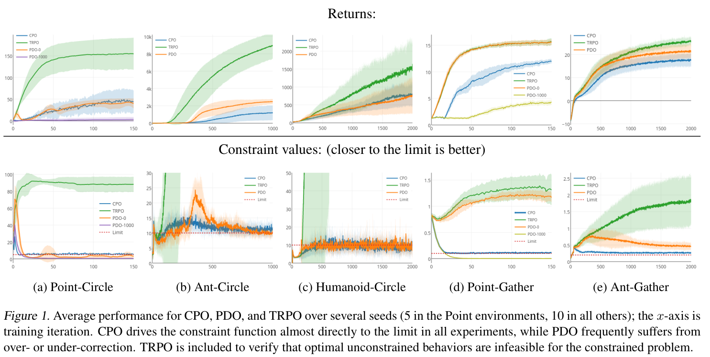

# 第 61 天｜CPO：追求更高回报时，怎样把代价预算写进每次更新

[系列首页](README.md) · [上一篇](60-draco.md) · [下一篇](62-qr-dqn.md)

**原论文与版本**：Joshua Achiam、David Held、Aviv Tamar、Pieter Abbeel，*Constrained Policy Optimization*。首次公开预印本为 [arXiv v1，2017-05-30](https://arxiv.org/abs/1705.10528)；正式发表于 **ICML 2017，PMLR 70:22–31**。本文以 [PMLR 正文](https://proceedings.mlr.press/v70/achiam17a/achiam17a.pdf)及[补充材料](https://proceedings.mlr.press/v70/achiam17a/achiam17a-supp.pdf)为依据，编号顺序不代表发表时间顺序。

### 先接住前作的问题

[TRPO](14-trpo.md)限制新旧策略的距离，避免旧数据支持的好方向走得太远。但“更新很稳”不等于“行为满足要求”：机器人完全可能稳定地学会越过危险边界。CPO 在信赖域之外，再加入明确的代价预算，把“这一步能提高多少奖励”和“这一步预计花掉多少安全余量”放进同一个局部优化问题。

[DRACO](60-draco.md)讨论没有成功验证器时怎样生成奖励并分配信用；这里切换到另一条研究线：奖励和代价已经给定，优化器怎样协调它们。两篇之间是教学议题切换，不是算法继承。

## 一、问题设定：高回报策略可能恰好违反行为约束

考虑折扣约束马尔可夫决策过程（CMDP）。策略与环境交互得到奖励 $R$，同时产生一个或多个代价 $C_i$。目标是最大化期望回报，但每种期望累计代价不能超过预先给定的阈值 $d_i$：

$$J(\pi)=\mathbb E_{\tau\sim\pi}\!\left[\sum_{t\ge0}\gamma^tR_t\right],\qquad J_{C_i}(\pi)=\mathbb E_{\tau\sim\pi}\!\left[\sum_{t\ge0}\gamma^tC_{i,t}\right].$$

$$\max_\pi J(\pi)\quad\text{s.t.}\quad J_{C_i}(\pi)\le d_i,\ i=1,\ldots,m.$$

这里初始状态分布固定，$0\le\gamma<1$。预算限制的是**轨迹分布上的期望累计代价**，不是每个动作绝不违规，也不是每条轨迹都满足上限。把越界指示量当作代价，约束的就是折扣累计越界量，不能直接改称“零碰撞保证”。见原文 §3–4（PDF 第2–3页）。

| 要素 | 本文设定 |
|---|---|
| 研究场景 | 单智能体、on-policy、连续控制 CMDP |
| 状态／观测 | 模拟机器人状态，Gather 另有任务观测 |
| 动作 | 高斯随机策略输出的连续控制 |
| 奖励与代价 | Circle 鼓励绕圈但限制越界；Gather 收集苹果并限制碰到炸弹 |
| 终止／边界 | 理论采用无限时域折扣目标；实验为有限 rollout，截断与真终止需分别处理 |
| 优化目标 | 在代价预算内提升任务回报，关注训练中间策略而不只看最终策略 |

### 五个前置概念

1. **CMDP**：在 MDP 中额外规定期望代价约束，预算与奖励不是同一个量。
2. **代价优势 $A_C^\pi$**：相对当前策略的平均动作，某动作增加或减少多少预期代价；正值在约束上通常是不利信号。
3. **替代目标**：用旧策略访问的状态估计新策略收益或代价变化，避开直接采集每个候选策略的数据。
4. **信赖域**：用 KL 散度限制策略变化，约束替代估计的局部适用范围。
5. **拉格朗日乘子**：约束紧张时，给代价梯度的权重；CPO 每次局部求解重新决定它，不是固定惩罚系数。

## 二、从性能差界推到奖励、代价和 KL 的联合更新

### 先解释旧状态分布替代了什么

令 $d_\pi(s)=(1-\gamma)\sum_{t\ge0}\gamma^tP(s_t=s\mid\pi)$ 为归一化折扣状态分布，$A^\pi=Q^\pi-V^\pi$ 为奖励优势，$A_C^\pi$ 为把奖励换成代价得到的优势。性能差恒等式是

$$J(\pi')-J(\pi)=\frac{1}{1-\gamma}\mathbb E_{s\sim d_{\pi'},a\sim\pi'}[A^\pi(s,a)].$$

真正难点是 $d_{\pi'}$：每试一个新策略都收集足够轨迹，成本太高。CPO 和 TRPO 一样改用 $d_\pi$。动作分布用重要性比 $\rho=\pi'(a\mid s)/\pi(a\mid s)$ 修正；这要求旧策略在需要估计的动作上有支持，且**不会修正状态访问分布的变化**。

CPO 的理论贡献之一，是把误差与旧状态分布下的**平均**策略散度联系起来。取

$$\epsilon_C^{\pi'}=\max_s\left|\mathbb E_{a\sim\pi'}[A_C^\pi(s,a)]\right|,\qquad \bar D_{KL}(\pi'\|\pi)=\mathbb E_{s\sim d_\pi}D_{KL}(\pi'(\cdot\mid s)\|\pi(\cdot\mid s)).$$

由原文 Corollary 2 的平均总变差界，再用 Pinsker 不等式和 Jensen 不等式，有

$$J_C(\pi')\le J_C(\pi)+\frac{1}{1-\gamma}\mathbb E_{d_\pi,\pi'}[A_C^\pi]+\frac{\sqrt{2\bar D_{KL}(\pi'\|\pi)}\,\gamma\epsilon_C^{\pi'}}{(1-\gamma)^2}.$$

因此与 TRPO 那篇的理论讨论相比，不能笼统说“所有理论只允许最坏状态 KL”。CPO 这里确实有平均 KL 的理论界；但它仍含全状态最大优势量 $\epsilon_C^{\pi'}$，以及真实分布期望，而不是只有有限批次的平均 KL。见正文 §5.1–5.2、式(6)–(7)（PDF 第4页）。

### 精确保守界与实际 CPO 必须分开读

如果优化奖励下界，同时让每种代价的完整上界不超过预算，原文 §5.3 描述了有严格前提的保守更新；初始可行和精确量是关键。这个完整界在 $\gamma$ 接近1时可能非常保守。

实际提出的 CPO 式(10)移去显式误差项，以 KL 预算控制它：

$$\max_{\pi'}\mathbb E_{d_\pi,\pi'}[A^\pi]\quad\text{s.t.}\quad J_{C_i}(\pi)+\frac{1}{1-\gamma}\mathbb E_{d_\pi,\pi'}[A_{C_i}^\pi]\le d_i,\quad\bar D_{KL}(\pi'\|\pi)\le\delta.$$

于是 Proposition 2 给出的仍是**近似满足约束**：$J_{C_i}(\pi')\le d_i+\sqrt{2\delta}\gamma\epsilon_{C_i}^{\pi'}/(1-\gamma)^2$，并非严格 $J_{C_i}(\pi')\le d_i$。理论量若不精确，后面还要再承担估计和求解误差。把摘要中的安全措辞直接当作神经网络每轮零违规承诺，会漏掉这些层次。

### 局部二次问题：自然梯度要扣掉多少代价方向

令参数增量 $x=\theta'-\theta$，$g$ 是奖励替代目标的梯度，$b_i$ 是**包含 $1/(1-\gamma)$ 缩放**的代价替代目标梯度，$c_i=J_{C_i}(\pi)-d_i$ 是当前超额量。$H$ 是旧参数处平均 KL 的 Hessian。线性化目标和代价，二次化 KL，得到正文式(11)：

$$\max_x g^\top x\quad\text{s.t.}\quad c_i+b_i^\top x\le0,\qquad\frac12x^\top Hx\le\delta.$$

对单约束，使用与上式一致的拉格朗日函数

$$\mathcal L(x,\lambda,\nu)=g^\top x-\nu(c+b^\top x)-\lambda\left(\frac12x^\top Hx-\delta\right),\quad\lambda,\nu\ge0.$$

在 $H$ 正定且 $\lambda>0$ 的常规情形，驻点满足

$$g-\nu b-\lambda Hx=0\quad\Longrightarrow\quad x=\frac1\lambda H^{-1}(g-\nu b).$$

这就是式(13)的单约束形式。约束不活跃时 $\nu=0$，退回 TRPO 型自然方向；约束活跃时，$\nu$ 由本轮预算余量和几何关系决定。多约束时把 $\nu b$ 换成 $B\nu$。共轭梯度求解 $H^{-1}g$、$H^{-1}b_i$，不显式构造逆矩阵。真实 Fisher 可能仅半正定，数值阻尼和退化分支不能省略。

补充材料 §10.2 的 Theorem 2 给出单约束解析分支，采用**最小化目标、$x^\top Hx\le\delta$**的记号。搬公式时必须同步转换符号和因子2；本文按正文式(11)自行展开驻点式，不把两套符号混用。强对偶的严格可行条件也不能略过。

### 手算：为什么最好的可行方向不再沿奖励梯度

以下是教学构造，不是论文实验。取 $H=I$、$g=(1,1)$、$b=(1,0)$、$c=-0.2$、$\delta=0.5$。可行条件是 $x_1\le0.2$ 和 $x_1^2+x_2^2\le1$。

没有代价约束时，最优步为 $(1/\sqrt2,1/\sqrt2)$，但 $c+b^\top x\approx0.5071>0$，预计超预算。加入约束后，解为

$$x^*=(0.2,\sqrt{0.96})\approx(0.2,0.979796).$$

代入有 $c+b^\top x^*=0$，$\frac12\|x^*\|^2=0.5$，奖励线性增益约1.179796。由第二维得 $\lambda=1/\sqrt{0.96}\approx1.020621$，第一维得 $\nu=1-0.2\lambda\approx0.795876\ge0$，驻点、可行性、互补条件均满足。也可在圆上检查 $f(t)=t+\sqrt{1-t^2}$ 在 $-1<t\le0.2$ 单调增加，直接确认最大值在 $t=0.2$。

如果只把 $c$ 改为1.2，则要求 $x_1\le-1.2$，与单位圆没有交集。纯降低代价的恢复步 $(-1,0)$ 只能把超额量从1.2减到0.2，不能一轮恢复可行。保持旧参数也仍然超限。这说明“恢复步骤”是减轻违反程度的机制，不是凭空制造可行解。

## 三、把局部解变成可执行的一轮训练

原文 Algorithm 1 与 §6（PDF 第5–6页）明确区分可行子问题与恢复分支。单约束恢复方向为

$$x_{\mathrm{rec}}=-\sqrt{\frac{2\delta}{b^\top H^{-1}b}}H^{-1}b.$$

分母退化或求解不稳定时不能直接应用此式。以下伪代码是带工程边界说明的教学重述，不声称是作者代码逐行转录：

```text
冻结旧策略，收集 on-policy 轨迹，同时记录 reward 和 cost
拟合奖励与代价价值函数，分别估计优势 A 和 A_C
估计当前代价 J_C、梯度 g/b、超额量 c 和 KL Hessian-vector product
用共轭梯度近似解所需线性系统，检查曲率/退化分母
若局部约束问题可行：求乘子，形成奖励与代价折中的候选步
否则：形成优先减小代价的恢复步，明确当前已不可行
回溯：重新计算样本替代目标、代价替代量与实际平均 KL
正常分支检查改善与可行条件；恢复分支检查代价下降和 KL
若没有合格候选，拒绝更新并记录失败，不能报告“已经安全”
独立统计真实任务回报、原始代价和训练中的违规情况
```

恢复分支在整个信赖域均不可行时，不能要求它同时实现原预算。实际实现必须明确可行性容差、回溯停止和失败处理。有限样本上的检查也不是新策略真实期望代价的精确测量。

论文还使用 **cost shaping**：$C^+=C+\Delta$，其中 $\Delta\ge0$，由未来固定窗口内进入不安全状态的预测产生。由于逐点非负，有 $J_C\le J_{C^+}$，所以约束更保守；但学到的失败概率并不是经过校准的真实风险证书，也不保证近似优化能满足 $C^+$ 的预算。补充材料 §10.3.2 说明 Point-Gather 没有采用该项，Ant-Gather 的系数为0.01，其他采用者为1。

## 四、读原图：奖励提高了多少，训练中代价又怎样变化

### 图1：把每个任务的上下两幅曲线配对阅读

<span id="rl-61-cpo-figure-1"></span>
<figure class="reading-evidence-figure"><a href="/rl/assets/papers/61-cpo-figure-1.png" target="_blank" rel="noopener noreferrer"></a><figcaption>原论文图形摘引；Achiam等，2017，Figure 1，PMLR正文PDF第7页，保留原图注。<a href="https://proceedings.mlr.press/v70/achiam17a/achiam17a.pdf#page=7" target="_blank" rel="noopener noreferrer">核对原图与上下文</a>。原作者保留版权，供本段技术评论。</figcaption></figure>

[图1](#rl-61-cpo-figure-1)横轴是**训练迭代**，上排是回报，下排是算法约束的代价。按 §8.1，下排除 Point-Gather 外画的是 **$C^+$ return**，不能把它直接当作原始越界或碰炸弹次数。红虚线是预算；“越贴近上限越好”要放在仍满足约束、且争取奖励的条件下理解，低代价本身不是失败。

先看 Ant-Circle：PDO 的代价在学会更有效运动时出现明显尖峰，而 CPO 更贴近预算。再看 Point-Gather：无约束 TRPO 以及常规 PDO 的奖励较高，但相应下排代价明显超过预算，这不是受约束任务中的公平胜出。把 PDO 初始乘子设为1000会更保守，却可能压低奖励，说明只靠大惩罚初始化并不能自动找到好的权衡。

图中 Point 任务平均5个随机种子，其他任务平均10个；阴影可见，但本文核读的图注未定义其是标准差、标准误还是置信区间，因此不据此宣称统计显著性。平均曲线贴近预算也不能推出每个种子、每条轨迹或每个时间步都安全。本文未数字化曲线，也未独立复现实验。

| 实验要素 | 原文设定与解读边界 |
|---|---|
| 环境 | Point-Circle、Ant-Circle、Humanoid-Circle、Point-Gather、Ant-Gather；没有 Humanoid-Gather |
| 策略 | 高斯策略；均值网络两层64、32，tanh；方差单独学习 |
| 对照 | CPO、PDO、无约束 TRPO；正文另讨论固定惩罚和 cost shaping 消融 |
| 共同参数 | $\gamma=0.995$，奖励 GAE 的 $\lambda=0.95$，KL预算0.01 |
| 每轮 batch size | 上述任务依次50,000、100,000、50,000、50,000、100,000 |
| 代价预算 | 同一顺序依次5、10、10、0.1、0.2 |
| 比较口径 | PDO也获得信赖域更新；跨迭代保留并学习乘子，与CPO每轮解乘子是主要差别 |
| 验证范围 | 模拟任务中的近似约束满足与回报折中；不是实体机器人安全认证 |

参数来自[补充材料 §10.3.1–10.3.3](https://proceedings.mlr.press/v70/achiam17a/achiam17a-supp.pdf)。不同任务每轮 batch size 不同，所以不能直接跨面板用迭代数比较样本效率，更不能把它当作墙钟时间。本文不补造 GPU 时长或训练总成本。

## 五、局限：安全预算、估计质量与恢复能力各管一层

第一，预算的含义由代价函数决定。设计错了代价，即使精确满足预算，也可能漏掉真正关心的伤害。期望约束还会允许少数高代价轨迹，风险尾部需要另行评估或另行建模。

第二，代价梯度很容易受估计影响。补充材料报告高维任务将代价 GAE 的 $\lambda_C$ 设为0.5；作者观察到取1时会高估代价梯度大小并导致不安全更新。不能由“更大梯度更保守”的直觉推断整套受限二阶更新必然更安全。

第三，局部可行不等于真实可行，局部不可行也不等于原 CMDP 永远无解。它可能只是当前策略已超限、信赖域太小，或估计失真。扩大步长可能扩大可达集，同时也削弱局部近似可靠性，不能作为无条件补救。

第四，多约束在理论局部问题中可写出，但论文实验只处理单约束，并利用其解析解。多个约束冲突、病态 Fisher、稀有危险状态、真实系统中的安全探索，均不能从这些五项模拟任务自动得到解决。

## 六、继续追问：惩罚系数、违规概率与不安全初始化

<details>
<summary>1. 把奖励改成 R−νC，是否就等价于 CPO？</summary>

对固定的一次局部优化，KKT 确实给出 $g-\nu b$ 这样的组合，但其中乘子由当前预算余量、代价梯度和信赖域共同决定。固定惩罚把同一个交换价格用于整个训练，奖励或代价尺度一变就可能需要重调；PDO 则逐步学习价格，可能落后于策略突然学会的新行为。CPO 每轮求局部乘子，避免该种滞后，但仍依赖估计与求解质量。原文 §7 和 §8.3 的对照支持这种机制差别，不能据此声称所有自适应惩罚方法都劣于 CPO。

</details>

<details>
<summary>2. 平均累计代价不超过0.1，能不能说违规概率不超过10%？</summary>

只有代价定义和概率事件对应时才能这样换算。若整条轨迹的代价恰是“是否曾违规”的0/1变量且没有额外折扣，期望就等于违规概率。论文的状态代价或碰炸弹累计代价通常不是这个事件指示量，折扣还会降低晚发生事件的权重。一个策略可能用极少数高代价轨迹和大量零代价轨迹得到很低均值。应分别报告累计代价、至少一次违规概率、最坏或分位数表现，并说明估计不确定性，不能把0.1这个阈值直接翻译成安全概率。

</details>

<details>
<summary>3. 初始策略不安全，CPO能保证训练第一轮就进入安全区域吗？</summary>

不能。手算中 $c=1.2$ 的情形已经给出反例：整个信赖域里都没有满足线性约束的点，最强恢复步仍超限。即使局部问题可行，真实系统中的代价也可能与估计不同。工程上可从已知可行策略启动、缩紧训练预算、独立监控违规，或用另行设计的安全控制器限制实际执行；这些是额外措施，不能冒充论文已证明的性质。若必须保证每次物理执行安全，单独依靠 CPO 的期望约束和线搜索不够。

</details>

## 七、放回系列：优化器、优势估计与风险目标不要混在一起

- **直接继承**：[TRPO](14-trpo.md)。保留旧分布替代目标、KL局部几何和回溯，增加代价约束及恢复分支。
- **几何基础**：[自然策略梯度](09-natural-policy-gradient.md)。解释为什么求 $H^{-1}g$，以及代价校正为什么也经过同一个几何矩阵。
- **模块组合**：[GAE](15-gae.md)。奖励和代价都要估优势，估计器改变偏差方差，不替代约束求解。
- **平行对照**：[PPO](27-ppo.md)。裁剪奖励目标不会自动加入 CMDP 代价预算，也不自动继承 CPO 的约束界。
- **下一篇**：[QR-DQN](62-qr-dqn.md)。转向回报分布的表示；知道回报分布与显式满足安全代价预算是不同问题。

**原文定位**：[正文](https://proceedings.mlr.press/v70/achiam17a/achiam17a.pdf) §3–4 定义，§5.1–5.3 性能界及式(10)，§6/Algorithm 1 近似求解与恢复，§8.1/Figure 1 学习曲线；[补充材料](https://proceedings.mlr.press/v70/achiam17a/achiam17a-supp.pdf) §10.2 Theorem 2 的问题、解及强对偶推导起始，§10.3 环境和参数。本文未逐行审计全部附录证明或作者实现。

## 自测两题

**问题 1**：教学例子中 $H=I,g=(1,1),b=(1,0),c=-0.2,\delta=0.5$。为什么普通 TRPO 型步不可行，CPO 局部解又是什么？

**参考答案**：普通步是 $(1/\sqrt2,1/\sqrt2)$，超额预测为 $-0.2+1/\sqrt2>0$。受约束解为 $(0.2,\sqrt{0.96})$，刚好满足代价边界与单位圆预算。这里验证的是局部二次模型，实际策略仍需回溯和独立代价评估。

**问题 2**：本轮经验平均 KL 合格、代价替代量低于阈值，为什么仍不能说下一轮绝不会违规？

**参考答案**：经验量有采样误差，优势和局部近似也有误差；即使按精确式(10)更新，理论约束界仍留有随 $\sqrt\delta$ 变化的余项。更根本地，CMDP 限制的是期望累计代价，不是每条轨迹的硬安全事件。需要同时区分优化误差与安全目标本身的含义。

[系列首页](README.md) · [上一篇](60-draco.md) · [下一篇](62-qr-dqn.md)
