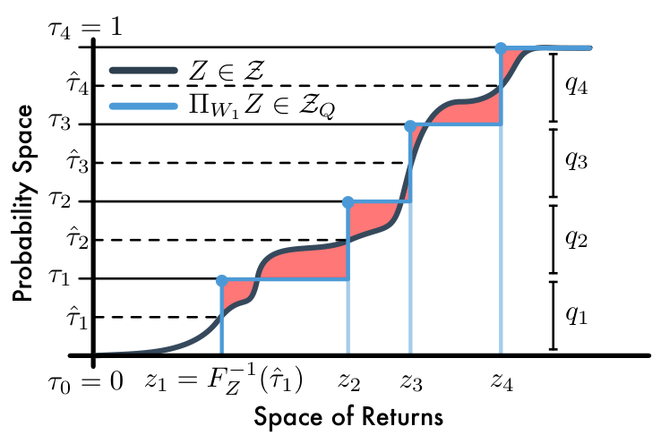

# 第 62 天｜QR-DQN：固定概率、学习位置，把回报分布变成分位数回归

[系列首页](README.md) · [上一篇](61-cpo.md) · [下一篇](63-iqn.md)

**原论文与版本**：Will Dabney、Mark Rowland、Marc G. Bellemare、Rémi Munos，*Distributional Reinforcement Learning with Quantile Regression*。2017年预印本，AAAI 2018发表。[arXiv入口](https://arxiv.org/abs/1710.10044) · [本文核读的v1 PDF](https://arxiv.org/pdf/1710.10044v1) · [AAAI出版入口](https://ojs.aaai.org/index.php/AAAI/article/view/11791)。以下公式、图表和实验口径以2017-10-27的v1为准，未将出版页视为已核读的修订正文。

### 先接住前作的问题

[第28天 C51](28-c51.md)让每个动作预测一个回报分布，却要预先固定回报支撑区间，并在每次Bellman更新后重新分配概率质量。另一个缺口是：理论讨论Wasserstein距离，实际训练却对投影后的概率做交叉熵。

QR-DQN把表示翻过来：每个点的概率固定为1/N，网络学习这些点应该落在哪里。问题随之变成：怎样从随机目标样本学习一组分位数，而不是直接把小批量样本间的Wasserstein距离拿来求导？它接续的是C51的分布价值路线，与[上一篇CPO](61-cpo.md)的约束策略优化是不同分支。

## 一、问题设定：不用固定回报边界，怎样学习可自举的分布

固定支撑之外的回报会在C51投影时被裁到边界。让支撑位置移动可以避免这项人为裁剪，但必须给每个位置一个明确的统计目标。否则，多个网络输出只是多个数，并不自动组成有意义的分布近似。

| 要素 | 本文设定 |
|---|---|
| 研究场景 | 固定策略的分布评价，以及基于DQN的离散动作控制 |
| 状态／观测 | 理论MDP状态；Atari中为图像观测 |
| 动作 | 训练行为采用ε-greedy；贪心动作仍按近似分布的均值选取 |
| 学习信号 | replay中的奖励、后继状态，以及目标网络给出的后继分位数 |
| 终止／边界 | 真终止时不再自举；N限制概率分辨率，不设置固定回报上下界 |

### 五个前置概念

1. **随机回报**：给定状态、动作和后续策略，累计折扣奖励是随机变量Z；Q是它的期望。
2. **累积分布函数**：F(z)=P(Z≤z)，描述回报不超过z的概率。
3. **分位数函数**：F⁻¹(τ)=inf{z:F(z)≥τ}；τ是概率水平，不是回报值。
4. **Wasserstein距离**：一维分布间可以通过分位数函数的距离来计算；它考虑回报位置差多少。
5. **半梯度自举**：用目标网络生成学习目标，反向传播时把该目标当常数；它不等于对整个Bellman固定点问题做全梯度优化。

回报分布描述的是环境转移、奖励和策略导致的结果随机性。即使分布很宽，也不能据此认定网络对自己的知识很没有把握；参数认知不确定性需要另行建模。

## 二、从Wasserstein投影推出分位数回归

### 先把概率轴分格，再决定回报位置

令N个概率区间端点为τᵢ=i/N，i=0,…,N；区间中点为τ̂ᵢ=(i−1/2)/N，i=1,…,N。网络输出θᵢ(s,a)，定义等权离散分布

$$Z_\theta(s,a)=\frac1N\sum_{i=1}^N\delta_{\theta_i(s,a)},\qquad Q_\theta(s,a)=\frac1N\sum_{i=1}^N\theta_i(s,a).$$

δ表示集中在一个位置的全部概率质量。C51固定位置、学习概率；这里固定概率、学习位置。θᵢ并不要求等距离，回报密集的区域可以有更多位置聚集。

对目标分布Y，在有序位置表示下，一维1-Wasserstein距离可写成

$$W_1(Y,Z_\theta)=\sum_{i=1}^N\int_{\tau_{i-1}}^{\tau_i}|F_Y^{-1}(u)-\theta_i|\,du.$$

每一项都是一段分位数函数与常数θᵢ之间的绝对偏差。绝对偏差由中位数最小化，所以一个合法最优位置是

$$\theta_i^*=F_Y^{-1}(\hat\tau_i).$$

这里的“中位数”指每个概率区间内部的中间位置，不是所有原子都去拟合全分布的50%分位数。离散目标可能有多个同样好的最小点，不能擅自要求唯一解。以上对应原文“Quantile Projection”、Lemma 2及式(7)。

### 原图2：为什么取概率区间中点

<figure class="reading-evidence-figure" id="rl-62-figure-2"><a href="/rl/assets/papers/62-qr-dqn-figure-2.png" target="_blank" rel="noopener noreferrer"></a><figcaption>原论文图形摘引｜Dabney等，arXiv:1710.10044v1，PDF第3页Figure 2。<a href="https://arxiv.org/pdf/1710.10044v1#page=3" target="_blank" rel="noopener noreferrer">核对原文</a> · 点图放大。仅裁取完整图形区域，原版权保留。</figcaption></figure>

横轴是回报，纵轴是累计概率。蓝色阶梯每次跳跃的高度相同，说明每个原子的质量都是1/4；但四个回报位置不等距。水平虚线标出τ̂ᵢ，沿黑色CDF找到对应回报，即蓝色竖线的位置。红色面积的总和是两条CDF之间的W₁误差。图中并没有学习四个不同的概率qᵢ，也没有把红色面积当作实际小批量训练损失直接反传。

### 为什么不能直接拟合样本Wasserstein距离

总体分布的Wasserstein最小点，与“先抽一小批样本、算距离、再对采样求期望”的最小点一般不同。原文Proposition 1指出，即便改用等权位置表示，也没有自动解决这个采样偏差。

解决办法是选一个最小点相同、又能从样本得到无偏梯度的目标。对残差u=y−θ，分位数损失为

$$\rho_\tau(u)=u\bigl(\tau-\mathbf1\{u<0\}\bigr).$$

当y大于当前θ，低估的代价斜率为τ；当y小于θ，高估的代价斜率为1−τ。τ越大，低估罚得越重，输出就向高分位数移动。在目标连续且可微的情形，

$$\frac{\partial}{\partial\theta}\mathbb E_Y[\rho_\tau(Y-\theta)]=F_Y(\theta)-\tau.$$

导数为零对应F_Y(θ)=τ；有原子时改用次梯度条件F_Y(θ⁻)≤τ≤F_Y(θ)。因此单样本的指示函数更新可以估计这个期望目标的梯度。注意：这是分位数回归目标的无偏样本梯度，不是宣称任意样本Wasserstein损失的梯度都无偏。

### 先检验投影，再检验均值是否保持

以下为独立构造的教学例，不是论文实验。设Y在0、2、6上的概率分别为0.2、0.5、0.3，N=2。τ̂为0.25、0.75，因此投影位置为2和6，各有0.5质量。

按概率轴分段算误差：区间[0,0.2)贡献0.2×2=0.4，[0.2,0.5)贡献0，[0.5,0.7)贡献0.2×4=0.8，其余贡献0，总W₁=1.2。作为对照，等权位置0和6的W₁为0.3×2+0.2×4=1.4。

但原均值是0.2×0+0.5×2+0.3×6=2.8，投影均值是4。**最优分位数投影不保证精确保持均值**，所以有限N的近似仍可能影响按均值选择的动作。这与C51在无裁剪时的线性质量分配保均值性质不同。

## 三、把分位数目标接到DQN更新

### 全部配对，而不是同下标相减

对replay样本(s,a,r,s′,d)，d表示真终止。用目标网络θ⁻构造下一状态的贪心动作和目标位置：

$$a^*=\arg\max_b\frac1N\sum_j\theta_j^-(s',b),\qquad y_j=r+\gamma(1-d)\theta_j^-(s',a^*).$$

这是本文展开的普通DQN式目标网络实现。若采用在线网络选动作、目标网络评价的Double DQN变体，应明确标成额外组合，不能悄悄混入原算法解释。v1 Algorithm 1的动作行写作Q(x,a′)，本文依据式(13)及算法前后定义使用下一状态s′，避免照抄这一状态下标不一致。

每个当前分位数θᵢ都要看到完整目标分布，因此对所有j做平均：

$$\mathcal L(\theta)=\sum_{i=1}^N\frac1N\sum_{j=1}^N\rho_{\hat\tau_i}^{\kappa}(y_j-\theta_i(s,a)).$$

只配对i=j会使每个输出只追自己的一个目标点，丢掉它相对整个目标分布的高估／低估频率，已不是这里的分位数回归。上式沿用原文对i求和、对j取平均；若实现对两个轴都取平均，会多一个1/N的常数因子，优化尺度也随之改变。

### Quantile-Huber怎样平滑，以及不能据此承诺什么

原文式(9)—(10)采用

$$L_\kappa(u)=\begin{cases}\frac12u^2,&|u|\le\kappa,\\\kappa(|u|-\frac12\kappa),&|u|>\kappa,\end{cases}\qquad \rho_\tau^\kappa(u)=|\tau-\mathbf1\{u<0\}|L_\kappa(u).$$

小残差区间是非对称平方损失，大残差区间是线性增长，减轻零附近恒定梯度造成的优化抖动。本文按v1定义不额外除以κ。原文把κ=0专门记作非平滑的ρτ，不能将κ=0直接代入上述Huber式得到零损失。

κ>0改变了目标函数，一般不能保证最小点还是精确τ分位数。精确分位数投影的理论，与使用平滑损失的神经网络控制算法，必须分别讨论。κ=1时两个常见的“除κ／不除κ”约定数值相同，但这不能掩盖其他κ下的实现差异。

### 四个残差验算一遍损失

再用一个独立教学构造。N=2，当前输出为(1,5)，后继目标位置为(0,4)，r=1、γ=0.5、d=0，则y=(1,3)。残差矩阵的行对应当前i、列对应目标j：

$$[u_{ij}]=\begin{pmatrix}0&2\\-4&-2\end{pmatrix},\qquad (\hat\tau_1,\hat\tau_2)=(0.25,0.75).$$

κ=1时Huber值分别为0、1.5、3.5、1.5。第一行正残差乘0.25，第二行负残差乘1−0.75=0.25，损失矩阵为(0,0.375;0.875,0.375)。按上式对j平均、对i求和，得到0.8125；若两个轴都平均则为0.40625。真终止时两列目标都等于r，此时仍学习多个分位数位置，但不再借用后继回报。

```text
设定N、概率中点tau_i、Huber参数kappa
初始化在线网络、目标网络和replay
每步用mean(theta(s, a))的epsilon-greedy动作收集经验
从replay采样(s, a, r, s_next, terminal)
在不求梯度的上下文中：
  用目标网络各动作的均值选择a_star
  y_j = r + gamma * (1 - terminal) * target_theta_j(s_next, a_star)
取在线网络对已执行动作a的N个输出
广播得到 [batch, current_quantile, target_quantile] 残差
对每个i用其tau_i计算全部j的quantile-Huber损失
按确定的轴归约，更新在线网络；周期性同步目标网络
评估时记录平均回报，并把分布预测诊断与策略成绩分开
```

时间截断是否当终止必须按环境语义处理。纯时间限制通常不能无条件把自举截掉。网络输出还可能出现分位数交叉，原方法没有强制单调结构；不能将未经检查的每个头直接当成已校准的尾部估计。

## 四、原始证据支持什么：分布评价与Atari控制分别读

### 固定策略评价实验先检查预测对象

v1“Value Distribution Approximation Error”使用带随机转移的两房间windy gridworld，策略由policy iteration得到并固定。参考回报分布来自每状态1000次Monte Carlo rollout，QRTD和TD(0)运行10000个episode，QRTD使用32个分位数。这里的Monte Carlo分布是有限样本参照，不是解析真分布。该实验检验分布近似与均值误差，不足以证明Atari控制时网络的尾部也可靠。

### Table 1是最佳检查点成绩，不是最后一次或三种子均值

| 实验要素 | v1原文设定与证据范围 |
|---|---|
| 环境 | ALE中的57个Atari 2600游戏 |
| 调参 | 在5个训练游戏调参，再用所选配置评价57个游戏；N=200 |
| 训练 | DQN架构改变输出层；Adam，学习率0.00005；训练预算200 million frames |
| 对比 | DQN、Double DQN、Dueling、Prioritized及组合、C51；QR-DQN自身未叠加dueling／优先回放 |
| 变体 | QR-DQN-0采用普通分位数损失；QR-DQN-1采用κ=1平滑损失 |
| 最佳策略评价 | 每100万训练帧冻结学习、评价50万帧；最多30随机no-op起步，评价ε=0.001；保留截至当时最好成绩 |
| 在线口径 | 另报告测试表现与训练表现；测试曲线用一个种子，训练曲线平均三个种子，不与最佳成绩表混用 |

[PDF第7页Table 1及相邻评价协议](https://arxiv.org/pdf/1710.10044v1#page=7)报告：C51的跨游戏human-normalized均值／中位数为701%／178%，QR-DQN-0为881%／199%，QR-DQN-1为915%／211%。human-normalized按(agent−random)/(human−random)计算，再以百分比表示。

这里211%与178%相差33个百分点，按这两个表内数值计算相对增长约18.5%，不能直接称作“中位数相对提升33%”。跨游戏平均值易受少数高分游戏影响，因此要同时看中位数；两个汇总都提高，也不意味着每个游戏都提高。

这些结果支持原实验协议下的实用收益，却没有严格隔离“分位数表示”这一个因素：优化器、输出数和损失形式也变了。帧预算相同不代表计算量或墙钟成本相同，全部N×N配对也有额外开销。本文未重新训练，也未重新计算逐游戏汇总或置信区间。

## 五、收缩定理没有覆盖整个深度控制系统

原文Proposition 2证明，在可数状态动作空间等条件下，固定策略π的精确分位数投影与Bellman算子复合满足

$$\bar d_\infty(\Pi_{W_1}\mathcal T^\pi Z_1,\Pi_{W_1}\mathcal T^\pi Z_2)\le\gamma\bar d_\infty(Z_1,Z_2).$$

其中d̄∞对所有状态动作取最大W∞距离，而W∞测量分位数函数的最大水平偏差。**用W₁定义投影，不等于复合算子在W₁中收缩**；论文特别指出不能直接推广成所有有限p的收缩。所得唯一固定点也是投影算子的近似固定点Ẑπ，不应写成一定精确等于真实Zπ。

进一步换成贪心控制、共享参数神经网络、有限数据与κ>0损失后，这个定理不再是完整算法的收敛证明。有限N会丢失概率细节，概率低于约1/N量级的尾部事件尤其不能期待自动准确捕捉；没有固定回报边界也不等于没有近似误差。

### 继续追问：概率网格、目标配对与风险决策

<details>
<summary>1. 既然位置能移动，增加N还能改善什么？</summary>

N控制概率轴而不是回报轴的分辨率。每个原子质量仍是1/N，最外侧分位数为1/(2N)和1−1/(2N)；有限N无法任意细分很稀有的事件。增加N可以让尾部和主体结构表达更细，但需要更多输出与两两残差计算，也需要足够样本训练。应把回报范围适应性、概率分辨率、样本误差分别检查，而不是只看没有Vmin/Vmax参数。

</details>

<details>
<summary>2. 为什么不能把第i个当前分位数只向第i个目标分位数移动？</summary>

θᵢ的目标是Bellman目标混合分布的τ̂ᵢ分位数，判断它偏高还是偏低，需要相对于完整目标分布统计。一个转移中的全部j提供后继近似分布，多个replay转移再提供奖励与状态混合；两层随机性都不能靠同下标配对消掉。只比较i=j会换掉优化目标，也错误暗示“混合分布的分位数”等于“每个分支对应分位数的平均”。

</details>

<details>
<summary>3. 我已经有低分位数，直接按它选动作就成了安全算法吗？</summary>

这会改变原QR-DQN的期望贪心目标，需要明确新的风险准则。单个低分位数、尾部条件均值CVaR和约束违规概率是不同对象，不能混称安全价值；风险准则是否与多步决策动态一致也需另外分析。还必须检验稀有失败样本覆盖与尾部校准。回报分布不是参数不确定性后验，不能单凭宽度安排“知道得少就多探索”。

</details>

## 六、沿着分布价值路线继续读

- [C51](28-c51.md)：直接前作，对照固定位置学概率与固定概率学位置，尤其比较边界裁剪和均值保持。
- [DQN](16-dqn.md)：QR-DQN继承replay、目标网络和期望贪心接口，改的是预测对象与训练损失。
- [Double DQN](18-double-dqn.md)：选择与评价拆分是可以组合的另一条改进轴，不能把它默认算进所有QR-DQN结果。
- [Rainbow](29-rainbow.md)：理解分布学习如何与多步、优先回放等模块组合；原Rainbow采用C51式分布部件，不应说它已经使用本文分位数头。

**原文定位**：[v1 PDF](https://arxiv.org/pdf/1710.10044v1)第3页式(7)与图2，第4页Lemma 2、Proposition 1、式(8)—(10)，第5页Proposition 2、式(11)—(13)与Algorithm 1，第6—7页实验设定和Table 1。正文已核对这些定义、算法与评价协议；附录完整证明、逐游戏结果及实验复现不在本文验证范围内。

## 自测两题

**问题1**：目标Y在0、2、6上的概率为0.2、0.5、0.3，用两个等权原子作W₁最优分位数投影，原子应放在哪？均值一定保留吗？

**参考答案**：取0.25和0.75分位数，位置为2、6。W₁误差为1.2，但均值从2.8变成4，因此不保证均值保持。概率质量和仍是1，这与均值保持是两件事。

**问题2**：为什么“QR-DQN做W₁投影，所以深度控制在W₁中收敛且自动规避风险”不成立？

**参考答案**：复合算子的收缩定理针对固定策略、精确投影，并使用最大W∞度量；它没有覆盖贪心控制、神经网络优化与平滑损失的全部误差。原算法仍按近似分布均值选动作，没有另加风险准则或安全约束。

[系列首页](README.md) · [上一篇](61-cpo.md) · [下一篇](63-iqn.md)
