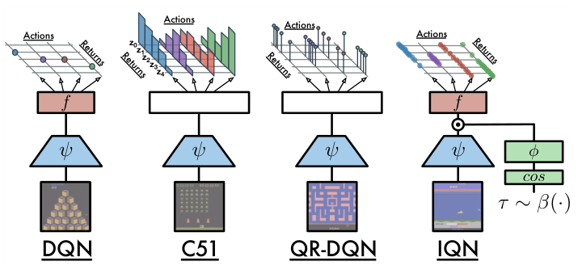
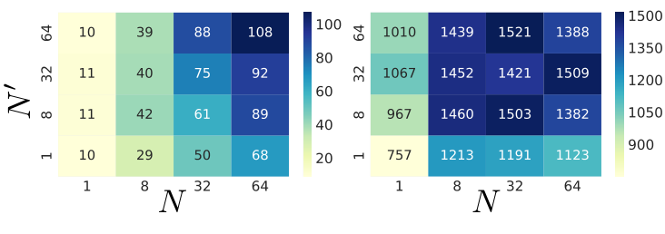
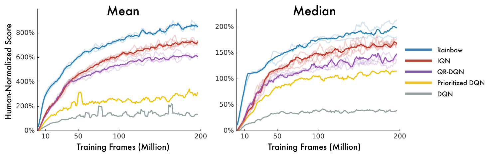
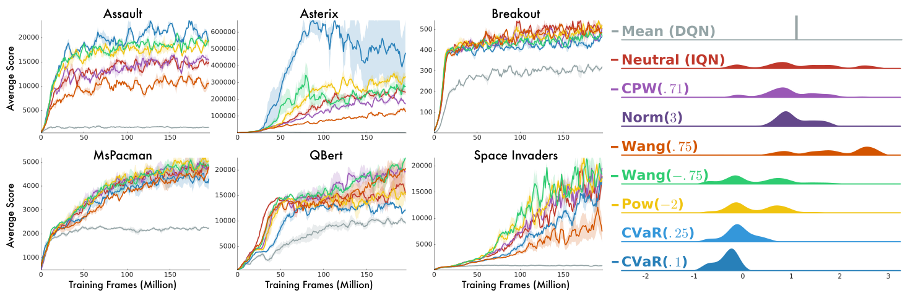

# 第 63 天｜IQN：把分位数变成网络输入，让回报分布可以按需查询

[系列首页](README.md) · [上一篇](62-qr-dqn.md) · [下一篇](64-fqf.md)

**原论文与版本**：Will Dabney、Georg Ostrovski、David Silver、Rémi Munos，*Implicit Quantile Networks for Distributional Reinforcement Learning*，ICML 2018。本文核读[PMLR正式正文](https://proceedings.mlr.press/v80/dabney18a/dabney18a.pdf)，公式、页码与表格均以该10页PDF为准；[arXiv入口](https://arxiv.org/abs/1806.06923)仅作检索入口，不混用版本。编号是主题扩展顺序，不是发表年份顺序。

### 先接住前作的问题

[QR-DQN](62-qr-dqn.md)让网络输出固定概率中点对应的回报位置。它不再需要C51的固定回报边界，但如果训练时只学了200个位置，想查询一个新的概率水平，就没有直接对应的输出头。增加分位数数量还会改变输出层规模，表达能力与计算预算绑在一起。

IQN把“第几个分位数头”改成一个连续输入τ：同一网络同时接收状态与概率水平，输出该位置的回报估计。这样，**网络学到的函数、每次更新抽多少位置、选动作时查多少位置**成为三个可分别调节的问题。知道整条分位数函数后，也可以在决策时偏重较差或较好的结果；但这项自由并不自动产生安全保证。

## 一、问题设定：学习一条函数，而不是把固定输出头加长

| 要素 | 本文设定 |
|---|---|
| 场景 | 离散动作控制；实验主要为ALE Atari游戏 |
| 输入 | 图像状态s，以及概率水平τ∈[0,1] |
| 输出 | 每个动作的条件回报分位数估计Zθ(s,a;τ) |
| 监督来源 | replay中的转移，加上下一状态的分布式Bellman目标 |
| 基本决策 | 对均匀概率水平的预测求平均，近似期望后ε-greedy |
| 可选决策 | 改变用于选动作的概率采样分布，形成风险敏感策略 |

### 五个前置概念

1. **回报随机变量Z**：环境、奖励及后续行为带来的累计折扣奖励，其均值才是Q。
2. **分位数水平τ**：概率轴上的坐标，0.9表示较高分位数，不是90分奖励。
3. **分位数值Zτ**：给定状态动作，在τ处的回报值；其单位与奖励一致。
4. **基础随机数U**：从均匀分布抽出的输入；通过分位数函数映射后得到回报样本。
5. **扭曲映射β**：选动作时把U变成β(U)，改变对不同结果的权重，不直接改变环境的真实奖励分布。

### 从分位数查询到期望

固定状态动作后，理想分位数函数记作q(u)=F_Z⁻¹(u)。若U服从[0,1]均匀分布，广义逆变换给出q(U)与Z同分布，从而

$$Q(s,a)=\mathbb E[Z(s,a)]=\int_0^1q(u)\,du=\mathbb E_U[q(U)].$$

有离散原子时q可以是阶梯函数，上式仍成立；不要求原分布有密度。有限均值是积分的基本条件。所谓“隐式分布”，就是通过抽U再输出qθ(U)定义采样过程，不必显式写出每一个回报值的概率密度。网络能在任意τ上求值，不等于有限网络已经精确学会任意分布。

## 二、怎样让概率坐标真正影响回报预测

### 从QR-DQN的固定头到共享条件函数

原文§3（PDF第4—5页）写成Zτ(s,a)≈f(ψ(s),φ(τ))a：ψ提取图像特征，φ把一维概率变成向量，f输出各动作的回报。正式采用的是逐元素相乘：

$$Z_\theta(s,a;\tau)=f\bigl(\psi(s)\odot\phi(\tau)\bigr)_a,$$

$$\phi_j(\tau)=\operatorname{ReLU}\left(\sum_{i=0}^{n-1}\cos(\pi i\tau)w_{ij}+b_j\right),\qquad n=64.$$

余弦特征提供多个频率的概率坐标编码，学习矩阵再将其投到与状态特征匹配的维度。这里64是余弦基的数量，不是“回报分布只有64个原子”，也不是必须取64次蒙特卡洛采样。i=0贡献常数项；其他频率使网络能够区分相近概率位置。

乘法让每个τ都能调节状态特征通道，再由同一输出函数形成该位置的动作价值。原文也试验拼接、残差式相乘等方案，因此乘法是作者选定的实用结构，不是逆变换采样定理的必要条件。每个τ共享图像编码与大部分参数，训练一个位置可能影响其他位置；这带来泛化，也可能产生相互干扰。

### 原图1：输入路径的改变比“输出更多数字”更关键

<figure class="reading-evidence-figure" id="rl-63-figure-1"><a href="/rl/assets/papers/63-iqn-figure-1.png" target="_blank" rel="noopener noreferrer"></a><figcaption>原论文图形摘引｜Dabney等，ICML 2018，PMLR正文PDF第4页Figure 1，完整四模型图形区域。<a href="https://proceedings.mlr.press/v80/dabney18a/dabney18a.pdf#page=4" target="_blank" rel="noopener noreferrer">核对原文</a> · 点图放大。原版权保留。</figcaption></figure>

这是结构示意，不是性能曲线：顶端“Actions”和“Returns”表示动作与回报维度，没有训练帧或得分轴。DQN每动作一个标量；C51在固定回报支撑上输出质量；QR-DQN输出固定概率对应的位置；最右侧IQN增加τ→cos→φ的路径，再与ψ结合。不能用这张图证明IQN的预测已经校准，也不能把顶端画出的有限点数当成论文固定的采样数。

图中采样通路还提示一个工程优势：同一状态可以复用ψ(s)，批量查询许多τ，不需要重复全部卷积。但后续嵌入与价值头仍有开销，训练损失还有两两配对成本。增大采样数是增加计算，不能称为“免费提高分布精度”。

### 有限查询误差为什么仍会改变动作

下面是本文对实现误差的教学拆分，不是原文新增定理。对某个动作，令真实均值Q=∫q、网络隐式分布均值Qθ=∫qθ，有限K查询均值为Q̂_K，则

$$|\hat Q_K-Q|\le|\hat Q_K-Q_\theta|+|Q_\theta-Q|.$$

第一项是给定网络之后的积分采样误差，第二项是函数近似误差。在独立均匀采样、有限方差条件下，采样均值Q̂_K的方差为Var[qθ(U)]/K，因此它相对于Qθ的均方误差按1/K缩小；第二项不随推理时增加K而自动缩小。若对同一状态的每个动作都有误差上界ε，而最优动作与次优动作的真实均值差大于2ε，估计排序才有直接保证。边际很小的状态对同样大小的误差更敏感。

这解释了为什么“多抽几百个τ后成绩不再提高”不意味着整个分布已经学好：可能采样噪声早已小于函数偏差，也可能策略瓶颈在经验覆盖。反过来，只看平均预测误差很小也不够，若错误集中在决策边际最小的状态，策略影响仍可能明显。诊断时应保存同一状态重复采样的动作翻转率，并把它与网络改变后产生的翻转分开。

### 一条共享函数不保证单调

真实分位数函数必须随τ非下降。上述余弦、ReLU与任意权重的组合却没有结构性单调约束。训练以分位数回归鼓励正确的统计关系，但有限数据或优化误差可能导致qθ(0.8)<qθ(0.7)。此时qθ(U)仍能定义一个随机变量，却不能逐点把原输入τ解释成其精确分位数。

因此要分别检查：采样分布是否有用、网络输出是否有序、分位数覆盖率是否校准。直接把输出排序会改变τ与输出的对应关系；若用排序或单调网络，应注明这是额外设计，不是原IQN已经内置的机制。

## 三、三个采样预算怎样进入同一轮Bellman更新

### N、N′与K分工不同

原文式(1)—(3)区分三组独立概率采样：当前预测的τᵢ共N个，目标预测的τ′ⱼ共N′个，选动作的ũₖ共K个。风险中性时β为恒等映射，下一动作按

$$a^*=\arg\max_b\frac1K\sum_{k=1}^KZ(s',b;\beta(\tilde u_k))$$

选择。对一个转移(s,a,r,s′,d)，构造

$$y_j=r+\gamma(1-d)Z_{\theta^-}(s',a^*;\tau'_j),\qquad \delta_{ij}=y_j-Z_\theta(s,a;\tau_i).$$

θ⁻表示目标网络，目标计算停止梯度；本文将其显式写出以说明DQN式实现。在线网络选动作、目标网络评价的Double变体是另一个可组合选择，不将它额外算成本文贡献。真终止d=1时所有yⱼ退化为r；时间上限截断不能未经判断就当作真终止。

每个当前位置都必须看到目标分布，因此使用全部N×N′配对，而非相同下标相减。原文损失对目标轴平均、对当前轴求和：

$$\mathcal L=\frac1{N'}\sum_{i=1}^{N}\sum_{j=1}^{N'}\rho_{\tau_i}^{\kappa}(\delta_{ij}),$$

$$\rho_\tau^\kappa(u)=|\tau-\mathbf1\{u<0\}|\frac{L_\kappa(u)}\kappa,\quad L_\kappa(u)=\begin{cases}u^2/2,&|u|\le\kappa,\\\kappa(|u|-\kappa/2),&|u|>\kappa.\end{cases}$$

这是IQN正式正文第3页的**除以κ**约定，与上一篇核读的QR-DQN预印本所写约定不同；κ=1时数值一致。若实现两个轴都平均，梯度尺度多出1/N，调N时要一起审计学习率与归约。不能把损失下降幅度直接横向解释成分布更接近。

在非平滑分位数损失下，固定τ的期望梯度指向F_Y(qθ(τ))−τ。随机抽τ再平均，相当于让整个概率区间获得训练机会；当前N和目标N′只决定一次更新怎样估计这一目标。κ>0提供平滑，但最小点通常不是精确分位数。目标网络、函数近似和采样误差都不能被“无偏分位数梯度”这句话一并消除。

### 手算：随机位置不是随机奖励，损失权重仍由当前τ决定

以下为独立教学例，数字不是论文实验。设本次抽到τ=(0.2,0.8)，网络输出(1,4)；抽到两个目标位置后，目标网络输出(0,4)。取r=1、γ=0.5且非终止，则y=(1,3)，残差为

$$[\delta_{ij}]=\begin{pmatrix}0&2\\-3&-1\end{pmatrix}.$$

κ=1时Huber矩阵为(0,1.5;2.5,0.5)。第一行正残差乘0.2，第二行负残差乘1−0.8=0.2，quantile-Huber矩阵为(0,0.3;0.5,0.1)。按原文归约，损失是(0+0.3+0.5+0.1)/2=0.45；双轴平均则0.225。这里没有用目标τ′来给第一维加权，目标概率水平已经通过yⱼ进入目标样本。

固定目标时，对两个当前输出的梯度分别为−0.1与0.2：第一个位置被向上推，第二个位置被向下推。若真终止，y=(1,1)，后继输出(0,4)不再影响结果。这个例子同时检查残差符号、哪个τ负责权重、终止屏蔽和归约轴，比只观察训练loss数值更能发现实现错误。

```text
初始化状态编码器、分位数嵌入、价值头、目标网络与replay
行为阶段：抽K个均匀数u，用Z(s, a; beta(u))的均值ε-greedy
采样一批转移；独立抽当前tau、目标tau_prime、动作估计u
在停止梯度的目标路径中：
  估计下一状态各动作的扭曲期望，选a_star
  y = reward + gamma * nonterminal * target_Z(next_state, a_star, tau_prime)
查询online_Z(state, executed_action, tau)
广播残差为[batch, N, N_prime]
用当前tau计算quantile-Huber；对目标轴平均、当前轴求和
只用这一步的半梯度更新在线参数；按DQN机制更新目标网络
独立记录策略回报、计算时间、分位数交叉及尾部覆盖情况
```

伪代码是机制重述，没有声称逐行复现作者实现。尤其应避免把动作采样ũ与训练采样τ视为必须同一批：原文明确将这些来源分开。K控制动作均值估计噪声，N与N′控制损失估计；动作argmax还是非线性的，即使各动作均值估计无偏，最大值及所选动作也不因此无偏。

## 四、风险敏感接口：改变查询权重，为什么会改变策略

### 从均值到低尾均值

定义

$$Q_\beta(s,a)=\mathbb E_{U\sim U[0,1]}[Z_\theta(s,a;\beta(U))].$$

当β(U)=U，得到风险中性均值；当β(U)=αU、0<α≤1，得到回报分布的低尾均值

$$Q_\beta(s,a)=\frac1\alpha\int_0^\alpha q(u)\,du.$$

这是以奖励越大越好约定的lower-tail CVaR。α是保留的最差概率质量，不是“95%置信区间”的置信水平。对含原子的分布，积分定义能正确处理边界原子的部分质量，比简单“挑出所有小于阈值的样本再平均”更明确。

这里要防一个记号陷阱：若T=β(U)，其CDF是H，那么期望等于∫q(t)dH(t)；β严格递增时H=β⁻¹。不能不区分“采样变换”和“CDF权重”，把同一β任意代入两套积分。本文固定采用原文实际采样接口E[q(β(U))]，由变量分布推导权重，避免曲率与风险方向说反。

### 一个会反转动作排序的核算

动作A恒得2；动作B以0.2概率得−4，以0.8概率得5。风险中性均值分别为2和3.2，因此选B。取α=0.25，B低尾的前0.2质量是−4，其余0.05质量是5，故

$$\operatorname{CVaR}_{0.25}(B)=\frac{0.2(-4)+0.05(5)}{0.25}=-2.2,$$

而A仍为2，低尾准则选择A。这不要求修改已知的两条分位数函数，只改选动作时的查询位置。可是控制学习中，改变当前与下一状态的策略会改变后续回报分布，所以不能永远冻结一个风险中性策略的Z，再宣称它已精确评价新的风险敏感策略。

原文§4在行为策略与Bellman目标的下一动作选择中都使用πβ，同时训练τ、τ′仍取均匀样本。它没有把完整分布学习偷偷改成只拟合最差10%的目标。后者是另一个训练设计，会损失其他概率段的信息，需要明确说明。

### 风险敏感不等于安全约束，也不等于有原则的探索

原文还考察Wang变换、概率加权等方式。对Wang(η,u)=Φ(Φ⁻¹(u)+η)，负η把查询推向较低分位数，正η推向较高分位数。这些变换影响对随机结果的偏好，却不提供参数后验。罕见坏结果没有出现在经验中，低尾查询也可能过度乐观。

另外，对每个状态重新应用同一静态风险度量，不自动等价于从初始状态优化整条轨迹的同一个风险目标；动态一致性需要额外分析。若要求违规概率上限或每步硬安全，还需要明确代价与约束。[CPO](61-cpo.md)解决的是另一类预算问题，不能由IQN有CVaR接口就替代。

## 五、原始实验：样本效率、最终表现与计算效率分开读

原文§3.1的六游戏架构与采样消融使用Asterix、Assault、Breakout、Ms. Pacman、Qbert和Space Invaders。Figure 2（PDF第6页）比较N,N′∈{1,8,32,64}：左侧汇总前1000万帧，右侧汇总最后1000万帧。作者发现两种采样数都明显影响早期成绩；超过N′=8后，长期收益变化较小。N=N′=8已取得大部分长期改善，这是该组实验的观察，不是所有任务的最优配置定理。

<figure class="reading-evidence-figure" id="rl-63-figure-2"><a href="/rl/assets/papers/63-iqn-figure-2.png" target="_blank" rel="noopener noreferrer"></a><figcaption>原论文图形摘引｜本文核读版本PDF第6页Figure 2，完整图形区域。<a href="https://proceedings.mlr.press/v80/dabney18a/dabney18a.pdf#page=6" target="_blank" rel="noopener noreferrer">核对原文</a> · 点图放大。原版权保留。</figcaption></figure>

两张热图横轴均为当前采样数N，纵轴为目标采样数N′；左图为前1000万帧、右图为190M至200M帧的六游戏平均human-normalized成绩，颜色刻度不同。单元格是得分，不是方差或Wasserstein误差；右图的大多数高分配置不能解读成每一游戏都有同样改善。

尤其N=N′=1仍可表现不错，不能推成“IQN等于DQN”：它每次只抽一个位置，但不同更新中τ变化，网络仍依赖τ，损失仍带非对称权重。只有把模型、目标和损失都做额外限制，才可能退化成某种标量方法。作者将所有实验的动作采样数固定K=32，对K的稳健性说明属于非正式评估，不是完整系统消融。

### Table 1与Table 2分别对应什么

| 指标 | QR-DQN | IQN | Rainbow |
|---|---:|---:|---:|
| Table 1，57游戏human-normalized均值 | 864% | 1019% | 1189% |
| Table 1，中位数 | 193% | 218% | 230% |
| Table 1，随机种子数 | 3 | 5 | 2 |
| Table 2，human-starts中位数 | 未列 | 162% | 153% |

这些数字已对照[PMLR PDF第7页](https://proceedings.mlr.press/v80/dabney18a/dabney18a.pdf#page=7)。Table 1是每游戏最佳human-normalized成绩，在最多30个随机no-op起步条件下跨指定种子平均；不能与最后一个检查点混为一谈，也不能与Table 2的human-starts拼成一个排行榜。表中QR-DQN的193%与上一篇QR-DQN v1表中的211%不同，协议、种子汇总及来源版本须随表记录，不能随意挑较大的数字充当同一对照。

IQN相对本表QR-DQN中位数高25个百分点，约12.95%相对增长；但在本表均值、中位数上仍低于Rainbow。human-starts中位数高9个百分点，也不证明IQN在所有游戏或所有起始条件都胜出。Rainbow包含优先回放、多步与其他增强，IQN这里主要检验分布模块，跨整套系统比较不是单因素因果实验。

Figure 4（第8页）显示训练帧推进中的均值和中位数曲线；作者描述IQN约在1亿帧达到QR-DQN在2亿帧的成绩水平。这是该图的样本效率比较，不是墙钟速度翻倍。图中各方法种子数不同，跨游戏均值又容易受极高分游戏影响，不能凭一条汇总曲线推断逐游戏显著性。

<figure class="reading-evidence-figure" id="rl-63-figure-4"><a href="/rl/assets/papers/63-iqn-figure-4.png" target="_blank" rel="noopener noreferrer"></a><figcaption>原论文图形摘引｜本文核读版本PDF第8页Figure 4，完整图形区域。<a href="https://proceedings.mlr.press/v80/dabney18a/dabney18a.pdf#page=8" target="_blank" rel="noopener noreferrer">核对原文</a> · 点图放大。原版权保留。</figcaption></figure>

左图为57游戏human-normalized均值，右图为中位数，横轴为百万训练帧。浅色线展示种子轨迹而非统一置信区间；IQN、QR-DQN和Rainbow分别汇总5、3、2个种子。均值与中位数的距离也提醒我们，少数极高分游戏会影响均值。

### 风险偏好实验并没有给出统一赢家

§4/Figure 3（第6—7页）报告六游戏的风险敏感策略，最终依然用普通平均游戏得分评价。风险厌恶在Asterix和Assault上有明显收益，但更强的CVaR(0.1)在Qbert及Space Invaders上损失部分表现；风险寻求也没有稳定更好的探索收益。作者讨论“可能更容易存活”等解释，但未建立因果证明。

<figure class="reading-evidence-figure" id="rl-63-figure-3"><a href="/rl/assets/papers/63-iqn-figure-3.png" target="_blank" rel="noopener noreferrer"></a><figcaption>原论文图形摘引｜本文核读版本PDF第7页Figure 3，完整图形区域。<a href="https://proceedings.mlr.press/v80/dabney18a/dabney18a.pdf#page=7" target="_blank" rel="noopener noreferrer">核对原文</a> · 点图放大。原版权保留。</figcaption></figure>

左侧六面板横轴是百万训练帧、纵轴是游戏原始平均分，各游戏纵轴尺度不同；右侧是扭曲采样对示意分布的影响，不是第七个游戏的学习曲线。风险厌恶在Asterix的优势和在Qbert中的代价都应保留，不能只摘最高一条线。

因此这组结果表明改变策略的结果偏好可以改变学习轨迹，有时也提高普通期望成绩。它不能证明低尾校准、真实安全性，或某个风险参数在所有游戏最优。本文未重跑训练、数字化曲线或重算逐游戏置信区间；引用的是原论文实验，不是独立复现。

## 六、理论边界与下一步问题

QR-DQN的固定概率投影具有特定度量中的收缩结果，但IQN把固定网格换成共享函数、随机查询，再加上神经控制。原文§6明确把推广收缩结果、样本式收敛和风险敏感控制理论列为未解问题。不能把前作定理的算法名称替换成IQN，就声称获得完整训练收敛保证。

从误差来源看，增加N′能减少某次目标采样噪声，却不消除目标网络偏差；增加K能降低决策积分噪声，却不修复错误尾部；增加网络容量能扩展函数类，却不保证经验覆盖。把这三种改进分别诊断，才能知道实际瓶颈在哪里。

<details>
<summary>1. IQN可以无限次查询，为什么还需要FQF？</summary>

查询次数仍受计算预算限制。IQN使表达能力不再由固定输出原子数直接卡住，但用有限均匀样本估计积分仍有误差。[下一篇FQF](64-fqf.md)学习概率区间，把有限代表位置分配给更需要精度的区域；它继承IQN的条件价值网络，却增加了分数提议与另一种优化目标。不能把FQF的可学习概率网格提前算成IQN原始机制。

</details>

<details>
<summary>2. 只提高K，是否就能保证选对动作？</summary>

不能。固定正确分位数函数、独立采样且均值存在时，采样平均随K增大可以逼近期望；但有限网络可能系统性预测错误，两动作真实均值也可能极接近。K处理蒙特卡洛误差，不处理表示、训练、环境覆盖和分布漂移。实际应记录动作间隙并比较重复采样下的动作稳定性，而不是只观察平均loss。

</details>

<details>
<summary>3. 让训练τ也只来自低尾，会更准确地优化CVaR吗？</summary>

这改变了原文均匀训练、扭曲决策的分工。低尾可能得到更多梯度预算，但整个Bellman目标仍依赖未来分布，其他概率段欠训练也可能影响自举。它不再是原IQN的简单参数设置，必须重新说明目标、采样权重及理论依据。即便低尾估计更准，也还没有解决多步静态风险目标的动态一致性。

</details>

**系列联系**：[DQN](16-dqn.md)提供经验回放和自举骨架；[C51](28-c51.md)与[QR-DQN](62-qr-dqn.md)提供分布表示对照；[Rainbow](29-rainbow.md)展示可组合的其他改进轴；[FQF](64-fqf.md)继续问有限概率预算如何分配。本文核心定位为PMLR第4—5页§3及式(1)—(4)、第6—7页§4、第7页§5与Tables 1—2、第8页§6；未审计单独补充材料与作者代码。

## 自测两题

**问题1**：N=2、N′=2，τ=(0.2,0.8)，预测(1,4)、目标(1,3)，κ=1。按原文归约，损失多少？N=N′=1时是否等于DQN？

**参考答案**：四项损失为0、0.3、0.5、0.1，目标轴平均后总损失0.45。单次只有一个配对也不等于DQN，因为跨更新仍抽不同τ、共享条件函数仍学习分位数且损失非对称。

**问题2**：动作A恒得2，B以0.2概率得−4、0.8概率得5，均值与α=0.25低尾准则分别选谁？

**参考答案**：均值为2和3.2，选B；低尾均值为2和−2.2，选A。这个排序反转说明决策准则改变，不能据此声称已经满足一个未定义的安全预算。

[系列首页](README.md) · [上一篇](62-qr-dqn.md) · [下一篇](64-fqf.md)
