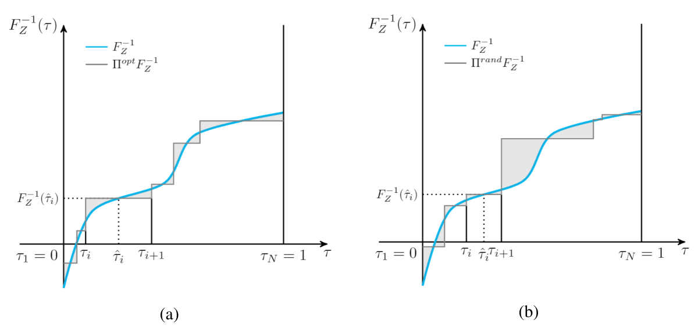
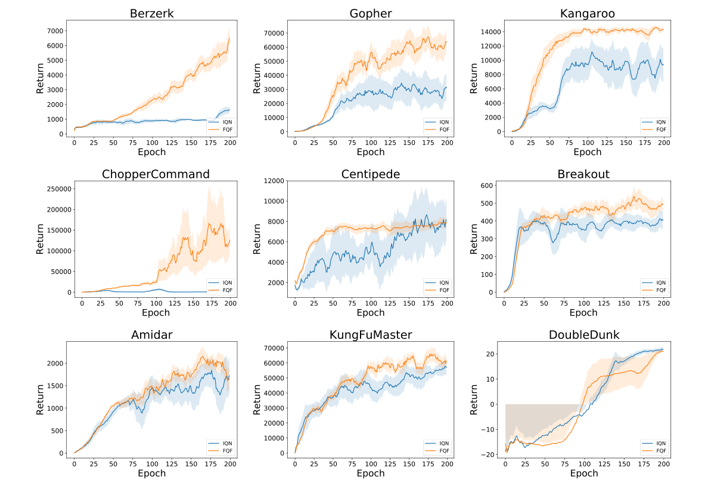

# 第 64 天｜FQF：分位数值之外，连概率区间也一起学习

[系列首页](README.md) · [上一篇](63-iqn.md) · [下一篇](65-rcpo.md)

**原论文与版本**：Derek Yang、Li Zhao、Zichuan Lin、Tao Qin、Jiang Bian、Tie-Yan Liu，*Fully Parameterized Quantile Function for Distributional Reinforcement Learning*，NeurIPS 2019。本文以[NeurIPS正式正文](https://proceedings.neurips.cc/paper_files/paper/2019/file/f471223d1a1614b58a7dc45c9d01df19-Paper.pdf)为主，另核对[arXiv:1911.02140v1，2019-11-05](https://arxiv.org/pdf/1911.02140v1)第11页的Proposition 1证明。正式正文与v1的实现记号有差异，下文明确标注，不把多个版本拼成一个不存在的算法。

### 先接住前作的问题

[IQN](63-iqn.md)允许在任意概率水平查询回报值，但真正选动作、构造损失时仍只有有限计算预算。均匀抽32个概率位置，与精心选择32个代表区间，不一定同样准确。尤其分位数函数有的地方平缓、有的地方陡峭，均匀分配计算可能把位置用在不太需要的地方。

FQF进一步问：**能否连“在哪些概率位置学习”也交给网络？** 它保留IQN的条件分位数值网络，增加fraction proposal network，输出可调概率区间。每个区间的宽度决定离散原子的质量，中点决定查询哪个回报分位数。由此，学习对象既包含概率轴的分割，也包含回报轴的高度。

## 一、问题设定：有限个原子，可以同时移动位置与质量

### 四种表示放在同一坐标系中看

| 方法 | 概率一侧 | 回报一侧 | 有限预算的主要约束 |
|---|---|---|---|
| C51 | 学习各原子概率 | 固定回报支撑 | 回报范围与支撑分辨率 |
| QR-DQN | 固定等宽概率区间 | 学习中点分位数值 | 固定概率网格与输出个数 |
| IQN | 用随机概率查询 | 学习连续条件函数 | 每次积分／更新的采样预算 |
| FQF | 学习区间边界与宽度 | 学习中点分位数值 | 有限区间数及两网络优化误差 |

这里的“fully”指概率与值两侧均被参数化，不表示有限网络能够精确表示所有回报分布，也不表示在所有损失或所有策略上全局最优。任务仍是离散动作、基于replay和Bellman自举的控制；论文最终按期望回报贪心，而不是把可学习概率质量解释成新的风险偏好。

### 五个前置概念

1. **区间边界τᵢ**：满足0=τ₀<τ₁<…<τ_N=1；内部N−1个边界可调。
2. **概率质量pᵢ**：pᵢ=τᵢ₊₁−τᵢ，所有质量和为1。
3. **区间中点τ̂ᵢ**：τ̂ᵢ=(τᵢ+τᵢ₊₁)/2，是查询分位数函数的位置。
4. **回报代表值θᵢ**：通常由值网络在τ̂ᵢ处输出，与概率宽度不是同一种量。
5. **W₁投影误差**：真实分位数函数与分段常数近似之间的面积，衡量概率质量搬动回报距离的成本。

### 概率区间怎样定义近似分布

给定状态动作，近似回报分布为

$$Z_{\theta,\tau}=\sum_{i=0}^{N-1}p_i\delta_{\theta_i},\qquad p_i=\tau_{i+1}-\tau_i.$$

它的均值是Σpᵢθᵢ，不能简单除以N。只有全部区间等宽时，等权平均才与这个离散分布的期望一致。FQF保留了“选择动作需要期望”这一接口，却改变了期望的数值计算方式。

对真实分位数函数q(u)=F_Z⁻¹(u)，有序阶梯近似的距离为

$$W_1(Z,\theta,\tau)=\sum_{i=0}^{N-1}\int_{\tau_i}^{\tau_{i+1}}|q(u)-\theta_i|\,du.$$

该公式要求把每个回报值与其概率区间对应起来。若网络分位数严重交叉，按原下标写出的面积未必就是两个诱导分布之间的最优耦合距离；因此理论中的单调函数和实际任意神经输出必须区分。

## 二、从固定区间的中点，到可学习边界的梯度

### 先解值，再移动边界

固定所有τ时，每个积分是该区间内q(u)到一个常数的绝对偏差。其最优代表值可以选为区间内中位数，即

$$\theta_i^*=q(\hat\tau_i),\qquad \hat\tau_i=\frac{\tau_i+\tau_{i+1}}2.$$

这是原文Lemma 1对QR-DQN固定等宽网格结论的扩展：最优值仍取概率中点，但区间不再要求等宽。常数区间或原子会造成非唯一性，不能把“一个最优选择”夸大成“唯一可行分位数”。正式版Lemma 1的边界句有τ₁=0记号，本文按§3.1统一使用τ₀=0，避免索引冲突。

代回后，优化变量只剩边界：

$$\mathcal W(\tau)=\sum_{i=0}^{N-1}\int_{\tau_i}^{\tau_{i+1}}|q(u)-q(\hat\tau_i)|\,du.$$

原文Proposition 1假设q连续且非下降，给出内部边界的导数

$$\frac{\partial\mathcal W}{\partial\tau_i}=2q(\tau_i)-q(\hat\tau_{i-1})-q(\hat\tau_i),\qquad i=1,\ldots,N-1.$$

只需比较一个边界值与左右两个中点值，便得到边界应该向哪边移动的信息，不必直接算出完整积分。这是fraction proposal学习的关键，而不是简单对随机采样器反向传播。

### 为什么中点移动的导数消失了

考察单个区间[l,r]，m=(l+r)/2。由q非下降，可拆成

$$E(l,r)=\int_l^m[q(m)-q(u)]du+\int_m^r[q(u)-q(m)]du.$$

形式上对r求导时，q(m)随r变化的项分别乘m−l与r−m，两者长度相等，正负抵消。移动中点本身的边界项也因q(m)−q(m)=0而消失，剩下∂E/∂r=q(r)−q(m)。类似地，∂E/∂l=q(l)−q(m)。内部τᵢ同时是左区间右端、右区间左端，相加便得到上式。

这段展开在可微q下最直观；论文用连续非下降函数陈述命题。核读的v1附录第11页提供了拆积分证明。连续性还用于边界导数符号与中间零点存在的论证，但一个方向上存在驻点不等于整个共享神经网络优化具有唯一全局最优解。

正梯度意味着边界下降更新向左移，负梯度意味着向右移。注意边界往右移，会增加左原子的质量、减少右原子的质量，同时两个中点也变动；它不是“把某个原子的回报值提高”这样的一维更新。

### 原图1：阴影说明的是表示误差，不是训练曲线

<figure class="reading-evidence-figure" id="rl-64-figure-1"><a href="/rl/assets/papers/64-fqf-figure-1.png" target="_blank" rel="noopener noreferrer"></a><figcaption>原论文图形摘引｜Yang等，NeurIPS 2019正式正文PDF第4页Figure 1，完整双面板图形区域。<a href="https://proceedings.neurips.cc/paper_files/paper/2019/file/f471223d1a1614b58a7dc45c9d01df19-Paper.pdf#page=4" target="_blank" rel="noopener noreferrer">核对原文</a> · 点图放大。原版权保留。</figcaption></figure>

横轴是分位数水平τ，纵轴是回报分位数F_Z⁻¹(τ)，与前面的QR-DQN展示CDF时的轴意义不同。蓝线是同一目标函数，灰阶梯是有限原子近似；每段水平长度对应概率质量，高度对应代表回报。两图都用N=6，左图调整边界后阴影更小，右图随机边界在函数变化明显的部分留下较大误差。

图中虚线标出某一区间的边界、中点及对应回报；τ̂ᵢ应取概率轴中点，而不是先平均两个回报端点。灰色面积是W₁误差，没有Atari分数、训练帧、误差条或显著性信息。它解释为何自适应分格可能有价值，不能单独证明训练过程必然找到左图那样的划分。

### 手算：均匀网格为什么并非总是最优

以下为独立构造并用符号积分校验的例子。取q(u)=u²，u∈[0,1]，用两个区间，唯一内部边界记t。中点为t/2、(1+t)/2，回报位置为t²/4、(1+t)²/4。逐段积分得到

$$\mathcal W(t)=\frac{2t^3-t^2-t+1}{4},\qquad \mathcal W'(t)=\frac{6t^2-2t-1}{4}.$$

直接代入命题也得到2t²−(t/2)²−((1+t)/2)²，完全一致。均匀边界t=0.5时，W₁=0.125、梯度=−0.125，因此下降方向让t增大。区间内驻点为

$$t^*=\frac{1+\sqrt7}{6}\approx0.607625,\qquad \mathcal W(t^*)=\frac{11}{54}-\frac{7\sqrt7}{216}\approx0.117962.$$

另一根小于0；导数在t*之前负、之后正，因此它是[0,1]上的最小点。较高概率处q增长较快，最优分割给右侧更窄的区间，符合需要更细回报分辨率的直觉。误差相对0.125降低约5.63%，这是这个构造的确定性积分结果，不是论文Atari提升。

但投影均值为

$$Q_{\mathrm{proj}}(t)=t\frac{t^2}{4}+(1-t)\frac{(1+t)^2}{4}=\frac{1+t-t^2}{4}.$$

真实均值∫₀¹u²du=1/3；均匀投影均值0.3125，自适应最优投影均值约0.309604。W₁更小，这个例子的均值绝对误差却略大。由此可见“分布近似改善”不等价于“所有统计量都改善”，更不能不经验证就推成每个动作排序都更准确。

## 三、两个网络怎样分工，而不是互相投机降低损失

### softmax生成质量，累积和生成有序边界

fraction proposal网络输出N个logit，经softmax得到p，再定义τᵢ=Σ_{j<i}pⱼ。由此τ₀=0、τ_N=1、内部边界有序，避免先输出任意边界再排序。有限精度下极小质量可能接近零，仍应监控塌缩与数值稳定，不能仅凭数学上pᵢ>0就忽略实现问题。

正式版§3.4及Algorithm 1采用状态特征ψ(s)输入proposal，同一状态的动作共享分割，价值头再输出各动作的值。§3.1叙述更一般的状态动作分布。v1 Algorithm 1曾写P(s,a)，与正式版P(s)不同，本文按正式实现描述，不把“逐动作独立proposal”当作正式版默认。

值网络沿用IQN的余弦嵌入φ(τ)与状态特征乘法，查询q_w(s,a;τ)。由于它接收连续τ，不仅能算中点，也能算内部边界τᵢ，这恰好提供proposal梯度所需的三个值。QR-DQN固定头没有这项任意位置查询接口，因此这里不只是给QR-DQN的softmax多加几层。

### proposal更新用当前分布的几何，value更新用Bellman目标

理想梯度中的真实q未知，实践将其替换为当前值网络估计：

$$g_i=2q_w(s,a;\tau_i)-q_w(s,a;\hat\tau_{i-1})-q_w(s,a;\hat\tau_i).$$

再经τ对proposal参数的链式法则更新。它是在“当前网络认为的分布”上重分配区间，不是直接从环境取到了真实分位数。因此值网络错在哪里，proposal也可能把计算预算分配错。原文用较小proposal学习率、近均匀初始化降低快速相互扰动，这是稳定性设计，不是理论误差界。

教学实现可用代理标量Σstopgrad(gᵢ)τᵢ注入规定梯度。这里stopgrad至关重要：如果把gᵢ也当成普通可微函数反传，会额外引入τᵢ∂gᵢ/∂参数，不再是命题给出的向量—雅可比积。这个代理标量的数值本身不是W₁，不能把它下降的曲线当成真正Wasserstein误差。

相应地，用quantile-Huber训练值网络时，应明确哪些τ视作固定目标位置，不让proposal仅通过移动分位数标签逃避难预测的位置。下面把两条优化路径分开是为了落实原文“各自用相应梯度更新”的机制；没有声称独立审计了作者代码中每一个共享编码器的梯度开关。

正式版还给出概率熵H(p)=−Σpᵢlog pᵢ作为防塌缩正则。最小化目标若鼓励较高熵，应减去正系数乘H，而非符号写反。v1第6页的该式缺少pᵢ因子，正式版已包含；本文采用正式版，不将预印本漏项解释成作者用了另一种熵。若加正则，实际优化也不再是纯W₁最小化，需要单独报告权重。

### 动作均值加权，与原文训练损失不是同一公式

在下一状态先计算τ′、中点和各动作值，按

$$a^*=\arg\max_b\sum_{i=0}^{N-1}(\tau'_{i+1}-\tau'_i)q(s',b;\hat\tau'_i)$$

选动作。这里下一状态的边界、权重与中点必须配套；正式Algorithm 1该行有未带撇号的中点与动作下标混用，本文按§3.2的均值定义重述其数学意图，不据印刷下标制造错位实现。

值损失需要更仔细地读。正式§3.3式(6)—(7)与Algorithm 1使用当前提出的同一组中点评估当前分布和后继目标，并采用均匀的1/N归约。统一令i是当前位置、j是目标位置，可写为

$$y_j=r+\gamma(1-d)q^-(s',a^*;\hat\tau_j),\quad \delta_{ij}=y_j-q_w(s,a;\hat\tau_i),$$

$$\mathcal L_{\mathrm{paper}}=\frac1N\sum_{i=0}^{N-1}\sum_{j=0}^{N-1}\rho_{\hat\tau_i}^\kappa(\delta_{ij}).$$

这里q⁻表示停止梯度的目标路径；本文显式补出终止屏蔽，并交换原文i、j命名方便与前篇一致。式(6)把值网络参数写成w₁，与§3.2命名不一致，Algorithm 1则使用w₂；本文使用q_w避免混淆。ρ是除以κ的quantile-Huber，κ>0时仍是平滑替代目标。

不能看到分布质量不等，就擅自把上述原文损失“修正”为权重p′ⱼ后仍称其原算法。若要计算**后继不等权离散分布下的分位数回归期望**，自然会得到另一种形式ΣᵢΣⱼp′ⱼρ_{τ̂ᵢ}(r+γq⁻(s′,a*,τ̂′ⱼ)−q_w(s,a,τ̂ᵢ))。这在数学上是清楚的加权目标，但与正式正文同中点、1/N损失不是同一表达。复现必须核对所选版本与代码，不能用今天熟悉的某个实现倒填2019年的公式。

### 一个两点反例，检查“权重到底放在哪”

假设某个后继离散分布在0和10的质量是0.9和0.1。其真实离散均值为1；等权平均却是5。如果另一动作恒得2，加权决策选后者，错用等权则选前者。这是遗漏质量会改变动作的最直接单元测试。

同样，固定当前预测z=0、τ=0.5、κ=1，目标为0、10时，两个Huber分位数损失是0和4.75。按真实质量加权得到0.475；目标均匀平均得到2.375。两者相差五倍，且对其他z的梯度也会不同，不只是一个可全局吸收的常数。这个反例并非宣称论文训练因此必然失败，而是要求准确区分“离散分布的精确期望”和“论文实际采用的训练近似”。

```text
给定N、两类优化器、Huber参数及可选熵系数
用状态特征生成p=softmax(logits)，累积得到tau与midpoint
在下一状态生成下一组边界；质量加权各动作值，选择a_star
按所选论文版本的中点共享约定构造停止梯度Bellman目标
固定proposal位置，用全部当前位置×目标位置更新value网络
查询当前动作在内部边界和相邻中点上的值
计算g_i = 2*q(tau_i) - q(left_mid) - q(right_mid)
把g_i作为外部梯度送过proposal的累积softmax路径
若使用熵正则，另加其梯度；不要把代理标量报告成W1
检查质量和、边界顺序、值交叉、终止处理与两条梯度路径
```

伪代码保留正式论文的近似边界，不声称是作者实现的逐行移植。replay、目标网络同步、batch聚合等沿DQN骨架处理；具体周期与优化器参数不在未核验情况下补造。若采用另一种加权目标，应在实验配置中显式命名，而不是只改一行损失后宣称完全复现。

### 一个不依赖训练成绩的最小验证清单

实现时先用已知解析分位数函数替换价值网络，单独训练proposal。对q(u)=u这样的直线，等宽区间应是合理的基准；对q(u)=u²，则可比较刚才求出的两区间最优边界。用有限差分核对每个内部τ的梯度，再把它经softmax雅可比传回logit。若这个独立小问题都不通过，Atari分数偶然上涨也无法证明proposal实现正确。

然后固定proposal，让value网络拟合一个已知目标分布，检查不同τ的高估与低估频率，确认损失权重来自当前分位数而非目标索引。再检查终止转移：所有后继项应被屏蔽；目标网络参数不得收到这一步梯度。最后才开启两个网络共同训练，并记录最小区间宽度、概率熵、交叉比例和每步用时。这些指标可以区分“网格塌缩”“值估计失真”与“计算成本增加”。

这种分层测试也有助于处理论文记号差异：把用于动作积分、用于目标分布、用于当前损失的三组概率位置分别命名，不依赖一个含混的tau变量贯穿全部计算。测试配置应记录是否共享中点、是否对目标质量加权，以及哪些张量停止梯度。以上是本文提出的工程验证建议，不能当作作者实验中已报告的结果。

## 四、实验结果：55游戏、三种子与额外计算成本

论文§4（正式PDF第7—8页）使用Dopamine实现与IQN基线。由于该框架的支持与成绩可靠性问题，未评估Surround和Defender，合计55个游戏。因此本表不能直接拿去与[IQN原论文](63-iqn.md)57游戏汇总做跨论文差值，哪怕两张表里某个中位数恰好相同。

| 实验要素 | 正文实际报告 |
|---|---|
| 主要评价 | 最多30次随机no-op起步；sticky-action结果另在附录 |
| 预算 | 每个agent训练2亿帧 |
| 概率区间 | FQF使用32个，proposal初始化近均匀 |
| 探索／评价 | 训练ε=0.01，评价ε=0.001 |
| 每次评价长度 | 12.5万帧 |
| 运行与硬件 | 报告三随机种子，NVIDIA Tesla V100 16GB |
| 曲线呈现 | Figure 2三种子平均，长度10的移动平均平滑 |

正式第8页Table 1的数值为：IQN跨游戏human-normalized均值1112%、中位数218%；FQF为1426%、272%；Rainbow为1213%、227%。FQF的高于人类游戏数为44，IQN为39；两者高于DQN的游戏数均为54。这里“54”不是FQF在54个游戏都战胜IQN，而是分别与DQN比较。

FQF对本表IQN的中位数差是54个百分点，相对218%约提高24.77%；均值差314个百分点，约28.24%相对增长。不能把“272%人类归一化得分”说成“在272%的游戏上超过人类”，也不能把跨游戏中位数当作典型单次episode的中位数。归一化使用各游戏自己的随机与人类基准，多个百分数还需要保持相同游戏集合与汇总口径。

正文说明IQN采用Dopamine实现，与原IQN论文成绩并非完全一致；主表列出跨方法对照，但本文没有据此认定所有历史基线都由FQF作者在同一软件栈重新跑过。正文也不足以让本文独立复算全部基线的检查点选择与种子来源，所以不补写成“所有方法统一最后检查点成绩”。这些边界应随表一起阅读。

### 学得更快，不代表每秒运行更快

Figure 2选取九个游戏展示学习曲线，横轴标为Epoch，纵轴是Return；正文另给总预算2亿帧。它的更早升高表示训练进程中的收益，不能把未标明的epoch直接换算成秒。三种子平均与移动平滑可能隐藏个别种子的尖峰、退化或晚期波动，不能仅凭曲线分离就宣布统计显著。

<figure class="reading-evidence-figure" id="rl-64-figure-2"><a href="/rl/assets/papers/64-fqf-figure-2.png" target="_blank" rel="noopener noreferrer"></a><figcaption>原论文图形摘引｜本文核读版本PDF第7页Figure 2，完整图形区域。<a href="https://proceedings.neurips.cc/paper_files/paper/2019/file/f471223d1a1614b58a7dc45c9d01df19-Paper.pdf#page=7" target="_blank" rel="noopener noreferrer">核对原文</a> · 点图放大。原版权保留。</figcaption></figure>

九个面板分别显示不同游戏，横轴原样标为Epoch、纵轴为Return，不能跨面板直接比较高度。蓝色IQN与橙色FQF曲线均为三种子平均，原文用10点移动平均；Centipede的后期接近与DoubleDunk的交替领先都说明收益并非逐时刻一致。图中阴影在该图注未明确给出统计定义，本文不擅自称其为置信区间。

作者在§4还报告同等设置下FQF训练速度约比IQN慢20%，并指出增加τ数量会显著拖慢FQF。这个“慢20%”是原实验实现的观察，未给本文足够信息把它精确换算成所有硬件的墙钟比例；更不能说FQF在样本效率改善的同时计算也无代价。新增proposal、边界查询、两类梯度以及两两残差都会消耗资源。

图表支持在该评估协议下FQF取得更好的汇总成绩，但尚未单独证明收益全部来自W₁投影误差下降。论文§5也提出：更好的分布表示究竟怎样影响策略、训练中的分数选择有多重要，仍待分析。本文没有独立训练、重算逐游戏结果或核验sticky-action附录，不将正文表扩展成更强结论。

## 五、理论与工程边界：更灵活的表示增加了哪些风险

第一，固定连续q的边界导数是一个局部几何结论。控制训练中q不断变化，proposal又使用当前估计代替真值，构成两个相互影响的优化过程。正式§5明确不保证这种深度网络、分位数回归与Bellman自举联合更新收敛，也把自适应概率是否保留固定网格收缩列为开放问题。

第二，理论要求非下降q，而IQN式价值网络没有强制单调。softmax只保证概率边界有序，不保证输出回报有序。把“τ有序”写成“整个分布已合法校准”遗漏了另一半条件。离散回报分布还可能产生不连续的分位数函数，不能不加说明把连续函数导数命题逐点搬到所有跳跃位置。

第三，W₁按概率质量累计距离，不一定优先照顾用户关心的极罕见灾难。一个很窄的低尾区间可能对总体积分贡献很小，算法没有外加风险预算就不会自动分配足够表示与数据。调proposal是拟合分布，不是像IQN的β那样主动改变风险偏好；这两类“非均匀概率”动机不同。

第四，有限原子投影可能改变均值。前面的q(u)=u²例子已经说明，即便W₁改善，均值误差不必同步改善。一般有|E[Z]−E[Ẑ]|≤W₁(Z,Ẑ)的界，但上界变紧不强迫实际误差严格下降。两个动作价值接近时，很小的剩余误差仍可改变贪心动作。

第五，proposal共享状态编码器，可能在某些动作的尾部与另一些动作的主体之间折中。正式实现的状态共享网格与理论逐状态动作讨论不是完全相同的自由度。要判断这个取舍，需要记录不同动作的误差与实际网格变化，而不是假设“fully parameterized”已经意味着每个动作拥有任意独立分割。

### 继续追问：质量、风险与复现边界

<details>
<summary>1. 既然FQF学概率，为什么不直接改回C51？</summary>

两者概率的坐标含义不同。C51在固定回报位置上学习质量，Bellman目标越界时要处理支撑裁剪；FQF学习概率区间边界，再查询可移动回报位置，代表值由分位数回归训练。FQF同时动两侧，并不等于C51取消边界那么简单。其proposal梯度来自分位数阶梯的W₁几何，而非C51的交叉熵分类目标。

</details>

<details>
<summary>2. 学出的低尾区间很窄，是不是说明模型主动避免危险？</summary>

不能。区间宽度是近似分布中的质量，区间变窄只是表示调整。若决策仍按Σpᵢθᵢ的期望选动作，目标仍是风险中性的。要偏重最差结果，需要另设风险准则并校准尾部；要满足代价预算，还要明确约束。[下一篇RCPO](65-rcpo.md)将回到约束优化，是主题切换，不是FQF的直接算法后继。

</details>

<details>
<summary>3. 我写了后继质量加权的quantile loss，可以说复现原始FQF吗？</summary>

应先标明版本与差异。正式正文式(7)使用1/N与共享中点，而后继质量加权是另一种自然的离散目标期望。二者在非均匀区间下不等价，本文两点例子已显示。可以研究或使用该变体，但要记录梯度停止、目标中点来源、动作选择与proposal共享方式，不能仅凭名称和网络图相同就称逐项复现。本文未核读作者代码，不能替代码背书。

</details>

## 六、放回系列：表示自由度增加，不代表所有误差一起消失

- [C51](28-c51.md)：固定回报支撑，学习质量，用于理解FQF为什么还需要分位数结构。
- [QR-DQN](62-qr-dqn.md)：固定概率中点的W₁投影是本文推导起点；不要把固定网格收缩自动延伸到可学习网格。
- [IQN](63-iqn.md)：提供连续条件价值函数，允许查询proposal梯度所需的边界和中点。
- [CPO](61-cpo.md)：对照显式代价约束与分布近似，不把分布精度当安全认证。
- [RCPO](65-rcpo.md)：下一篇讨论另一种约束策略优化路线，编号相邻只是阅读安排。

**原文定位**：NeurIPS正式PDF第4页§3.1/图1/式(1)—(2)，第5页§3.2–3.3/Lemma 1/Proposition 1，第6页式(7)、Algorithm 1及§3.4，第7—8页§4/图2/Table 1，第8页§5；证明补看arXiv v1第11页。本文明确记录两个版本在proposal接口与熵式上的差异，没有核读所有补充实验或独立审计代码。

## 自测两题

**问题1**：q(u)=u²，N=2，均匀边界t=0.5时proposal梯度多少，应该往哪边动？W₁最优是否保证均值误差也最小？

**参考答案**：导数为−0.125，梯度下降使t增大；最优t=(1+√7)/6≈0.607625，W₁从0.125降至约0.117962。但近似均值从0.3125变为约0.309604，真实均值为1/3，均值误差反而略增，因此不保证所有统计量一起改善。

**问题2**：回报位置为0、10，概率质量为0.9、0.1，与恒得2的动作比较，应选谁？为什么softmax有序还不足以证明理论收缩？

**参考答案**：加权均值为1，故选恒得2的动作；等权平均5会选错。softmax保证概率边界顺序，不保证价值网络单调、真实分位数已学准或联合自举收敛。论文明确没有把固定网格的收缩证明推广到实际FQF深度控制过程。

[系列首页](README.md) · [上一篇](63-iqn.md) · [下一篇](65-rcpo.md)
