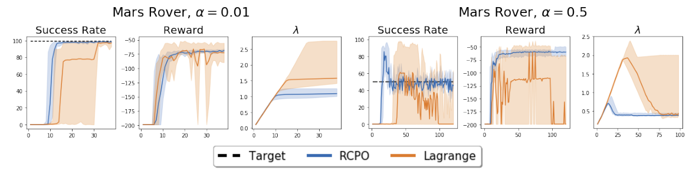

# 第 65 天｜RCPO：用可自举的惩罚引导策略，用真实约束调节罚价

[系列首页](README.md) · [上一篇](64-fqf.md) · [下一篇](66-pid-lagrangian.md)

**原论文与版本**：Chen Tessler、Daniel J. Mankowitz、Shie Mannor，*Reward Constrained Policy Optimization*，ICLR 2019。首次预印本为[2018-05-28的arXiv v1](https://arxiv.org/abs/1805.11074)，本文核读[2018-12-26的v3全文](https://arxiv.org/pdf/1805.11074v3)，包括附录A—E。[OpenReview出版入口](https://openreview.net/forum?id=SkfrvsA9FX)仅作出版入口；本文实际核读的是上述固定v3，不据出版入口声称核读另一个修订版本。编号按学习主题安排，不代表发表先后。

### 先接住CPO留下的问题

[CPO](61-cpo.md)把期望折扣代价放进每次策略更新的局部约束，希望训练中的策略也尽量可行。但约束有时不是与奖励同形的折扣累计量：例如“整个任务失败的概率”“每回合平均施加的力矩”。它们可能能在回合结束后计算，却不能直接写成原状态空间里的Bellman递推。

RCPO的核心是把两件事分开：**给actor和critic一个便于学习的逐步惩罚，给乘子一个忠于任务要求的完整约束统计。** 这带来一个必须回答的问题：优化替代惩罚，为什么会改善真正约束？论文不是用“二者相关”四个字跳过去，而是明确提出局部极小点与可行集之间的包含假设。理解这个假设，才知道方法能用到哪里。

上一篇FQF属于分布价值学习，这里返回安全约束路线。RCPO与CPO名称相近，但目标结构、更新方式和保证范围都不相同。

## 一、问题设定：一步代价、轨迹统计与折扣代理不能混写

### 五个前置概念

1. **CMDP**：在最大化奖励之外，另有一个明确的期望代价预算。
2. **轨迹统计**：对一整段经历计算的C(τ)，未必能仅靠原状态写成逐步Bellman递推。
3. **拉格朗日乘子**：非负罚价λ，违规时增大，以交换奖励和成本的优化压力。
4. **TD自举**：用短段真实数据与后继价值估计结合，降低完整回合估计的等待与方差。
5. **多时间尺度随机逼近**：不同更新相对速度逐渐分离，让快变量跟踪慢变量近似静态时的解。

### 真实约束与指导代理

记策略为πθ，初始状态分布为μ，奖励目标为

$$J_R(\theta)=\mathbb E_{\tau\sim\pi_\theta}\left[\sum_{t=0}^{\infty}\gamma^t r_t\right].$$

每步可以观测惩罚cₜ，但任务真正约束的是轨迹函数C(τ)：

$$J_C(\theta)=\mathbb E[C(\tau)],\qquad \max_\theta J_R(\theta)\quad\mathrm{s.t.}\quad J_C(\theta)\le\alpha.$$

论文§2.2允许C是逐步惩罚序列的更一般聚合，而不仅是折扣和。若C是失败指示量，其期望是失败概率；若C是T步平均力矩，其期望是每回合平均量的期望。T随机时，E[总力矩/T]一般不等于E[总力矩]/E[T]，也不等于折扣和乘一个常数。

| 层次 | RCPO使用的对象 | 主要用途 |
|---|---|---|
| 环境每步信号 | rₜ、cₜ | 构造修正奖励与TD样本 |
| 折扣引导目标 | J_Cγ=E[Σγᵗcₜ] | actor和critic实际学习的惩罚方向 |
| 原约束统计 | J_C=E[C(τ)] | 检查预算、更新乘子 |
| 最终要求 | J_C≤α | 期望约束可行性，不是每条轨迹零违规 |

失败概率不超过1%，仍允许少数失败轨迹；平均力矩不超过25%，也不限制每个瞬间的最大力矩。若真正需求是“任何动作都不能伤害设备”，就需要额外的动作限制、安全过滤或其他机制，不能靠重新命名平均量得到逐步保证。

还有一个容易漏掉的前提：原约束虽然未必可自举，仍须能够从采样轨迹估计。RCPO没有解决“失败发生但记录不到”“成本标签系统性漏报”的观测问题，也没有从数据中自动发现用户遗漏的约束。

## 二、从普通拉格朗日法走到三时间尺度

### 罚价为什么要自动更新

对奖励最大化问题，采用

$$L(\theta,\lambda)=J_R(\theta)-\lambda(J_C(\theta)-\alpha),\qquad\lambda\ge0.$$

θ沿奖励增大的方向更新，λ沿L减小的方向更新。因此

$$\lambda_{k+1}=\Gamma_\lambda\left[\lambda_k+\eta_\lambda(k)(\widehat J_C-\alpha)\right].$$

超预算就涨价，低于预算就降价，投影防止负罚价。在固定λ下，λα不依赖θ，可以从actor目标中去掉；这不意味着α能从乘子更新中去掉。若把符号反过来，违规时降低惩罚，整个反馈会朝错误方向走。

直接对L求策略梯度，原则上可以使用轨迹似然比乘以R(τ)−λC(τ)。问题是一般C未必能拆成当前状态上的递归价值，需要等待完整轨迹，还可能产生高方差。普通无约束actor-critic的优势，恰恰在于使用短段数据和critic自举。RCPO要保留这个接口。

### 内层换代理，外层仍看真实指标

论文§4定义

$$\hat r_t=r_t-\lambda c_t,\qquad \hat V^{\pi}(\lambda,s)=V_R^{\pi}(s)-\lambda V_{C_\gamma}^{\pi}(s).$$

固定π、λ时，V̂满足标准Bellman关系：

$$\hat V^{\pi}(\lambda,s)=\mathbb E[\hat r_t+\gamma\hat V^{\pi}(\lambda,s_{t+1})\mid s_t=s].$$

于是可以用TD误差

$$\delta_t=r_t-\lambda c_t+\gamma(1-d_t)\hat V_v(s_{t+1})-\hat V_v(s_t)$$

训练critic，并用δₜ或多步优势更新actor。这里dₜ表示真正终止；时间截断是否截断自举要按任务定义处理。原文Algorithm 1自举行的状态写作sₜ，本文依据Bellman定义和附录A的多步回报使用后继sₜ₊₁，不把这个下标问题解释成新算法。

关键是：actor提升的目标变为J_R−λJ_Cγ，而乘子仍根据J_C−α更新。**当J_Cγ与J_C不同时，这不是对同一个原始拉格朗日函数的两块精确梯度下降／上升。** 因而不能直接搬用普通原始—对偶收敛结论，也不能把折扣成本估计器拿来代替回合结束后的真实约束统计。

### “快、中、慢”是近似静态关系，不是三个随便不同的学习率

论文安排critic最快、actor居中、λ最慢。其直觉为：critic看到近似固定的策略和罚价；actor看到已跟上的critic与近似固定的罚价；乘子看到对当前罚价已经适应的策略。随机逼近中对应步长和发散、平方和收敛，以及相邻尺度比趋于零，例如

$$\frac{\eta_\lambda(k)}{\eta_\theta(k)}\to0,\qquad \frac{\eta_\theta(k)}{\eta_v(k)}\to0.$$

作为独立的数学示例，可以选ηv=k⁻⁰·⁶、ηθ=k⁻⁰·⁸、ηλ=k⁻¹，k从1开始。三者累积步长都发散，平方和都收敛，两个比值都是k⁻⁰·²。这个例子只核对步长条件，不证明某个神经网络实现收敛。

实际训练还涉及每轮更新次数、Adam预条件、梯度大小、网络共享和采样频率。只看到配置中“乘子学习率更小”，不能说已经满足渐近时间尺度分离；论文附录B的深度实验配置也不应当成这些极限条件的逐项验证。

```text
初始化actor theta、修正奖励critic v、非负乘子lambda
重复采样短段轨迹：
  收集原始r、逐步c、状态、动作、终止标志
  固定本段lambda，计算r_hat = r - lambda*c
  用后继critic自举构造多步回报与优势
  在快尺度拟合critic；在中尺度更新actor
  累积原始约束所需统计，不把截断片段冒充完整回合
  若获得完整C(tau)：
    用若干完整回合估计J_C
    在慢尺度更新lambda = projection(lambda + eta_lambda*(J_C-alpha))
评价时分开报告奖励、真实约束、折扣代理与lambda
```

这个模板说明信息流，未复制论文某一具体训练实现。若复用历史数据，还要处理策略分布变化；“修正奖励只多一行”不等于off-policy校正也自动完成。

## 三、替代惩罚可靠的条件，以及一个能手算的反例

### 定理要求的是集合包含，不是平均相关性

论文Theorem 2把真实可行集记为Θ={θ:J_C(θ)≤α}，把J_Cγ的局部极小点集合记为Θγ，关键假设为

$$\Theta_\gamma\subseteq\Theta.$$

意思是：沿代理成本下降即使停在局部低谷，也不能停在真实不可行的策略上。它比“在训练样本上，两个成本大致同涨同跌”强得多；它约束整个参数化策略类里的局部几何。某个零力矩策略同时最小化两个目标，只说明找到了一个好点，不能单凭它断定所有局部极小点都可行。

§2.3还列出奖励价值有界，以及原约束的每个局部极小点均可行。附录E借助稳定迭代、噪声条件和三时间尺度分析：先让critic跟踪固定策略的值，再分析actor固定点，最后分析乘子；在指导代理的包含假设与乘子可提供足够惩罚等条件下，论文得到几乎必然收敛到可行固定点的结论。

这里有三道边界。第一，结论是可行固定点，不是任意非凸神经策略类里的全局最高奖励。第二，“几乎必然”是随机过程的渐近结论，不是某个训练预算内违规概率为零。第三，附录以TD算子收缩推进critic论证，不能由此宣布任意非线性共享网络、Adam和有限批量都得到同等收敛保证。本文核读论证路径，但没有补证或重现一般非线性函数逼近情形。

### 教学例：折扣可以偏爱晚发生的高成本

以下是独立构造，不是论文实验。回合固定两步，原约束为平均成本C=(c₀+c₁)/2，阈值α=1，γ=1/2。两种策略A、B的成本与奖励为：A的成本(2,0)，B的成本(0,3)；全部奖励在第一步给出，A得2，B得4。

A的真实成本为1，正好可行；B为1.5，违规。折扣代理却是A的2、B的1.5。若以概率p选B，

$$J_R(p)=2+2p,\quad J_C(p)=1+0.5p,\quad J_{C_\gamma}(p)=2-0.5p.$$

代理actor目标变成

$$J_R-\lambda J_{C_\gamma}=2-2\lambda+(2+0.5\lambda)p.$$

对任何非负λ，p的系数都为正，actor都偏好p=1；外层发现违规不断涨价，反而进一步强化B相对A的优势。真实拉格朗日目标关于p的系数则是2−0.5λ，当λ>4时会选择A。代理的全局低谷B本身不满足预算，正好违反Θγ⊆Θ。

这不是说RCPO一定失败，而是精确展示为什么需要它的假设。短视代理可以把“少产生危险”换成“晚一点产生危险”。因此实现时仅画代理曲线下降是不够的，还要同时检查真实指标。λ一直上涨而真实成本不降，是代理失配、可行策略不可达或优化失败的诊断线索。

### 教学例：两个统计量在同一次更新里的不同位置

仍取两步成本(0,3)，奖励(4,0)，λ=2。修正奖励为(4,−6)，折扣回报为4−3=1；它等于J_R−λJ_Cγ=4−2×1.5。若当前J_C估计是1.5、α=1、ηλ=0.1，新的乘子为2.05。

把“平均成本1.5”塞进每个时间步扣除，会得到另一个目标；把折扣回报里的λα常数加回也不会修复上述代理方向问题。这个算例的用途是核对数据流和符号，不能替代策略训练。本文用精确分数独立核算了这些数值。

## 四、看原始证据：要把“更快”“近似可行”和“严格可行”分开

### Mars Rover：完整曲线比一句“更安全”有信息量

<figure id="rl-65-figure-2" class="reading-evidence-figure"><a href="/rl/assets/papers/65-rcpo-figure-2.png" target="_blank" rel="noopener noreferrer"></a><figcaption>原论文图形摘引｜Tessler、Mankowitz、Mannor，arXiv:1805.11074v3，PDF第6页Figure 2。<a href="https://arxiv.org/pdf/1805.11074v3#page=6" target="_blank" rel="noopener noreferrer">核对原文</a> · 完整图形区域含图例，原版权保留。</figcaption></figure>

原图每组三栏依次为成功率、奖励、λ，左组α=0.01，右组α=0.5，黑色虚线为目标，蓝色为RCPO，橙色为直接Lagrange。蓝线在左组更早接近高成功率，右组奖励与乘子相对稳定；橙色有较大波动。图的纵轴明确写Success Rate，所以成功率应与1−α比较，不能照着图注的“at or below threshold”把成功率越低当成越可行。原图未给每个点的精确数值，本文不从曲线读取臆造的小数或显著性。

环境是随机转移网格：短路更容易碰岩石，撞击终止，目标是尽快到终点且失败概率不超过α。附录B.1给出随机转移参数δ=0.05、每步奖励−0.01、终点奖励0、γ=0.99；采用A2C，另有随迭代衰减的随机起点安排以减轻探索问题。每5120回合评价1024回合，λ从0.6起，乘子学习率0.000025。

这些设定说明比较同时处于一个特定探索与评价方案中；不能把曲线优势直接外推到任意初始分布或极稀有灾难。有限评价中的零失败也不等于真实失败概率为零，尤其α=0.01的任务需要关注估计误差。

### Robotics：Table 2并没有支持“六项全部严格达标”

机器人实验用PPO，比较自动调整λ和若干固定惩罚系数，约束是平均力矩。附录B.2报告每次训练100万样本、γ=0.99、GAE系数0.95，λ从0开始，乘子学习率5×10⁻⁷并衰减。论文§5.2明确把结果称为可行或接近可行，而不是全部严格可行。

[第7页Table 2](https://arxiv.org/pdf/1805.11074v3#page=7)的门槛为25%。RCPO报告Swimmer 24%、Walker2d 25.2%、Hopper 26%、Humanoid 24.3%、HalfCheetah 26.7%、Ant 15.2%。按表内数值，三个超预算的项目是Walker2d、Hopper、HalfCheetah，分别高0.2、1和1.7个百分点。这些不是统计误差已被证明覆盖的偏差，不能擅自替作者四舍五入成合格。

例如Swimmer的λ=0基线奖励94.4、力矩30.4%，RCPO奖励72.7、力矩24%。回报下降换来了预算满足，不能只比较94.4与72.7就说RCPO更差。反过来，Walker2d的λ=0基线力矩24.6%、奖励3364.1，而RCPO为25.2%、591.6；这是真正不利于RCPO的案例，不应藏掉。论文也指出Walker2d例外，并在脚注对Hopper的优势判断保留意见。

固定λ=100也未让Humanoid达标，表中力矩仍30.5%。这提醒我们：神经训练里的巨大惩罚并不等于成功求解对应全局优化，策略可能落入不良局部解。文章未提供足以从这些表值独立重建置信区间的信息，本文不添加种子数、误差条定义或统计检验结果。

### 实验没有做的比较也要说清

论文这组非折扣约束实验主要比较直接Monte Carlo拉格朗日法和固定reward shaping，不是CPO对RCPO的全面同协议竞赛。原文认为其所选约束不适合直接照搬折扣约束基线；这不意味着CPO在所有扩展表示或所有安全任务上都不能使用。把约束改写、扩展状态或换估计方法会改变实验设计，应当作为新实验说明。

“reward agnostic”的合理理解是不用为每个奖励尺度手工固定最终罚价，λ可以适应。奖励整体乘正数时，理想最优策略不变，所需罚价尺度却会变化。有限时间下，同样的乘子步长、初始化和采样噪声不会因此自动产生相同学习曲线。下一篇PID Lagrangian正面讨论这类动态响应与尺度问题。

## 五、实际使用时怎样判断是否适合RCPO

先明确需求是什么统计量，再决定是否值得引入代理。如果真实约束本来就是折扣累计成本，J_Cγ与J_C可以一致，许多代理失配问题随之消失；这时RCPO的吸引力主要是简单的actor-critic组合，而不是“任意约束”的能力。

如果真实约束是整段轨迹属性，应先找出哪些事件在时间上被折扣弱化，哪些早停行为会改变平均值分母，哪些参数化局部极小点可能不可行。检查应包括奖励、真实代价、代理代价和λ的联合轨迹，而不是最终一行奖励。对安全要求高的任务，还要独立报告每回合分布、峰值与罕见事件，避免用平均值掩盖尾部。

最后，收敛到可行策略与可行训练是两个要求。RCPO可能需要经历超预算策略才能调出合适λ；惩罚过大又可能损害奖励学习。CPO关注每次更新的局部可行控制，RCPO关注易于自举的引导与渐近可行性，二者不是互换的名字。论文讨论将两者结合是未来方向，不能写成本文已经实现并证明的系统。

### 继续追问：代理、时间尺度与罚价

<details>
<summary>1. 我能把任何轨迹约束都随便选一个逐步c来替代吗？</summary>

不能。首先得能从真实轨迹估计C，否则外层不知道是否违规；其次代理的低谷要落在真实可行集内。本文两步例子说明，即使c就是原始成本，折扣方式不同也可能反向排序策略。对复杂约束可尝试扩展状态表示或直接使用完整轨迹梯度，但它们是另一些建模与估计选择，不由RCPO名称自动保证有效。

</details>

<details>
<summary>2. 把lambda更新得特别快，是不是就不会违规了？</summary>

这会破坏原分析中慢乘子看到近似收敛actor的条件。有限批量误差可能立刻变成大幅罚价摆动，critic又要追逐快速变化的修正奖励。慢更新存在响应迟缓，快更新存在振荡风险；该论文没有给出一个适用于所有任务的速度处方。下一篇通过控制器结构改善动态响应，而不是仅把学习率放大。

</details>

<details>
<summary>3. lambda到达上限而代价仍超标，应当直接增加上限吗？</summary>

先分清不可行预算、策略表达能力不足、代理失配、critic误差和训练未充分几种原因。增加上限只增加允许的惩罚强度，不会让错误代理变正确；在教学反例中反而更偏爱违规策略。有限上限时还可能稳定在边界，不能把投影后的固定点当成原约束已满足。应直接检查真实统计及其误差，再决定模型或优化修改。

</details>

## 六、沿着约束学习路线继续读

- [CPO](61-cpo.md)：比较信赖域里的约束更新与外层调罚价，注意每次更新保证和渐近结论的区别。
- [PPO](27-ppo.md)：理解实验所用策略优化器与RCPO约束机制是两个模块；PPO裁剪本身不提供成本预算。
- [PID Lagrangian](66-pid-lagrangian.md)：继续追问乘子为何振荡，如何让罚价更及时地响应代价与变化趋势。

**原文定位**：v3第3页§2.2—3定义与假设，第4—5页§3.1—4、式(5)—(11)、Theorem 2和Algorithm 1，第6页Figure 2，第7页Table 2，第12—13页附录A—B，第13—15页附录C—E。核读了这些章节与证明文本；未运行作者代码、重训策略或验证所有非线性收敛条件。

## 自测两题

**问题1**：成本A=(2,0)、B=(0,3)，γ=1/2，原约束为两步平均不超过1。为什么增大代理惩罚系数不一定把策略拉回可行区？

**参考答案**：A真实成本1、代理2；B真实成本1.5、代理1.5。代理更偏好违规的B。若奖励A=2、B=4，代理目标中选B概率p的系数为2+0.5λ，任何非负λ都推动p增加，包含假设不成立。

**问题2**：RCPO的critic、actor与乘子各用哪个目标？理论保证能否直接写成“整个训练过程安全且最终最优”？

**参考答案**：critic拟合折扣修正奖励，actor提升其价值，乘子依据真实J_C−α调节。论文在相关假设下得到渐近可行固定点，不保证任意神经实现的全局最优，也不保证每个训练策略或每条轨迹都安全。

[系列首页](README.md) · [上一篇](64-fqf.md) · [下一篇](66-pid-lagrangian.md)
