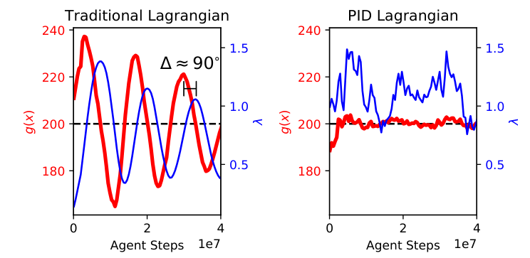
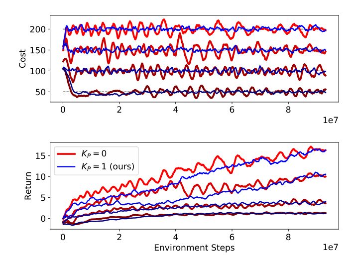
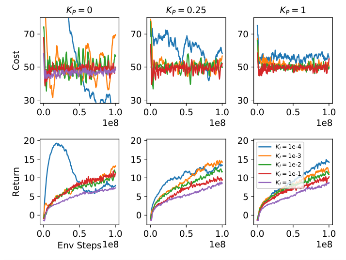
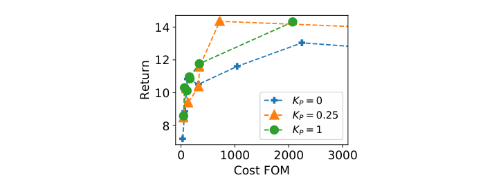
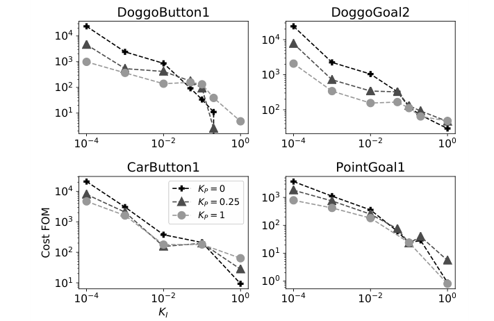
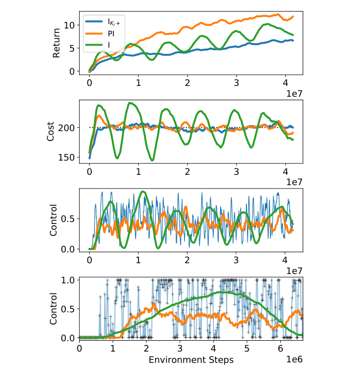
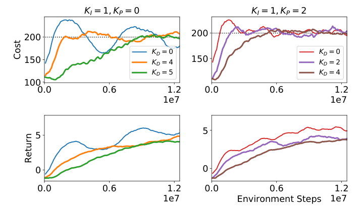
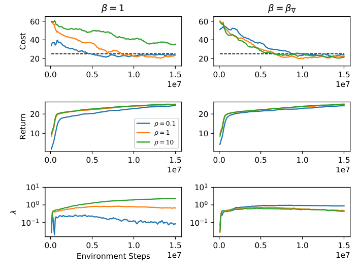

# 第 66 天｜PID Lagrangian：把惩罚系数当控制器，减少训练中的违规振荡

[系列首页](README.md) · [上一篇](65-rcpo.md) · [下一篇](67-bootstrapped-dqn.md)

**原论文与版本**：Adam Stooke、Joshua Achiam、Pieter Abbeel，*Responsive Safety in Reinforcement Learning by PID Lagrangian Methods*，ICML 2020，PMLR 119:9133–9143。[首次预印本](https://arxiv.org/abs/2007.03964)提交于2020-07-08。本文以[PMLR正式正文](https://proceedings.mlr.press/v119/stooke20a/stooke20a.pdf)与[补充材料](https://proceedings.mlr.press/v119/stooke20a/stooke20a-supp.pdf)为核读版本；以下页码为各自PDF页码，不是会议连续页码。系列编号按主题安排。

### 先接住RCPO的问题：最终能达标，训练时也可能反复越界

[RCPO](65-rcpo.md)让乘子根据约束误差逐渐调节，解决固定罚价难以选择的问题。但罚价追赶策略需要时间：代价已经超过预算，乘子仍在慢慢积累；等惩罚终于足够，代价掉下去，乘子又不会立刻回落。训练于是可能在预算两侧振荡。

这篇论文换了观察角度：把“策略优化器+采样环境”看成被控系统，成本作为测量输出，乘子λ作为控制输入。普通拉格朗日更新只是积分控制。加入当前误差的比例项和成本上升趋势的微分项，可以更及时地调节罚价。

这里的PID作用于**学习迭代中的乘子**，不是给机器人的电机直接安装一个动作PID，也不是把策略梯度优化器换成所谓PID优化器。机器人仍由学习策略选动作，控制器调的是奖励与成本之间的权重。

## 一、问题设定：控制目标是什么，哪些“安全”尚未获得

### 五个前置概念

1. **期望成本预算**：限制策略的成本统计量，须与逐轨迹或逐动作硬安全分开。
2. **拉格朗日乘子**：把成本对策略更新的影响转成可调非负罚价。
3. **反馈误差**：测量成本减去预算，正值表示当前估计超标。
4. **积分、比例、微分**：分别利用误差历史、当前误差和输出变化趋势，响应角色不同。
5. **阻尼与超调**：反馈系统可能越过目标并来回摆动，减少振荡和加快反应未必只靠增大增益。

### 要控制的统计量

理论设定仍是CMDP：

$$\max_\theta J_R(\theta),\qquad J_C(\theta)\le d.$$

正文§3定义奖励与成本为期望折扣累计值，随后强调，不只要最终πK可行，还希望学习过程每个πk都满足成本预算。这个表述是要追求的训练目标，不是后文神经PID算法已经无条件证明的性质。

实验有一个重要口径变化：Safety Gym回合最长1000步，作者利用有限时域，把**未折扣的回合成本和**作为控制器的约束输入；训练critic和优势估计仍有折扣。看到配置γ=0.99，不应把控制器实际测到的ĴC也自动写成折扣成本。若改变任务时域或回合长度，预算d的含义也可能变化。

| 控制语言 | RL里的对应物 | 容易误解之处 |
|---|---|---|
| 系统状态 | 策略参数θ及学习过程的相关状态 | 不仅是机器人此刻位置 |
| 控制输入 | 非负惩罚乘子λ | 不直接决定单个动作 |
| 测量输出 | 当前策略的成本估计ĴC | 有采样噪声、延迟与偏差 |
| 设定值 | 成本预算d | 是期望累计指标的预算 |
| 扰动／漂移 | 奖励学习不断改变行为 | 即使λ曾合适，后来也可能不合适 |

若成本是碰撞次数，期望次数小于d不代表任何回合都不碰撞。对每个迭代的期望施加约束，也不等于每条轨迹的硬约束。论文改善训练违规表现，但未引入实时屏障、备用安全控制器或逐状态可达性证书。

## 二、普通乘子为什么是积分器，比例项又如何增加阻尼

### 从更新公式看出滞后

传统投影拉格朗日更新为

$$\lambda_{k+1}=[\lambda_k+K_I(J_{C,k}-d)]_+,\qquad [x]_+=\max(x,0).$$

暂不考虑投影，展开递推就是λ₀加上过去约束误差的累计和。当前刚出现一次大的正误差时，它只增加一个增量；当前误差刚降到零时，过去累积的罚价却仍保留。这是积分项能消除稳态偏差、又可能产生滞后的两个侧面。

单纯把K_I调大确实能更快反应，但采样误差也被同时放大。最终效果可能是λ在很小与很大之间来回切换，策略这一轮主要追奖励、下一轮主要降成本，稳定的奖励学习被打断。论文不是声称所有积分控制都必然失稳，而是指出这一结构在安全RL里经常表现出超调与振荡。

### 连续时间推导给出机制，不是深度RL总定理

为分析方便，§4先研究平滑的等式约束最小化问题min f(x)，g(x)=0，采用

$$\dot x=-\nabla f-\lambda\nabla g,\qquad \dot\lambda=\alpha g.$$

对x再求导，得到

$$\ddot x+A\dot x+\alpha g\nabla g=0,\qquad A=\nabla^2 f+\lambda\nabla^2 g.$$

可以把它看成带阻尼矩阵A的振子。如果把乘子的微分更新改为

$$\dot\lambda=\alpha g+\beta\dot g,$$

就得到

$$\ddot x+(A+\beta\nabla g\nabla g^\top)\dot x+\alpha g\nabla g=0.$$

为什么λ的更新里出现g的一阶导数，却叫“比例项”？因为积分后λ里出现βg本身。不要把“λ里有什么”和“λ的导数里有什么”混在一起。β≥0时，新增矩阵β∇g∇gᵀ半正定，沿约束梯度相关的方向增加阻尼，这是比例反馈减轻振荡的解释。

新增半正定项并不保证任意原A都变成正定；约束梯度正交方向也不一定得到额外阻尼。更重要的是，这个分析使用平滑、连续时间、理想梯度，不能直接覆盖离散学习率、PPO裁剪、神经网络共享参数和有限采样。

论文还分析在λ中加入成本导数所对应的λ̇=αg+γg̈。所得动力学含B=I+γ∇g∇gᵀ及约束曲率相关项，表现出预测性，也可能不稳定。这里γ是该段分析的控制系数，不应与RL折扣因子混淆。作者在§4末明确把更严格的综合分析与系数选择留给后续研究，因此本文不把推导包装成所有PID超参数下的稳定性证明。

### 一维例子看懂阻尼，而不是背一个矩阵

独立教学构造：令f(x)=0、g(x)=x。普通方法给ẋ=−λ、λ̇=αx，所以ẍ+αx=0，是无阻尼振子。加比例项后，ẍ+βẋ+αx=0。取α=1、β=2，特征方程r²+2r+1=0，有重根−1；取β=0时根为±i，表现为持续振荡。

这个例子解释“比例项为什么有帮助”，没有机器人、随机采样或不等式投影，也不声称β=2适用于任何实际任务。真实RL的反馈延迟、局部敏感度、噪声强度都会改变合理增益。把这个小模型与大系统区分开，才能避免用熟悉的PID名字替代验证。

## 三、论文实际用的离散PID：三个投影位置都重要

正文第6页Algorithm 2给出下面的规则。记Δk=J_C,k−d，先更新积分状态，再计算乘子：

$$I_k=[I_{k-1}+\Delta_k]_+,\qquad D_k=[J_{C,k}-J_{C,k-1}]_+,$$

$$\lambda_k=[K_P\Delta_k+K_II_k+K_DD_k]_+.$$

比例项看当前离预算多远；积分项记住累计误差；微分项看成本是否正在上升。D只保留正变化，是原算法特意的非对称设计：成本下降时不让微分项反向削弱惩罚，从而不阻碍成本下降。它不是标准带符号差分PID的逐字照搬。

若K_P=K_D=0且K_I>0，把λ=K_I I代入，就恢复带非负投影的普通乘子更新。只有比例项时，边界Δ=0会让该项消失；若奖励梯度仍持续把策略推向高成本区域，就可能需要非零稳态误差才能维持足够罚价。因此论文保留积分项来消除稳态违规，而不是说P或D可以完全替代I。

### 未超预算时为什么D也可以起作用

若d=10，成本从6升到9，则Δ=−1但D=3。当D项足够大时，总乘子仍可能为正，在真正越界前压低成本增长。这种“预测”只使用已经观测到的上升趋势，不是知道下一回合必然发生什么，也不是有模型的最坏情形预测。

反过来，成本从12降到11虽然仍然超标，D变成0，但P与I仍可维持正惩罚。三个项负责不同问题，不能用“微分项归零”推断控制器不再约束策略。

### 独立算例：先投影I，再组合输出

取d=10、K_P=0.2、K_I=0.1、K_D=0.5，初始I₀=0。按原Algorithm 2初始化前次成本为0，连续收到成本8、12、11、9。以下没有加入平滑，是便于核算的算法示例，不是论文训练结果。

| 当前成本 | Δ | 正差分D | 更新后的I | λ |
|---|---:|---:|---:|---:|
| 8 | −2 | 8 | 0 | 3.6 |
| 12 | 2 | 4 | 2 | 2.6 |
| 11 | 1 | 0 | 3 | 0.5 |
| 9 | −1 | 0 | 2 | 0 |

第一行暴露了一个实用细节：前次成本初始化为0，会让首个正成本产生微分响应，哪怕它低于预算。若改成“拿第一个测量初始化历史”，第一行D将为0，但那就是一个需明确说明的初始化变体，不能在解释原算法时偷偷替换。

最后一行输出已经投影成0，积分状态仍为2。**输出被截到0，不代表积分记忆清零。** 再收到成本10时，D=1、I=2，λ=0.7，即使当前误差为0，控制器仍有历史和上升趋势带来的惩罚。这里每个值都已用精确分数重新计算。

### 积分饱和问题要说到证据为止

Algorithm 2把I投影为非负，避免长期低成本累积一个很大的负积分“信用”；但没有给I设置一个通用上限，也没有列出标准控制工程里的回算式anti-windup机制。长期大正误差仍可把I积累得很大，此后需要一段负误差才会释放。

把I≥0投影称为“彻底解决积分饱和”并无论文依据；把λ≥0投影误写成I每次重置也会得到另一个算法。若工程实现另加积分限幅、条件积分或回算，应把它标为额外设计并重新测试，而不是声称这些都来自本文。

## 四、接入PPO：快速改罚价，需要分开估值与处理噪声

### 两个价值目标，加一个有界权重组合

RCPO常用一个critic拟合r−λc。这里λ可能更快变化，作者改为分别估计奖励价值和成本价值，再组合策略梯度：

$$g_\theta=\frac{1}{1+\lambda}(\nabla_\theta J_R-\lambda\nabla_\theta J_C).$$

对固定λ，除以1+λ这个正常数不改变理想目标的最优策略，却改变优化步幅；它避免λ很大时梯度整体被任意放大。令u=λ/(1+λ)，就得到

$$g_\theta=(1-u)\nabla J_R-u\nabla J_C.$$

u趋近1时主要沿降成本方向，趋近0时主要沿奖励方向。数学上可用u重参数化解释控制输入，但正文明确把“直接设计u∈[0,1]上的控制器”的实验留到未来。不能把画出的u曲线误当成论文实际直接更新u。

“两个价值估计器”也不等于“两套完全不共享的网络”。补充材料§2写明奖励价值、成本价值与策略共享参数。区分预测目标是为了减少移动λ造成的混合价值目标漂移，不是消除所有函数逼近耦合。

### 实验算法不只是三行未平滑差分

正文§6.2在PPO上构造Constraint-Controlled PPO，用类似的裁剪代理处理奖励与成本；策略为两层MLP后接带跳连的LSTM。控制器每轮更新一次，每轮内部执行多个策略梯度更新，不能把环境每一步当成一个PID周期。

补充材料第3页Table 1列出：学习率3×10⁻⁴、隐藏层512、tanh、PPO epochs 8、clip 0.1、γ=0.99、GAE参数0.97；控制器成本缩放为1/10。P项指数移动平均系数0.95，D项0.9，微分差分延迟15个迭代。平滑与跨步差分缓和噪声，也带来额外响应延迟。

这些数字是原实验配置，而不是普适推荐。把未平滑Algorithm 2跑出的强烈抖动与论文平滑实验直接比较，会遗漏一个重要实现差异。本文核读配置表，没有逐行审计作者仓库中所有预处理顺序；因此不臆造每个平滑器的代码初始化、偏置修正或自适应anti-windup规则。

```text
初始化策略、奖励价值头、成本价值头、PID状态和历史
每个学习迭代：
  用当前策略收集一批r、c、状态与动作
  用完成回合的成本和估计当前约束输入
  按明确约定的单位、平滑与历史窗口更新P/I/D
  计算非负lambda，保留积分与历史状态
  分别计算奖励优势和成本优势
  用组合权重1/(1+lambda)、lambda/(1+lambda)构造策略更新
  在同一轮内部执行PPO更新，训练各价值预测目标
  记录回报、原单位的回合成本、违规量和lambda
```

预算必须与输入成本保持同一单位。若c缩小到1/10却忘记同步缩放d，控制的就是另一个任务。以完成回合估计成本还涉及短回合和长回合的采样比例，应检查实际任务的终止机制，不能用未结束片段的低累计值虚报达标。

## 五、奖励尺度：让罚价含义更稳定，而不是承诺任意实现严格不变

若所有奖励乘ρ>0，约束不变，理想最优策略不变，但对应的原始罚价通常要乘ρ。保留同一组K_I、K_P、K_D及初始λ，会改变相对响应速度。RCPO自动学习罚价减少了手工固定λ的负担，却没有因此解决有限时间的尺度敏感性。

论文§7加入梯度权重βk：

$$g_\theta=(1-u_k)\nabla J_R-u_k\beta_k\nabla J_C,\qquad \beta_{\nabla,k}=\frac{\|\nabla J_R\|}{\|\nabla J_C\|}.$$

λ=1对应u=1/2，此时两项加权后的梯度范数相同。β是根据当前梯度尺度调整成本项的权重，不能把它误写成“把成本预算d也乘β”，后者会改变可行集。它也不要求两个梯度方向相同，方向冲突依然由任务决定。

独立检查：设奖励梯度(3,4)，成本梯度(0,2)，两者范数为5与2，β=2.5。λ=1时组合梯度为0.5(3,4)−0.5×2.5(0,2)=(1.5,−0.5)。奖励放大10倍后，β=25，组合变成(15,−5)，方向相同而整体幅度变成10倍。也就是说，该权重保持相对贡献，单靠这个式子并不保证固定步长SGD参数轨迹逐点相同；具体优化器与归一化仍影响步幅。

若成本梯度范数接近0，比值会很敏感，实作需要数值防护，但正文公式没有给一个通用ε默认值。本文不会补造作者采用了哪个防护常数。补充材料另列β的移动平均系数0.9，并讨论其他平衡选择；这不是所有噪声与病态梯度都已解决的证明。

## 六、原图与实验：减少训练违规，要同时看回报和时间累计量

<figure id="rl-66-figure-1" class="reading-evidence-figure"><a href="/rl/assets/papers/66-pid-lagrangian-figure-1.png" target="_blank" rel="noopener noreferrer"></a><figcaption>原论文图形摘引｜Stooke、Achiam、Abbeel，ICML 2020 PMLR正文，PDF第2页Figure 1。<a href="https://proceedings.mlr.press/v119/stooke20a/stooke20a.pdf#page=2" target="_blank" rel="noopener noreferrer">核对原文</a> · 完整双面板、双轴与标签，原版权保留。</figcaption></figure>

横轴是环境交互步数，图示至约4×10⁷；红线是成本测量，蓝线是乘子λ，两者使用不同纵轴。虽然图中红轴标g(x)，这里画的是接近200的成本量，不是已经减去d后应围绕0的误差。黑色虚线是200预算。

左图红蓝曲线有约90°相位差，成本越界时罚价仍在追赶；右图成本围绕预算的小幅波动明显减少，罚价却仍持续变化。它展示了反馈动态，不是“λ最终固定”才算成功。红线在阈值附近仍有波动，不能据此宣称逐次绝不超标。图注对应DoggoButton1、预算200；本文没有从像素读取精确的最大违规率。

### 不把一个漂亮面板当作全部证据

正文Figure 3展示DoggoButton1，积分系数10⁻²，比较K_P=0与1，在成本限额50、100、150、200下的个别训练曲线。Figure 4转到DoggoGoal2、限额50，扫描K_I从10⁻⁴到1，对照K_P=0、0.25、1。随K_I增大，纯积分振荡可减轻，但回报也可能下降；加P后，在较宽的K_I范围保持了较高回报和较低振荡。

<figure class="reading-evidence-figure" id="rl-66-figure-3"><a href="/rl/assets/papers/66-pid-lagrangian-figure-3.png" target="_blank" rel="noopener noreferrer"></a><figcaption>原论文图形摘引｜本文核读版本PDF第7页Figure 3，完整图形区域。<a href="https://proceedings.mlr.press/v119/stooke20a/stooke20a.pdf#page=7" target="_blank" rel="noopener noreferrer">核对原文</a> · 点图放大。原版权保留。</figcaption></figure>

原图3上栏为回合成本，下栏为回报，横轴均为环境步数。不同深浅曲线对应50、100、150、200预算，蓝色增加P、红色为积分基线；这是个别运行曲线，不能把各曲线之间的差当成误差条或四种子均值。

<figure class="reading-evidence-figure" id="rl-66-figure-4"><a href="/rl/assets/papers/66-pid-lagrangian-figure-4.png" target="_blank" rel="noopener noreferrer"></a><figcaption>原论文图形摘引｜本文核读版本PDF第7页Figure 4，完整图形区域。<a href="https://proceedings.mlr.press/v119/stooke20a/stooke20a.pdf#page=7" target="_blank" rel="noopener noreferrer">核对原文</a> · 点图放大。原版权保留。</figcaption></figure>

原图4三列是K_P=0、0.25、1，上排成本、下排回报，不同颜色扫描K_I。纯积分的大增益可减少成本振荡却降低回报；加入P后多个增益维持较好折衷，仍不能从单图推断任意增益都安全。

论文使用成本评价量

$$\mathrm{Cost\ FOM}=\sum_k[D(\pi_{\theta_k})-d]_+,$$

其中D是未折扣回合成本的期望，实际以在线数据估计。它积累的是各迭代“超预算的部分”，不是所有成本，也不是带负号的预算余额。一次低于预算20不能抵消另一次高于预算20。

例如独立序列成本(8,12,11,9)、d=10，对应FOM=0+2+1+0=3；平均成本却正好10。只看最终或全程平均会掩盖过程超调。这个FOM还依赖迭代次数、每轮采样量及训练预算，比较时应固定协议，不能把不同采样频率下的裸和当成统一安全量。

Figure 5把最终回报对FOM作图，每点代表一个K_I设置，平均四次运行。Figure 6在DoggoButton1、DoggoGoal2、CarButton1、PointGoal1四个环境展示类似扫描，点也是四次运行均值。作者观察到PI在有用的参数范围改善回报—违规折衷；这支持“超参数更稳健”，不等于任何增益都可靠，也不等于每个环境有相同收益百分比。

<figure class="reading-evidence-figure" id="rl-66-figure-5"><a href="/rl/assets/papers/66-pid-lagrangian-figure-5.png" target="_blank" rel="noopener noreferrer"></a><figcaption>原论文图形摘引｜本文核读版本PDF第8页Figure 5，完整图形区域。<a href="https://proceedings.mlr.press/v119/stooke20a/stooke20a.pdf#page=8" target="_blank" rel="noopener noreferrer">核对原文</a> · 点图放大。原版权保留。</figcaption></figure>

原图5横轴是累计正违规Cost FOM，越左越好，纵轴是最终Return，越高越好。每点对应一种K_I、四次运行平均；连线用于呈现设置间折衷，不是同一次训练的时间轨迹。

<figure class="reading-evidence-figure" id="rl-66-figure-6"><a href="/rl/assets/papers/66-pid-lagrangian-figure-6.png" target="_blank" rel="noopener noreferrer"></a><figcaption>原论文图形摘引｜本文核读版本PDF第8页Figure 6，完整图形区域。<a href="https://proceedings.mlr.press/v119/stooke20a/stooke20a.pdf#page=8" target="_blank" rel="noopener noreferrer">核对原文</a> · 点图放大。原版权保留。</figcaption></figure>

原图6分别展示四个环境，横轴积分增益K_I，纵轴Cost FOM采用对数坐标。每点四次运行平均；不同环境纵轴范围不同，不能用屏幕上同样一厘米的下降当作同样绝对违规减少。

Figure 7专门比较较快积分与PI：DoggoButton1、预算200，I与PI用中等K_I=10⁻³，快I用10⁻¹。快积分能控制成本，却更容易把控制权重推向两端；作者用约4000万步的回报与成本曲线及前段控制迭代说明奖励学习被扰动。这个比较比“把学习率调大不就行了”更具体。

<figure class="reading-evidence-figure" id="rl-66-figure-7"><a href="/rl/assets/papers/66-pid-lagrangian-figure-7.png" target="_blank" rel="noopener noreferrer"></a><figcaption>原论文图形摘引｜本文核读版本PDF第8页Figure 7，完整图形区域。<a href="https://proceedings.mlr.press/v119/stooke20a/stooke20a.pdf#page=8" target="_blank" rel="noopener noreferrer">核对原文</a> · 点图放大。原版权保留。</figcaption></figure>

原图7前两排是回报和成本，后两排是u=λ/(1+λ)；底栏放大早期迭代、显示更快变化，时间轴与上面不同。快积分的控制多次贴近两端，PI更平稳；曲线是控制动态证据，不是直接对u更新的算法。

### D项与尺度实验回答不同问题

Figure 8在DoggoButton1、预算200测试D项，展示它能缓和上升过程的超调，甚至在可行区域内减慢靠近边界的速度。它是噪声神经训练中的经验结果，并未给出“导数项总有正收益”的一般定理。

<figure class="reading-evidence-figure" id="rl-66-figure-8"><a href="/rl/assets/papers/66-pid-lagrangian-figure-8.png" target="_blank" rel="noopener noreferrer"></a><figcaption>原论文图形摘引｜本文核读版本PDF第9页Figure 8，完整图形区域。<a href="https://proceedings.mlr.press/v119/stooke20a/stooke20a.pdf#page=9" target="_blank" rel="noopener noreferrer">核对原文</a> · 点图放大。原版权保留。</figcaption></figure>

原图8上排成本、下排回报，两列分别固定K_P=0和2，彩线改变K_D。更强D减缓接近预算的速度，也可能延后奖励增长；成本曲线并未证明每条实际轨迹都安全。

Figure 9在PointGoal1、预算25，将奖励乘0.1、1、10，采用K_I=10⁻³、K_P=0.1的PI设置。没有梯度平衡时学习动态明显不同；加入β∇后曲线接近。两端奖励尺度相差100倍，支持该配置下的尺度鲁棒性。作者此处仍把λ₀设为0，虽然讨论了平衡后λ₀=1的解释便利；不要把建议初始化和实际实验混写。

<figure class="reading-evidence-figure" id="rl-66-figure-9"><a href="/rl/assets/papers/66-pid-lagrangian-figure-9.png" target="_blank" rel="noopener noreferrer"></a><figcaption>原论文图形摘引｜本文核读版本PDF第9页Figure 9，完整图形区域。<a href="https://proceedings.mlr.press/v119/stooke20a/stooke20a.pdf#page=9" target="_blank" rel="noopener noreferrer">核对原文</a> · 点图放大。原版权保留。</figcaption></figure>

原图9左列没有梯度平衡、右列使用β∇；各行依次成本、回报和λ，横轴环境步数。颜色对应奖励缩放0.1、1、10，右列学习动态更接近；乘子轴为对数刻度，回报曲线的高度不能据此推成固定步长下参数轨迹完全相同。

本文核对这些环境、预算、扫描值与图注，不把图线估读当成精确数值表，不添加未报告的显著性，也没有重新训练或复算四种子统计。特别是正文大量实证是PI而不是每个结果都启用完整PID，介绍时应说明到底哪个控制项带来了哪组证据。

## 七、与CPO、RCPO如何对照，什么时候还不够

[CPO](61-cpo.md)基于策略距离与局部约束近似求更新，并讨论每轮近似可行性；PID Lagrangian调整罚价，使基于梯度的学习过程更少超调。PID的连续时间解释和曲线改善不是CPO信赖域界的替代证明，二者也不是完全等价的优化器。

与[RCPO](65-rcpo.md)相比，本文把重点放在训练动态而非一般轨迹约束的代理可行性。若你把一个与真实约束方向相反的代理喂给actor，PID也不能靠更精细的罚价修好这个建模错误；它会更灵敏地操纵错误方向。反馈控制假设至少存在可用的控制作用，并且成本测量与真正要求一致。

上线前要分别检查三层：统计预算是否表达真实风险，采样测量是否足够及时可靠，策略更新对λ是否有稳定响应。若碰撞一次就不可接受，仅改善期望曲线不够；若罕见违规没有出现在小批量中，控制器也看不见；若预算根本不可行，积分状态可能持续积累。降低振荡是重要改进，但它处理的是整个安全系统中的一部分。

### 继续追问：历史状态、预测与尺度

<details>
<summary>1. 当前成本等于预算，lambda为什么还不为零？</summary>

比例项归零，但积分项可能保留过去的违规负担，D项也可能因成本刚刚上升而为正。边界上的奖励梯度常常继续推动成本增加，此时维持非零罚价恰恰有助于平衡。只用当前误差决定所有罚价，会丢掉积分反馈的作用。

</details>

<details>
<summary>2. 微分项越强，就越能提前避免事故吗？</summary>

它只从过去成本变化推断趋势，噪声和延迟同样会被反映。太大可能对偶然上升过度反应，影响奖励学习甚至稳定性。原实验平滑D并使用15轮差分间隔，说明实际响应有估计权衡；这不提供对未见危险或单条轨迹事故的预测保证。

</details>

<details>
<summary>3. 既然beta平衡了梯度，我能把一套增益直接搬到所有任务吗？</summary>

β主要处理奖励与成本梯度相对尺度，无法消除任务反馈延迟、策略对罚价敏感度、稀疏事件与观测噪声的差别。成本单位改变也要同步处理预算和误差输入。应先用小范围扫描检查回报、违规FOM、峰值与控制曲线，而不是把某一环境的接近重合曲线当成跨任务通行证。

</details>

**原文定位**：正文第3页§3及式(5)—(8)，第4—5页§4、式(9)—(17)，第5—6页§5、Algorithm 1—2，第7—9页§6—7、Figures 3—9及式(25)—(26)。补充材料第1—3页§1—2用于核对推导和训练配置，第4页起附加曲线作为上下文；未逐点数字化所有附图或审计作者代码。下一篇[Bootstrapped DQN](67-bootstrapped-dqn.md)转向探索，不是本文控制器的直接继承。

## 自测两题

**问题1**：用d=10、K_P=0.2、K_I=0.1、K_D=0.5，初始I=0、前次成本=0，收到成本8后，为什么lambda不是0？若接着12、11、9，最后积分状态是多少？

**参考答案**：首次Δ=−2、D=8、I=0，因此λ=[−0.4+4]₊=3.6。后续积分依次为2、3、2，最后λ投影为0但I仍为2。输出投影不等于清空历史。

**问题2**：成本(8,12,11,9)、预算10的平均值与FOM分别是多少？它们为什么会给出不同印象？

**参考答案**：平均为10，FOM为3。FOM只累加正违规，低成本阶段不能抵消超预算阶段；平均达标不说明训练过程没有违规。两者仍是策略成本统计，不能由此推出每条轨迹安全。

[系列首页](README.md) · [上一篇](65-rcpo.md) · [下一篇](67-bootstrapped-dqn.md)
