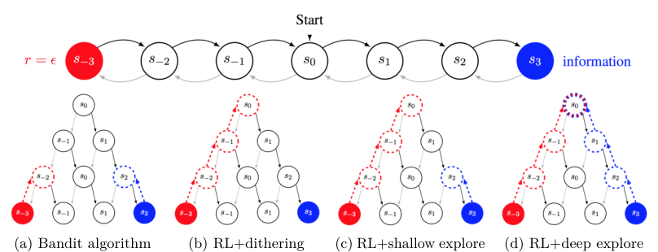

# 第 67 天｜Bootstrapped DQN：一次抽取一种价值判断，让探索走完一段路

[系列首页](README.md) · [上一篇](66-pid-lagrangian.md) · [下一篇](68-noisynet.md)

**原论文与版本**：Ian Osband、Charles Blundell、Alexander Pritzel、Benjamin Van Roy，*Deep Exploration via Bootstrapped DQN*，NeurIPS 2016（当时会议名称为NIPS）。[会议条目](https://proceedings.neurips.cc/paper/2016/hash/8d8818c8e140c64c743113f563cf750f-Abstract.html) · [arXiv版本历史](https://arxiv.org/abs/1602.04621) · [本文核读的v3 PDF](https://arxiv.org/pdf/1602.04621v3)。首版提交于2016-02-15；以下章节、页码、图号及实验细节以2016-07-04的v3为准，未把会议条目当成另一次全文核验。系列编号按教学主题衔接，不按发表年代排序。

### 先接住前作的问题

[DQN](16-dqn.md)把像素映射为动作价值，并用ε-greedy探索：大多数时候选择当前最好动作，少数时候随机行动。如果奖励就在下一步，这样做可能够用；如果必须连续走过很长一段暂时没有奖励的道路，逐步随机就可能一直在门口徘徊。

Bootstrapped DQN要改变的不是“每一步随机得更多”，而是“随机选择一种对世界的判断，然后沿着这套判断行动”。多个价值头为未充分访问的区域保留不同预测，回合开始时抽一个头，在整个回合里按这个头决策。探索由此有机会跨越多个时间步。

上一篇讨论约束优化中的乘子控制，本篇切换到数据收集问题。它与安全约束不存在直接继承关系；真正的技术入口是DQN、Double DQN，以及“价值估计对未知区域可能有不同解释”这件事。

## 一、问题设定：信息也可能藏在多步以后

考虑未知MDP，智能体只能通过交互取得转移样本。目标仍是最大化环境回报，没有额外内在奖励，也没有监督标签告诉它哪里值得探索。用价值函数指导行为时，我们关心的不只是一个动作当前估计有多好，还包括这个估计是否可能因新数据而改变。

### 五个前置概念

1. **统计bootstrap**：通过数据重采样获得多个估计器，反映有限数据支持下的估计差异。
2. **TD自举**：把后继价值估计放进当前学习目标，与统计bootstrap不是同一操作。
3. **后验采样思想**：抽取一种可信的价值假设再行动；近似集成并不因此成为精确贝叶斯后验。
4. **共享多头网络**：共用状态特征、分别预测动作价值，以计算效率换取一定的统计耦合。
5. **时间一致性**：多步行动沿用同一个抽样假设，才能走向远处的信息，而非每步重新摇摆。

### 交互与训练对象

| 要素 | 本文的具体含义 |
|---|---|
| 输入 | 小型链环境的特征，以及Atari的连续图像观测 |
| 输出 | K组动作价值，每个头对所有动作分别给出一个Q值 |
| 行为随机性 | 每回合随机选择一个头；Atari实现还保留退火ε-greedy |
| 学习数据 | 带有固定bootstrap掩码的replay转移 |
| 自举目标 | 每个头使用属于自己的目标价值函数 |
| 主要问题 | 怎样到达当前看不到奖励、但能带来重要信息的状态 |

这里有两个容易混淆的“bootstrap”。统计bootstrap对数据重采样，用多个估计器刻画数据不充分时的估计差异；TD bootstrap则用后继状态的估计值更新当前值。本文同时用到二者：前者制造和保留差异，后者把这些差异沿时间向前传播。两者都叫自举，但工作位置完全不同。

还要区分两种不确定性。一枚真实随机硬币即使抛了很多次，下一次结果仍不可预测，这是环境随机性；只抛过两次、不知道正面概率是多少，则是知识不足。本文多个头主要被用作后者的近似信号，但网络间分歧并不天然等于经过校准的认知不确定性。大家犯相同错误时，分歧甚至可以很小。

### 原图：为什么“知道右边未知”还不够

<figure class="reading-evidence-figure" id="rl-67-figure-2"><a href="/rl/assets/papers/67-bootstrapped-dqn-figure-2.png" target="_blank" rel="noopener noreferrer"></a><figcaption>原论文图形摘引｜Osband等，arXiv:1602.04621v3，PDF第4页Figure 2。<a href="https://arxiv.org/pdf/1602.04621v3#page=4" target="_blank" rel="noopener noreferrer">核对原文</a> · 点图放大。完整图形区域，原版权保留。</figcaption></figure>

这不是成绩曲线，没有数值横纵轴。上半部是状态链：从s₀开始，三步内连续向左可取得已知小奖励ε，连续向右才能到达未知的s₃。红色表示有奖励，蓝色表示有信息；下半部树的深度表示未来决策步数，虚线表示能把奖励或信息向前考虑。

图中的关键对照是(c)与(d)：能够偏好眼前有信息的动作，仍不一定能计划到达三步以外的信息源。深探索要求当前愿意采取既无即时奖励、也无即时信息的动作，因为它是未来学习的必要前缀。图只说明这一概念差异，不提供“所有深度网络都能高效探索”的定理，也不是实测成功率。

## 二、从数据重采样到多头价值函数

### 1. 为什么不是训练多个网络后取平均

设有数据集D，传统bootstrap反复从D有放回抽样，得到D₁,…,D_K，再分别拟合估计器。如果样本对结论的支持不足，不同重采样数据可能导向不同预测。这种差异不是额外观测，却能提示原始数据尚不能唯一确定的地方。

深度网络中，独立训练K个完整模型成本很高。论文使用共享特征网络h(s;ψ)，再分出K个独立的价值头：

$$Q_k(s,a;\theta)=g_k(h(s;\psi),a;\omega_k),\qquad k=1,\ldots,K.$$

共享卷积层节省计算，并让一个头看到的有用视觉结构惠及其他头；代价是头之间的统计独立性更弱。即使某条样本没有直接更新头k，共享表示被其他头更新后，Q_k也可能改变。因此“掩码为零”不是对整套预测函数的绝对隔离。

探索时不把Q值平均后贪心。平均可能把少数头对未知路径的乐观判断抹掉。假设三个头对“安全／未知”两动作分别预测(2,0)、(2,0)、(2,5)。均值贪心一直选安全动作，因为未知均值只有5/3；随机抽头则有1/3机会选择未知路径。这个例子说明的是行为分布不同，并不是说少数乐观头一定正确。

### 2. 掩码必须跟样本一起保存

对转移i保存mᵢ=(mᵢ¹,…,mᵢᴷ)，最简单的选择是各分量服从Bernoulli(p)。头k只接收mᵢᵏ非零的样本梯度：

$$L_k=\frac{1}{|B|}\sum_{i\in B}m_i^k\,\frac12\left(y_i^k-Q_k(s_i,a_i;\theta)\right)^2.$$

这里用平方损失说明机制；具体实现可保留DQN的误差裁剪等细节，不应把教学式直接当作全部工程配置。掩码控制样本归属，而不是每次replay时重新抛硬币。如果每次都重采样，长期看所有头都会见到近似相同的数据分布，它就不再实现固定数据子集的bootstrap语义。

原文有一处值得认真区分的粒度：[附录B Algorithm 1，第12页](https://arxiv.org/pdf/1602.04621v3#page=12)用每个转移采样mₜ的一般写法；第6.1节和附录C.1描述按回合生成Bernoulli掩码，再赋给该回合的数据。两者都能保存固定归属，但时间相关性不同。复现时要声明选哪个，而不是把“每回合选行为头”与“每回合选训练掩码”混成一个随机变量。行为头可以是k，样本却同时训练多个其他头。

p=0.5对应论文讨论的double-or-nothing bootstrap。附录还列出Poisson(1)等非二值权重；有放回抽样时单个样本出现次数的极限分布，提供了Poisson权重与传统bootstrap的联系。Bernoulli子集不是逐字复制经典有放回重采样，因此对统计保证也不能不加条件地搬运。

### 3. 每个头需要自己的未来

论文除非另行说明，DQN变体采用Double DQN更新。将其写清楚，头k的目标是

$$a_i^{*,k}=\arg\max_a Q_k(s'_i,a;\theta),$$
$$y_i^k=r_i+\gamma(1-d_i)Q_k(s'_i,a_i^{*,k};\theta^-).$$

dᵢ表示真正终止，目标端停止梯度，θ⁻按固定间隔复制。头k选择自己的后继动作，再由自己的目标头评价；不要将所有头共用一个平均目标，否则就会不断把差异拉回同一个未来假设。

这一点使得深探索不要求某个初始随机网络从第一天起就知道整条正确路线。某个头只需在新到达的边界，对尚未试过的动作保留较高估计，TD更新便可能把这项判断向已访问的前驱传播。之后抽到这个头时，智能体能够更有方向地再次走到边界，继续扩展经验覆盖。它依赖函数泛化、初始化和实际优化，没有一般神经网络下的效率保证。

## 三、时间一致性：一次抽样为什么比逐步抽样重要

### 一个独立核算的四步走廊

以下是教学例子，不是论文实验重跑。走廊长四步，每步必须选“前进”，任何一次选“返回”都结束本回合。到终点才观察到未知奖励。假设目前恰有两个固定价值假设：头A在四个状态都偏好前进，头B都偏好返回；两头被选中的概率均为1/2。先固定这些预测，不在回合中训练。

若每一步独立重新抽头，到终点需要连续四次抽中A，概率为(1/2)⁴=1/16。若回合开始只抽一次头，概率为1/2。独立重复回合下首次成功的期望等待次数分别为16与2，差8倍；扩展为L步时分别是2ᴸ与2。

如果使用ε=0.2的ε-greedy，且当前贪心动作总是返回，随机分支在两个动作间均匀选择，那么单步前进概率为0.2/2=0.1，四步成功概率为10⁻⁴，期望等待10000回合。这个数值取决于明确的失败即重启、固定预测和无学习假设，不是原论文对Atari的量化结论。

这个例子只隔离“随机性保持多久”的作用。它没有解释A这种一致价值假设怎样从有限数据中出现，也没有证明真实训练会维持A、B各占一半。Bootstrapped DQN的学习机制正是要让这一步不只靠幸运初始化：多样的边界判断可以通过各自目标网络传播回来。把条件概率算例写成完整算法的复杂度证明，会跳过最困难的环节。

### 一个掩码和目标更新手算

设γ=0.9，某条非终止转移奖励r=1，两个头当前对已执行动作的预测均为2。头1的在线后继值为(2,3)，目标后继值为(4,5)；头2在线后继值为(4,1)，目标后继值为(2,7)。于是Double DQN分别选择第二、第一动作，得到y¹=1+0.9×5=5.5，y²=1+0.9×2=2.8。

若保存的掩码为(1,0)，只更新头1。以表格型标量、学习率α=0.1作半梯度演示，Q₁从2变为2+0.1×(5.5−2)=2.35；Q₂保持2。若掩码改成(1,1)，Q₂才变为2.08。头2目标不是7.3：选后继动作看的是在线值，不是目标网络的最大值。共享神经网络中还会有表示耦合，不能把“另一个头的标量完全不动”照搬过去。

上述概率与有理数更新已用独立Python计算核对；没有运行环境训练。手算的价值在于逐项检查掩码、动作选择、评价网络、终止位和学习率，而不是给整套算法背书。

### 可实现的训练骨架

```text
初始化共享表示、K个不同初始化的价值头及对应目标头
初始化replay；选定掩码粒度、p和共享梯度归约规则
每个回合：
    均匀抽取行为头k，整个回合保持k
    若采用回合级掩码，抽取本回合的m
    每步按Q_k选择动作，收集(s,a,r,s',done)
        若采用转移级掩码，此时抽取m
        把转移与m一起存入replay，不在回放时刷新m
        在规定的训练时刻抽取共同小批量B
        对每个头j计算自己的Double DQN目标与掩码损失
        更新各头，按选定尺度聚合共享表示梯度
        到目标同步时刻复制所有头及共享表示
```

骨架省略了Atari中的ε退火与预处理，不能据此宣称原实验完全取消ε-greedy。回合固定的是头的身份；若回合内还做梯度更新，头的数值会变化，因此也不是冻结整套参数。长而无自然终止的任务还必须定义何时重新抽头；任意切分会改变探索的时间尺度。

## 四、原始实验支持什么，不支持什么

### 链实验隔离深探索，而非视觉识别能力

[第5.1节，第5页](https://arxiv.org/pdf/1602.04621v3#page=5)构造长度N的链，每回合N+9步，从s₂开始，比较逐步重抽头的Thompson DQN、ensemble策略和Bootstrapped DQN等。输入包含one-hot和thermometer两种状态特征，正文展示效果更好的thermometer结果。不要把这种二值编码的链实验说成Atari式复杂视觉理解。

每个长度训练2000回合、三个种子，以累计完成100个最优奖励为10的回合判为学会，绘制学习所需回合数的中位数。原文还给出浅探索的保守理论下界作参照。它展示Bootstrapped DQN在所构造问题上的较好尺度趋势，但失败截断、种子数量和成功标准都属于结果含义的一部分；图线不是任意MDP上的统一样本复杂度上界。

最有解释力的对照是：相似的多头表示，只改重抽样时间，就可能出现完全不同的学习尺度。这比“网络多了，所以更强”更接近论文的论点。反过来，不能因为实验支持时间一致性，就断言估计分布已经是真后验。

### Atari的实用取舍：十个头，却让全部头看全部数据

[第6节与附录D.1，第6—8、14—15页](https://arxiv.org/pdf/1602.04621v3#page=6)评估49个Atari游戏。共享DQN卷积主干，在最后卷积层之后分成K=10个头；每头含512单元的全连接层及动作输出。训练为5000万智能体步、约2亿游戏帧，replay保存最近100万条转移，每4步抽32条更新；目标网络每10000步同步。学习率0.00025，折扣0.99。

附录D.1明确写训练ε从1在线性100万步内退火至0.01，评价时采用ensemble voting。也就是说，训练的“随机选头再行动”和评价的“多头投票”是两种模式，不能将后者拿去解释深探索的来源。与前面的理想机制说明相比，实际Atari还保留了行动层随机扰动。

更意外的是，作者选择p=1。此时每个头使用全部数据，没有数据子集重采样，严格说是无bootstrap数据随机化的ensemble特例。差异主要来自不同初始化、各自目标及非线性训练过程。这个结果支持“在这些实验中，数据掩码不是收益的必要条件”，却不支持“bootstrap从来不重要”或“共享数据不影响不确定性质量”。

共享表示收到K个头的梯度，相比单头直接求和会改变有效学习率。论文讨论了1/K归一化：它改善部分最终成绩，却可能减慢早期学习。因而增加头数的对照如果不控制梯度尺度，可能混入优化器效应。作者报告K=10、p=1时运行墙钟额外开销低于20%，这是其实现和硬件上的经验结果，不是所有网络结构的固定成本。

### 学得快、累计收益高、峰值高是三个指标

正文报告到达人类水平的学习速度总体有改善，并讨论训练期间累计奖励和峰值评价成绩。本文不重新计算跨游戏“平均快30%”这一汇总，也不把它当成每个游戏都快30%的承诺。达到阈值所用帧数、整个学习过程面积、最高检查点评分，分别回答不同问题。

特别有启发的是失败案例：[第6.2节，第7页](https://arxiv.org/pdf/1602.04621v3#page=7)写到Montezuma’s Revenge在2000万帧后取得第一把钥匙，却没有有效把这次经验学成稳定行为；Frostbite中的学习也出现崩溃。这区分了“发现奖励”和“保留、回放、传播奖励”。[PER](19-per.md)可以改变哪些经验被反复训练，但它不是本文已验证组合，更不能说PER负责产生首次探索成功。

Atari结果没有证明对所有极稀疏奖励任务都有效。不同随机初始化可能不足以表达真正不同的长期假设，奖励裁剪、函数逼近和长时信用分配也可能成为瓶颈。本文未重跑训练、未逐游戏重算置信区间、未核验全部附录敏感性图，因此仅引用已核读的协议和作者明确报告的现象。

## 五、何时该怀疑“多头等于知道自己不知道”

多个头都训练在同一批偏置数据上，可能一致地错。共享表示可能让尚未访问的状态映射到熟悉区域，从而给出看似自信的值；掩码再精巧也不能恢复观测中根本缺失的信息。头间方差因此可作诊断量，却不能直接转换成错误概率、置信区间覆盖率或安全保证。

反方向也成立：优化未收敛、目标滞后、奖励尺度过大都可能造成头间分歧，这种分歧未必代表值得付出代价的信息。探索质量取决于价值假设如何影响策略，数值分歧很大却不改变动作排序时，行为可能完全相同。实践中应同时记录头间动作一致率、未访问区域覆盖、有效回报和梯度尺度，而非只画一个方差曲线。

最后，随机价值函数并不等于显式计算信息增益。本文没有对每条轨迹求互信息，也没有维护完整MDP后验；它借用posterior sampling的行为思想，用可训练的近似集成代替昂贵推断。线性或表格随机价值方法的理论启发，不会自动成为共享非线性网络的后验一致性证明。

### 实现审查：先做小实验，再解释大成绩

在正式跑Atari以前，可以设计三个不依赖昂贵训练的检查。第一，把两个头的初始化、掩码和目标全部设成相同，并固定随机性。若它们仍产生显著差异，首先排查实现中的非确定性，而不是把差异解释为知识不确定性。随后只恢复独立初始化，观察差异是否会在相同数据训练中消失；这个对照有助于确认究竟哪一项机制在维持多样性。

第二，创建只含两条转移的replay，给它们互补掩码(1,0)和(0,1)，暂时冻结共享表示。分别执行一次更新，检查每个头只收到被允许样本的梯度，再重复回放并确认掩码没有变化。若某个头在一个小批量中全为零，应得到零贡献，而不是对零个样本求平均产生NaN。用批量大小归一化与按有效样本数归一化，会改变p较小时的有效步长；两种实现不能在不调学习率的情况下视为完全等价。

第三，构造固定预测的走廊，记录每个回合选中的头和每步动作。这个测试不需要神经网络学习，专门检查头是否误在每步重抽、环境重置是否误触发新掩码、多个并行环境是否共享了不该共享的行为头。完成这些检查后，再开启在线更新观察到达边界的频率。将机制测试与性能测试分开，才知道“没有探索成功”是算法局限还是程序根本没有执行预期算法。

此外应区分真正终止与时间上限截断。如果走廊人为截断是任务定义的一部分，终止目标就应切断；如果只是采集器的时间限制，是否继续自举取决于实际MDP约定。原始论文年代的环境接口与现代接口不同，不能只靠一个名为done的布尔量就默认语义一致。训练日志至少保留环境步、游戏帧、优化步三种计数，避免把每四步更新与每四帧动作重复混成同一个时间尺度。

这些检查是本文根据机制提出的复现实务建议，不是作者已经报告的新增实验。它们也不能证明集成校准，却能先排除掩码、目标路由和时间一致性上的低级错误，让之后对探索效率的讨论有明确对象。

### 继续追问：平均、多样性与奖励

<details>
<summary>1. 多头平均的估计更稳定，为什么不始终平均后行动？</summary>

平均适合降低某些评价噪声，却会把相互矛盾的长期假设混成折中值。若未知路径只有少数头看好，均值可能永远不支持走进去，结果也永远收不到新证据。训练时抽头是为保留假设对应的行为；评价时投票则着眼于利用已有知识。两者目标不同，没有一个聚合方式同时解决全部问题。

</details>

<details>
<summary>2. p=1仍有效，是不是掩码、独立目标和随机初始化都可以删掉？</summary>

不可以。p=1只去掉数据归属差异，原实验仍保留不同初始化和各自目标。若再让各头参数相同、目标相同、更新完全相同，对称性下它们会一直相同，抽头不会带来行为多样性。逐项消融才能判断必要性，不能从删一个部件的结果推出所有部件都不重要。

</details>

<details>
<summary>3. 与ICM、RND相比，它到底探索什么？</summary>

[ICM](24-icm.md)和[RND](36-rnd.md)以预测误差等信号构造内在奖励，直接改变训练所见的奖励；Bootstrapped DQN保留环境奖励，通过不同价值假设改变行为选择。二者可以概念上互补，但误差奖励也有噪声干扰、遗忘和尺度问题，多头也有共同偏差和多样性坍缩。不能把RND的随机目标网络与本篇的目标价值头当成同一个机制。

</details>

## 六、沿着探索机制继续读

- [DQN](16-dqn.md)与[Double DQN](18-double-dqn.md)：直接算法基础，分别提供replay／目标网络与选择评价拆分。
- [PER](19-per.md)：互补的数据利用轴；发现稀有奖励之后，哪些转移值得多学几次。
- [NoisyNet](68-noisynet.md)：下一篇把随机性直接写进可学习参数，重点比较噪声保持时间和是否具有后验语义。
- [Rainbow](29-rainbow.md)：原Rainbow使用NoisyNet作探索组件，并没有把Bootstrapped DQN多头集成列为六个组成部分。

**原文定位**：v3第2—3页共享多头与独立目标，第4页图2，第5页链实验，第6—8页Atari与限制，附录B第11—12页掩码和Algorithm 1，附录D.1第14—15页实现协议。这里只核读有关章节，不声称所有附录、全部基线实现或训练结果均获独立验证。

## 自测两题

**问题1**：四步走廊中，两个头分别始终向前与始终返回。逐步独立抽头和每回合抽头各有多大成功率？这能否证明Bootstrapped DQN在所有四步任务都好8倍？

**参考答案**：分别为1/16和1/2，首次成功期望回合数16与2。不能普遍推广，因为算例假定两种一致价值假设已经存在、概率固定、失败立即终止且学习暂时关闭。真实网络如何形成并维护这些假设是另一项问题。

**问题2**：p=1时十个头共用全部数据，还能叫精确贝叶斯后验采样吗？若评价时投票，是否意味着训练也该投票？

**参考答案**：不能。此时数据bootstrap退化为ensemble，随机初始化与独立目标仍能产生差异，但没有精确后验保证。评价投票服务于利用，训练抽头服务于跨时间的探索；替换训练策略会改变论文的核心机制。

[系列首页](README.md) · [上一篇](66-pid-lagrangian.md) · [下一篇](68-noisynet.md)
