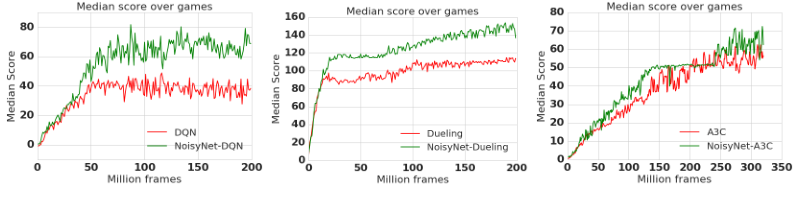
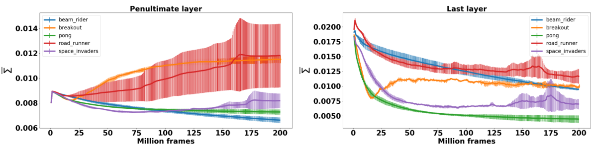

# 第 68 天｜NoisyNet：把探索噪声写进参数，让学习决定扰动有多大

[系列首页](README.md) · [上一篇](67-bootstrapped-dqn.md) · [下一篇](69-episodic-curiosity.md)

**原论文与版本**：Meire Fortunato等，*Noisy Networks for Exploration*，ICLR 2018。首次预印本提交于2017-06-30；本文核读的是2019-07-09的arXiv v3，其PDF标注“Published as a conference paper at ICLR 2018”。[版本与作者入口](https://arxiv.org/abs/1706.10295) · [核读的v3 PDF](https://arxiv.org/pdf/1706.10295v3)。以下页码、公式、图表和实现细节均指v3，不把2019修订日期误写成方法首次提出年份。本文作者署名采用“Fortunato等”，具体完整作者表以PDF首页为准；入口元数据与PDF作者排列并不完全相同。

### 先接住前作的问题

[Bootstrapped DQN](67-bootstrapped-dqn.md)保留多个价值头，每回合抽一个头来探索。一套价值假设可以影响许多连续决策，但多个头也带来参数、目标网络和训练管理成本。NoisyNet提出另一个接口：不显式维护K个头，而是令网络权重等于“可学习均值＋可学习尺度×随机噪声”。

这不只是把ε换成σ。ε-greedy在动作层面随机改选动作，NoisyNet改变的是整张状态到价值或策略的映射。同一次参数扰动会对不同状态产生相关但不一定相同的影响；噪声尺度还参与RL损失的梯度更新，不必按预先指定的曲线单调退火。

先把一个常见误解放在前面：原NoisyNet-DQN并非整回合保持同一噪声。它在每次行动前重新采样，训练批内固定噪声；NoisyNet-A3C则在整个rollout内保持噪声一致。参数空间随机性与跨时间保持多久，是两条必须分开说明的设计轴。

## 一、问题设定：让噪声进入函数，而不是只进入动作选择

网络仍然解决原有RL任务。DQN与Dueling输出动作价值，A3C输出策略和基线价值。奖励不增加好奇心项，replay或on-policy更新框架仍各自保留；变化发生在全连接层、随机采样方式和探索正则项。

### 五个前置概念

1. **参数空间噪声**：先随机化状态到价值或策略的映射，再用该函数决定动作。
2. **重参数化**：把随机权重写成可学习均值、尺度与固定统计噪声的组合，让梯度有确定路径。
3. **认知不确定性**：数据不足带来的知识误差；可学习噪声没有自动与它校准。
4. **随机目标与半梯度**：目标网络也有噪声，但更新当前参数时停止对目标的反向传播。
5. **rollout一致性**：on-policy多步数据与计算策略梯度的随机策略需要匹配，采样日程也是算法的一部分。

### 被替换的具体组件

| 原组件 | NoisyNet中的对应改动 |
|---|---|
| 普通全连接参数w、b | 可学习μ、σ与外生噪声ε共同构成有效参数 |
| DQN／Dueling的ε-greedy | 对采样后的随机Q函数直接贪心 |
| A3C的策略熵奖励 | 原文去掉该项，以参数噪声产生不同策略 |
| 手工探索强度日程 | σ与其他网络参数由同一RL目标更新 |
| 一个确定的前向输出 | 给定状态和参数噪声后确定；换噪声可得不同输出 |

这里的ε是噪声随机变量，不是ε-greedy中的随机行动概率。σ是逐参数尺度，也不是一个全局探索概率；不同层、不同权重可以学出不同数值。给网络加噪声后，σ的变化既可能影响行为数据，也可能改变训练目标的随机性。因此，性能提高不能未经消融就全部归因于“探索更好了”，原文结论也讨论了优化效应可能参与其中。

### 对比动作噪声时，先问随机性依赖什么

ε-greedy的随机分支通常在动作集合均匀抽样，它不根据当前状态判断哪一个非贪心动作更有意义。NoisyNet则先随机出一个函数Qε(s,a)，再用状态s计算动作排序。即使使用同样一组噪声，在门前可能选择开门，在走廊可能选择前进，在障碍物前可能选择转弯。相关的是函数参数，不是要求所有状态执行同一个动作。

但这只是表达结构更丰富，不是自动获得有用策略的保证。一个扰动也可能把所有动作同时抬高而不改变排序，或者只损坏已学会的视觉特征。原实验主要扰动全连接层，并没有声称“给所有卷积核加最大噪声”会更有效。究竟扰动哪里、多大、多久，需要和训练目标一起考虑。

## 二、从重参数化推导可学习的噪声尺度

### 1. 随机参数，确定的可微路径

令θ为有效网络参数，ζ=(μ,σ)为实际被优化器保存的参数，定义

$$\theta=\mu+\sigma\odot\varepsilon,\qquad \bar L(\zeta)=\mathbb E_\varepsilon[L(\mu+\sigma\odot\varepsilon)].$$

ε来自固定统计分布，不作为可学习参数。只要满足交换微分与期望所需的常规可积、可微条件，可以把梯度写为

$$\nabla_\mu\bar L=\mathbb E_\varepsilon[\nabla_\theta L],\qquad
\nabla_\sigma\bar L=\mathbb E_\varepsilon[\nabla_\theta L\odot\varepsilon].$$

实际每个优化步用一次噪声样本近似这个期望，即[第3节式(12)—(13)，PDF第5页](https://arxiv.org/pdf/1706.10295v3#page=5)。对固定ε而言，梯度可沿通常的网络计算图反传，不需要对随机数生成器求导。σ接收的梯度比μ多乘一次ε，这使得同一个误差对两类参数可能推动相反方向。

“无偏梯度估计”在这里指给定训练分布与定义好的噪声期望，随机梯度对应这项目标；它不意味着TD目标等于真实最优价值，也不意味着忽略策略影响数据分布后就成了整个RL问题的全梯度。目标网络端仍应停止梯度。分清局部优化目标与长期交互目标，才不会把重参数化写成收敛证明。

一个p输入、q输出的层变为

$$y=(\mu^w+\sigma^w\odot\varepsilon^w)x+\mu^b+\sigma^b\odot\varepsilon^b.$$

权重和偏置各自都有均值与尺度。普通层的参数数目为pq+q，噪声层的可学习参数数目翻倍为2(pq+q)；但不意味着整个网络都翻倍，因为卷积层可以保持普通形式。乘法主干仍存在，生成有效权重也有成本，论文的低额外开销观察不能替代具体实现的速度测量。

### 2. σ不必单调减小，也不必是正数

此参数化并未要求σ通过指数或softplus保持正。若ε分布关于零对称，σ与−σ诱导相同的边缘扰动分布；因此分析噪声强度时，应看绝对值、平方或对输出的影响，而不是直接平均带符号的σ。

对独立标准正态ε，单个权重扰动方差是σ²。可是σ不是“动作选择出错的概率”，也不是“网络对这条权重的后验标准差”。动作是否变化还依赖当前输入、激活、动作之间的价值差距，以及其他权重的联合扰动。

在一个固定监督回归问题里，额外参数噪声常常增加均方误差，训练可能把σ压到零。RL却不断改变数据分布和目标；保留噪声可能帮助收集后来降低误差的经验，也可能只是当前训练过程的局部结果。因此不能从“存在确定性解”推导“所有层最终都关掉噪声”，更不能把不归零自动当成探索最优的证据。

## 三、独立高斯与因子化高斯，不是同一噪声模型

### 独立噪声：每条连接自己抽一个数

独立高斯方案令每个εᵂⱼᵢ和εᵇⱼ独立服从N(0,1)。一层需要pq+q个随机数，直观而直接。原文在A3C主要实验中采用它；分布式执行降低了随机数生成开销的相对影响。

由于多个输出各有自己的噪声来源，给定输入后的输出扰动关系由网络结构决定，不能把它等同于每个动作独立加一个固定方差高斯数。中间层的非线性会继续改变分布，参数噪声的最终策略分布一般没有简单闭式表达。

### 因子化噪声：减少随机数，并引入共享结构

采样p个输入端标准正态变量uᵢ与q个输出端标准正态变量vⱼ，定义

$$f(z)=\operatorname{sgn}(z)\sqrt{|z|},\qquad
\varepsilon^w_{ji}=f(v_j)f(u_i),\qquad \varepsilon^b_j=f(v_j).$$

随机数从pq+q减少到p+q，权重和偏置同用输出端因子。DQN与Dueling使用这一方案。[第3节式(10)—(11)，第5页](https://arxiv.org/pdf/1706.10295v3#page=5)给出定义；正文将其称为factorised Gaussian noise，但经过f变换和相乘后，每个最终权重噪声并不仍是标准正态。

用原定义可以独立算出：若Z为标准正态，E[f(Z)]=0，E[f(Z)²]=E|Z|=√(2/π)。两个独立因子的乘积噪声方差因此为2/π，而偏置噪声方差为√(2/π)。所以对这种方案，不能不加说明地把σ²称为每条权重的实际扰动方差；权重方差还需乘2/π。

同一行共用vⱼ，同一列共用uᵢ，因此不同连接的噪声一般不是独立的。某些不同连接的协方差可以因零均值而恰好等于零，但零相关不代表独立。εᵂ本身是外积形式；实际扰动σᵂ⊙εᵂ由于逐元素尺度不同，不一定仍是秩一矩阵。这里“因子化”降低的是噪声生成成本，不是把可学习权重矩阵强制变成低秩。

### 初始化只是起点，不是后验先验

[第3.2节，第6页](https://arxiv.org/pdf/1706.10295v3#page=6)对独立噪声的μ采用依输入数缩放的均匀初始化，σ设为0.017；因子化方案的μ范围为±1/√p，σ按σ₀/√p初始化，σ₀=0.5。不同方案的数值不能直接比较，因为噪声的边缘统计与输入尺度不同。

这些是论文采用的工程初始化，不是通过贝叶斯推导得到的后验参数。原文明确表示NoisyNet不维护必须逼近后验的参数分布。没有KL项把它约束到某个先验，也没有一个数据似然更新规则保证σ随知识增加而按后验规律收缩。它的定位是可学习的随机函数族，而不是免费的贝叶斯推断器。

## 四、两次手算：噪声怎样影响输出与梯度

### 同一组因子，在一个状态可以抵消

取两输入、两输出，输入x=(2,1)，均值权重为单位矩阵，均值偏置为零，所有权重和偏置的σ均为0.1。指定一次教学噪声样本u=(1,−4)、v=(9,−1)，于是f(u)=(1,−2)，f(v)=(3,−1)。

$$\varepsilon^w=\begin{pmatrix}3&-6\\-1&2\end{pmatrix},\qquad
\varepsilon^b=\begin{pmatrix}3\\-1\end{pmatrix}.$$

权重噪声乘x后恰为(0,0)，只剩偏置扰动，所以输出为(2.3,0.9)。换成x=(1,0)，权重扰动不再抵消，输出为(1.6,−0.2)。这两个前向结果用Python矩阵运算独立核对。指定实数样本只为手算方便，不代表实际随机采样经常精确得到这些数。

这个例子揭示，σ不变、噪声不变时，输出扰动也会随状态改变。它还提醒我们不要把每层平均|σ|当作可跨任务比较的“行为探索率”：输入特征缩放两倍，即使σ不变，权重噪声对输出的影响也可能显著放大。

### 一次梯度更新可以增大或减小σ

再看一个标量层q=(μ+σε)x，损失L=(q−y)²/2。设μ=1、σ=0.5、x=2、y=3，抽到ε=−1，则q=1、L=2。梯度为

$$\frac{\partial L}{\partial\mu}=(q-y)x=-4,\qquad
\frac{\partial L}{\partial\sigma}=(q-y)x\varepsilon=4.$$

学习率0.1的一步梯度下降给出μ'=1.4、σ'=0.1；用同一ε再前向，q'=2.6。μ增大而σ减小，因为这次负噪声把预测拉得太低。若改变目标或噪声符号，σ的更新方向也会改变，不存在程序内置的“每步减少噪声”规则。

对零均值、单位方差噪声，这个固定数据标量问题的期望损失为[(μx−y)²+σ²x²]/2，期望σ梯度为σx²=2。它的最优解μ=1.5、σ=0。这个小结论只针对固定监督目标；不能据此否定RL探索中的参数噪声，因为真实训练后续会看到什么数据，本来就受行为影响。

这里验证的是前向计算、链式求导和一次更新，不是独立训练NoisyNet。把这种可核算局部例子与原始Atari实验分开，才能既检查理解，又不夸大复现范围。

## 五、真正容易写错的是采样日程

### DQN：行动噪声、当前值噪声、目标噪声分别处理

NoisyNet-DQN的一个批量目标可写成

$$y_i=r_i+\gamma(1-d_i)\max_a Q(s'_i,a,\varepsilon';\zeta^-),$$
$$L_B=\frac1{|B|}\sum_i\left(y_i-Q(s_i,a_i,\varepsilon;\zeta)\right)^2.$$

在线训练噪声ε与目标噪声ε'独立，并在整个批量中各自保持固定。环境行动另抽噪声εᵃ，对Q(s,a,εᵃ;ζ)贪心。NoisyNet-Dueling继承其基线的Double DQN式选择评价拆分，后继动作选择再用独立噪声；不能把NoisyNet-DQN的max目标和NoisyNet-Dueling的Double目标混写。

原文[第3.1节，第5—6页](https://arxiv.org/pdf/1706.10295v3#page=5)说明参数样本在优化步之间保持，DQN／Dueling一行动步对应一优化步，因而每次行动前重采样。附录C.1 Algorithm 1进一步区分行为、在线损失和目标生成。这里的行动步不应直接等同于Atari原始视频帧；动作重复与环境预处理另有计数。

```text
初始化可学习μ、σ，以及包含二者的目标网络
每个行动步：
    采样行为噪声εa，以随机Q函数贪心选动作
    保存转移(s,a,r,s',done)到replay
    抽取小批量B
    独立采样在线噪声ε、目标噪声ε'
    整批固定这两组噪声
    若使用NoisyNet-Dueling：另抽后继选择噪声
    按对应DQN或Double目标计算损失，目标停止梯度
    同时更新在线网络μ与σ
    到同步时刻，将在线μ、σ复制到目标网络
```

目标网络固定的是分布参数ζ⁻，不是永远固定一组噪声。若缓存一次随机权重后数千步不刷新，就改变了原文的目标随机化。反过来，若在同一批样本每次调用forward时暗中刷新噪声，当前预测、动作选择和损失之间也可能失去设计中的一致性。实现最好显式区分“重采样噪声”与“执行前向”。

### A3C：整段rollout共用同一个随机策略

A3C不是用Q值argmax行动，而是从当前策略分布采样。NoisyNet-A3C去掉策略熵奖励，在一个rollout开始时抽参数噪声，收集多步数据、计算末端价值自举和策略梯度时都保持同一份噪声。更新后才为下一段rollout重抽。

这样，条件于这份噪声，轨迹与用于计算logπ和价值的策略相匹配。若动作来自噪声A、更新却用全新噪声B算似然，会额外引入行为策略和更新策略不匹配，不再是原文所述的on-policy构造。第6页式(17)及附录A、第13页对此给出解释；它并不消除异步训练、函数逼近或价值估计自身的全部误差。

因此，NoisyNet能表示跨状态相关的策略变化，但其DQN实现不像Bootstrapped DQN那样承诺整回合同一假设。不能把参数噪声与“回合级深探索保证”画等号，也不能把A3C的rollout长度当成完整环境回合长度。两篇真正的对照应同时看随机函数怎么生成、怎样训练，以及多久换一次。

## 六、原图与实验：改善在哪里，数字怎样读

<figure class="reading-evidence-figure" id="rl-68-figure-2"><a href="/rl/assets/papers/68-noisynet-figure-2.png" target="_blank" rel="noopener noreferrer"></a><figcaption>原论文图形摘引｜Fortunato等，arXiv:1706.10295v3，PDF第8页Figure 2。<a href="https://arxiv.org/pdf/1706.10295v3#page=8" target="_blank" rel="noopener noreferrer">核对原文</a> · 点图放大。完整三面板图形，原版权保留。</figcaption></figure>

横轴为百万环境帧，纵轴为跨游戏的人类归一化分数中位数；左、中、右分别对应DQN、Dueling、A3C，红线为基线，绿线为NoisyNet。前两个面板到约2亿帧，A3C面板延伸到约3.2亿帧，横纵范围并不相同。绿色DQN、Dueling曲线较早分开且大体较高；A3C曲线更接近，不能从三个面板的相似大小推断三种算法收益相同。

这张图报告训练过程中各评价时刻的表现，不是各游戏最优检查点组成的Table 1。图上也没有逐游戏误差条，不能凭一条中位数曲线断言每款游戏都提升，或宣称已证明统计显著性。下面的数值来自表格核对，不是从曲线上估读。

### 协议决定可比性

第4.1节评估57个Atari游戏，训练与评价采用随机no-op起步；每100万帧暂停学习，用50万帧评价最新智能体，单回合最长108000帧，即模拟游戏30分钟。DQN训练2亿帧，A3C训练3.2亿帧；不同基线及对应NoisyNet使用各自原有架构与超参数。Dueling采用论文所述duel clip基线，不能把它称为纯DQN只加一个输出分支。

每个游戏的最大成绩口径是先取各次运行的最大原始分数，再对三个种子平均；学习曲线则在每个评价时刻对三个种子平均，再汇总游戏表现。选最好检查点会受评价频率与选择机会影响，因而其值不必等于最后一次评价，也不必等于图2末端高度。

人类归一化定义为100×(agent−random)/(human−random)，随后跨游戏求均值或中位数。它便于比较不同量纲，但均值仍可能被少数极高相对分数的游戏主导；中位数反映典型位置，也会隐藏两端的大幅变化。评估应同时看二者和逐游戏分布，而不是只挑提升最明显的一列。

### 表1的“48%”不是48个百分点

[第8页Table 1](https://arxiv.org/pdf/1706.10295v3#page=8)列出如下均值／中位数：DQN为319／83，NoisyNet-DQN为379／123；Dueling为524／132，NoisyNet-Dueling为633／172；A3C为293／80，NoisyNet-A3C为347／94。

按表中已经舍入的中位数计算，DQN增加40个人类归一化百分点，相对增长40/83≈48.2%；Dueling也增加40个百分点，相对增长40/132≈30.3%；A3C增加14个百分点，相对增长14/80=17.5%。表末列48%、30%、18%与这些相对比例的舍入一致。

v3相邻正文用了“percentage points”来描述18至48的提升，而表末列标题及表内数值支持相对百分比。这里应保留这一文本与表格的口径区别，不能照抄成“中位数增加48个百分点”，也不能把18%与17.5%的正常舍入说成数据矛盾。我们没有重新汇总逐游戏原始数据，以上仅是对表内显示值的独立算术检查。

### 学到的噪声真的会变化吗

第4.2节以每层平均|σ|观察噪声尺度，图3对五个游戏、三个种子给出轨迹。作者报告末层平均尺度在所示游戏下降，倒数第二层却只在其中两个游戏下降，其他三个上升。这支持“噪声强度随层和任务变化”，不支持“σ就是后验不确定性”或“噪声必然自动退火到零”。

<figure class="reading-evidence-figure" id="rl-68-figure-3"><a href="/rl/assets/papers/68-noisynet-figure-3.png" target="_blank" rel="noopener noreferrer"></a><figcaption>原论文图形摘引｜本文核读版本PDF第9页Figure 3，完整图形区域。<a href="https://arxiv.org/pdf/1706.10295v3#page=9" target="_blank" rel="noopener noreferrer">核对原文</a> · 点图放大。原版权保留。</figcaption></figure>

原图3左面板是倒数第二个噪声层，右面板是末层；横轴百万训练帧，纵轴Σ̄是层内平均绝对噪声尺度。五种颜色对应五游戏，线为三种子平均、误差条为正负一个标准差，不是置信区间。左图部分尺度上升、右图整体下降，支持任务与层相关的变化，不能把任一尺度曲线直接解释成已校准的知识不确定性。

平均|σ|还会丢失方向、输入激活以及动作间间隔信息。要判断实际探索，应进一步看相同状态换噪声后动作排序改变多少、策略分布变化多少、到访状态是否增加。原文展示的是性能与部分机制诊断，不是对所有这些量的完整因果分解。本文未重新训练、未逐条验证附录全部游戏表，也未独立复算误差条。

## 七、边界与实现检查：噪声存在不等于探索有效

NoisyNet的学习目标仍来自已经收集的转移。如果某条关键路径从未被尝试，梯度没有凭空知道它存在的能力。可学习σ降低了手调固定探索日程的负担，但也可能在尚未充分探索时变小；尺度、初始化、奖励稀疏性、状态表示与优化器仍影响结果。

建议在训练前做三项局部检查。先固定随机种子和ε，确认重复前向一致，改变ε后输出能变化；再把σ设为零，确认噪声层退化为普通线性层；最后用前述标量样例做有限差分，检查μ和σ都在优化器中、目标端却没有梯度。这些是根据公式提出的程序测试，不是声称已验证某个公开实现。

训练中应分别记录每层|σ|、同状态动作变化率、replay TD误差与评价回报。如果|σ|很大但动作从不变化，可能是所有动作共同偏移；若σ迅速下降且状态覆盖停滞，则值得排查探索过早消失；若σ升高而TD误差失控，则不能只把它赞为“更积极探索”。这些现象需要对照实验，不是凭一条曲线就确定原因。

评价也必须写清楚。保留噪声评价、固定一份噪声评价、把σ置零评价，是三个不同策略。尤其Q在非线性网络中对噪声的期望不一定等于将噪声设为零后的Q，贪心的期望也不等于期望后的贪心。若部署时选择确定性策略，应作为额外评价条件报告，不能直接套用原论文成绩。

### 与回报分布再划一条边界

[C51](28-c51.md)和[QR-DQN](62-qr-dqn.md)对固定状态动作表示未来回报的分布；NoisyNet则随机化预测函数本身。环境完全已知但奖励随机时，回报分布可以很宽，而参数噪声未必应当很强。反过来，环境是确定性的，但尚未访问的区域缺少数据，函数预测仍可能有很大认知误差。把随机Q输出直接当成回报样本，会混淆这两层随机性。

组合两者时应分别定义网络输出的分布对象、采样参数噪声的方法和选动作所用的统计量。原Rainbow在随机参数下仍通过分布价值的期望选动作，并不是随便抽一个回报原子就行动。理解这种分层，也能避免把“分布式强化学习”中的分布预测与多机器并行训练混为一谈。

### 继续追问：后验、回放与组合

<details>
<summary>1. σ大是否表示智能体知道这个动作不确定，所以更应该探索？</summary>

不一定。σ由RL损失训练，没有后验校准目标；它属于权重，动作扰动还依赖状态输入和整个网络。某条权重σ很大可能几乎不影响当前动作，σ很小也不排除共同模型偏差。更可靠的判断需同时看行为多样性、数据覆盖和实际回报，不能只按σ大小分配安全预算。

</details>

<details>
<summary>2. 为什么不让replay批量里每条样本都各抽一套噪声？</summary>

这可以定义另一种Monte Carlo估计方式，但不是原文批内固定噪声的实现；它改变梯度方差、样本间相关性与计算成本。原文固定批内随机函数，并使在线与目标噪声独立。修改采样规则时应说明是在做变体，尤其不要在同一个目标计算的不同前向中无意刷新噪声，导致选择与评价关系失控。

</details>

<details>
<summary>3. NoisyNet、PER、ICM是不是同一种“让难样本更多出现”的方法？</summary>

不是。[PER](19-per.md)改变已有replay转移的抽样概率，NoisyNet改变收集新数据时的随机策略函数，[ICM](24-icm.md)及[RND](36-rnd.md)通过内在奖励改变学习信号。它们可以组合，但作用位置和潜在偏差不同。[Rainbow](29-rainbow.md)确实使用NoisyNet与PER等组件，并未因此证明任意内在奖励与参数噪声组合都有效。

</details>

## 八、把两篇探索论文放回同一张问题地图

- [Bootstrapped DQN](67-bootstrapped-dqn.md)：有限个价值假设、独立目标头、回合级抽头；近似后验是启发而非神经网络校准保证。
- [DQN](16-dqn.md)与[Dueling](20-dueling-dqn.md)：原文直接改造的价值学习载体，后者的Double目标不能遗漏。
- [A3C](22-a3c.md)：说明参数噪声不只适用于离散贪心价值策略，rollout一致性需单独维护。
- [Rainbow](29-rainbow.md)：直接组合NoisyNet的后续系统；原Rainbow分布模块用C51，不是QR-DQN，探索模块也不是Bootstrapped DQN。

下一篇[情节好奇心（Episodic Curiosity）](69-episodic-curiosity.md)转向内在奖励。进一步研究时，可以问：怎样判断新状态与已见状态在行为上是否真的不同？这与本篇“怎样随机化策略函数”互补，但需要另一套记忆或可达性机制，不能仅靠增大σ回答。

**原文定位**：v3第4—6页第3节、式(9)—(17)及初始化；第6—9页第4节、Table 1和Figure 2—3；附录A第13页rollout噪声一致性，附录C.1第15页DQN／Dueling算法。正文、表内数字与嵌入图已核验，未将未逐项检查的附录结果标为复现证据。

## 自测两题

**问题1**：因子化方案的一层有p=512、q=18。独立方案与因子化方案各需要多少个基础随机数？可学习σ是否也只剩p+q个？

**参考答案**：独立方案需要512×18+18=9234个，因子化需要512+18=530个。减少的是基础噪声抽样数，权重和偏置仍各自有逐元素μ、σ，共2×9234=18468个可学习参数，不是只学530个尺度。

**问题2**：把NoisyNet-DQN改成整回合固定噪声，再在A3C每一步重抽噪声，是否忠实复现原文？Table 1的83到123应如何描述？

**参考答案**：都不是原文采样日程。DQN行动前重抽，批内固定；A3C整段rollout固定噪声以维持条件策略一致性。83到123增加40个百分点，相对增长约48.2%；不能写成增加48个百分点。

[系列首页](README.md) · [上一篇](67-bootstrapped-dqn.md) · [下一篇](69-episodic-curiosity.md)
