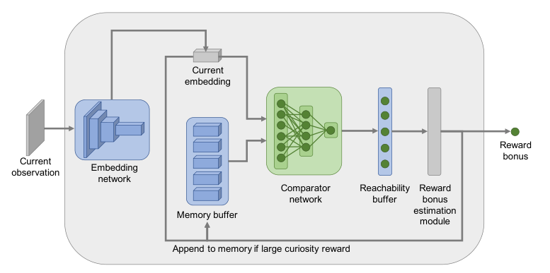
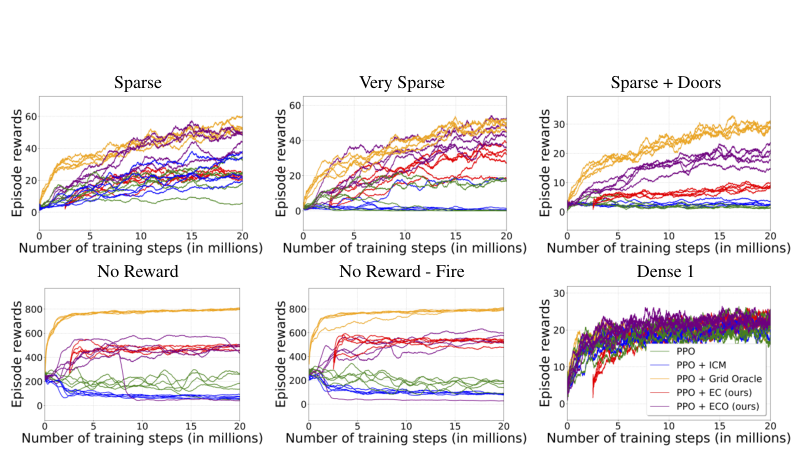

# 第 69 天｜Episodic Curiosity：用可达性判断新奇，而不是追逐预测误差

[系列首页](README.md) · [上一篇](68-noisynet.md) · [下一篇](70-ngu.md)

**原论文与版本**：Nikolay Savinov等，*Episodic Curiosity through Reachability*。首次预印本为2018-10-04，正式发表于ICLR 2019。本文核读[arXiv v5（2019-08-06）](https://arxiv.org/pdf/1810.02274v5)，不将首发年与会议年混为一谈。

### 一个有变化却没有进展的房间

如果智能体不断对着墙开火，画面、音效、预测误差都可能持续变化，但它并没有去过新的地方。把“预测不准”直接解释为“值得探索”，就可能把智能体奖励在原地。

EC提出另一种问题：当前观测是否能从本回合已记住的观测，在少量环境步内到达？如果可以，视觉变化再大也未必新鲜；如果不行，就值得发放探索奖励。这里的距离首先是环境中的行动距离，不是像素距离。方法用时间邻近数据训练可达性判别器，再用回合记忆把局部判别变成探索信号。

它并不掌握真实状态转移图，也不求精确最短路径。因此“可达性”始终是学出来的近似，不能据此声称已经解决随机电视或所有不可控噪声。

### 五个前置概念

1. **回合记忆**：只保存当前回合选中观测的表示，回合结束清空；它与训练经验回放不同。
2. **可达性**：在较少环境步内从一个观测附近到达另一个的关系；本文模型只是学习近似。
3. **嵌入**：把高维观测编码为向量，便于比较，不能自动保证距离具有正确环境含义。
4. **百分位聚合**：把多个比较值按分布位置汇总，减轻单一极端值影响，但也可能忽略真实近邻。
5. **内在奖励**：由agent内部构造的行为激励，会改变任务目标，必须与外在评分区分。

## 一、问题设定：把新奇性的参照系放进当前回合

RND等终身预测误差会随着访问而逐渐消退；EC的记忆每个回合重置。同一地点在新回合可以重新获得奖励，在同一回合反复往返则应越来越无趣。这样做适合需要反复开展探索的任务，但也意味着奖励不是简单的终身访问次数。

令当前观测为o，嵌入网络为E，比较网络为C。可达性模型为

$$R(o_i,o_j)=C(E(o_i),E(o_j))\in[0,1].$$

高输出表示模型认为两个观测在少量步骤内可达。它不是“越大越新奇”，方向恰好相反。记忆M保存当前回合选中的嵌入，计算当前观测与记忆各项的比较分数：

$$e=E(o),\qquad c_i=C(e_i,e),\quad e_i\in M.$$

本文用“状态”作直观描述时，不应忘记输入仍是观测。外观相似的两个位置可能被混淆，同一位置的视角变化也可能改变嵌入；有限容量模型无法保证获得准确的拓扑距离。

## 二、可达性分类器怎样获得监督

从轨迹o₁,…,o_N中采样观测对。时间间隔满足|i−j|≤k的对作为正例；满足|i−j|>γ_gap k的对作为负例，其中γ_gap>1。中间留出的间隔不用于这项二分类，以减少临界时间差造成的含糊。这里γ_gap是采样间隔系数，不是强化学习的折扣因子。

用标签y∈{0,1}训练交叉熵：

$$\mathcal L_R=-y\log R(o_i,o_j)-(1-y)\log(1-R(o_i,o_j)).$$

轨迹时间差是廉价监督，但不是实际最短路径。两个时间上很远的观测可能来自绕圈后回到相邻房间；负样本因此会有噪声。模型学到的是采样数据支持的可达性规律，而非环境图上的严格度量。这个差别也解释了为什么不能把比较网络输出当作可证明的通行证。

原文分别研究预训练EC与在线ECO。前者用随机策略的数据训练R网络，再用于策略学习；后者在任务策略采集数据的同时更新R网络。在线数据可能覆盖随机策略没去过的区域，但表示也随训练变化，需要注意旧记忆与新嵌入的一致性。本文不把两种运行的成绩合成一个模型。

随机预训练的交互预算也是真实成本。原文描述DMLab使用250万次四帧重复动作步，VizDoom使用30万次四帧重复动作步。若比较端到端样本效率，不能只计后续策略学习而隐去这部分数据。

## 三、从一组可达性分数得到奖励

先聚合记忆比较分数：

$$q=C(M,e)=F(c_1,\ldots,c_{|M|}),\qquad b=\alpha(\beta-q).$$

理论上max很自然：只要存在一项近邻记忆，就不应视作全新。然而学习模型可能偶尔给出错误高分，一个离群值就会抹去奖励。论文用第90百分位作为较稳健的替代。它仍是启发式：记忆规模、分数分布和百分位实现方式都会影响结果。

α控制奖励规模；β控制零点。本文这里的β不是后面NGU中的策略族索引。原文经验上固定时长回合使用β=0.5，可变时长回合更偏向β=1。原因是当q>β时奖金为负，可能诱导智能体缩短回合；当奖励总为正时，又可能偏向延长回合。探索奖励会改变原始任务的优化目标，并非无代价的辅助标签。

只有当b>b_novelty，当前嵌入才进入记忆。若每一步都保存，下一步往往总能从刚保存的观测在一步内到达，密集记忆容易让奖金很快失去作用。门槛相当于把路线压缩成较稀疏的地标。有限容量记忆溢出时，论文讨论随机替换已有项；被遗忘的地方之后可能再次得到奖励。

### 一个独立教学算例

假设记忆得到11个比较分数，其中10个为0.275，1个离群高值为0.95。按常见线性百分位插值，本例第90百分位为0.275，而max为0.95。取α=0.03、β=0.5：

$$b_{90}=0.03(0.5-0.275)=0.00675,\qquad
b_{\max}=0.03(0.5-0.95)=-0.0135.$$

若记忆门槛为0.005，前者存入当前嵌入，后者不存。这说明聚合器不仅改变本步奖励，也会改变未来记忆，进而改变后续探索。例子刻意展示离群值的作用，不证明第90百分位在所有环境更优。

## 四、读原图3：奖励与记忆之间存在反馈

<figure class="reading-evidence-figure" id="rl-69-figure-3"><a href="/rl/assets/papers/69-figure-3.png" target="_blank" rel="noopener noreferrer"></a><figcaption>原论文图形摘引｜arXiv1810.02274v5, 2019-08-06，PDF p4, Figure 3, intact graphic without original caption。<a href="https://arxiv.org/pdf/1810.02274v5#page=4" target="_blank" rel="noopener noreferrer">核对原文</a> · 点图放大。原作者及权利人保留版权，有限摘引用于直接技术评论。</figcaption></figure>


图中最值得注意的是底部回路：记忆不是独立记录器，而受奖励门槛控制。嵌入网络负责把观测变成可比较向量；比较器负责判断近距离可达性；聚合器负责把多个分数压成一个奖金。三个层次不能简化成“在向量空间求最近邻就完成EC”。

图还说明为什么记忆只存嵌入可以节省计算：历史观测不必每次重新通过完整视觉编码器。但这种节省并不意味着在线表示漂移不存在，也不意味着可以把回合记忆和经验回放混成同一容器。前者定义新奇性，后者供策略或表示学习抽样。

解释流程的伪代码如下，空记忆初始化和容量由具体配置决定：

```text
准备可达性嵌入 E 与比较器 C
每个回合开始: 清空回合记忆 M
每一步:
    取得当前观测 o，计算 e = E(o)
    将 e 与 M 中的嵌入比较，得到分数集合
    依定义的聚合器和空记忆规则计算 q
    b = alpha * (beta - q)
    用任务奖励与 b 的组合训练策略
    若 b 超过新奇性门槛，将 e 加入 M
    容量超限时按配置替换旧记忆
若使用 ECO，另外按训练日程更新可达性模型
```

这里没有把教学伪代码伪装成可复现实验的全部实现，尤其没有擅自发明原文未在本段规定的空记忆默认值。

## 五、读原图7：同一张图里有两种评价对象

<figure class="reading-evidence-figure" id="rl-69-figure-7"><a href="/rl/assets/papers/69-figure-7.png" target="_blank" rel="noopener noreferrer"></a><figcaption>原论文图形摘引｜arXiv1810.02274v5, 2019-08-06，PDF p8, Figure 7, intact graphic without original caption。<a href="https://arxiv.org/pdf/1810.02274v5#page=8" target="_blank" rel="noopener noreferrer">核对原文</a> · 点图放大。原作者及权利人保留版权，有限摘引用于直接技术评论。</figcaption></figure>


上排比较Sparse、Very Sparse、Sparse+Doors；下排包括No Reward、去除Fire动作的No Reward和Dense 1。横轴是训练动作步数（百万），论文使用四帧重复动作步。不能把2000万这样的数值直接当成原始模拟帧数。

每个方法运行30个随机种子，但图中只画随机选取的5次运行，并非30次的均值加置信带。它适合看学习过程、跨运行差异与退化趋势，不适合从某一条线断言总体显著性。

更重要的是，无任务奖励面板的纵轴用Grid Oracle奖励衡量覆盖程度，并不是把“没有环境奖励”变成“没有评价指标”。Grid Oracle基线还使用其他方法没有的特权信息，因此是参照，不是观测条件完全相同的竞争者。

图中ICM在某些无奖励任务上先上升再退化，EC/ECO保持更好的覆盖。去掉Fire动作后仍出现差距，说明问题不只是开火这一种行为。与此同时，Dense 1中各方法较接近，不支持“任何任务加EC都会显著获益”。

## 六、实验数字能支持多大的结论

第9页表1报告30个种子的mean±std，不是标准误或95%置信区间。Very Sparse中，PPO+EC为24.7±2.2，PPO+ICM为11.2±3.9，均值比约2.21；No Reward覆盖指标分别为475±8与72±2，均值比约6.60。这是特定任务、预算和指标下的比值，不是通用样本效率倍数。

在线ECO在Very Sparse为40.5±1.1，而固定EC为24.7±2.2。它提示在线可达性学习可能重要，但不能据此把差异全归于某一个单独组件，或忽略表示更新、采样分布及预训练预算。Dense 1中EC为19.9±0.7，普通PPO为22.8±0.5，更直接提醒我们内在奖励也会干扰已经足够清晰的任务目标。

论文的优势证据集中于指定探索问题与所用环境。可达性分类器对一步内的视觉扰动可以较稳健，却仍受数据覆盖、可控性、观测混淆、记忆容量与门槛影响。没有一个公式保证对任意噪声都不受骗。

## 七、与接下来的NGU有什么关系

EC留下了两条路线：把记忆重置到回合尺度，避免探索奖励彻底耗尽；用适合行动的表示比较过去和当前，避免纯像素差异主导新奇性。NGU继续采用回合记忆，却以可控表示上的近邻核计数构造奖励，并用终身新奇性调制它。两者不能仅因都有“episodic”就视为同一算法。

本篇没有重新训练或审计作者代码；教学数值是独立例子。更值得带走的问题是：新奇性参照的是谁的历史、在哪种距离下判断、这种奖励会怎样改变行为？

### 三个继续追问

<details>
<summary>1. 时间上很远的观测，为什么不一定是真正不可达的负例？</summary>

轨迹可能绕圈，智能体也可能在附近停留很久。时间差是采样策略产生的路径长度信息，不是环境最短路径。间隔采样减少临界样本歧义，却不能消除这类标签噪声，因此R网络只是学习的可达性近似。

</details>

<details>
<summary>2. 为什么只改变写入记忆的门槛，也会改变探索策略？</summary>

门槛决定以后拿哪些地标与当前观测比较。过密记忆使大多数下一观测都与某项近邻可达，奖励容易消失；过稀或遗忘过快则可能反复奖励旧地点。它既影响奖励估计的成本，也改变后续的数据收集。

</details>

<details>
<summary>3. 第90百分位比最大值稳健，是否意味着最大值一定错误？</summary>

不是。如果比较器精确，“有一项记忆可达”即可判定不新鲜，max具有明确含义。百分位是针对估计离群值的折中，可能忽略一个真实高分近邻。它改善某些经验问题，不替代对表示和分类器误差的检查。

</details>

## 自测两题

**自测1：** 使用上文α=0.03、β=0.5，聚合分数q=0.8，奖金是多少？能否直接称其为正向探索奖励？

答案：b=0.03×(0.5−0.8)=−0.009，是负数。其符号会改变生存或回合长度偏好，需要连同任务终止条件解释，不能默认所有“bonus”都非负。

**自测2：** Figure 7画了5条曲线，表1使用30种子mean±std。能否把图中最佳一条与另一方法的表格均值直接比较？

答案：不能。单次最好运行和30次均值的统计对象不同；图中5次是随机抽取展示，不代表最佳5次。比较还必须保持任务、动作集合、预算及评分指标一致。

[系列首页](README.md) · [上一篇](68-noisynet.md) · [下一篇](70-ngu.md)
