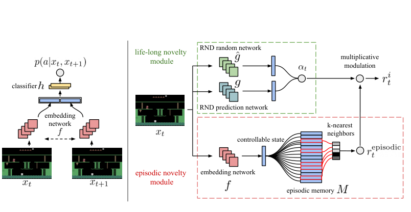

# 第 70 天｜Never Give Up：让探索持续存在，也让纯任务策略有自己的位置

[系列首页](README.md) · [上一篇](69-episodic-curiosity.md) · [下一篇](71-agent57.md)

**原论文与版本**：Adrià Puigdomènech Badia等，*Never Give Up: Learning Directed Exploration Strategies*，ICLR 2020。本文核读[arXiv:2002.06038v1（2020-02-14）](https://arxiv.org/pdf/2002.06038v1)。2020是已核实的arXiv及正式发表年，不声称已确认最早匿名稿的首次公开年。[OpenReview记录](https://openreview.net/forum?id=Sye57xStvB)本次未能通过正常访问核读终稿，因此以下版本差异不擅自归因于已修正的旧稿。

### 为什么探索奖励不消失，反而带来了新问题

探索奖励耗尽后，智能体可能停止尝试新路线；但让探索奖励永远存在，也可能使它始终偏离任务最优行为。一个喜欢新奇性的角色未必愿意反复执行最赚钱的熟悉动作。

NGU同时处理这两面：回合记忆使探索每回合重新启动，终身新奇性调节探索强度；价值网络则学习一族不同奖励混合比例的策略，明确包含β=0的纯外在目标。它不是先探索、再把同一个已学价值函数上的奖励按钮关掉，而是训练时就为“只追求任务分数”保留条件。

### 五个前置概念

1. **回合新奇性**：相对当前回合已经访问的表示判断新鲜程度，每回合重置参照。
2. **终身新奇性**：跨回合累计学习的预测误差信号，用于调制而不完全取消回合奖励。
3. **逆动力学**：从前后观测预测动作，以此学习较关注行动相关变化的表示。
4. **条件价值函数**：同一网络以策略条件区分多种奖励目标，不等于每个条件都有独立参数。
5. **离策略校正**：用行为与目标策略的差异修正旧轨迹学习；同一奖励条件也可能离策略。

## 一、问题设定：两种新奇性服务于两种时间尺度

令外在奖励为rᵉ，回合奖励为rᵉᵖⁱˢᵒᵈⁱᶜ，终身新奇性估计为α。原文式1定义

$$r_t^i=r_t^{\mathrm{episodic}}\min\{\max\{\alpha_t,1\},L\},\qquad L=5.$$

内层max确保乘数至少为1，外层min把它限制到5。终身预测误差消退时，回合探索不会随之归零；当某状态跨回合也新鲜时，乘数可进一步放大它。

回合记忆M在每回合开始清空，终身预测模型的参数则跨回合保留。两者不能混为同一个访问表。某个地点在过去一千回合已多次出现，只要在当前回合还新鲜，仍可能产生回合奖励。

终身模块采用RND：固定随机网络g，训练预测器ĝ，误差err(x)=‖ĝ(x)−g(x)‖²。原文将其标准化为

$$\alpha_t=1+\frac{\mathrm{err}(x_t)-\mu_e}{\sigma_e},$$

然后再做上述[1,5]截断。运行均值和标准差依赖训练历史，实际实现还需处理数值稳定性。预测误差不是精确访问次数，也不是任务价值；作为调制器，它不能取代外在评价。

## 二、用逆动力学学习较可控的表示

若环境墙纸每步随机变色，直接对像素计数会把无意义变化当成新状态。NGU以连续观测对预测动作，训练嵌入f：

$$p(a_t\mid x_t,x_{t+1})=g_{\mathrm{inv}}(f(x_t),f(x_{t+1})),\qquad
\mathcal L_{\mathrm{inv}}=-\log p(a_t\mid x_t,x_{t+1}).$$

与动作无关的变化对这个预测任务通常帮助较小，因此表示倾向于保留受行动影响的信息。不过这是一种学习偏置，不是对因果可控变量的严格识别。相关但不可控的背景可能被利用；对动作预测不重要的长期任务信息也可能被忽略。

这一点与EC的可达性判别不同。EC学习时间邻近下的可达性分类；NGU学习动作预测表示，再在表示上建立近邻核计数。两个方法都有回合记忆，并不意味着奖励公式或监督信号相同。

## 三、近邻核怎样把重复访问变成较低奖励

在当前嵌入f(xₜ)与记忆中的向量之间寻找k个近邻。默认配置k=10。计算平方距离dᵢ²，使用运行距离尺度d_m²归一化，再减去簇距离阈值ξ并截断到零：

$$z_i=\max\left\{\frac{d_i^2}{d_m^2}-\xi,0\right\},\qquad
K_i=\frac{\varepsilon}{z_i+\varepsilon}.$$

近邻越接近，Kᵢ越接近1；远邻贡献较小。因此这些核值的和近似局部访问密度，而不是“距离越大就直接给越大的无限奖励”。归一化尺度使不同任务或表示大小的距离较可比，但也引入了历史统计依赖。

本文数值流程依照第16页Algorithm 1：

$$s=\sqrt{\sum_iK_i}+c,\qquad
r_t^{\mathrm{episodic}}=\begin{cases}0,&s>s_m,\\1/s,&s\le s_m.\end{cases}$$

默认c=0.001、s_m=8。先用当前记忆计算奖励，再把当前嵌入写入记忆；若先写入，会把自身距离0立即算作一次重访。记忆容量和环形替换也会影响“已经访问过”的含义。

### 不把原文内部差异偷偷合成一个配置

v1第4页式2与第16页Algorithm 1都把c放在平方根外，即√(ΣKᵢ)+c；不能把低清晰度公式误读成√(ΣKᵢ+c)。正文把距离运行尺度描述为第k近邻平方距离的平均，算法第6行则以距离列表更新；本篇不声称两段是完全相同的更新实现。

正文式3写核ε=10⁻³，附录表6写10⁻⁴；第20页价值变换描述ε=10⁻²，表6线性项为0.001。它们是需要记录的配置或表达差异，而不是读者可以任意挑一个后宣称精确复现的细节。下面教学例明确选择自己的参数，不冒充实际运行的唯一配置。

## 四、把整个奖励流水线算一遍

取三个近邻，仅为简化教学。假定归一化后的平方距离为0.028、0.128、0.928，取ξ=0.008，截断后为0.02、0.12、0.92。取ε=0.001，则

$$K_1=0.04761905,\quad K_2=0.00826446,\quad K_3=0.00108578.$$

核和约0.05696929，按Algorithm 1得s≈0.23968241，小于8；回合奖励约4.1721879。若RND得到α=3，内在奖励约12.5165637。再令外在奖励1、β=.3，则混合奖励

$$r=1+0.3\times12.5165637\approx4.7549691.$$

若三个近邻都落入距离簇内，zᵢ=0、Kᵢ=1，则回合奖励为1/(√3+.001)≈0.5770171，显著变小。重复访问的压制来自近邻密度，不需要终身预测误差降到零。

若α从3降到0.2，乘数会截到1而不是0.2；如果α升到12，则截到5。注意这两个截断只限制终身乘数，不意味着总内在奖励一定在[1,5]。

## 五、读原图1：两个学习问题和一个奖励生成器

<figure class="reading-evidence-figure" id="rl-70-figure-1"><a href="/rl/assets/papers/70-figure-1.png" target="_blank" rel="noopener noreferrer"></a><figcaption>原论文图形摘引｜arXiv2002.06038v1, 2020-02-14，PDF p3, Figure 1, intact graphic without original caption。<a href="https://arxiv.org/pdf/2002.06038v1#page=3" target="_blank" rel="noopener noreferrer">核对原文</a> · 点图放大。原作者及权利人保留版权，有限摘引用于直接技术评论。</figcaption></figure>


左图说明表示的监督来自动作，而非任务得分。右图下半部包含当前嵌入、回合记忆和近邻奖励，上半部包含固定随机网络与预测器，最后相乘。图中的两条路径具有不同的训练信号与更新速度，不能简化为一个“好奇心网络”。

图也揭示一种边界：奖励依赖本回合记忆及终身模型，单看当前图像不能确定奖励。因此完整agent使用循环状态，并把先前动作、两类奖励和策略条件作为输入上下文，以应对这种历史依赖。它没有因此获得精确可观测的MDP状态。

## 六、为什么必须训练一族β条件策略

设离散索引j对应βⱼ及γⱼ，价值网络学习

$$Q_j^\pi(x,a)=\mathbb E_\pi\left[\sum_{k\ge0}\gamma_j^k\big(r_{t+k}^e+\beta_jr_{t+k}^i\big)\mid x_t=x,a_t=a\right].$$

默认N=32，包含β₀=0及最大β=.3。γ从纯任务条件的.997到最强探索条件的.99；探索奖励较稠密，较短折扣仍能提供信号，而稀疏外在回报需要更长范围。这是设计选择，不是所有任务的最优配方。

原文v1附录A第14页为每个actor分配固定的β条件，并使用相应的γ；不是每回合重新选择条件。网络共享参数、以条件编码区分目标；这不等于训练32套完全独立网络。评估数值一般使用β=0条件，而不是把一个只训练β=.3的网络临时去掉奖励后就期待其价值函数自动变化。

纯任务条件仍可能从共享表示和共同数据收集生态中获益，也可能遭受探索条件的干扰。NGU没有保证多任务共享总是正迁移，这正是Agent57进一步分开内外价值参数的背景。

### CMR=0不等于没有共享

Cross Mixture Ratio定义训练批中来自不同β条件轨迹的比例。论文基础NGU使用CMR=0：训练某条件时，使用该条件产生的经历。CMR=.5是另外的消融，不能把“分布式共享回放”误解为默认把每条轨迹重新标记给全部32种目标。

CMR=0仍然共享网络参数，也仍是离策略学习：同一条件的actor参数可能旧于learner，动作ε-greedy也不同。跨条件与离策略是不同维度。

## 七、循环回放与transformed Retrace

NGU基于R2D2式分布式循环架构，256个actor产生经历，learner优先抽样连续序列。附录配置trace length80、replay period40、batch64。循环网络需要连续上下文，而不是独立打散观测。

原文损失为transformed Retrace double Q-learning。先用未变换的形式解释离策略校正：

$$c_t=\lambda\min\left\{1,\frac{\pi(a_t\mid x_t)}{\mu(a_t\mid x_t)}\right\},$$

$$G_t=Q^-(x_t,a_t)+\sum_{k=t}^{T-1}\gamma_j^{k-t}\left(\prod_{i=t+1}^{k}c_i\right)\delta_k,$$

其中δ使用该条件下的混合奖励与目标策略，μ是采样时行为概率；终止后不bootstrap。截断重要性比值限制长连乘的方差，不意味着可以丢掉行为概率。

实际transformed Retrace先在逆变换价值域构造回报，再变回训练目标。常用变换形状是

$$h(x)=\operatorname{sign}(x)(\sqrt{|x|+1}-1)+\epsilon_hx.$$

ε_h与近邻核ε不是同一参数。非线性变换一般不能与加法、期望随意交换；所以不能把一个普通n-step目标直接冠上“transformed Retrace”的名字。双Q式在线选动作、目标支路估值也要与目标网络更新区分。

## 八、从数据流看清楚各模块的职责

下面是教学伪代码，不覆盖原实现的所有数值稳定项和采样权重。

```text
建立条件循环Q网络、逆动力学嵌入、RND及序列回放
每个actor初始化:
    分配固定的beta/gamma条件j
每个回合开始:
    清空回合记忆，保留actor的条件j
每一步:
    用当前观测嵌入查询回合近邻
    归一化平方距离、聚簇、计算核计数与回合奖励
    用RND误差产生截断到[1,5]的终身乘数
    相乘得到内在奖励，按先算奖励后写记忆的顺序更新M
    用条件价值和actor动作噪声交互，记录行为概率等信息
    将连续序列送入回放
learner:
    默认CMR=0，为目标条件抽取同条件经历
    用transformed Retrace更新条件Q网络
    分别按各自目标更新嵌入与RND预测器
评估:
    使用已训练的beta=0条件，按外在回报计分
```

奖励生成、策略学习和评价各有目标。把任一模块的损失下降理解成任务已经解决，都会过度解释。

## 九、实验支持持续探索，不支持全面压倒旧方法

v1正文报告57款Atari中51款超过人类基准，中位数1354.4%；同段R2D2为1920.6%。摘要则给出1344%的中位数，本文保留这一未消歧的汇总差异，不把两个数字平均，也不声称已经重算全部游戏。

在第8页表1的困难探索任务中，NGU(N=32)的Montezuma’s Revenge为10.4k±1.6k、Pitfall!为8.4k±4.5k、Private Eye为100.0k±0.4k。后者奖励台阶较大，几万分差异可能来自很少几个关键事件，不宜直接解释为行为质量同比例提升。

训练预算必须一起报告。第19页表5列NGU等分布式比较为350亿帧、256actor；其他引用方法有不同帧预算及actor数。不能从绝对得分推出同预算样本效率。附录表6写3种子，配置选择先在8款游戏上搜索，再用选择出的配置评价完整57款；这也不是对所有超参数选择偏差的消除。

基础CMR=0与CMR=.5的消融呈现任务间权衡，不能因为某个游戏变好就说跨条件回放普遍更优。纯任务条件缓解了持续内在奖励对稠密任务的干扰，却仍未在所有游戏达到R2D2成绩。全文最有说服力的结论是持续探索与显式利用条件可以共存，而非所有汇总分数第一。

本篇未独立训练、未审计代码，未重算57游戏中位数。后续[Agent57](71-agent57.md)会进一步回答：这些条件该如何分配采样机会，以及内外奖励价值能否用不同网络减少干扰。

### 三个继续追问

<details>
<summary>1. RND误差趋近稳定后，NGU为何仍然能够探索？</summary>

终身乘数下界为1，而回合记忆会重置。终身新奇性消退后，只是额外放大效果变小，不会把回合奖励乘成零。代价是探索目标长期存在，因此需要明确训练纯外在条件。

</details>

<details>
<summary>2. CMR=0为什么不代表学习已经是同策略？</summary>

它只限制经验来自同一β条件。行为actor可能使用旧参数和不同动作噪声，learner的目标策略已经变化，仍需要离策略目标与行为概率。不同条件混合和参数陈旧不是同一个问题。

</details>

<details>
<summary>3. 逆动力学嵌入是否保证完全忽略不可控噪声？</summary>

不保证。它鼓励保留有助于预测动作的信息，但有限数据可能含伪相关，网络也可能保留冗余背景。它是面向可控性的归纳偏置，不是因果识别证明，奖励仍需通过任务行为与消融检验。

</details>

## 自测两题

**自测1：** 回合奖励为2，α分别为0.2与12，L=5。两种内在奖励各是多少？

答案：乘数分别截为1和5，内在奖励分别为2与10。不能得到0.4与24，也不能说内在奖励本身被限制在1至5。

**自测2：** 用三近邻教学例，若K之和为3、c=.001，正确奖励是多少？假如实现误把c放进平方根内，会得到什么值？

答案：v1式2与Algorithm 1一致，正确值为1/(√3+.001)≈.5770171。误写为1/√(3+.001)会得到约.5772541；这是人为引入的实现错误，不是原论文两处公式的差异。差异虽小也应修正，不能把公式误读与真实配置差异混为一谈。

[系列首页](README.md) · [上一篇](69-episodic-curiosity.md) · [下一篇](71-agent57.md)
