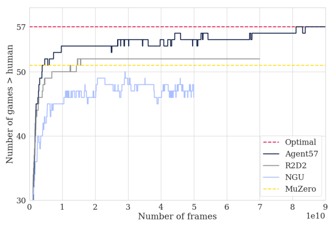

# 第 71 天｜Agent57：让探索策略竞争训练资源，补齐 Atari 的最后几块短板

[系列首页](README.md) · [上一篇](70-ngu.md) · [下一篇](72-drqn.md)

**原论文与版本**：Adrià Puigdomènech Badia等，*Agent57: Outperforming the Atari Human Benchmark*。首次预印本提交为2020-03-30。本文以[ICML 2020正式主文](https://proceedings.mlr.press/v119/badia20a/badia20a.pdf)和[官方补充材料](https://proceedings.mlr.press/v119/badia20a/badia20a-supp.pdf)为核读依据；主文11页，补充材料单独分页，以下明确区分。[正式出版记录](https://proceedings.mlr.press/v119/badia20a.html)为PMLR 119:507–517，会议日期2020-07-13至18日。另对读过arXiv v1；正式版表1的部分MuZero汇总值与v1不同，本文数值均按正式版，不混用两套实验表。

### 从“会探索”走到“知道什么时候该探索”

[NGU](70-ngu.md)把回合内新奇性与跨回合新奇性结合，训练一族内在奖励权重不同的策略。可是，这些策略如果总是平均分配采样机会，就隐含了一个很强的假设：在所有游戏、所有训练阶段，每一种探索强度都同样有用。

Agent57针对这个假设动手。它让每个actor根据最近的外在回报，选择下一个回合要执行的探索权重与折扣因子；又把外在、内在价值分给两个独立网络，以减少稀疏任务奖励和稠密新奇奖励在优化中的冲突。第三项变化很朴素：把反向传播时间窗口由80增至160。

这篇论文的核心不是又发明一种新奇性奖励，而是把已有探索方法变成更稳定、更可调度的系统。标题里的“57”也有严格含义：同一种算法、同一组超参数，分别在57个游戏上训练并按论文协议评分；不是一张共享参数的多任务网络同时掌握57个游戏，更不是击败每个游戏的人类世界纪录。

### 五个前置概念

1. **策略族**：一组由内在奖励权重和折扣因子区分的行为目标，索引在回合内保持固定。
2. **价值分解**：把混合奖励价值拆成内外两支，但仍用同一个组合目标策略选择后继动作。
3. **非平稳bandit**：在收益随训练变化的选项之间分配尝试机会，本文每个actor独立调度。
4. **Retrace**：利用截断重要性权重学习目标策略价值的多步离策略方法。
5. **CHNS**：把人类归一化分数截到0至1，突出未达到人类基准的尾部游戏。

## 一、问题设定：目标函数没有统一成一种回报，策略族仍然存在

令外在奖励为rᵉ，内在奖励为rⁱ。NGU留下的内在奖励接口是

$$r_t^i=r_t^{\mathrm{episodic}}\min\{\max\{\alpha_t,1\},L\},\qquad L=5.$$

回合记忆判断当前访问是否新鲜；α来自生命周期新奇性估计，本文沿用RND。截断因子下界为1，因此生命周期预测误差变小，不会直接把回合新奇性乘成零。具体特征与近邻奖励构造仍见NGU，Agent57没有用元控制器替换这套机制。

策略索引j对应一对预先设定的数(βⱼ,γⱼ)，训练目标为

$$r_{j,t}=r_t^e+\beta_jr_t^i,\qquad
Q_j^\pi(x,a)=\mathbb E_\pi\!\left[\sum_{k\ge0}\gamma_j^k(r_{t+k}^e+\beta_jr_{t+k}^i)\mid x_t=x,a_t=a\right].$$

这里x代表价值网络使用的观测及循环上下文，不能把一张Atari截图自动当成完整马尔可夫状态。实际网络还接收前一步动作、两类奖励与策略索引。N=32；β从纯任务策略的0扩展到探索策略，γ覆盖0.99至0.9999。较小β配较大γ，用于更长程的任务回报；较大β配较小γ，服务较稠密的探索奖励。

这不是连续优化β或γ。元控制器选择的是32个离散选项，而不是对折扣因子反向传播。一个选项被选中后保持整个回合，避免每一步都切换目标导致行为失去一致性。不同actor仍保留各自的动作级ε-greedy，它与回合级策略选择是两层随机性。

### 折扣为何关系到最后几款游戏

教学近似中，折扣的有效长度可看作1/(1−γ)：γ=0.99对应约100步，0.9999对应约10000步。这不是严格的记忆容量，也不等于BPTT长度。1000步以后出现的单位奖励，在两者下分别只剩约0.000043与0.905。

所以，一个更会寻找新状态的探索奖励，仍可能救不了被折扣几乎抹去的远期任务反馈。提高γ能保留信号，却增加长回报的方差与学习难度。Agent57把“去哪里搜集数据”与“多远的结果值得关心”放入同一个策略索引，但没有消除两者的代价。

## 二、分开参数化两种价值，必须共享同一个目标策略

原文§3.1（PDF第4页）采用

$$Q_j(x,a;\theta)=Q_j^e(x,a;\theta^e)+\beta_jQ_j^i(x,a;\theta^i),\qquad \theta^e\cap\theta^i=\varnothing.$$

这两支网络的参数、优化器状态可以分开，但它们不是分别追逐两种最优行为。对同一条采样序列，两支网络分别使用外在奖励与内在奖励训练；目标策略都必须来自组合价值：

$$\pi_j(x)=\arg\max_a\{Q_j^e(x,a)+\beta_jQ_j^i(x,a)\}.$$

如果外在分支取自己的最大动作，内在分支也取自己的最大动作，相加就可能拼出一个不存在的动作。一般而言，max不能穿过加号。

### 一个能看见错误的数值例子

下面是独立教学数字，不是论文实验。下一状态有两个动作A、B，外在价值分别为6、3，内在价值分别为0、10，β=0.5。组合价值分别为6、8，因此共同目标动作是B。

令本步外在奖励为0.5、内在奖励为0.4、γ=0.9。忽略价值变换与多步校正，一步目标为

$$y^e=0.5+0.9\times3=3.2,\qquad y^i=0.4+0.9\times10=9.4,$$

$$y^e+0.5y^i=7.9.$$

直接按混合奖励计算同样得到0.5+0.5×0.4+0.9×8=7.9。但若两支各取自己的最大值，就得到0.5+0.9×6+0.5×(0.4+0.9×10)=10.6。多出的2.7不是更好的估计，而是把动作A的外在收益与动作B的内在收益错误合并。

### 精确算子等价，不等于神经网络训练轨迹相同

补充材料附录B第2–3页的出发点是精确价值迭代。给定当前两支价值，以它们的线性组合选共同策略，然后分别用外在和内在Bellman算子更新。把更新后的两支相加，奖励项合成rᵉ+βrⁱ，转移期望项也因线性性合并，于是组合价值遵循原混合奖励的价值迭代。这个推导真正依靠的是相同转移、相同折扣、同一个目标策略，以及正确的线性组合。

用Pᵖ表示共同策略下的转移算子，固定一个策略索引j，可写成

$$Q_{k+1}^e+\beta_jQ_{k+1}^i
=r^e+\beta_jr^i+\gamma_jP^{\pi_k}(Q_k^e+\beta_jQ_k^i).$$

有限折扣MDP、精确更新与相应收缩条件下，这能还原混合奖励的价值迭代；它没有承诺两个有限容量LSTM加上各自优化器、优先回放和不断变化的数据分布，逐次更新也会和单网络相同。分开参数化的动机恰恰是允许两类信号拥有不同的拟合尺度和优化状态。

对于变换价值，附录还给出先逆变换、相加、再变换的形式：

$$Q=h\!\left(h^{-1}(Q^e)+\beta_jh^{-1}(Q^i)\right).$$

注意正式主文明确说，实验选择简单线性分解的网络结构，同时仍然使用transformed Retrace损失。不能因为写出了上述变换分解，就把它当成实验必然采用的结构。

### 离策略序列为什么还需要Retrace

actor收集数据时的策略μ，与learner现在要评估的πⱼ不同。只更换奖励标签，并不能使一条旧序列自动成为当前策略的同策略样本。先给出未加价值变换的教学形式：

$$\delta_t=r_t+\gamma_j\sum_a\pi_j(a\mid x_{t+1})Q^-(x_{t+1},a)-Q^-(x_t,a_t),$$

$$c_t=\lambda\min\!\left\{1,\frac{\pi_j(a_t\mid x_t)}{\mu(a_t\mid x_t)}\right\},\qquad
G_t=Q^-(x_t,a_t)+\sum_{k=t}^{T-1}\gamma_j^{k-t}\!\left(\prod_{i=t+1}^{k}c_i\right)\delta_k.$$

μ是采样时的行为策略，πⱼ是现在要学习的目标策略；空乘积为1，终止位置停止bootstrap。重要性比值经过截断，避免把离策略校正写成无界的长连乘。原文补充材料附录C（第4–6页）再把价值变换h与逆变换加入目标，实际训练不应直接拿上面的教学式代替。

分别用rᵉ与rⁱ代入，得到两支损失，但共同目标策略保持一致。保存行为动作概率、序列边界和循环状态因此不是可有可无的实现细节。

## 三、元控制器选择回合策略，而不是直接选择游戏动作

原文§3.2及补充材料附录D（第6–7页）为每个actor设置独立非平稳bandit。臂j就是(βⱼ,γⱼ)。每个回合结束后，给bandit的回报是未折扣的外在回合总回报：

$$R_k^e=\sum_{t\in\text{episode }k}r_t^e.$$

这与价值网络训练的混合、折扣回报不同。若把内在奖励也作为调度器的收益，调度器可能偏爱容易制造新奇性却不推进任务的条件。Agent57让探索策略竞争的最终尺度仍是任务表现。

为何每个actor独立？actor具有不同的动作ε-greedy强度，同一策略索引在不同噪声下未必同样有效。一个全局bandit会把这些不同的行为条件混成单个估计。独立调度并不能消除噪声，但与各自的数据产生过程更一致。

### 滑动窗口与简化UCB

在最近τ个回合中，统计臂j的使用次数nⱼ和外在回报均值μ̂ⱼ。附录先介绍标准UCB和滑动窗口版本，随后说明实际实验采用的简化得分省去了对数项：

$$U_j=\widehat\mu_j+c_{\mathrm{UCB}}\sqrt{\frac{1}{n_j}}.$$

这里c_UCB是置信奖励系数，不是内在奖励的βⱼ。先初始化各臂；之后以概率ε_UCB随机选臂，否则选择上述得分最大的臂。零计数必须由初始化或明确的实现规则处理，不能直接计算1/0。论文这一简化公式不应被悄悄替换成教科书的log(t)版本。

滑动窗口的原因是学习器一直变化。训练早期高探索策略可能有帮助，后期纯任务策略可能更好；把很久以前的回报永远平均进来，会使适应变慢。窗口也有代价：小窗口更敏感却更嘈杂，大窗口更平稳却容易滞后。非平稳环境下，UCB形式不是对最终最优策略的保证。

教学例：取c_UCB=1，两臂窗口均值都是2，次数分别为4和25，则得分为2.5与2.2。第一臂因较少被尝试而获得更大探索奖励。但若第二臂均值升至3，其得分3.2就超过第一臂。随机选臂层仍可能暂时选到非最高分臂。

主文§4报告训练actor窗口160、随机选臂概率0.5；评估侧窗口3600、概率0.01。不过补充材料附录G表3又写bandit窗口90，与主文不一致。对读[ICML正式主文第5页](https://proceedings.mlr.press/v119/badia20a/badia20a.pdf#page=5)与[官方补充材料表3](https://proceedings.mlr.press/v119/badia20a/badia20a-supp.pdf#page=13)，两处仍分别保留160／3600和90。它不是仅能用“预印本太旧”解释的差异；本文不把两处数字合成一个声称可精确复现的配置。附录E的评估器还区分训练bandit与贪心选择估计最优臂的评分阶段，每5回合切换；它的经验不进入训练replay。

## 四、把组件放进同一条数据流

下面是解释组件关系的伪代码，省略优先采样权重、完整transformed Retrace公式与具体张量结构，不是可直接复现实验的程序。

```text
初始化两支条件循环价值网络、目标网络、序列回放
为每个 actor 初始化自己的回合级 bandit
并行 actor:
    回合开始，bandit 选择索引 j，清空回合记忆并初始化循环状态
    每步以 Qe + beta[j] * Qi 和 actor 的动作 epsilon 选择动作
    计算外在奖励及 NGU 内在奖励
    保存观测、动作、两类奖励、j、行为概率和循环状态
    将连续且不跨回合的片段送入优先序列回放
    回合结束，以未折扣外在回报更新该 actor 的 bandit
learner:
    采样连续片段并按配置处理循环状态
    用组合价值构造共同目标策略
    分别构造外在和内在 transformed Retrace 目标
    更新两支网络及回放优先级，按周期同步参数
独立 evaluator:
    交替学习自己的 bandit 与选择估计最佳策略评分
    不把评分轨迹送入训练回放
```

这里至少有三个不同的时间尺度：环境每一步选动作，bandit每回合选目标条件，learner持续从旧序列更新网络。元控制器没有替代动作策略，也没有直接让每个actor拥有一套永久独立的学习目标网络。

附录E报告256个actor、单GPU learner，约每秒5次更新，每批64条、每条长度160；相邻序列重叠80步。论文还比较长度80与160的BPTT窗口。更长窗口能够把梯度传到更早的表示，却增加计算和优化难度；它不把数千步前的一次探索自动变成可学习信号。折扣、bootstrap传播和循环梯度的时间范围是三个不同概念。

序列回放还继承循环网络的状态陈旧问题。历史片段开始的隐状态来自采样时参数，而learner已经变化；仅仅把网络换成LSTM不会修复这种不一致。相关存储状态与burn-in的权衡留到[R2D2](73-r2d2.md)展开。

## 五、57个游戏的成绩，必须连同计算预算一起读

### 原图1真正测量的是什么

<figure class="reading-evidence-figure" id="rl-71-figure-1"><a href="/rl/assets/papers/71-figure-1.png" target="_blank" rel="noopener noreferrer"></a><figcaption>原论文图形摘引｜ICML2020 PMLR formal main and official supplement，PDF p1, Figure 1, intact graphic without original caption。<a href="https://proceedings.mlr.press/v119/badia20a/badia20a.pdf#page=1" target="_blank" rel="noopener noreferrer">核对原文</a> · 点图放大。原作者及权利人保留版权，有限摘引用于直接技术评论。</figcaption></figure>


[正式主文PDF第1页Figure 1](https://proceedings.mlr.press/v119/badia20a/badia20a.pdf#page=1)以训练帧数为横轴，以超过人类基准的游戏数为纵轴。它展示Agent57最终达到57款的覆盖过程，也显示尾部几个游戏需要远多于前面游戏的数据。

横轴右下角的1e10极其重要：刻度8意味着800亿帧，不是8亿。纵轴是过人类阈值的游戏**数量**，不是平均分；红色“Optimal”线表示该计数最多57，不是所有游戏都达到理论最优策略。曲线会下降，说明某一时刻超过阈值与最终取训练中最好成绩的统计，不是同一个事件。MuZero的水平参考也不能当作在同预算下重新运行的学习曲线。

主文指出，前50亿帧已超过51款的人类基准，而Skiing约到780亿帧才过线。高折扣保留长程反馈，也可能提高回报方差并加重数据需求。此图支持“最终覆盖尾部任务”，不支持“以很低样本预算解决全部Atari”。

### HNS、截断均值与尾部覆盖

定义

$$\mathrm{HNS}=\frac{s_{\mathrm{agent}}-s_{\mathrm{random}}}{s_{\mathrm{human}}-s_{\mathrm{random}}},\qquad
\mathrm{CHNS}=\max\{0,\min\{1,\mathrm{HNS}\}\}.$$

CHNS把超过人类基准的部分全部截到1，也把负值截到0。一个游戏十倍人类与一百倍人类，在这个指标上相同；它有意不让少数极高分掩盖未解决的游戏。因此需要一起看未截断均值、中位数、尾部分位数和逐游戏成绩，而不是只挑最漂亮的一列。

[第6页表1](https://proceedings.mlr.press/v119/badia20a/badia20a.pdf#page=6)给出Agent57过线57款、平均CHNS 100.00%；NGU为51款、95.07%。这两个截断均值相差4.93**个百分点**。同表Agent57平均HNS 4766.25%、中位数1933.49%，并非所有汇总指标第一；例如MuZero报告的平均与中位数都更高。论文的进展是尾部覆盖，不是把任何指标都压倒性胜出。

这里的NGU是Agent57论文比较表中的运行结果，不能无说明替换成NGU原论文里不同版本或协议的汇总值。正式版表1的MuZero数据也与Agent57 arXiv v1不同，跨版本拼接会制造不存在的统一排行榜。

### 评分协议与预算限制

主文§4说明，评估器记录未折扣外在回报，使用50回合滑动均值，并对随机种子平均；一般比较使用3个种子，Agent57全57款使用6个种子增强证据。最终分数取这种平均之后的训练期间最大值，而不是统一最后一个checkpoint的分数，也不是每个种子独立挑最好再平均。挑选最优训练时点使结果与持续学习曲线有不同含义。

补充材料附录G表2（第12页）注明：单帧输入、灰度、最多30分钟回合、动作重复4、随机no-op范围30、完整动作集合、关闭sticky actions、丢命不把折扣直接置零。人类基准是标准参照分数，不是专家极限。没有保持这些条件，就不能把另一个Atari榜单的数字直接接到此表上。MuZero一栏引用既有结果，本文没有把它当成作者同硬件重跑的对照。

原文挑战子集包含10款游戏，兼有困难探索与长程信用分配。只在这个子集上改一个组件，能更集中地观察短板，却不能替代57款游戏的全面结果。例如，BPTT窗口从80增至160的比较，在Solaris尤其明显；同样改动也帮助R2D2，说明它并非只有内在奖励存在时才有效。把这一收益全部记在元控制器头上，会错误归因。

R2D2 (Retrace)还是一个需要保留名字后缀的基线：它将原R2D2的n-step损失换为transformed Retrace；R2D2 (bandit)再引入折扣策略族及调度。不能把这些运行都简称R2D2后，声称只改了一个超参数。

## 六、可迁移的设计与不可外推的承诺

Agent57最可迁移的思想有三项。第一，让有用的探索目标作为条件策略长期存在，而不是只能在训练开始时打开一次。第二，把不同尺度、不同稀疏性的价值信号分开参数化，同时保持同一个决策目标。第三，利用任务回报调度探索条件，把资源分配本身也变成适应过程。

这些思想需要付出代价。独立价值分支增加参数与计算；多个条件之间仍可能干扰；bandit只看有限窗口的噪声回报，不能知道一个暂时无分的探索回合是否将在遥远将来有用；高γ和长序列会增加学习成本。更全面的终局覆盖与更低样本复杂度是两项不同目标。

最后，本篇没有独立训练，也没有逐游戏重新计算置信区间。核读范围为主文关键方法与实验、附录B–G相关推导和实现描述；对正式主文与补充材料的不一致保留说明。下一篇[DRQN](72-drqn.md)会暂时把系统规模放下，回答更基础的问题：网络到底怎样利用过去观测？再到[R2D2](73-r2d2.md)讨论分布式replay如何处理这种记忆。

### 三个继续追问

<details>
<summary>1. 两支网络分别使用不同奖励，为什么还必须使用共同目标策略？</summary>

因为它们分解的是同一个策略下的混合价值。共同转移、折扣及目标策略使期望的线性性成立；分别最大化会把不同动作的收益拼接。上文例子中，共同动作B给出7.9，独立最大化给出10.6，后者不对应一个真实动作选择。

</details>

<details>
<summary>2. bandit回报为什么不用内在奖励，窗口为何不能无限长？</summary>

调度的目的仍是提高任务表现，所以使用未折扣外在回报来比较策略条件。内在奖励用于产生有价值的探索行为，不是调度器需要最大化的最终成绩。学习器持续变化使臂回报非平稳，过长历史会拖慢适应；过短窗口又会放大噪声。滑动窗口与随机选臂是在这些风险之间折中，并不保证最佳调度。

</details>

<details>
<summary>3. 更高γ与更长BPTT不是都让网络看得更远吗？</summary>

γ控制目标中未来奖励的权重；BPTT控制一次更新直接传播梯度的循环时间范围。提高γ不会自动延长反向传播，提高BPTT也不能恢复被γ压到近零的奖励。多步目标和反复bootstrap还能在多次更新中传递信息，因此三种时间尺度不能用一个“记忆长度”代替。

</details>

## 自测两题

**自测1：** 随机基准为−100、人类为−20，智能体为−10。HNS和CHNS是多少？能否据此说达到理论最优？

答案：HNS=(−10+100)/(−20+100)=90/80=1.125，即112.5%；CHNS=1，即100%。它只超过所选人类基准，截断后无法再区分更好的分数，更不能说明理论最优。

**自测2：** 简化UCB的两臂均值都是2、次数分别4和25、置信系数为1，哪个臂在非随机分支被选？如果第二臂均值变成3呢？

答案：得分先为2.5与2.2，选择第一臂；第二臂均值变成3后得分3.2，选择第二臂。这不是动作级ε-greedy：它选择整个下回合的(β,γ)，而动作仍由所选条件价值和actor动作噪声决定。

[系列首页](README.md) · [上一篇](70-ngu.md) · [下一篇](72-drqn.md)
