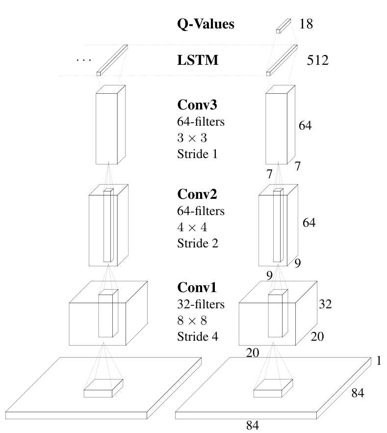
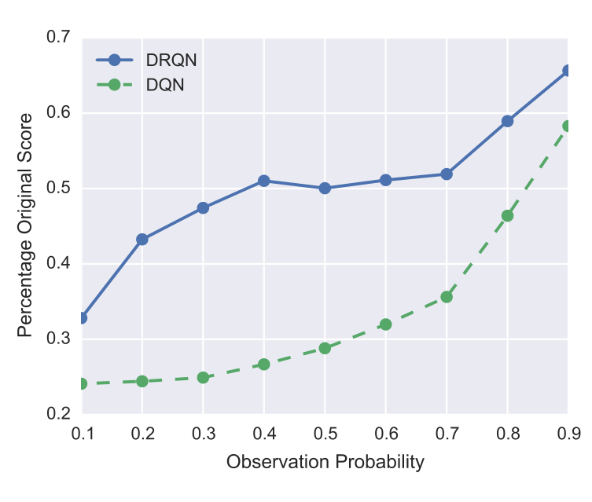

# 第 72 天｜DRQN：让Q网络从连续观测中学会记忆

[系列首页](README.md) · [上一篇](71-agent57.md) · [下一篇](73-r2d2.md)

**原论文与版本**：Matthew Hausknecht与Peter Stone，*Deep Recurrent Q-Learning for Partially Observable MDPs*。首次预印本2015-07-23；本文核读[arXiv v4（2017-01-11）](https://arxiv.org/pdf/1507.06527v4)。[作者出版记录](https://www.cs.utexas.edu/~pstone/Papers/bib2html/b2hd-SDMIA15-Hausknecht.html)对应2015年11月AAAI Fall Symposium的Sequential Decision Making专题，不是AAAI主会议论文。

### 一张截图告诉不了球往哪里飞

看到球在屏幕中央，并不能确定它正在向左还是向右。同样的单帧观测可能对应不同环境状态，最合适的动作也就不同。DQN把连续几帧堆成输入，显式提供短时间变化；DRQN则每步只读一帧，把跨时间信息交给循环网络。

这篇工作早于前面讨论的大规模探索系统。这里倒回基础，是为了看清一个被“加LSTM”遮住的问题：记忆不只是网络结构，也影响训练样本、初始化、目标计算和实验解释。

### 五个前置概念

1. **部分可观测性**：单次观测不足以确定决策所需环境状态，历史可能提供额外信息。
2. **循环状态**：由过去输入递推形成的网络内部表示，不自动等同于真实状态或精确信念。
3. **目标网络**：用于构造较稳定bootstrap目标的延迟参数副本，与在线预测网络区分。
4. **截断BPTT**：只在有限连续片段内反传梯度，限制直接信用传播而非硬性限定推理记忆。
5. **序列回放**：抽取连续经历片段供循环网络学习，同时明确片段边界的隐状态初始化。

## 一、问题设定：循环隐状态不是自动得到的真实状态

POMDP中，底层状态sₜ不可直接观察，智能体收到oₜ。一般历史可包含观测、动作与奖励，而这篇DRQN的网络输入是连续观测，不应擅自改写为完整历史接口。令zₜ=φ(oₜ)是卷积特征，循环状态满足

$$h_t=F_\theta(h_{t-1},z_t),\qquad Q_\theta(h_t,a)=W_a h_t+b_a.$$

这里h简写循环网络内部状态；LSTM实际还含细胞状态。网络可能从历史推断速度等信息，但h不是经过证明的充分统计量，更不是精确贝叶斯信念状态。若历史本身无法区分两个底层状态，循环网络也不能凭空补出信息。

与固定窗口相比，循环状态在推理时可以持续传递，不必把所有旧帧显式拼接到输入。但有效记忆取决于训练和表示容量：能够传递状态，不等于一定会学习到长期依赖。

## 二、读原图2：只改一层，改变的是时间处理方式

<figure class="reading-evidence-figure" id="rl-72-figure-2"><a href="/rl/assets/papers/72-figure-2.png" target="_blank" rel="noopener noreferrer"></a><figcaption>原论文图形摘引｜arXiv1507.06527v4, 2017-01-11，PDF p3, Figure 2, intact graphic without original caption。<a href="https://arxiv.org/pdf/1507.06527v4#page=3" target="_blank" rel="noopener noreferrer">核对原文</a> · 点图放大。原作者及权利人保留版权，有限摘引用于直接技术评论。</figcaption></figure>


输入是84×84单通道图像。第一层32个8×8卷积核、步长4，得到20×20；第二层64个4×4核、步长2，得到9×9；第三层64个3×3核、步长1，得到7×7。随后由512单元LSTM替代DQN的第一个卷积后全连接层，最后线性层产生动作Q值。

图里横向连线才是记忆所在。单帧卷积无法直接从两个时刻的位置变化检测速度，循环层需要把信息跨步整合。图的18维动作输出是示意，不能据此把实验附录使用的minimal action set改写成所有游戏都用完整18动作。

论文也尝试LSTM加在全连接层之上、加入ReLU、以及同时堆帧和循环。它没有得到“参数更多必然更好”的结论。网络设计的目标是隔离循环结构的作用，而不是展示一个越大越优的规模定律。

## 三、把TD学习改成连续片段学习

保留DQN的一步bootstrap思想。对片段中的时间t，用目标网络计算教学形式的目标：

$$y_t=r_t+\gamma(1-d_t)\max_{a'}Q_{\theta^-}(h^-_{t+1},a'),$$

$$\mathcal L(\theta)=\sum_t\big(y_t-Q_\theta(h_t,a_t)\big)^2.$$

dₜ表示本步是否终止，终止时不再bootstrap。目标网络自己的循环状态应由相应历史得到，不能把一个任意缓存向量当成在任何参数下都有效的环境状态。上式为解释目标与序列依赖的简化写法，不是原实现所有细节的完整替代。

网络更新是对损失做梯度下降。计算目标时通常停止对目标支路求导；在线网络的梯度则可通过片段内的循环连接向前面的特征传播。随机打散每一帧虽然接近传统DQN的数据抽样，却会破坏LSTM学习的时间关系。

### 一个独立数值例子

假设当前Q=2、r=1、γ=0.9、下一状态目标最大Q=3，且没有终止，则y=3.7，平方损失为(3.7−2)²=2.89。对当前预测Q求导为2(Q−y)=−3.4，梯度下降会提高预测值。

如果同一步是终止，y=1，损失变为1，导数为2。仅仅漏掉终止掩码，就可能让本应下降的值向上更新。循环记忆不会自动修复这种目标错误。

## 四、两种回放方式与片段开头的问题

原文讨论两种bootstrapped更新。

第一种从随机选中的回合开头依序训练，隐状态沿完整回合传递。好处是当前状态的历史来源较完整；代价是连续更新更相关，不能完全保持DQN式随机抽样。

第二种先随机选回合，再随机选起点，只取连续unroll步作为训练片段。每次片段开始把循环状态清零。它保持较随机的片段抽样，但片段开头的网络不知道更早发生过什么。

最终报告使用第二种，即随机连续片段、零初始化，而不是把完整回放打散成单帧，也不是每个环境步都清零。清零是在训练片段边界；运行完整回合时仍需让隐状态逐步传递。

论文训练时向后展开10步。这限制一次更新的直接梯度范围，并使需要更长历史的函数更难学习，但不能解释为推理时网络最多记住10步。推理状态可能持续更久，只是“能持续”与“已经学会稳健保存”不是同一回事。

```text
初始化在线卷积-LSTM-Q网络和目标网络
交互时每回合重置循环状态，逐步读入单帧并选择动作
将带回合边界的连续经历写入回放
训练时:
    随机选择回合及片段起点
    提取连续10步及所需后继观测
    将本次训练片段的循环初态置零
    按时间顺序展开在线网络和目标计算所需的历史
    对非终止步构造bootstrap目标，终止步只用奖励
    累加片段损失并做截断时间反向传播
    按日程更新目标网络
```

这段伪代码强调顺序与状态边界；优化器、重放大小及目标同步频率仍需读取实验配置。后续R2D2会进一步处理存储隐状态、burn-in和参数陈旧，这些不能倒灌成DRQN原文已经采用的机制。

## 五、闪烁实验到底改变了什么

Flickering Atari将部分观测完全遮蔽为黑屏，游戏本身仍继续演化。原文常用每帧遮蔽概率0.5。它不是暂停环境，也不是让被遮蔽时动作不生效；缺少的是信息，不是时间。

如果每步独立遮蔽，连续10步全部不可见的概率是0.5¹⁰=0.0009765625，即0.09765625%。少于两帧可见的概率为

$$P(N_{\mathrm{visible}}<2)=\frac{\binom{10}{0}+\binom{10}{1}}{2^{10}}=\frac{11}{1024}\approx1.0742\%.$$

这是教学中的独立遮蔽计算，不是论文测得的失败率。至少两帧可见也不保证能推断球速：两帧可能太近、对象被遮挡，或中间发生了碰撞。

Pong实验比较10帧堆叠DQN与每步单帧、训练展开10步的DRQN，给二者相近的训练历史范围。循环版本能够跨闪烁观测整合信息，但不能把这一比较改写成“DRQN拥有无限训练历史，DQN只有一帧”。

在附录10款闪烁游戏的结果中，Pong最显著：DRQN为12.1±2.2，DQN为−9.9±3.3。论文同时明确指出，这种优势并不系统地扩展到所有闪烁游戏。选择Pong作为直观例子合理，选择它作为循环网络普遍优越的证明则不合理。

## 六、读原图5：鲁棒性实验不等于闪烁训练实验

<figure class="reading-evidence-figure" id="rl-72-figure-5"><a href="/rl/assets/papers/72-figure-5.png" target="_blank" rel="noopener noreferrer"></a><figcaption>原论文图形摘引｜arXiv1507.06527v4, 2017-01-11，PDF p5, Figure 5, intact graphic without original caption。<a href="https://arxiv.org/pdf/1507.06527v4#page=5" target="_blank" rel="noopener noreferrer">核对原文</a> · 点图放大。原作者及权利人保留版权，有限摘引用于直接技术评论。</figcaption></figure>


横轴是observation probability，也就是可见概率，不是遮蔽概率。向右表示信息更多。纵轴是原游戏得分的保留比例，先相对各自原成绩归一化，再跨表1九款游戏汇总，不是Atari人类归一化分数。

此图的训练发生在正常游戏上，测试才引入闪烁。蓝色DRQN曲线整体高于绿色DQN，支持在这组分布变化下DRQN性能退化较缓，而不是证明训练时已解决所有部分可观测任务。两条曲线都明显低于完整观测下各自原得分，鲁棒不等于不受损。

图没有给出每款游戏的完整分布或置信区间，也不能从平均比例直接推导任一游戏必然占优。与前面的闪烁训练实验一起读，才能区分“在缺信息条件下学会控制”与“训练后面对信息缺失是否稳健”。

## 七、普通Atari、训练预算与计算成本

第5页表1比较9款正常游戏，DRQN在Frostbite为2875±535，作者的DQN为519±363，均值比约5.54；但Beam Rider分别为3269±1167与6923±1027，DRQN反而更低。因此全文结论是循环网络可以成为堆帧的可行替代，不是全面提升分数。

表中还列出Mnih等人的DQN结果，它不是同一实现、同一次训练的数字。讨论循环结构差异时应优先辨清“作者自己的DQN”这一列，不能把几个DQN版本挑着比较。原文显著性检验使用独立t检验和Benjamini–Hochberg校正、P=.05；均值高并不自动等于显著更好。

实验附录说明训练1000万次迭代，回放容量40万，每5万次迭代评估10回合；使用ADADELTA，学习率0.1、动量0.95，LSTM梯度裁剪至10，并使用minimal action set等ALE设置。这里的“迭代”不是直接可与Agent57训练帧数对齐的单位。

计算成本也需要同列比较。第7页表2在单张GTX Titan Black、CuDNN与Caffe下，单输入帧的非循环基线反向传播为8.82ms，展开10步为77.3ms；对应前向分别为2.0ms与2.5ms。不能把反向的约8.76倍写成每一步部署延迟同样放大8.76倍，更不能当成现代硬件的固定性能。

DRQN最重要的贡献是使“训练时保存怎样的时间关系”成为Q学习的显式设计问题。它留下的困难同样重要：片段开头缺失历史、截断梯度、表示容量、循环状态与网络参数的一致性。下一篇[R2D2](73-r2d2.md)将把这些困难放进分布式优先回放系统。

本篇重新核读指定版本的结构、更新方式、主要实验和附录配置，未独立训练、未运行原作者实现。教学算例不代表测得的实验数据。

### 三个继续追问

<details>
<summary>1. 为什么不能将经验回放中的单帧随机打散，再直接训练LSTM？</summary>

LSTM的循环状态应概括真实历史。任意相邻的随机帧没有时间联系，网络会收到不对应环境轨迹的隐状态输入。原文随机的是回合和片段起点，片段内部必须连续有序。

</details>

<details>
<summary>2. 十步BPTT是否意味着网络绝不可能使用第十一步以前的信息？</summary>

不是。它限定本次训练直接回传梯度的范围；运行时隐状态可以持续传递。只是训练片段清零和梯度截断会使长期依赖更难学，不能把理论上可传递的状态当成已经可靠学得的长期记忆。

</details>

<details>
<summary>3. 原图5为何不能证明循环结构在所有POMDP上都更优？</summary>

它只检验正常训练后对特定随机遮蔽的迁移，并汇总9款游戏的相对成绩。其他部分可观测性可能来自隐藏规则、长期秘密或动作依赖信息，机制并不相同。论文的10款闪烁训练实验也没有显示系统性全面优势。

</details>

## 自测两题

**自测1：** 当前Q=2，奖励1，γ=.9，后继目标最大Q=3。本步终止时平方损失与对Q的导数分别是多少？

答案：目标只有1，损失(1−2)²=1，导数2(Q−y)=2。若错误继续bootstrap会得到2.89和−3.4，连更新方向都变了。

**自测2：** 原图5横轴从0.2增加到0.8，是遮蔽更多还是更少？纵轴0.5是否表示达到人类一半水平？

答案：可见概率上升，遮蔽更少。纵轴是相对正常游戏原成绩的保留比例，0.5不是人类归一化分数，也不是每款游戏都恰好保留50%。

[系列首页](README.md) · [上一篇](71-agent57.md) · [下一篇](73-r2d2.md)
