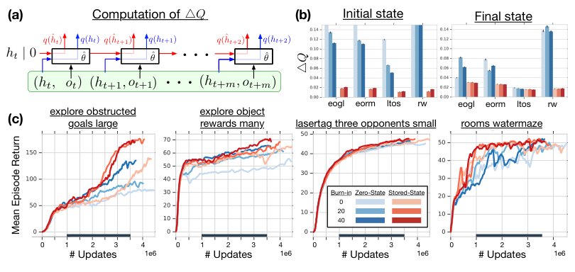
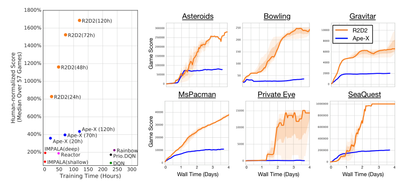

# 第 73 天｜R2D2：回放的不只是经验，还有可能过期的记忆

[系列首页](README.md) · [上一篇](72-drqn.md) · [下一篇](74-rudder.md)

**原论文与版本**：Steven Kapturowski、Georg Ostrovski、John Quan、Rémi Munos、Will Dabney，*Recurrent Experience Replay in Distributed Reinforcement Learning*，ICLR 2019。[作者论文页](https://willdabney.com/publication/r2d2/)确认署名、会议与2019年5月；会议日期为[2019年5月6—9日](https://iclr.cc/Conferences/2019)。2018年已公开流传有同期[Ray issue，2018-10-27](https://github.com/ray-project/ray/issues/3148)旁证，精确首次公开日未核实。本文核读[OpenReview保存的17页匿名评审稿](https://openreview.net/references/pdf?id=rknDUp-A7)，页眉为“Under review as a conference paper at ICLR 2019”，修订日期未标注。此前访问最终19页稿遇到验证页面，没有核读最终稿。以下页码、原图、超参数与协议统一指17页稿，尤其不混入最终稿的输入配置和DMLab比较。

### 先接住前作的问题

[DRQN](72-drqn.md)让网络从观测序列中学习记忆，避免只能依赖固定长度的图像堆叠。但把LSTM放进DQN只是第一步：训练时通常从经验池中间随机切一段，行动时的记忆却从回合开头连续积累。这段训练序列应从哪一个隐藏状态开始？

从零开始，可能忘掉片段之前拿过的钥匙；直接存下行动时的隐藏状态，又会遇到网络已经更新的事实。旧网络形成的内部表示，未必还能被新网络正确读取。R2D2把这个问题放进多actor、集中learner和优先经验回放的系统里研究，核心是让记忆的保存、重建和训练彼此兼容。

本文要回答的不是“LSTM能不能记很久”，而是：**当旧数据反复用于训练一个不断变化的记忆网络时，怎样避免从错误的内部状态学习？**

## 一、问题设定：参数落后、表示漂移与隐藏状态陈旧

令actor采集数据时使用参数θᵃ，learner现在使用θ。RNN内部状态记为z，包含LSTM的hidden state和cell state；观测记为o。递推关系为

$$z_{t+1}=F_\theta(z_t,o_t),\qquad Q_t(a)=q_\theta(z_t,o_t,a).$$

这里把循环输入简写为o，具体实现若额外输入动作、奖励，必须一并保存；公式不允许丢失实际需要的历史输入。POMDP真实环境状态s没有直接提供给智能体，z只是可学习的历史摘要，不是保证充分的信念状态。

### 五个前置概念

- 部分可观测：当前画面可能不足以决定正确动作；两段不同历史可以得到相同当前画面。
- 循环状态：网络在前向计算中保存的内部记忆，既受输入历史影响，也受编码它的参数影响。
- 经验回放：数据收集后多次用于更新，训练网络未必仍是采集网络。
- Double Q：在线网络选择后继动作，目标网络评价该动作，避免把选取与评价完全绑定。
- 截断反向传播：只在有限时间窗口传播梯度；不等于推理时记忆只能保持这么久。

三个容易混淆的术语描述不同层次：**parameter lag**是采集网络与训练网络相差多少次参数更新，既包含actor同步间隔，也包含数据等待时间；**representational drift**是参数变化后同一历史的编码发生改变；**recurrent state staleness**是旧参数生成的隐藏状态交给新参数继续计算，内部状态与当前网络不匹配。

落后100次更新并不能直接推出隐藏状态误差有多大。若学习率很小或相关特征已稳定，漂移可能很轻；一次改变循环动力学的更新也可能影响很大。参数落后是风险来源，表示漂移是机制，状态陈旧是训练时的输入不一致。

即使没有分布式actor，单机经验回放也存在这个问题。actor变多也不必让问题单调变坏：新数据写入更快，旧数据可能更早淘汰。本评审稿附录第12页中，actor从256降到64，平均参数落后从约1500次升到约5500次更新。结果依赖写入、抽样和learner吞吐，不能概括成“分布式一定比单机更陈旧”。

### 与普通off-policy的区别

行为策略过时影响“数据由哪个策略产生”，隐藏状态陈旧影响“当前网络怎样解释数据”。重要性采样可以修正某些抽样或动作分布差异，却不会把旧向量自动翻译成新网络的坐标系统。优先回放权重不能替代记忆重建。

目标网络又引入θ⁻。循环Double Q要求在线网络与目标网络各自沿同一观测序列展开，不能只算在线隐藏状态，再把它当成目标网络由历史自然得到的状态。即使两个状态维度一样，也不表示语义完全相同。

## 二、四种初始化方式：什么被保留，什么仍然丢失

### 零状态：把中间片段伪装成回合开头

每个抽样片段把z初始化为零，容易实现，也不用保存隐藏状态，但片段之前的信息全部消失。若当前画面无法判断钥匙是否已经获得，网络无法从零初态准确估计开门动作价值。

更隐蔽的是训练压力：片段前几步预测错得很大，优化器可能反复惩罚循环记忆的使用，让网络转而依赖当前画面。测试时持续携带记忆，并不意味着训练教会了它可靠使用记忆。

### 整回合展开：有真实起点，但计算与采样成本高

从回合开头用当前参数重放完整历史，可以得到一致的当前网络状态。代价是回合长度不固定，长回合耗时和显存增加，整段数据相关性强。若只需要中间窗口的损失，前面很多计算只是重建上下文。这适合作为小规模一致性检查，却不容易直接替代大吞吐量的短序列训练。

### Stored state：携带旧记忆，不是承诺它永远正确

actor把片段起点循环状态与序列一并存入replay，learner从该向量出发。这样可能保留窗口之前的关键事件，即使窗口没有再次出现钥匙；缺点是状态由θᵃ生成，之后却由θ读取。

必须保存LSTM完整循环状态，不能只存hidden而漏掉cell。还要明确索引：若保存“读入第t个观测之前”的状态，训练应先输入第t个观测；保存之后状态却再读一次同一帧，会重复推进记忆。

### Burn-in：先恢复上下文，再要求网络负责

先用前缀只做前向展开，让当前网络从零状态或stored state进入较合适的状态，随后才在学习段计算损失。本评审稿第4页与第14页Table 2采用长度m=80的学习序列，另有l=20或40的前缀，主评估用l=40。不能写成“80步总长度里40步预热、40步训练”。

前缀帮助状态适应当前网络，却不保证恢复前缀之外的事件。若钥匙发生在200步之前，40步前缀没有线索，纯零状态预热无法凭空重建它。stored state与burn-in互补：前者提供远处历史的近似摘要，后者让摘要经过当前动力学校正。

教学实现可将前缀放在无梯度区，并在学习段边界detach状态，明确“前缀只用于恢复”。若只令前缀直接loss为零，但后面loss仍穿过前缀反传，梯度范围就不同。原稿描述前缀仅展开、不在其上更新；复现需明确实现边界，不能仅给张量起名burn_in。

### 一个小模型说明预热的条件

考虑教学标量递推zₖ₊₁=ρzₖ+uₖ，两条路径用相同输入与当前参数，仅初始状态相差d₀。相减得dₖ₊₁=ρdₖ，所以l步后dₗ=ρˡd₀。若ρ=0.9，40步后初态差只剩约1.48%；若ρ=1，初态差原样保留；若ρ=1.01，40步后反而放大约1.49倍。这不是LSTM的收缩证明，而是在最简单情形中展示：预热有效需要动力学与输入支持，不是只要循环40次就自动校准。

实际LSTM的门值依输入和状态变化，某些记忆维度可能刻意接近不遗忘。保持长期线索与消除错误初态之间因此存在张力：如果所有维度快速收缩，早期线索也容易消失。保存状态的意义，是不要把所有需要长记忆的任务都交给一个短前缀从零恢复。

还有两个容易漏掉的采样问题。其一，80步学习片段重叠40步，意味着同一转移可能出现在多个回放条目中；“均匀抽序列”不等于对所有环境转移完全等概率。其二，按序列修正的重要性权重不能分别校正每个位置的出现次数。把PER的无偏措辞直接搬到重叠窗口和部分校正β上，会夸大数学保证。

## 三、价值变换：先回到奖励单位，再做多步目标

R2D2沿用分布式优先回放、dueling输出和n-step Double Q，本版本n=5。不裁剪奖励，而采用可逆值变换

$$h(x)=\operatorname{sgn}(x)(\sqrt{|x|+1}-1)+\varepsilon x.$$

ε为小的非负数；h单调递增，所以同一状态下对变换后的值取argmax与对其逆变换取argmax一致。εx项让大值区保留线性分量。ε不是行为探索率，本文也不从其他版本为本稿补一个未明确列出的数值。

网络输出Q处在变换坐标中。n步内没有终止时，目标为

$$a^*=\arg\max_a Q_\theta(x_{t+n},a),$$
$$y_t=h\left(\sum_{k=0}^{n-1}\gamma^k r_{t+k}+\gamma^n h^{-1}\!\left(Q_{\theta^-}(x_{t+n},a^*)\right)\right).$$

x概括该网络基于观测和循环状态的输入，奖励索引沿用原稿rₜ。终止在n步内发生时，于终止处截断奖励和，去掉之后自举项。目标网络的值先逆变换，回到奖励单位；再加累计奖励与折扣后继价值；最后整体变换。直接写“奖励＋γQ”会把真实奖励单位和压缩后价值单位混在一起。

对ε>0，令u=√(|x|+1)，则|y|=u−1+ε(u²−1)。解二次方程得

$$h^{-1}(y)=\operatorname{sgn}(y)\left[\left(\frac{\sqrt{1+4\varepsilon(|y|+1+\varepsilon)}-1}{2\varepsilon}\right)^2-1\right].$$

ε=0时简化为sign(y)[(|y|+1)²−1]。工程上需注意ε很小时的数值相消；这里给的是代数式，不保证所有浮点精度下最稳定。

h可逆不意味着随机环境中的训练目标毫无变化。非线性h一般满足E[h(Y)]≠h(E[Y])，拟合变换后样本目标改变误差权重。单调性支持给定数值的动作排序，但不能由此推出非线性Bellman采样、函数逼近和优化与原始Q学习完全等价。

## 四、序列优先级：不让关键错误被长序列平均掉

设有效学习位置的绝对TD误差eᵢ=|yᵢ−Qᵢ|，序列优先级为

$$p=\eta\max_i e_i+(1-\eta)\frac1m\sum_{i=1}^{m}e_i,\qquad \eta=0.9.$$

最大项突出关键位置，均值项保留整段难度。若80步只有拿钥匙的一步误差很大，纯均值会稀释它；纯最大值又容易受单点噪声支配。混合式是工程折中，不是对哪个时刻具有因果贡献的识别。

抽样还需另施幂指数α：P(j)=pⱼ^α/Σₖpₖ^α，本版本α也为0.9。η决定max与mean混合，α决定采样分布尖锐程度，虽然数值相同，不能视作同一个参数。

通常PER权重与[NP(j)]⁻ᵝ成正比，N为可采样序列数。本稿β=0.6，因此并未完全消除优先抽样相对均匀序列抽样的偏差。归一化权重、正优先级下限应另行记录；这个权重也不是修正多步行为策略的动作重要性比。

### 两组可手算的检查

第一组为方便取ε=0，n=2、γ=0.9，奖励为2和3，目标网络选中动作输出Q⁻=3。由h⁻¹(3)=15，原奖励单位目标为

$$2+0.9\times3+0.9^2\times15=16.85.$$

变换后y=√17.85−1≈3.224926。错误地直接加变换值会得2+2.7+0.81×3=7.13；即使再对7.13做h，也不正确。若第二步后真终止，则正确目标为h(4.7)=√5.7−1≈1.387467。

第二组取误差A=(0,0,0,8)、B=(2,2,2,2)。两段均值都是2，混合后pA=7.4、pB=2。α=0.9时，P(A)≈0.7645，P(B)≈0.2355；β=0.6、最大权重归一化到1时，A权重约0.493，B为1。A仍较常被抽到，但每次损失贡献相应减小。数值是教学计算，不是训练结果。

priority与loss还应使用一致误差单位。若有时在变换域更新priority，有时在原奖励域更新，就改变了抽样规则。terminal padding与burn-in位置不能冒充有效学习位置参与均值，否则只改padding长度便能改优先级。

## 五、把actor、回放与learner接起来

以下是对应本稿机制的教学伪代码，省略设备通信与批处理调度，不声称逐行复刻作者程序。

```text
初始化在线参数θ、目标参数θ−、优先序列回放池
各actor循环：
    定期同步θa（本稿为400个环境步）
    从回合起点携带完整循环状态，以行为策略行动
    保存连续观测、动作、奖励、终止标志和片段起点循环状态
    构造学习长度80、相邻学习片段重叠40的序列
    为burn-in提供额外前缀，不跨回合边界
    将带初始优先级的序列写入回放池
learner循环：
    按序列优先级抽样，计算序列重要性权重
    在线网与目标网各自从保存状态展开前缀
    在前缀/学习段边界停止前缀梯度
    分别展开学习段，准备5步目标所需后继信息
    在线网选后继动作，目标网评价
    逆变换后组合奖励，再整体变换
    只在有效学习位置计算TD损失，以序列权重加权
    更新θ，并用本次有效TD误差刷新优先级
    每2500次learner更新复制θ到θ−
```

序列末端需有足够后继信息支持5步目标，或者仅对有合法目标的位置计算损失。固定窗口结束不等于环境终止。真实回合结束时隐藏状态重置与目标截断同时生效；时间上限造成的截断是否自举，应与任务定义一致。

同步参数不等于重建actor此前全部记忆。actor若在回合中途换参数，其携带状态也来自旧网络。R2D2提供经验有效的方案，没有宣称所有内部状态从此完全一致。

## 六、原图：改善初态失配，不是证明记忆无误

<figure class="reading-evidence-figure" id="rl-73-figure-1"><a href="/rl/assets/papers/73-r2d2-figure-1.png" target="_blank" rel="noopener noreferrer"></a><figcaption>原论文图形摘引｜R2D2匿名17页评审稿，OpenReview reference rknDUp-A7，PDF第4页Figure 1。<a href="https://openreview.net/references/pdf?id=rknDUp-A7#page=4">核对原文</a>。保留完整图形，作者及出版方保留版权；用于直接技术评论。</figcaption></figure>

图1(a)两条路径使用同一套当前网络参数，差别来自隐藏状态：一条使用训练时重建的状态，另一条输入actor在相应时刻存下的状态。若同时换参数与状态，就无法区分正常价值学习变化与状态失配。归一化指标为

$$\Delta Q_i=\frac{\|q_{\hat\theta}(o_i,\hat z_i)-q_{\hat\theta}(o_i,z_i^{\rm stored})\|_2}{|\max_{a,j}q_{\hat\theta}(o_j,\hat z_j,a)|}.$$

分母帮助跨任务与阶段比较尺度，但近零时可能敏感。stored state只是参考，不是真实最优隐藏状态；ΔQ小不等于Q准确，也不等于恢复真实POMDP状态。

图1(b)比较序列开始与末尾的差异；(c)横轴为learner更新次数，纵轴为平均回合回报，四面板为四个DMLab任务。蓝色为零初态，红色为stored state，深浅区分burn-in 0、20、40。曲线平均3个种子。保存状态与预热组合整体更稳，但各任务提升不同，不能读成每个游戏中更长前缀都严格更好。

### 版本与协议比一句“超过人类”更重要

本稿Atari采用4帧堆叠、18动作、不裁奖励、不把丢命视作回合结束；DMLab采用单张RGB。共用网络架构和超参数不是一套共同权重同时解决全部游戏。网络含512单元LSTM，learner每批64条学习序列，典型256个actor。

第14页规定训练与评价回合封顶108000游戏帧，报告未折扣回合回报。R2D2采用最终成绩，部分对比方法用训练中最好成绩，跨方法排名还混有检查点、数据预算与硬件差异。

<figure class="reading-evidence-figure" id="rl-73-figure-2"><a href="/rl/assets/papers/73-r2d2-figure-2.png" target="_blank" rel="noopener noreferrer"></a><figcaption>原论文图形摘引｜同一17页审稿版本，PDF第6页Figure 2。<a href="https://openreview.net/references/pdf?id=rknDUp-A7#page=6">核对原文</a>。完整左侧散点图与右侧六面板；图注注明左图改编扩展自Horgan等。原作者及相关出版方保留版权，用于协议与结果评论。</figcaption></figure>

第6页Figure 2左侧把不同方法的人类归一化中位数与训练时间放在一起，右侧是若干游戏随墙钟时间变化的分数。右侧R2D2曲线平均3种子，Ape-X为单种子，不能虚构相同置信区间。其时间优势和最终表现不等于相同交互量、相同机器条件下的纯算法比较。

[第7页Table 1](https://openreview.net/references/pdf?id=rknDUp-A7#page=7)中，本稿R2D2的Atari人类归一化中位数为1686.9%，Ape-X为434.1%，比值约3.886，原文以“四倍”概括。两者相差1252.8个百分点；相对增长约288.6%，不能把“达到约四倍”说成“提高四倍”。R2D2均值3806.5%也不等于中位数，少数极高分游戏会改变均值。这里仅检查表内显示数的算术，不重新汇总57个游戏。

该版本报告R2D2在52/57游戏超过人类参考，Ape-X和Rainbow为49/57。这个计数比仅看中位数更能反映弱项覆盖，但“人类参考成绩”不是最高人类纪录。仍未超过参考的任务也说明，高汇总成绩并不自动解决困难探索。以上数字是这份审稿版本的历史报告，不能将后续更改的评价协议无声地拼接进来。

第15页Table 3承认DMLab比较中R2D2用改进动作集而IMPALA没有；IMPALA又采用更大ResNet及有利于语言任务的特殊奖励裁剪。因此不能用一个汇总分数宣称“纯粹加入记忆回放就超过IMPALA”，也不能与最终稿重新对照混写。

这些结果支持循环价值学习可以在分布式回放中有效工作，而不证明全部收益来自burn-in。折扣、值变换、终止规则、网络结构和计算量共同参与。原稿第13页还指出，除前馈替代消融以外，其他选择都有个别游戏反例。

## 七、边界：记住过去与找到奖励仍是两回事

burn-in长度有限，无法保证恢复任意长依赖；stored state的远处信息也可能漂移。优先回放会强调大TD误差，噪声、错误终止标记和过时目标同样会制造大误差。更多actor改变数据流量、经验年龄、重用次数与资源成本，不能只按墙钟速度判断样本效率。

RNN也不自动解决探索。本稿仍有困难探索游戏低于人类，说明记忆与发现数据是不同瓶颈。这是一套深度RL经验训练策略，没有给出任意POMDP、非线性网络和异步更新下的全局收敛保证。

下一篇[RUDDER](74-rudder.md)继续处理时间：从“训练时如何恢复记忆”转向“最终奖励应分配给历史中的哪些事件”。二者都用循环网络，一个主要改变状态与回放处理，一个用序列预测构造训练奖励，不能直接替代。

### 三个继续追问

<details><summary>1. 提高actor同步频率，能完全消除状态陈旧吗？</summary>

不能。同步只减少采集时的参数延迟，数据仍会在replay里等待；循环状态还编码更早历史，只换当前参数不会重算历史。应同时监控数据年龄、状态差异、经验重用率，并比较stored state与burn-in的组合。

</details>

<details><summary>2. 为什么不把burn-in越设越长？</summary>

更长前缀增加重建机会，也增加前向与读取成本；有效记忆不保证单调改善，陈旧起点影响也未必收缩。总预算固定时还可能减少更新数，应该按任务需求和相同资源预算比较。

</details>

<details><summary>3. ΔQ很小，是否可以不再看环境回报？</summary>

不可以。两种内部状态对应的输出可以一起错；完全忽略记忆也可能得到小ΔQ。应同时检查任务表现、明确需要记忆的测试以及初始化消融。

</details>

## 自测两题

**题1：** 序列只有第1步误差10，其余9步误差0。η=0.9时priority是多少？能说抽中概率为0.91吗？

**答案：** 最大值10、均值1，priority=9.1。概率还需对全部序列p^α归一化，缺少其他序列就不能确定。η不是概率，β也不是指数α。

**题2：** 学习片段从第100步开始，钥匙在第20步获得，后续画面无线索。零初态加40步前缀是否保证恢复钥匙信息？

**答案：** 不保证。前缀只有第60—99步，没有所需事件。stored state可能携带信息，但要承担漂移；从回合起点重建能提供完整历史，却昂贵，且网络也未必学会记住它。

[系列首页](README.md) · [上一篇](72-drqn.md) · [下一篇](74-rudder.md)
