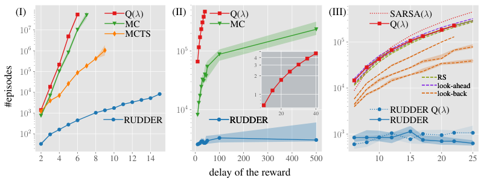

# 第 74 天｜RUDDER：把结尾的回报，重新分给真正改变预测的事件

[系列首页](README.md) · [上一篇](73-r2d2.md) · [下一篇](75-option-critic.md)

**原论文与版本**：Jose A. Arjona-Medina、Michael Gillhofer、Michael Widrich、Thomas Unterthiner、Johannes Brandstetter、Sepp Hochreiter，*RUDDER: Return Decomposition for Delayed Rewards*。首次预印本为2018-06-20，正式发表于[NeurIPS 2019](https://papers.nips.cc/paper/2019/hash/16105fb9cc614fc29e1bda00dab60d41-Abstract.html)，会议日期为[2019年12月8—14日](https://neurips.cc/Conferences/2019)。本文核读[arXiv v3，2019-09-10](https://arxiv.org/pdf/1806.07857v3)，含指定附录章节；[版本记录](https://arxiv.org/abs/1806.07857)可核验首发与修订日期。以下定理、图表和页码均指v3，不混用早期v2的实验措辞。没有独立复现训练，也没有把附录所有证明与作者代码宣称为已审计。

### 先接住前作的问题

[R2D2](73-r2d2.md)讨论怎样让循环网络在回放旧经验时可靠使用记忆。但即使网络记得很久，最终只收到一个奖励，仍然要判断：是很早以前拿钥匙、刚才开门，还是最后一步走进房间值得奖励？

TD学习通过自举让奖励逐步往前传播；Monte Carlo直接把最终回报作为前面各步的目标，却把许多与当前动作无关的后续随机收益也带回来。长延迟因此有两种困难：信息传播慢，以及估计方差大。RUDDER把问题改为“先预测整段回报，再分析事件对预测的贡献”，构造更靠近关键事件的奖励。

关键字是**重新分配**。它没有凭空增加环境奖励，也不是给所有看起来重要的动作额外奖励。新的训练奖励应保留原任务回报，再争取使当前动作之后的期望奖励接近零。后者是理想目标，不是任何训练好的LSTM自动满足的性质。

## 一、问题设定：回报相等、最优策略不变与未来奖励为零

设有限时域t=0,…,T，动作aₜ后得到原奖励R̃ₜ₊₁，原回报为

$$\widetilde G_0=\sum_{t=0}^{T}\widetilde R_{t+1}.$$

主要理论采用γ=1、有限时域或吸收状态，并保持状态转移与策略对应关系。推导时可以把分散奖励累计到结尾；若还要维持马尔可夫状态表示，累计量等必要信息须进入状态，不能只移动奖励就假定仍是原来的MDP表示。

### 五个前置概念

1. **回报与奖励**：奖励在某一步发生，回报是按目标规定累计的奖励；移动奖励可能不改总和，却改变折扣和。
2. **信用分配**：把结果的学习信号交给影响结果的过去决策，不等于单纯记住过去。
3. **回报等价**：对所有可比较策略保留期望总回报，而不只是当前数据集平均值相近。
4. **条件期望**：未来奖励均值为零不要求每条轨迹都零；随机正负残差仍可能存在。
5. **贡献分析**：分解预测输出的来源；预测贡献与干预动作产生的因果效应需要分开。

### Return-equivalent究竟比较什么

两个过程对每个策略都具有相同的期望总回报，且只改变奖励分布，称为回报等价。更强的逐序列条件要求，给定相同状态动作序列，期望总回报相同。对每条实际轨迹直接保证奖励和相同，则提供更强、也更容易核算的样本路径守恒：

$$\sum_t R_{t+1}(\tau)=\sum_t\widetilde R_{t+1}(\tau).$$

在相同初始分布、状态动作路径分布与可比较策略集合下，对每个π取期望可得J新(π)=J原(π)，因而最优策略集合保持。第3页Theorem 1给出这一基本结论。它不是只对当前策略平均相等，更不是“整个数据集总奖励差不多就够了”。

新奖励可以依赖历史，甚至依赖结束后的分析，因此论文采用sequence-Markov decision process，简称SDP：状态转移与所考虑策略仍为Markov形式，奖励不要求一步Markov。不能把“奖励和相同”直接接到标准MDP Bellman方程而省略信息结构条件。

### 相同总回报，不保证分配有用

把全部奖励从最后一步移到倒数第二步，可以保持回报，但未必帮助最早的关键动作。前面加100、最后减100也保持总和，却可能制造高方差。等价性负责保留任务，分配质量负责学习效率。

定义给定当前(sₜ,aₜ)后的剩余期望奖励

$$\kappa_t=\mathbb E_\pi\!\left[\sum_{k=t+1}^{T}R_{k+1}\mid s_t,a_t\right].$$

这不包括当前动作立即得到的Rₜ₊₁；若稍后构造中增加T+2时刻的末端校正，剩余奖励求和也相应延长至该时刻。若κₜ=0，当前动作价值可由立即重分配奖励的条件均值估计。它不要求每条轨迹未来奖励全为零，也不要求新奖励都非负，正负残差可在条件期望中抵消。

## 二、理想重分配：为什么相邻价值差值得注意

第4页Theorem 2针对延迟奖励MDP、固定策略π，以及满足回报等价的二阶Markov重分配，给出最优重分配与下式的等价关系：

$$\mathbb E[R_{t+1}\mid s_{t-1},a_{t-1},s_t,a_t]
=\widetilde q^\pi(s_t,a_t)-\widetilde q^\pi(s_{t-1},a_{t-1}).$$

二阶表示奖励条件均值可依赖前后两个状态动作对。有限时域还需把时间并入状态或显式标出时间索引。固定π也很重要：策略更新后q̃^π通常改变，之前理想的分配未必继续理想。

直觉是“这一步让最终回报的预期改变多少”。关键事件发生前预测基本不变，发现钥匙使成功概率上升、预测跳高，丢失钥匙则可能让预测下降。连续差分把很晚兑现的收益分给较早的信息变化。

但是直接使用真实q差形成循环依赖：本来不知道q才需要学习。RUDDER并不是先求精确q再执行定理，而是训练序列预测器，再通过贡献分析近似这种结构。定理解释理想形式，LSTM是寻找该形式的学习工具。

### 差一个状态基线，为什么动作排序可以保留

Theorem 3的理想条件下，新过程价值满足

$$q^\pi(s_t,a_t)=\mathbb E[R_{t+1}\mid s_t,a_t]
=\widetilde q^\pi(s_t,a_t)-\psi^\pi(s_t),$$
$$\psi^\pi(s_t)=\mathbb E[\widetilde q^\pi(s_{t-1},a_{t-1})\mid s_t].$$

ψ只依赖当前状态而非当前动作，同一状态下减去它不改变动作排序。V也减同一偏移，所以优势A=Q−V相同。这解释了重分配奖励用于策略梯度的接口：动作无关基线在期望策略梯度中抵消。

不能把q与q̃写成完全相等，也不能把任意历史依赖奖励都套进来。Theorem 3继承理想重分配与状态条件。原文还讨论行为策略下偏移，但不等于任意off-policy策略梯度都无需修正。

若分配不理想，立即奖励均值之外仍有κₜ；忽略它通常有偏。可以继续对新奖励做TD或MC，或显式估计剩余项。回报等价支持任务保留，却不替一个把非零κ当零的估计器背书。

## 三、从回报预测到贡献：LSTM究竟学什么

### 预测整段回报，不只是从现在起的回报

令Hₜ为截至t的输入历史，gθ(Hₜ)在每个前缀预测同一个序列总回报G̃₀。训练标签可在结束后获得，前缀预测只使用当时可见信息。一个教学监督目标为

$$L(\theta)=\sum_{t=0}^{T}w_t\left(g_\theta(H_t)-\widetilde G_0\right)^2.$$

wₜ指定各前缀权重；这是回归问题示意，不是Atari完整损失。实际还有最终预测、辅助预测、正则化与截断序列安排。g的目标含已发生贡献与对未来的预测，语义不同于标准“从当前向后累计”的V或Q；完整序列给定时它是序列到总回报的回归器，前缀输入时还须预测未知后续。

### 用相邻预测差定位新贡献

第5—6页讨论三类贡献分析：预测差分、Integrated Gradients、Layer-wise Relevance Propagation。主实验偏好差分：

$$c_0=g_\theta(H_0),\qquad c_t=g_\theta(H_t)-g_\theta(H_{t-1}),\quad t\ge1.$$

这里取空前缀基线零，把首个预测放入c₀。若基线为非零b，必须另行分配b，不能让它消失。相邻预测的共享误差有望抵消，但只有相关误差才会抵消，不能说任意误差都自动消失。

LSTM保存累积证据，可能在没有新信息时保持预测稳定。比起每帧重新估整个回报的前馈网，这有机会减少无关波动。但门控结构的稳定倾向是建模与经验理由，不是训练成功定理。模型可能记错、过拟合，把时间或背景当成贡献。

### Explaining away：末帧泄露结局，早期动作被忽略

若末帧直接显示总分，模型只读它就能预测回报。最终误差很小，却没有识别早期关键事件。因此回归准确与信用有用不能由同一个指标代替。

论文引入相邻状态动作变化Δ，并在理论讨论中假定变化分量统计独立，不能直接携带此前全部贡献，以迫使模型累积事件。实际Atari采用相邻帧像素差加当前帧，不能因此宣称真实游戏事件独立或完全消除末帧泄露。

IG或LRP可以借助后续信息解释早期贡献，但可能使新奖励更依赖未来和完整历史。差分便于在线生成，也要明确初始基线、模型版本及边界。它们是不同路线，不能把所有RUDDER实验写成“把反向传播梯度当奖励”。

## 四、残差校正：连接模型预测与真实回报

差分望远镜求和为Σcₜ=gθ(H_T)，不必等于真实G̃₀。直接把c当奖励，模型误差就改变任务。第6页因此加入额外末端校正：

$$e=\widetilde G_0-g_\theta(H_T),\qquad R_{T+2}=e.$$

于是

$$\sum_{t=0}^{T}c_t+e=g_\theta(H_T)+\widetilde G_0-g_\theta(H_T)=\widetilde G_0.$$

额外末端时刻是原文理论构造；γ=1时也可明确合入最后一个训练奖励，但须保持终止与索引一致。校正确保总和，不强迫κ都为零。若模型严重低估，大部分奖励仍留在末端，信用分配困难也仍存在。

随机奖励还须单独考虑：即使模型精确预测条件期望，单轨迹仍可能有随机残差。理想情形要求相应条件期望零，不要求每次预测等于随机实现。不能把模型误差与环境不可约随机性混为一谈。

### 手算：不完美预测也可以严格守恒

教学轨迹原奖励(0,0,0,10)，空前缀基线0，前缀预测(2,7,6,9)，所以

$$c=(2,5,-1,3),\qquad e=10-9=1.$$

保留额外校正得(2,5,−1,3,1)，总和10；合入末项得(2,5,−1,4)，总和也为10。负数−1表示新证据降低预测，不代表环境惩罚，更不证明某动作具有负因果效应。

不补校正只得9，改变轨迹收益。补校正却把首个预测2从首项再减掉、又不另行分配2，总和会变8。必须说明首项和边界，不能只写“相邻预测相减”。例子是代数与独立计算核查，不是Bowling实验曲线，也不证明学习会更快。

### 折扣问题不能靠省略γ解决

同例若γ=0.9，原折扣回报0.9³×10=7.29；校正合入末项后的新折扣和为2+0.9×5−0.9²+0.9³×4=8.606。未折扣和相同，折扣目标已不同。

若要保持折扣目标，可先在折扣贡献单位中分解，或构造带γ与边界条件的变换，不能把γ=1的守恒式原封不动用于γ<1。这也区别于常见潜势塑形r'=r+γΦ(s')−Φ(s)：后者的折扣望远镜边界需要专门处理，不能只因两者都出现差分就当作相同构造。

## 五、完整训练闭环：先发现样本，再学习分配

论文包含safe exploration、lessons replay与LSTM贡献分析三部分。safe exploration尝试在一段时间避免低价值动作以发现延迟收益；名称不意味着安全约束或零风险保证。lessons buffer保留值得学习的轨迹，减少稀有奖励被普通数据淹没。

人工任务没有启用全部组件：第7页明确不使用lessons buffer或safe exploration，采用去掉输出门、遗忘门的LSTM，以预测差分贡献分析。Atari则有独立回报模型和PPO网络。压成统一的“每步替换reward即可”会丢失关键协议。

```text
教学用完整回合版本（γ=1）：
    按当前策略采集轨迹，保存真实奖励与总回报G
    加入序列训练集或lessons buffer
    用G监督前缀与最终回报预测
    固定本次模型参数，在同一轨迹重新前向
    首项预测与后续预测差得到贡献c
    末端残差e = G - sum(c)
    将e作为额外校正，检查回报守恒
    用新奖励训练价值/策略网络
    模型不理想时，保留未来奖励估计或原奖励信号
    策略变化后继续收集数据并更新模型
```

固定本次模型参数很重要。若相邻预测来自不同版本网络，差分同时含观察变化与参数更新影响，不再只是同一函数上的事件贡献。也不能把回报标签作为行动时输入，否则泄漏未来。

### Atari实现比教学伪代码多了什么

附录A4.2第58—61页，PPO与重分配模型分开。PPO输出原奖励价值、重分配奖励价值和策略；回报模型可读取PPO视觉特征，但不通过该连接向PPO反传梯度。LSTM有64个memory cells，省略输出门与遗忘门，不能随便放一个标准LSTM就称为同一实现。

模型最终预测相对误差构成截断到[0,1]的quality，以它混合两类优势并加权重分配价值损失，避免模型不成熟时完全替换信号。正文写限制到500帧块，附录实际样本为512个连续转移、TBPTT每128步截断；两种粒度不能强行说成精确相同。

第62页还说明，未完成回合的块末端使用PPO价值预测估计剩余回报。实际块训练含自举近似，完整轨迹、真实末端校正的逐路径守恒证明不能未经说明地套到每个截断块。块开头当新起点，块内回合结束重置LSTM，避免跨回合分配奖励。

附录第62页还限制safe exploration样本的用途：8个并行actor里只有2个使用该探索方式，这些off-policy转移用于训练奖励重分配模型，而不用于PPO更新。这样才没有把额外探索轨迹无条件冒充当前策略的on-policy数据。论文名称里的safe描述的是探索启发式，不构成真实部署的安全保证。

lessons buffer强调预测困难与回报偏离平均的样本；模型损失含最终误差、连续前缀误差、提前预测及辅助任务。独立回报模型还消耗额外训练时间，减少环境交互不必意味着计算时间也减少相同比例。本文核读实现边界，没有逐行审计代码，也不把完整回合教学伪代码标成原PPO在线程序。

## 六、原图与人工任务：延迟增大后要多少回合才能学会

<figure class="reading-evidence-figure" id="rl-74-figure-1"><a href="/rl/assets/papers/74-rudder-figure-1.png" target="_blank" rel="noopener noreferrer"></a><figcaption>原论文图形摘引｜Arjona-Medina等，arXiv:1806.07857v3，PDF第8页Figure 1。<a href="https://arxiv.org/pdf/1806.07857v3#page=8">核对原文</a>。保留完整三面板图形，原作者及出版方保留版权；用于直接技术评论。</figcaption></figure>

这不是训练过程回报逐渐上升的学习曲线。横轴改变奖励延迟，纵轴为达到最大期望回报90%所需训练回合数，对数刻度。图注明确主线为100次试验中位数，阴影40%—60%分位，不是标准误差或95%置信区间。正文个别位置写averaged，本文按图注解释绘图统计量，不把中位数改成均值。

三个任务针对不同困难：

1. **Grid World**：31×31网格，靠近炸弹有即时惩罚，远离有即时奖励；先拆弹再离开可以在结尾取得概率大奖。考察TD传递延迟信号并克服即时干扰。这里γ=1，困难不能归咎于折扣衰减。
2. **The Choice**：先选子树，之后随机转移，节点贡献累积到叶子支付。无关后续随机贡献使MC估计初始决策差异困难。完整回报虽是合法目标，却可能需要很多样本才能分清较小决策影响。
3. **Trace-Back**：前两步决定最终收益，之后动作不影响结果。正确序列先受即时负奖励，结尾取得更大利益，考察信用如何回到早期，并比较塑形与trace方法。

这些是暴露特定瓶颈的表格型任务，ε-greedy采用ε=0.2，对照λ=0.9。第三面板蓝虚线表示RUDDER配Q(λ)，另一蓝线为直接Q估计，不是两个种子。部分塑形对照的潜势由重分配构造，不能概括为“所有可能的奖励塑形均无效”。

差距随延迟增大是该协议的重要证据。论文针对特定设置讨论指数困难，不等于证明任意长序列中RUDDER都有指数加速，更没有给出图像网络、数据发现和LSTM训练的普适复杂度保证。

## 七、Atari实验：先说清比较的PPO是哪一个

第8—9页比较52个与工具链兼容的Atari游戏，训练200M游戏帧，每4帧取一次观测，随机no-op起步；训练段以丢命或108K帧上限结束。三个随机种子分别用于网络和ALE初始化。这不同于R2D2不把丢命视作结束，也不是57游戏、同算力预算下的排名。

PPO基线有调整：不用sign奖励裁剪，而按已见最大回报尺度线性缩放；同用safe exploration；熵系数用比例控制，并做粗粒度超参数搜索。RUDDER复用基线设置，再加重分配。所谓比PPO提升指该受控基线，不是直接拿原PPO论文分数比较。

线性缩放保留不同奖励的比例，比sign裁剪更适合区分大额延迟收益，但最大值变化时训练尺度也变。双方共享该改动有助于对照，不能将其效果全部归给LSTM。

### 两种指标回答不同问题

全文分别报告训练全程每局平均分与最后10局平均分。前者兼顾学习速度，后者接近训练末端表现，不是挑最好检查点。52游戏中，全程平均为32个RUDDER更高、20个基线更高，末端为29比23；收益并不普遍。

[第9页Table 1](https://arxiv.org/pdf/1806.07857v3#page=9)选四个明显延迟游戏，RUDDER/基线分别为Bowling 192/56、Solaris 1827/616、Venture 1350/820、Seaquest 4770/1616。表注为3种子、各10次试验平均；结合正文是末端成绩，不是全程平均。

按显示值，Venture加530分，约64.6%，不是加64.6个人类归一化百分点。Bowling用舍入56算约增长242.9%，[附录第64页Table A6](https://arxiv.org/pdf/1806.07857v3#page=64)用更精细56.3给出约241%，首先是显示精度区别，不应直接判作矛盾。

图1不展示Atari，不能从人工任务阴影推出Atari置信区间。本文核对协议与指定表值，没有重新聚合逐局记录、重做显著性检验或复现训练。四个挑选游戏说明延迟场景收益，不能替代全部52游戏分布；均值、末端分数和达到阈值回合数也不是可互换的学习效率指标。

## 八、局限：预测贡献不是因果效应，守恒不是收敛证明

**相关线索可能被误分信用。** 若模型根据背景颜色预测收益，颜色变化可能得到新奖励。因果效应需要定义干预、反事实和识别假设，预测差分本身没有这些条件。论文用reward-causing actions作直觉描述，也不能把网络贡献当成识别过的干预效应。

**探索要先产生证据。** 从未找到有奖励轨迹时，监督学习没有成功事件可分解。lessons buffer能保存稀有成功，不能创造未见成功。人工任务不启用safe exploration，不意味着复杂环境也无需探索机制。

**稀疏不等于延迟。** 奖励少可能来自探索覆盖不足，延迟强调行动影响很久后才兑现。RUDDER更直接针对后者，困难探索游戏未必因重分配就解决。

**模型与策略共同变化。** 旧策略下事件关系未必适用于新策略，分配质量与数据分布会共同漂移。双时间尺度分析需要假设，不能把研究稳定点写成非线性LSTM与PPO保证全局最优。

**长序列仍有成本。** 额外序列训练仍可能有优化、容量和耗时问题；非延迟任务中成本未必值得，错误差分也会制造伪奖励。实践应同时看总回报守恒、预测误差、剩余奖励条件均值和真实环境得分，而不是只挑漂亮的贡献可视化。

R2D2问“从哪里恢复记忆”，RUDDER问“把结果信号放回哪里”。它们都用历史，却分别改变状态处理与训练奖励。本批暂接[系列收尾](61-系列收尾.md)，不把未发布后续文章作为现有链接。

### 三个继续追问

<details><summary>1. 最终回报预测完全准确，就一定能找到关键动作吗？</summary>

不能。模型可能只读末端总分，或者利用相关而非因果线索。原文对Δ表示和理想分解有额外结构条件；实际须检查前缀预测、结局泄漏与剩余奖励条件期望。末端准确是有用条件，不是信用正确的充分证据。

</details>

<details><summary>2. 奖励和已经守恒，为什么还要原奖励价值头？</summary>

守恒保留完整轨迹目标，但新奖励可能很嘈杂、κ可能很大。实际PPO保留两套价值估计，按模型quality调整影响，避免过早完全依赖差的分配。这是稳定训练的设计，不否定回报等价定理。

</details>

<details><summary>3. 预测下降产生负奖励，能截断为零吗？</summary>

不能随意截断。负贡献可能抵消之前过高预测；去掉它破坏守恒，也可能改变策略偏好。若需要非负奖励，应重新设计等价变换与校正，不能裁掉负数后继续沿用原保证。

</details>

## 自测两题

**题1：** 前缀预测(1,4,4)，真实回报6，空前缀基线0。贡献与校正是多少？未来奖励条件期望必然零吗？

**答案：** 贡献(1,3,0)，末端校正2，总和6。守恒成立但不能推出κ=0；较大校正可能说明有用信号仍在结尾，需要继续学习或估计剩余回报。

**题2：** 原奖励(0,10)、γ=0.5，改成(10,0)是否保留同一目标？

**答案：** 未折扣和都10，原折扣回报5，新回报10，不等价。移动奖励须保留真正优化的加权和，或明确采用γ=1；不能只检查普通和就宣布最优策略不变。

[系列首页](README.md) · [上一篇](73-r2d2.md) · [下一篇](75-option-critic.md)
