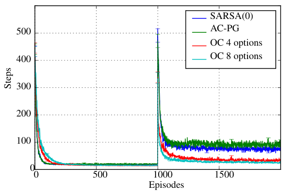
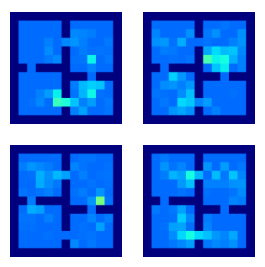
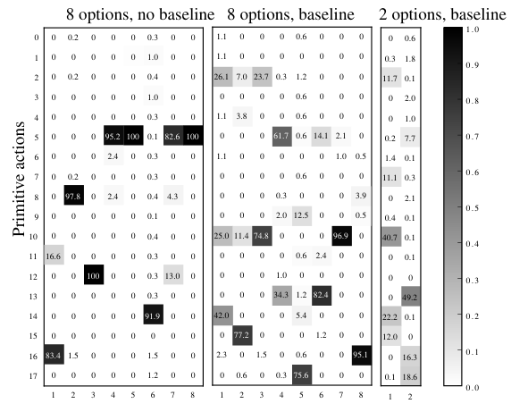
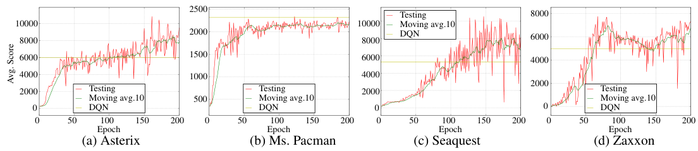

# 第 75 天｜Option-Critic：把“做什么”和“何时停”一起交给回报学习

[系列首页](README.md) · [上一篇](74-rudder.md) · [下一篇](76-feudal-networks.md)

**原论文与版本**：Pierre-Luc Bacon、Jean Harb、Doina Precup，*The Option-Critic Architecture*，AAAI 2017。本文重新核读[arXiv:1609.05140v2，2016-12-03 PDF](https://arxiv.org/pdf/1609.05140v2)，公式、图和实验均以这个版本为准，不将后来的实现习惯倒填进原文。

### 先接住前作的问题

[Options](07-options.md)定义了持续多步的动作，却把一个重要问题留给设计者：每个技能内部怎样行动，什么时候交回控制权？[RUDDER](74-rudder.md)从重分配奖励处理长程信用，本文换到另一条路线，让控制本身具有时间结构。

Option-Critic的贡献不是再造一个高层菜单，而是给菜单中的策略和停止规则提供可微的学习信号。它不要求事先标注门口、子目标或技能奖励，但也不承诺仅凭任务回报就一定长出可迁移、互不重复的技能。

## 一、问题设定：一个技能执行到哪里，继续还是交还控制权

考虑折扣MDP，每个option记为ω=(Iω,πω,βω)。πω(a|s)在执行期间选择原始动作，βω(s)表示抵达状态s后结束的概率。本论文假设所有option在所有状态都能启动，即Iω=S，数量由设计者指定。高层πΩ在当前option结束时才重新选择。

这种call-and-return机制有两个时刻：在s_t执行当前ω_t，得到a_t；到达s_{t+1}后，根据β_{ω_t}(s_{t+1})决定是否更换。把终止概率误放在出发状态，梯度对应的状态分布就会错一拍。环境真正终止则是另外的事件，必须停止回报自举，不能和option交接混为一谈。

### 五个前置概念

1. **时间抽象**：高层一次决策控制若干环境步，持续时间可以随机，不等于把同一原始动作机械重复。
2. **Option三元组**：启动集合规定何处可用，内部策略规定如何行动，终止函数规定何时退出。
3. **增广状态**：(s,ω)记录环境和当前技能，使call-and-return下的过程可以按马尔可夫链分析。
4. **策略梯度**：通过动作概率对参数的导数提高期望回报，需要正确的价值信号与访问分布。
5. **优势**：AΩ(s,ω)=QΩ(s,ω)−VΩ(s)，比较继续当前技能与重新按高层策略选技能的价值。

## 二、从到达价值推出两个梯度

### 三种价值各自负责什么

原文第2页定义

$$Q_\Omega(s,\omega)=\sum_a\pi_\omega(a|s)Q_U(s,\omega,a),$$

$$Q_U(s,\omega,a)=r(s,a)+\gamma\sum_{s'}P(s'|s,a)U(\omega,s'),$$

$$U(\omega,s')=(1-\beta_\omega(s'))Q_\Omega(s',\omega)+\beta_\omega(s')V_\Omega(s').$$

Q_U评价“在当前技能下执行这个原始动作”，QΩ评价技能，U评价抵达下一状态后尚未决定交接的混合价值。对给定高层策略，VΩ(s)=ΣωπΩ(ω|s)QΩ(s,ω)。在贪心控制目标中，才把它替换为maxωQΩ；随机高层的期望与最大值不是同一个定义。

### 内部策略梯度仍然瞄准全任务回报

令θ只参数化内部策略。展开QΩ对θ的导数，一部分直接作用在当前动作概率，另一部分通过后继状态的U继续递归。将递归展开成折扣访问权重μΩ，原文Theorem 1得到

$$\nabla_\theta J=\sum_{s,\omega}\mu_\Omega(s,\omega)\sum_a\nabla_\theta\pi_{\omega,\theta}(a|s)Q_U(s,\omega,a).$$

由∇π=π∇logπ，采样实现使用∇logπω(a|s)乘Q_U估计；也可减去与a无关的QΩ(s,ω)作baseline。这一减法在精确期望中不改梯度，因为Σa∇πω(a|s)=0。它改善的是估计方差，不是在高层和低层之间增加一份新的奖励。

这里更新内部动作仍然考虑整个任务的未来回报，包含将来终止并切到别的option的收益。若另行给每个技能设计独立子目标奖励，优化的就不再完全是同一个目标。

### 终止梯度的负号从哪里来

令ϑ只参数化β。暂时固定两种后续价值，直接对U求导：

$$\frac{\partial U(\omega,s')}{\partial\beta_\omega(s')}=V_\Omega(s')-Q_\Omega(s',\omega)=-A_\Omega(s',\omega).$$

将价值随未来终止规则变化的间接项递归展开，就得到Theorem 2：

$$\nabla_\vartheta J=-\sum_{s',\omega}\widetilde\mu_\Omega(s',\omega)\nabla_\vartheta\beta_{\omega,\vartheta}(s')A_\Omega(s',\omega).$$

这里访问权重对应“新状态、上一技能”的组合，和内部策略梯度的分布有时间偏移。A<0说明继续当前技能比交接差，梯度上升会增大β；A>0则压低β。优势的出现由混合价值推导而来，不只是人为选的降方差技巧。

若β=σ(z)，单次局部更新为Δz=−αβ(1−β)A。sigmoid接近0或1时导数很小，说明“应该停止”不代表有限学习率下会立刻变成必停；饱和与价值误差都可能拖慢修正。

### 独立手算：把“应该停止”的方向验出来

以下为教学构造，不是论文数据。设两个技能价值分别为4、10，高层选择概率为1/4、3/4，则VΩ=8.5。当前技能是第一个，β=0.2，U=0.8×4+0.2×8.5=4.9。

把β增加0.01，U增加0.01×(8.5−4)=0.045。对应A=−4.5、β(1−β)=0.16，所以对logit的局部梯度为0.72，方向确实是提高终止概率。若r=1、γ=0.9，一步价值目标是1+0.9×4.9=5.41。

若改为贪心高层，VΩ=10，U变为5.2，目标为5.68，logit梯度变为0.96。同一状态动作并不允许一边使用随机高层的V，一边写贪心控制目标，再声称数值是一套算法的结果。

## 三、怎样把梯度变成能训练的系统

### Critic可以离策略，两个actor头不因此自动离策略

原文Algorithm 1先用一步intra-option Q-learning更新critic，再更新内部策略与终止。非终止转移的控制目标是

$$y=r+\gamma\left[(1-\beta_\omega(s'))Q_\Omega(s',\omega)+\beta_\omega(s')\max_{\bar\omega}Q_\Omega(s',\bar\omega)\right].$$

这保留“继续原技能”和“重新选技能”两个分支。环境终止时y=r。若存储了Q_U，可以直接做TD更新；在深度实现中同时存Q_U和QΩ较浪费，论文主要学习QΩ，再用一步目标提供Q_U样本估计。

```text
若没有正在执行的option，用高层epsilon-greedy选一个
按该option内部策略采样动作，观察奖励和下一状态
更新critic：继续当前option或终止后选最佳option的混合目标
用当前在线轨迹更新内部策略梯度与终止梯度
若环境终止，结束episode
否则采样终止事件；只有终止才让高层重新选择
```

ALE实验使用共享卷积表示，分别输出技能价值、内部动作分布和终止概率。critic使用经验回放，内部策略与终止函数在线更新。不能因为系统有replay就说所有梯度都能直接对旧轨迹无偏计算。两个梯度定理还要求参数的依赖关系与相应推导一致，共享底座的工程更新并不构成整个非线性系统的全局收敛证明。

### 长技能不是任务目标天然偏爱的解

仅最大化回报时，每一步都重新选动作也足够解决MDP。终止函数容易把option缩短，甚至退化到一步控制。原文深度实验用AΩ+ξ代替终止更新里的AΩ，ξ=0.01。只要当前技能没有差到超过ξ，更新就偏向继续，形成持续执行的余量。

例如A=−0.005时，不加项会提高终止概率，加ξ后A+ξ=0.005，方向反转。它改变了学习偏好，不能把它描述成不影响目标的baseline。原文同时加入内部策略熵正则，减轻过早确定化；另加QΩ baseline降低内部策略梯度方差。这三者分别作用于持续时间、动作分布与估计噪声。

## 四、原始证据：技能边界、动作分布和最终成绩分别读

### 四房间的迁移与边界

<figure class="reading-evidence-figure" id="rl-75-figure-2"><a href="/rl/assets/papers/75-option-critic-figure-2.png" target="_blank" rel="noopener noreferrer"></a><figcaption>原论文图形摘引｜Pierre-Luc Bacon、Jean Harb、Doina Precup，arXiv:1609.05140v2, 2016-12-03，PDF第4页Figure 2。<a href="https://arxiv.org/pdf/1609.05140v2#page=4" target="_blank" rel="noopener noreferrer">核对原文</a> · 点图放大。裁取完整图形区域，原版权保留。</figcaption></figure>

图2横轴为episode，纵轴是到达目标所需步数，越低越好。第1000个episode后目标从东侧门口移到右下房间随机位置；每条曲线平均350次运行。四个或八个option在变化后恢复更快，变化前学习速度也与原始动作方法可比。状态初始位置随机，动作有1/3概率失效，γ=0.99，目标奖励+1，其余0。这是一个明确的目标变化实验，不是任意新任务上的通用迁移保证。

<figure class="reading-evidence-figure" id="rl-75-figure-3"><a href="/rl/assets/papers/75-option-critic-figure-3.png" target="_blank" rel="noopener noreferrer"></a><figcaption>原论文图形摘引｜Pierre-Luc Bacon、Jean Harb、Doina Precup，arXiv:1609.05140v2, 2016-12-03，PDF第5页Figure 3。<a href="https://arxiv.org/pdf/1609.05140v2#page=5" target="_blank" rel="noopener noreferrer">核对原文</a> · 点图放大。裁取完整图形区域，原版权保留。</figcaption></figure>

图3每个小格图对应一个option的终止概率。最深色是墙，更亮表示更容易终止，不是更高的价值或更频繁访问。门口附近出现较高终止概率，说明任务回报能诱导与地形有关的交接位置；但图没有提供每个格子的访问量或误差条，不能据此推断所有训练种子都发现同一种“门口技能”。

### 动作不塌缩与任务得分是两类证据

<figure class="reading-evidence-figure" id="rl-75-figure-7"><a href="/rl/assets/papers/75-option-critic-figure-7.png" target="_blank" rel="noopener noreferrer"></a><figcaption>原论文图形摘引｜Pierre-Luc Bacon、Jean Harb、Doina Precup，arXiv:1609.05140v2, 2016-12-03，PDF第6页Figure 7。<a href="https://arxiv.org/pdf/1609.05140v2#page=6" target="_blank" rel="noopener noreferrer">核对原文</a> · 点图放大。裁取完整图形区域，原版权保留。</figcaption></figure>

图7是Seaquest的经验动作频率：纵轴18种原始动作，横向列代表option，分别比较八技能无baseline、八技能有baseline、两技能有baseline。无baseline时多个技能几乎只使用单个动作，有baseline后频率分布较分散。这是给定训练结果上的行为统计，不是网络在每个状态的完整策略分布，也不能仅凭不同列就证明可组合的语义技能。

<figure class="reading-evidence-figure" id="rl-75-figure-8"><a href="/rl/assets/papers/75-option-critic-figure-8.png" target="_blank" rel="noopener noreferrer"></a><figcaption>原论文图形摘引｜Pierre-Luc Bacon、Jean Harb、Doina Precup，arXiv:1609.05140v2, 2016-12-03，PDF第7页Figure 8。<a href="https://arxiv.org/pdf/1609.05140v2#page=7" target="_blank" rel="noopener noreferrer">核对原文</a> · 点图放大。裁取完整图形区域，原版权保留。</figcaption></figure>

图8四面板横轴标为Epoch，纵轴为各游戏平均得分；红线是测试，绿线是十点移动平均，黄线是原DQN基准。不要把移动平均当跨种子的置信区间。四款游戏共享八个option、0.01终止正则、0.01熵正则及内部策略baseline。原文叙述使用与早期DQN相同的episode预算，并称200个episode内学成；图轴却写Epoch，因此本文不擅自把它换算为统一环境帧数。

论文报告在Asterix、Seaquest、Zaxxon超过所用原DQN基准，Ms. Pacman不属于这个“超过”列表。这里不是57款Atari完整套件，也不是对现代DQN变体的统一重训比较。没有原始种子日志，不能从图中制造精确提升百分比或显著性。

此外，Pinball验证连续状态、离散原始动作的组合：状态含位置与速度，动作共有五个，使用Fourier特征与线性函数逼近。它并不是连续动作机器人控制实验。论文的理论允许适当条件下扩展到连续空间，不应与这项实验覆盖范围混写。

## 五、什么时候值得用，以及尚未解决什么

Option-Critic适合研究无需人工子目标的端到端时间抽象，但要监测option长度、选择频率、内部策略熵和重复度。只看最终奖励，无法区分真正形成分工、一个option包办全局，还是高层每步切换。更多option也意味着更多参数和探索分配，不等于更丰富的有效技能。

所有option到处可用的假设简化了推导，却没有学习启动集合；“内部策略+终止函数可学”不应扩写成三元组每一部分都已自动解决。原文讨论还明确指出，实践中忽略折扣访问权重会使折扣目标的梯度估计有偏，修正会增加方差与采样代价。正确的梯度表达式、有限数据估计与训练稳定性是三层不同结论。

### 继续追问：终止、正则与迁移

<details>
<summary>1. 如果当前option是最高价值的，为什么不永远继续？</summary>

优势只描述当前状态的比较，下一状态的排序可以改变。终止学习依赖到达状态的AΩ，不是启动时做一次永久承诺。即使此刻A=0，终止梯度也没有特别偏好某个持续时间；ξ正则才会加入继续倾向。长执行还可能遮住探索机会，所以应同时检查高层探索与终止饱和。

</details>

<details>
<summary>2. 为什么QΩ可以作内部策略baseline，却不能从终止梯度里随便删掉VΩ？</summary>

内部策略对动作分布求导，动作无关baseline因概率和为1而抵消。终止梯度比较继续和重选两个分支，VΩ正是终止后的价值；删掉它会把相对优劣变成只看当前技能的绝对回报，甚至随着奖励平移改变停止方向。两处“优势”不能因为名字相同就套用同一种删减规则。

</details>

<details>
<summary>3. 门口附近终止就足以说明这些option可迁移吗？</summary>

还不够。需要固定或明确允许微调哪些部件，在新目标、新地形和不同动力学下比较适应样本数，并检查与重新训练的公平预算。原四房间实验支持指定目标位置变化下较快恢复；它没有证明技能对所有任务都通用，也没有独立学习与任务回报无关的技能库。

</details>

## 六、沿着层级控制继续读

- [Options](07-options.md)：直接继承的形式框架，比较人工规定技能与学习内部策略、终止。
- [策略梯度定理](08-policy-gradient-theorem.md)：推导的基础，注意折扣访问权重与baseline条件。
- [DQN](16-dqn.md)：critic的replay与深度表示可组合，内部策略仍不是DQN的贪心动作头。
- [FeUdal Networks](76-feudal-networks.md)：平行路线，高层输出连续潜在方向，低层接受内在奖励，不以离散技能终止为核心接口。

**原文定位**：v2 PDF第2页式(1)–(4)；第3页两个梯度定理；第4页Algorithm 1与四房间；第5–7页Pinball、ALE设置、正则与局限；第8–9页梯度证明。本文核对上述公式及指定实验，不声称重训或验证完整非线性收敛性。

## 自测两题

**问题1**：QΩ(s,ω)=4、VΩ(s)=8.5、β=0.2时，增加β能否提高到达价值？对sigmoid logit的局部梯度是多少？

**参考答案**：U=4.9，β每增加0.01，U提高0.045。对logit的梯度是−0.2×0.8×(4−8.5)=0.72，应增大终止概率。

**问题2**：终止正则ξ与内部策略baseline都是“加减一个数”，为什么不能视为同一种无偏技巧？

**参考答案**：动作无关baseline乘内部策略score后期望为零，可保持原梯度；把ξ加进终止优势直接改变停止方向与持续时间偏好，不会通过动作概率归一化抵消。

[系列首页](README.md) · [上一篇](74-rudder.md) · [下一篇](76-feudal-networks.md)
