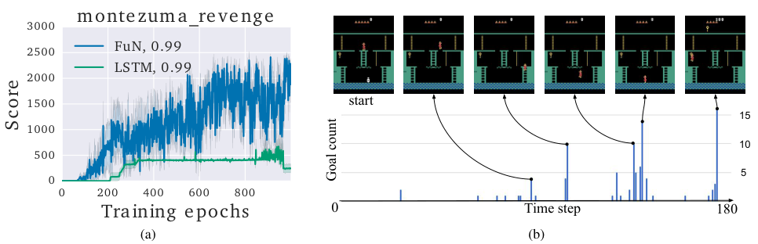

# 第 76 天｜FeUdal Networks：高层给方向，低层学会把方向走出来

[系列首页](README.md) · [上一篇](75-option-critic.md) · [下一篇](77-hiro.md)

**原论文与版本**：Alexander Sasha Vezhnevets、Simon Osindero、Tom Schaul、Nicolas Heess、Max Jaderberg、David Silver、Koray Kavukcuoglu，*FeUdal Networks for Hierarchical Reinforcement Learning*，ICML 2017，PMLR 70。本文核读[PMLR正式论文PDF](https://proceedings.mlr.press/v70/vezhnevets17a/vezhnevets17a.pdf)，以其十页正文、公式和实验为准。

### 先接住前作的问题

[Option-Critic](75-option-critic.md)让高层选择离散option，并学习何时交还控制权。若只优化任务回报，高层可能每步切换，也可能只剩一个技能有用。FuN换一个接口：高层不报技能编号，而是在学到的状态空间中发出方向；低层受到奖励，去产生与这个方向一致的变化。

关键在于接口有可检查的含义。目标g不能只是随意的隐藏向量，它应当与未来状态位移相关。为此论文没有把Worker的策略损失一路反传给Manager，而是分别给两层建立学习信号。

## 一、问题设定：视觉长程任务里，怎样让高层目标具有稳定含义

智能体每步看到图像x_t，Worker每步输出原始动作。共享感知网络得到z_t，Manager再把它映射到潜在状态s_t，并输出单位方向g_t。这里s_t是学习得到的表示，不应直接视为环境的完整马尔可夫状态；递归网络承担了部分记忆需求。

Manager想提高外部任务回报，Worker既追求外部回报，也追求遵循方向的内在回报。时间尺度由预测跨度c、目标池化和dilated LSTM共同形成。**高层输出可以每一步更新**，不是每隔c步才运行一次的固定开关。

### 五个前置概念

1. **目标条件策略**：动作分布除了观测还依赖目标；同一图像在不同目标下可以产生不同动作。
2. **方向目标**：规定潜在状态应该朝哪里变化，不直接规定必须到达哪个绝对点，也不规定移动距离。
3. **余弦相似度**：dcos(u,v)=uᵀv/(‖u‖‖v‖)，比较夹角，范围为[−1,1]；零向量需要额外数值处理。
4. **内在奖励**：由任务之外的内部准则产生的训练信号；本文奖励遵循Manager方向，不是单纯奖励新奇。
5. **时间展开反向传播**：BPTT在有限轨迹窗口内传播递归网络梯度；展开长不代表长依赖一定能学到。

## 二、先设计接口，再决定哪些梯度能够通过

### 两个循环网络与乘法动作头

原文式(1)–(4)的基本结构是

$$z_t=f_{\rm percept}(x_t),\quad s_t=f_{\rm Mspace}(z_t),\quad g_t=\hat g_t/\|\hat g_t\|,$$

$$w_t=\phi\left(\sum_{i=t-c}^{t}g_i\right),\qquad \pi_t=\operatorname{softmax}(U_tw_t).$$

Manager的递归网络生成未归一化的ĝ_t；Worker的递归网络生成矩阵U_t，每一行是一个原始动作的嵌入。φ把高维目标压到低维空间，论文使用潜在维度256、动作嵌入维度16。w与每个动作向量做内积，形成动作logit。

注意原文式(3)从t−c到t含两端，共c+1个目标，附近文字称“last c goals”。本文保留公式而标明这一边界差异，实现时须统一窗口定义，不能把它当成不影响输入尺度的笔误随手隐藏。随后内在奖励的求和则明确是i=1,…,c，共c项。

φ是无偏置线性投影，设计目的是减少通过固定非零偏置忽略Manager的捷径。但这不是一般意义的“网络不可能忽略目标”定理：U的各动作行相同或投影退化时，策略仍可能失去有用的目标依赖。结构性偏置和保证有语义分工应分别评价。

### Worker为什么需要自己的奖励

论文式(6)定义

$$r_t^I=\frac1c\sum_{i=1}^{c}d_{\cos}(s_t-s_{t-i},g_{t-i}).$$

它检查最近c个时刻发布的方向，各自与从发布时刻到现在的位移有多一致。不是只比较最新g_t与一步位移，也不是计算到某个目标坐标的欧氏距离。多个重叠目标让一个时间点的行为可以回应此前的连续指令。

Worker用优势actor-critic优化外在与内在回报的加权和：

$$\widehat A_t^W=R_t+\alpha R_t^I-V_t^W,\qquad \Delta\theta_W\propto\widehat A_t^W\nabla\log\pi(a_t|x_{\le t},g_{\le t}).$$

α过小可能使Worker不理高层，过大则可能追求容易执行的潜在方向而忽略任务。论文并未完全对低层屏蔽外部奖励，纯内在奖励只是消融变体。目标嵌入φ由Worker梯度学习，但梯度在目标接口处截断，不把动作损失反传给Manager目标生成器。

### Manager怎样避免把方向变成任意编码

Manager的更新是

$$\Delta\theta_M\propto\widehat A_t^M\nabla_{\theta_M}d_{\cos}(s_{t+c}-s_t,g_t(\theta_M)),\qquad \widehat A_t^M=R_t-V_t^M.$$

正优势意味着这段最终方向值得更容易被发出，负优势则反过来。计算余弦梯度时，论文明确忽略s对θ的依赖，避免通过任意扭曲起终点表示来轻易提高相似度。它不等于整套表示永远冻结；必须说清是这条目标更新中的哪一条梯度路径被截断。

这里没有把未来外部奖励直接分给某个像素，也没有从Worker中反传环境动力学。需要先执行轨迹，等到t+c观察状态位移，再形成这项监督。因此c增大可以跨越更长行为，同时也让归因更延迟、位移更难由当前单个方向解释。

## 三、近似转移策略梯度：有条件的解释，不是无条件定理

### 把一段行为压成末端状态分布

设高层选择o_t=μ(s_t;θ)，低层持续执行c步，末端分布为p(s_{t+c}|s_t,o_t)。如果这个分布可知，可把“选择末端状态”视为高层策略，使用

$$\nabla J=\mathbb E\left[(R_t-V(s_t))\nabla_\theta\log p(s_{t+c}|s_t,\mu(s_t;\theta))\right].$$

FuN假设归一化位移方向近似遵循以g_t为均值方向、固定集中程度的von Mises–Fisher型模型，其与目标有关的对数概率项正比于dcos(s_{t+c}−s_t,g_t)。因此上式退化为Manager使用的余弦梯度。若显式写集中参数κ，则梯度还乘κ；固定比例可吸收入学习率。

这个说明需要低层确实能把目标转化为围绕该方向的位移。Worker的内在奖励促使近似变合理，但并未证明训练过程中每一步的转移分布都服从这个模型。低层尚未学会、障碍限制可达方向、表示快速变化时，更新只是有结构的近似信号。

此外，推导用固定时长子策略解释高层转移，实际系统却采用重叠目标和每步输出。读者不能因此把实现描述为精确采样某个孤立的c步option，也不能声称已经得到全部网络参数的无偏真实策略梯度。

### 两个独立数值检查

教学例一：c=2，s₀=(0,0)、s₁=(1,0)、s₂=(1,1)，g₀=(1,0)、g₁=(0,1)。在t=2，一步位移s₂−s₁=(0,1)与g₁完全一致；两步位移(1,1)与g₀余弦为1/√2。因此r₂ᴵ=(1+1/√2)/2≈0.853553。

若把两个目标都改成(1,0)，第一项变0、第二项仍为1/√2，r₂ᴵ≈0.353553。状态相同、目标不同，奖励就不同。由于余弦忽略长度，沿同一方向走0.1和10可能得到相同相似度；不能把0.853553解释成到达目标的成功率。

教学例二：位移单位方向v=(0.6,0.8)，当前g=(1,0)，Manager优势A=2。对未归一化向量ĝ的梯度在‖ĝ‖=1处为

$$\nabla_{\hat g}\bigl[A\,v^Tg\bigr]=A(I-gg^T)v=(0,1.6).$$

更新把目标往上旋转而不沿自身方向无限放大。学习率0.1时，先得到(1,0.16)，再归一化，余弦由0.6提高到约0.718857。若A=−2，旋转方向相反。计算应对归一化层求导，不能只把v当成最终梯度。

## 四、时间尺度来自什么，实验又怎样控制预算

### dLSTM不是十个独立参数网络

Manager的dilated LSTM有r组记忆核心，时间t只更新t mod r对应的一组，所有组共享LSTM参数。其他记忆状态保留，输出再通过过去目标池化平滑。原实验r=c=10。这样每组的递归依赖跨十个输入步，而整体仍处理每个观测。

它缩短了长时间间隔之间的梯度路径，但并没有凭空补回被截断轨迹之前的信息。FuN使用BPTT长度400，普通LSTM基线通常40，并额外考察100。基线用316个隐藏单元，FuN两层各256，意在使总参数量接近。不能只说“参数一样”，然后忽略展开长度、内在奖励与优化尺度不同。

### 原图2：好成绩与可解释目标各回答一件事

<figure class="reading-evidence-figure" id="rl-76-figure-2"><figcaption>原论文图形摘引｜Alexander Sasha Vezhnevets等，ICML 2017, PMLR 70 official PDF，PDF第5页Figure 2。<a href="https://proceedings.mlr.press/v70/vezhnevets17a/vezhnevets17a.pdf#page=5" target="_blank" rel="noopener noreferrer">核对原文</a> · 点图放大。裁取完整图形区域，原版权保留。</figcaption></figure>

左图横轴是训练epoch，每epoch定义为一百万次智能体观测；原始动作还重复4帧。因此epoch不能不加说明地等同于百万模拟器帧。纵轴为episode得分。右图横轴是单次轨迹的时间，纵轴Goal count统计有多少此前时刻将该未来状态选为与其目标方向最对齐的状态。它不是目标概率、访问频率或外部奖励。

右图较高柱对应梯子、钥匙等有用位置，是方向目标可以形成可解释进度点的定性证据。图注的余弦状态下标有排版问题，正文明确意图是比较某个未来状态与当前状态的差。本文按该语义解释，不把“同一状态减自己”的零向量写成算法。

Montezuma实验中，FuN的Worker折扣0.99、Manager为0.999；基线用0.99，并扩大搜索学习率范围才获得进展。原文报告FuN不到200个epoch解决第一间房，之后进入更多房间，成绩可达2600；LSTM超过300个epoch才到约400分，较长时间停滞。这些结果不能改写为“所有随机种子稳定达到2600”。

### 必须保留的选择口径

全部方法使用A3C、32个异步线程及共享RMSProp。作者通常为每种方法运行100个随机超参数设置，画按最终分数选择的前五个智能体的平均episode得分。学习率、熵系数和FuN的α参与搜索，FuN学习率范围还因较长BPTT而调整。

这衡量的是较大搜索预算下的优良配置表现，不是随机初始化的无选择总体均值。图中的带状变化也不能自行命名成95%置信区间。选择前五再画其整个学习过程还带有事后选择，适合展示潜力，不宜估算普通使用者一次运行的成功概率。

其他Atari比较也不支持“所有游戏都更好”：原文第6–7页指出Seaquest、Breakout上较短视的LSTM表现最好，Alien亦是基线占优。记忆任务包括Water maze、T-maze、T-maze+和Non-match，四项上FuN相较所用LSTM更快且最终回报更高；这仍是具体任务与训练协议下的证据。

## 五、消融、迁移与实际限制

第5.4节分别比较直接从Worker反传、用普通高斯策略梯度训练Manager、绝对目标和低层仅用内在奖励。完整FuN在所测四款游戏更好，纯内在奖励版本虽优于其他若干删改仍弱于完整系统。这里支持的是这些设计在该组合中的经验价值，不是独立证明某一模块永远必需。

第5.5节将动作重复4的策略转移到不重复动作的环境，调整奖励折扣，将dLSTM dilation与目标跨度都乘4，再继续训练。这是带时间尺度适配与微调的迁移，不能叫零样本跨机器人迁移。潜在方向的抽象性提供了这种可能性，但真实身体变化还涉及不同可达集与观测表示。

实际实现需检查：位移接近零时余弦分母如何稳定；目标归一化与停止梯度是否正确；池化窗口是否与奖励跨度一致；内在奖励是否被表示塌缩利用；Manager方向对Worker是否可达。仅输出一条平滑的g曲线，不能说明分层学习成功。

### 继续追问：语义接口与两种时间尺度

1. 全网络可微，为什么主动阻断Worker到Manager的梯度？

若完全通过最终动作损失训练，g可以变成任意内部代码，未必对应未来位移方向。FuN希望高层发出可由状态变化检验的指令，因此用外部优势加转移方向更新Manager，用遵循方向的奖励训练Worker。这牺牲了单一端到端真实梯度的简单解释，换取接口的归纳偏置，并依赖低层能执行指令。

2. 用方向而非绝对坐标，解决了所有目标泛化问题吗？

没有。方向具有平移和正尺度层面的相似性，但潜在表示改变或障碍阻挡时，同一向量仍可能代表不同或不可实现的行为。余弦还忽略距离，无法单独说明何时足够接近、何时该停止。它缓解绝对目标难以到达的问题，而不是给出可达性证明。

3. 为什么不能把c=10解释为高层十步才决策一次？

c规定位移评价跨度与内在奖励回看窗口，dLSTM的r规定每个记忆核心的更新间隔，池化使输出慢变。整体每步仍处理输入、输出目标和动作。固定十步提交同一个目标会改变这三者的组合，也不再是论文所写的滚动接口。

## 六、沿着目标接口继续读

- [Option-Critic](75-option-critic.md)：平行比较离散技能及终止与连续方向目标，不能把两者的学习信号混用。
- [A3C](22-a3c.md)：FuN实验的优化骨架，与层级接口形成模块组合。
- [ICM](24-icm.md)：同样使用内在信号，但好奇心追求预测新奇，FuN追求服从方向。
- [HIRO](77-hiro.md)：进一步研究离策略回放时，下层变化如何使高层旧目标失去含义。

**原文定位**：PMLR PDF第2–3页式(1)–(7)，第4页转移策略梯度与dLSTM，第5页图2及调参协议，第6–8页游戏结果、记忆任务、消融与动作重复迁移。未重跑训练，未从图形估算未报告的显著性。

## 自测两题

**问题1**：s₀=(0,0)、s₁=(1,0)、s₂=(1,1)，g₀=(1,0)、g₁=(0,1)，c=2时r₂ᴵ是多少？

**参考答案**：(1+1/√2)/2≈0.853553。两项分别比较最近一步与g₁、最近两步与g₀，不能仅比较最新一步。

**问题2**：FuN有策略梯度解释，为何不能称其Manager更新始终是真实环境回报的精确无偏梯度？

**参考答案**：解释依赖低层诱导的方向转移近似满足指定分布，并有固定时长子策略等建模条件；实际Worker持续学习、目标重叠、表示变化。余弦更新是结构化近似，不能从可微性推出这些条件自动成立。

[系列首页](README.md) · [上一篇](75-option-critic.md) · [下一篇](77-hiro.md)
