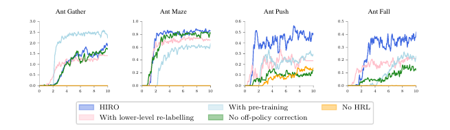

# 第 77 天｜HIRO：低层学会了新走法，旧的高层经验还能怎样使用

[系列首页](README.md) · [上一篇](76-feudal-networks.md) · [下一篇](78-hac.md)

**原论文与版本**：Ofir Nachum、Shixiang Gu、Honglak Lee、Sergey Levine，*Data-Efficient Hierarchical Reinforcement Learning*，NeurIPS 2018。本文核读并下载[arXiv:1805.08296v4，2018-10-05](https://arxiv.org/pdf/1805.08296v4)，公式与页码固定到该版。教学例独立构造，不冒充论文实验。

### 先接住前作的问题

[FeUdal Networks](76-feudal-networks.md)用经理设目标、工人执行，把行动拆成两种时间尺度。但当工人不断进步时，经理过去发出的同一道命令，今天未必产生相同后果。普通经验回放默认动作的环境含义比较稳定，层级系统偏偏会改变这件事。

HIRO抓住的是这种特殊的非平稳性。它让高层提出状态变化目标，让低层学习到达目标；回放高层旧轨迹时，再寻找一个在**当前低层策略**看来最能解释当时动作的目标。读完本文，应能区分“给失败轨迹换一个成功目标”和“给旧动作寻找新的解释”，并知道后者为什么仍只是近似校正。

## 一、问题设定：两个策略，两种奖励，一个正在变化的动作接口

考虑连续控制任务。环境状态为s，原始动作a由低层执行，环境任务奖励记R。每隔c步，高层输出相对目标g；低层接收(s,g)，产生动作。低层使用几何目标奖励r，高层使用环境奖励R。两者虽然来自同一轨迹，却解决不同问题。

### 五个前置概念

1. **离策略学习**：利用别的行为策略产生的数据更新目标策略。它允许动作采样分布不同，但不是任意转移含义变化都自动正确。
2. **时间抽象**：高层一条命令持续c步。它评价的是一段行为，而不是单个关节力矩。
3. **目标条件策略**：同一低层网络接收不同g，形成不同的局部行为，不必每个技能单建网络。
4. **内在与外在奖励**：r推动追踪子目标，R决定最终任务是否完成。到达一个没用的子目标可以让低层得分较好，但高层未必得益。
5. **有效转移核**：固定低层参数后，执行高层目标g会诱导一个c步状态分布。低层参数变化，相同g对应的这个分布也变化。

记低层参数为φ，高层看到的有效转移可以抽象为

$$P^{(c)}_\phi(s'\mid s,g)=\sum_{\text{中间轨迹}}\prod_{i=t}^{t+c-1}P(s_{i+1}\mid s_i,a_i)\,\pi^\mathrm{lo}_\phi(a_i\mid s_i,g_i).$$

连续变量时求和应换成积分。这是教学表达，不是原文公式编号。它直接显示：环境物理规律P没变，φ一变，高层“动作”的效果仍会变。仅使用TD3，并不能让旧的高层样本突然来自当前的有效转移核。

## 二、相对目标为什么必须随状态变化

原文§3.2、式(2)定义目标递推：

$$g_{i+1}=h(s_i,g_i,s_{i+1})=s_i+g_i-s_{i+1}.$$

因此

$$s_{i+1}+g_{i+1}=s_i+g_i=s_t+g_t.$$

相对向量会变化，但这段高层命令所指向的绝对目标保持不变。若机械保持g不动，智能体每前进一步，目标也向前平移一步，低层追逐的就成了移动靶。

原文式(3)用下一状态到目标的欧氏距离作为负奖励：

$$r_i=-\|s_i+g_i-s_{i+1}\|_2=-\|g_{i+1}\|_2.$$

注意这里是L2范数，不是平方范数。论文动作似然校正中的残差则是平方范数，两处不能抄成同一个式子。原文在Ant实验中以位置相关观测表示目标，包括根部与关节位置，而不是把所有观测分量、速度与像素一概拿来做相减。

### 一维手算：没有到达目标，不等于没有朝目标移动

独立构造：s₀=0，高层g₀=3，两步后状态依次为s₁=1、s₂=2。

- 第一步后g₁=0+3−1=2，r₀=−2。
- 第二步后g₂=1+2−2=1，r₁=−1。
- 两个时刻的绝对目标均为3；若低层折扣γ=0.9，两步内在回报为−2+0.9×(−1)=−2.9。

它仍然没有到达目标。负距离奖励给的是连续进展信号，不是成功标签；经过障碍时，正确路径甚至可能短暂增大距离。因此“使用状态距离”既带来稠密监督，也带来几何度量的偏置。

低层可在增广状态(s,g)上用离策略连续控制学习。例如教学版一步目标为

$$y_i^\mathrm{lo}=r_i+\gamma(1-d_i)Q^{\mathrm{lo},-}(s_{i+1},g_{i+1},\mu^{\mathrm{lo},-}(s_{i+1},g_{i+1})).$$

这里写单critic便于说明；原实验使用TD3，完整实现需考虑双critic、目标平滑与延迟策略更新。终止标记d必须表示对应学习问题的真实终止，不能因为高层到了决策时刻就随手把所有低层目标设成环境终止。

## 三、回放校正：找出今天能解释昨天动作的目标

高层回放至少需要保留整段状态和动作，而不只是(s_t,g_t,s_{t+c})。原文§3.3问：当前低层在什么目标下，最可能采取曾经实际发生的动作序列？

$$\tilde g_t\in\arg\max_g\sum_{i=t}^{t+c-1}\log\pi^\mathrm{lo}_{\mathrm{current}}(a_i\mid s_i,\tilde g_i),\qquad\tilde g_{i+1}=s_i+\tilde g_i-s_{i+1}.$$

所有候选都沿着**真实记录的状态**递推目标，不重新模拟一条候选轨迹。若行为策略为确定性网络输出加固定、各维相同的高斯噪声，则忽略不影响排序的常数，等价于最小化

$$E(g)=\sum_{i=t}^{t+c-1}\|a_i-\mu^\mathrm{lo}_{\mathrm{current}}(s_i,\tilde g_i)\|_2^2.$$

固定方差σ²下，log似然为−E/(2σ²)+常数。若不同动作维噪声方差不同，就应使用协方差逆矩阵加权的二次型，不能无条件继续使用未加权欧氏距离。

原实现不是对g求出精确全局最优解，而是比较十个候选：原目标、实际位移s_{t+c}−s_t，以及围绕实际位移随机产生的八个候选。这个搜索规模与候选组成来自v4第6页，不能将它写成算法必须固定遵守的数学定义。

### 完整手算：实际位移不一定就是最佳重标记

仍取旧状态(0,1,2)，旧动作(a₀,a₁)=(1,1)，旧目标为3。为了手算，设当前低层均值为μ(s,g)=g/2。比较候选初始目标g=1、2、3：

- g=1：递推目标为(1,0)，均值动作(0.5,0)，E=0.5²+1²=1.25。
- g=2：递推目标为(2,1)，均值动作(1,0.5)，E=0²+0.5²=0.25。
- g=3：递推目标为(3,2)，均值动作(1.5,1)，E=0.5²+0²=0.25。

在这三个候选中，实际位移2与旧目标3打平。若允许连续优化，

$$E(g)=(1-g/2)^2+(1-(g-1)/2)^2,$$

令导数为零得g=2.5，E=0.125，更好。σ=0.5时，它相对g=2的log似然优势为(0.25−0.125)/(2×0.25)=0.25，似然比为e^0.25。

这个例子同时检查了目标递推、动作残差与有限候选近似。重标记不要求选一个实际到达的目标；它是在解释一段动作。若把每步目标都错误地设为同一个g，手算结果也会改变，得到的已经不是HIRO的相对目标校正。

### 校正之后，高层到底学什么

换掉的是高层动作标签g，环境状态、原始动作与外在奖励都保持真实。原文用一段环境奖励的和构造高层训练样本。复现时必须明确时间尺度的折扣约定：若要严格对应原始步折扣γ的SMDP，长度k的备份应为

$$y^\mathrm{hi}=\sum_{j=0}^{k-1}\gamma^jR_{t+j}+\gamma^k(1-d)Q^{\mathrm{hi},-}(s_{t+k},\mu^{\mathrm{hi},-}(s_{t+k})).$$

这条式子是教学上的SMDP口径，不把它冒充原作者训练代码的逐行实现。若选择“段内奖励求和、高层每决策折扣一次”，也能定义一个学习目标，但它与原始步折扣不是自动等价。短段提前终止时，更不能继续固定乘γ^c。

## 四、为什么它不同于HER，也不是严格消除分布偏差

HER常把任务目标换成轨迹达到的目标，并据此重算目标奖励。HIRO这里更改的是高层动作的解释，使旧低层动作尽量符合当前低层。前者处理稀疏目标反馈，后者处理层级接口随学习变化。两者可以发生在不同层，不能只因都叫“重标记”就互相替代。

这个似然匹配仍有边界：候选有限；某些旧动作在当前低层下对所有目标都很不可能；用最可能标签并没有按完整分布进行重要性加权；神经网络与Q函数还会产生自己的估计误差。因此本文不宣称它把所有高层回放变成无偏的当前策略数据。

目标空间也不是免费得到的语义空间。关节角周期、坐标尺度、不可控分量以及障碍拓扑都可能让原始距离不理想。若将坐标单位从米换成毫米而不归一化，就会改变不同维度在奖励与目标搜索中的权重。若直接套到视觉任务，相同像素距离也未必对应相同可达性。

## 五、原始证据：比较的是样本利用与设计组合

<figure class="reading-evidence-figure" id="rl-77-figure-4"><figcaption>原论文图形摘引｜Nachum等，arXiv:1805.08296v4，PDF第8页Figure 4。<a href="https://arxiv.org/pdf/1805.08296v4#page=8" target="_blank" rel="noopener noreferrer">核对原文</a>。原版权保留。</figcaption></figure>

已检查此原图：四个面板横轴均为百万环境步；Gather画平均奖励，另外三个任务画成功率。蓝色HIRO、绿色无离策略校正、浅蓝低层预训练等曲线不是五种不同环境。Push与Fall包含物体交互，对高层动作含义稳定性的要求更明显；Gather中预训练变体表现更好，不能概括为HIRO在每一任务都胜出。

**证据定位与口径**：v4第7页§5描述任务；第7页Table 1报告训练预算内最佳策略的统计；第8页Figure 4及§5.2比较消融。表1使用十次随机种子运行的均值与标准误，图4说明十次运行平均；本文不把表格的误差定义自动移植给图中阴影，也不把“最佳策略”当成最终检查点。原图各曲线未做数字化，本文不从像素估计精确提升比例。

对于FuN，作者在相同框架中实现其关键设计的变体，没有把全部原始FuN组件原封不动移植。比较支持这些任务和实现预算下的结论，不能证明所有学习表示都不如原始状态目标。模拟器里的交互步数也不能自动等同于真实机器人的墙钟训练时间：重置、安全与硬件损耗并未由这组曲线验证。

## 六、从论文到可检查的最小实现

实现时先做三类单元检查，再跑大型实验：

1. 对随机状态序列验证s_i+g_i恒定；这是纯代数测试，不用训练。
2. 固定一个低层网络，手工计算几个候选的动作误差，核对程序选择结果；探索噪声尺度必须与似然解释一致。
3. 分别记录内在奖励与外在奖励、真实终止与时间截断、原目标与重标记目标，避免指标混用。

然后才比较固定低层、持续更新但不校正、持续更新并校正三个设置。若低层固定，不存在同样的接口漂移；若没有记录动作序列，无法忠实执行本文校正。训练效率应同时报告交互步数和计算成本，因为每个高层回放样本还要为多个候选评估整段低层动作。

阅读路线：[Option-Critic](75-option-critic.md)学习离散技能及终止；[FeUdal Networks](76-feudal-networks.md)在表示空间下发目标；[UVFA](80-uvfa.md)解释目标条件价值共享；HIRO把连续目标接口与离策略回放结合起来。这几者解决的问题有交集，但“固定c步”与“学习终止”不能混为一谈。

### 继续追问

1. 高层只使用新的数据，能不能绕开校正？

可以减少旧低层造成的转移不一致，但会牺牲经验复用，并不消除当前多层同时训练的全部非平稳性。HIRO选择保留回放、近似校正，属于效率与偏差之间的设计取舍。

2. 为什么不总把旧目标改成最终状态减初始状态？

最终位移只约束端点，动作序列还包含怎样走到那里。同一端点可以由不同路线与动作实现。手算例中连续最优解释为2.5，实际位移为2，已经说明端点重标记不等于动作似然最大化。

3. c越大是否越能处理长程任务？

更大的c降低高层决策频率，却增加低层完成目标的难度，也增加目标解释需匹配的动作数量。环境变化快时还会延迟高层纠偏。它是时间抽象的设计参数，不是越大越好的样本效率开关。

## 自测两题

**问题1**：s₀=0、g₀=3、s₁=1、s₂=2时，g₁、g₂与两步内在奖励是什么？为何目标不移动？

**参考答案**：g₁=2，g₂=1，奖励为−2、−1。因为s₁+g₁=s₂+g₂=3，只有相对表达变化。

**问题2**：教学低层μ=g/2下，候选g=2与g=2.5的动作平方误差分别是多少？后者是否证明回放已无偏？

**参考答案**：0.25与0.125。后者仅在这个候选目标下更能解释记录动作，不能保证整个高层转移分布一致，更不能消除函数逼近与有限搜索偏差。

**核读与复现边界**：已下载v4原PDF，核读§2—§5中的相关方法和实验文字，并实际查看第8页图形与本地摘图。未逐项审计全部附录、未执行作者代码、未重新训练、未复算统计显著性。图像仅作为本文讨论的证据摘引；本文手算与SMDP展开是教学推导。

[系列首页](README.md) · [上一篇](76-feudal-networks.md) · [下一篇](78-hac.md)
