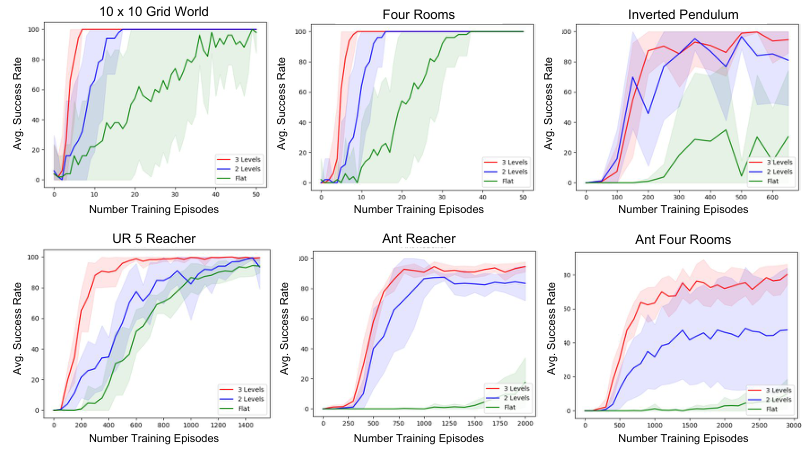

# 第 78 天｜HAC：先承认实际走到了哪里，再让多层目标一起学习

[系列首页](README.md) · [上一篇](77-hiro.md) · [下一篇](79-dads.md)

**原论文与版本**：Andrew Levy、George Konidaris、Robert Platt、Kate Saenko，*Learning Multi-Level Hierarchies with Hindsight*，ICLR 2019。本文核读 [arXiv:1712.00948v4，2019-03-01](https://arxiv.org/abs/1712.00948v4) 的正文、算法与附录；图来自同版本 PDF。

### 先接住前作的问题

[HER](26-her.md)把“没有到达指定目标”的经历，改写成“到达了另一个目标”的成功经历。[Option-Critic](75-option-critic.md)学习选项及终止机制，[FeUdal Networks](76-feudal-networks.md)让高层发出方向。HAC 则问：如果高层和低层都还在学习，高层怎么知道自己发出的子目标到底意味着什么？

昨天发出“去门口”，低层可能撞墙；今天同一个指令可能成功。这种变化发生在高层看来相同的动作上，造成非平稳性。HAC 的关键不是假装失败没有发生，而是把经验明确拆成两个问题：**如果我下令去实际到达的位置，这条路线值多少？我原来下的指令，现在到底能不能执行？**

## 一、问题设定：低层变化让高层动作的含义也变化

环境提供状态 $s$、原始动作 $u$ 和目标 $g$。目标可以是状态空间中的区域，例如位置进入给定容差内。论文用目标条件的 UMDP 表述问题。连续控制版使用确定性 actor-critic，离散版称为 HierQ；不能把二者都说成 DDPG。

一个 $k$ 层系统由 $\pi_0,\ldots,\pi_{k-1}$ 组成。底层输出原始动作，其余层输出下一层要到达的子目标。每层看到环境状态及自己的目标。形式定义中目标、子目标来自状态空间，实际实验还需要指定目标坐标和到达阈值。算法没有自动发现任意语义目标的能力。

### 五个前置概念

1. **目标条件策略**：$\pi(s,g)$ 的行为随 $g$ 改变；状态相同不表示任务相同。
2. **层内时间步**：上层一次动作是下层一段执行过程，不等于一个环境步。
3. **离策略回放**：旧经验可供当前策略学习，但动作标签必须解释清楚。
4. **HER**：改写目标后要重算奖励及结束标记；只替换字符串是不够的。
5. **可达性**：距离近不保证在规定时间内可达，墙壁、动力学、控制能力都会影响它。

低层获得至多 $H$ 次尝试；成功、达到更高层目标或用尽预算会触发返回。对于三层结构，中层一次动作至多消耗 $H$ 个原始动作，顶层一次动作可嵌套至多 $H^2$ 个原始动作。这是执行预算的量级，不是每次都会跑满，也不是整集长度的统一定义。见原文 §4.1–4.2、附录 Algorithm 3。

## 二、三种经验为什么缺一不可

### 1. 后见动作：改的是高层动作，不是原始力矩

设高层在 $s$ 为目标 $g$ 提出子目标 $a$，低层执行后停在 $s^+$。常规高层经验会记录 $(s,a,s^+,g)$。其转移依赖当前低层：低层一更新，同一个 $a$ 就可能导向另一个结果。

HAC 的后见动作经验改为

$$\bigl(s,\tilde a=s^+,r(s^+,g),s^+,g,\gamma_g\bigr).$$

这里为简明采用目标等于状态的符号；若任务用状态投影定义目标，则动作标签应取对应目标坐标，而非不加区分地复制全部观测。最短路径奖励为

$$r(s^+,g)=\begin{cases}0,&s^+\in g,\\-1,&s^+\notin g,\end{cases}\qquad
\gamma_g=\begin{cases}0,&s^+\in g,\\\gamma,&s^+\notin g.\end{cases}$$

它表达“假如下层足够好，接到 $s^+$ 就能到达 $s^+$”。奖励只取决于终点与目标，不依赖真实下层走过的曲折路径，否则这种重标记无法模拟理想下层。高层学习的是每层动作数意义上的短路径，不能直接宣称优化了原始时间、能耗或碰撞成本。

这也解释一个常见误读：HAC 没有把低层的力矩改成终点。底层动作仍是真正施加的控制；只有子目标层能把实际到达状态当作自己的动作。

### 2. 后见目标：再问这条经历为哪个目标有用

后见动作减少了高层动作语义随低层变化的问题，但最终目标可能仍未到达。于是每层再对自己的序列应用 HER：选一个实际到达的状态 $\tilde g$，把目标替换成它，重算奖励与折扣。

在高层，后见目标经验建立在后见动作经验上；在底层，则保留原始动作再改目标。两种重标记是两个轴：动作回答“我可以把这段过程看成执行了什么”，目标回答“它对完成什么任务算成功”。把二者混为“就是 HER”会遗漏 HAC 处理层间非平稳性的核心。

成功经验的价值在于提供可传播的边界：成功步的 TD 目标是0，前一失败步可能学到−1，再往前传播。没有这些锚点，稀疏奖励下大量经验可能都只告诉网络“还没成功”。

### 3. 子目标测试：把实际能力重新放回来

只记录实际到达的子目标，会留下一个危险空白：从未到达的远处子目标没有被充分惩罚，函数逼近器可能给它们虚高的 Q。上层随后总提出无法执行的指令。

HAC 以概率 $\lambda$ 测试原始子目标。测试期间，下面的策略层级按当前确定性策略执行，不额外加入探索噪声。若在预算内失败，额外记录

$$\bigl(s,a,\mathrm{penalty}=-H,s^+,g,0\bigr).$$

此处保留**原来提出的 $a$**，而不是重标记后的终点；折扣为0，因此 TD 目标直接等于 $-H$，不继续从这个惩罚转移 bootstrap。后见动作经验仍可以同时生成，不会因为测试失败就删掉这段轨迹的全部学习价值。见 §4.4.1。

三类子目标得到不同信号：本来就不可能在预算内达到的目标持续受罚；当前已经可达的目标几乎不受失败测试影响；理论可达但当前能力不足的目标同时收到理想化路线价值和失败惩罚。最后一类是折中，不是严格消除了所有非平稳性。作者在附录把转移写成混合对象，不能把其理想化解释升级为一般收敛定理。

## 三、从经验到 actor-critic 更新

每层有自己的目标条件 critic $Q_i(s,a,g)$ 和 actor $\pi_i(s,g)$。把该层经验统一记成 $(s,a,r,s^+,g,d)$，其中 $d$ 已包含终止处理，TD 目标写为

$$y=r+d\,Q_i(s^+,\pi_i(s^+,g),g),\qquad
L_i=\mathbb E[(Q_i(s,a,g)-\operatorname{sg}(y))^2].$$

$\operatorname{sg}$ 表示目标端不回传梯度。上式只展示更新结构，不声称论文所有层都有独立 target network。附录 §7.6 明确说，作者在二层、三层版本去掉了 DDPG target networks；平坦基线比较了有／无 target 的结果并取较好者。复现时机械照搬标准 DDPG 伪代码会改变实验设置。

actor 沿着

$$\nabla_{\theta_i}J_i\approx\mathbb E\left[\nabla_aQ_i(s,a,g)|_{a=\pi_i(s,g)}\nabla_{\theta_i}\pi_i(s,g)\right]$$

提高本层价值。网络在同一个 replay 中看到多种标签。测试比例、HER 数量与采样频率共同决定各类监督的实际权重，$\lambda$ 不能直接当成每个 $(s,a,g)$ 上惩罚的固定混合系数。

### 手算：一次失败可以产生三条不同监督

下面是教学例子，不是原论文数据。高层从位置0出发，最终目标10，提出子目标6；低层预算 $H=4$，结束在位置3。设 $\gamma=0.9$，位置必须相等才算达到。

- 后见动作：$(0,3,-1,3,10,0.9)$。若下一状态的估计 Q 是−2，则 $y=-1+0.9(-2)=-2.8$。
- 后见目标：把该条目标改成3，得到 $(0,3,0,3,3,0)$，所以 $y=0$。
- 若本次是无噪声测试且未到6：额外得到 $(0,6,-4,3,10,0)$，所以 $y=-4$。

第一、二条的动作是3；第三条的动作是6。第二条“成功”没有证明原子目标6成功，也没有把最终目标10改成已经完成。第三条惩罚的是当前可执行性，第一条保留了终点3作为路线节点的价值。三者并不矛盾。

假设另一条后见动作经验对同一个原子目标6给出−2，而失败测试给−4，且在一个简化标量回归中出现次数是3:1，平方误差最优拟合值为 $[3(-2)+(-4)]/4=-2.5$。这只是说明混合监督的折中，不是声称真实神经网络能逐点独立求平均，也不是由 $\lambda=0.3$ 直接推出3:1。

### 一轮实现应检查什么

1. 上层提出子目标，并决定本次是否测试；测试标记向下传递，防止更低层仍偷偷加噪声。
2. 底层真实执行，逐层检查当前目标与更高层目标的到达条件。
3. 每个子目标调用返回后，构造后见动作；底层保留真实动作。
4. 在本层序列结束后构造后见目标，重算奖励与折扣。
5. 对失败测试另外保存原动作与终止惩罚。
6. 各层从自己的回放学习，再进行下一轮交互。

还应区分环境真终止、层级预算用尽、目标到达。三者都可能导致控制权返回，却不必拥有同一 TD 掩码。最可靠的单元测试是打印一条真实轨迹生成的全部经验，逐字段检查，而不是先追求大规模训练吞吐量。

## 四、原始证据：层数增加在哪些任务上有帮助

<figure class="reading-evidence-figure" id="rl-78-figure-4"><figcaption>Levy等，ICLR 2019，arXiv v4，Figure 4，PDF第9页；截取完整六面板及坐标、图例，不含图注。<a href="https://arxiv.org/pdf/1712.00948v4#page=9">原图上下文</a>。原作者保留版权，作论文评论所需的有限摘引。</figcaption></figure>

图4比较10×10网格、四房间、倒立摆、UR5 Reacher、Ant Reacher、Ant Four Rooms。红色三层、蓝色两层、绿色平坦；纵轴是平均成功率，横轴是**训练回合数**，不是统一的原始交互步数或墙钟时间。正文 §5.1 写明离散任务平均50次试验，连续任务至少7次，误差范围为一个标准差。

应读出的信息是：在这些任务中，多层结构通常更早达到较高成功率，Ant Four Rooms 的层级差异尤其明显；不能仅凭图宽、末端高度推算精确倍数。不同策略的一回合可能包含不同数量的原始动作，若要严格比较交互成本，还需要逐回合步数。本文不从像素反推未提供的数据表。

图5另比较两层 HAC 与 HIRO，图6研究子目标测试。正文与附录报告，完全不测试会出现不可执行却高估值的子目标；对带噪声执行的所有失败都惩罚又容易过分保守。这个消融对应前面两个风险，但并不隔离掉目标空间设计、网络、回放和预算之间全部交互。

附录的关键实现信息包括：三层 MuJoCo 使用 $H=10$；两层一般取20–30；测试率 $\lambda=0.3$；目标阈值由人工指定；critic 通过负 sigmoid 限于 $[-H,0]$。非正奖励支持0这个上界，但−H并不是任意折扣无限时域回报的天然数学下界，它还体现作者的任务尺度与训练设计。

## 五、怎样把 HAC 放回方法谱系

和 HER 比，HAC 多了动作重标记及可达性测试；和 Option-Critic 比，它没有同时学习任意选项的终止概率，而是使用目标到达与固定预算；和 FeUdal Networks 比，子目标更直接落在环境的目标空间，而非只依赖隐空间方向。

与 HIRO 的相近点是上层子目标和下层控制共同学习。区别在于高层经验如何解释：HIRO 的离策略修正寻找与当前低层动作序列更相容的目标，HAC 直接用已达终点构造后见动作并另行测试可达性。两者不是同一个重标记公式的不同名字。

它适合目标可计算、稀疏成功信号、长路径可拆为短可达片段的问题。若任务高度随机、目标投影遗漏关键速度、失败代价昂贵，理想下层近似和后见重标记都需要谨慎审查。知道“某次到过那里”不等于“以后给同样指令就可靠到那里”；高成功率也不是安全证明。

## 六、三个追问

**问1：既然后见动作把终点当动作，高层是不是学会了瞬移？**

答：学习数据在抽象层上确实把一次子目标调用折叠成一次转移，但执行仍要由低层完成真实动作。后见动作帮助学习路线，子目标测试抑制不可执行捷径。若只有前者，瞬移式高估恰恰是会发生的失败模式。

**问2：为什么不让低层完全训练好，再训练高层？**

答：这可避免一部分非平稳性，但低层可能不知道高层最终需要哪些目标，且逐层等待会延长训练。HAC 试图让路线与控制同步改善。是否值得同时学，仍取决于任务、目标覆盖和计算成本，不能把并行学习等同于并行硬件加速。

**问3：层数是不是越多越好？**

答：不是。更多层能缩短各层要学习的序列，却增加 critic、actor、重标记和控制接口，错误也可逐层传播。论文只支持其所测一至三层的结果，不能外推十层一定更好；目标空间和 $H$ 选择同样重要。

## 七、两道自测（含答案）

**自测1。** $H=5$，测试子目标8失败并到达4，最终目标9。若下个状态 Q 为−2，是否应把测试目标设为 $-5+0.9(-2)=-6.8$？

**答案：** 不应。失败测试折扣为0，目标为−5；原子目标8留在动作字段。另一条后见动作记录动作4，才会按其目标与折扣另算 TD 目标。把两个记录合并，会破坏测试与后见学习的分工。

**自测2。** 三层系统各层预算 $H=10$，有人说“顶层每提出一个子目标，必定执行100个原始动作”。错在哪里？

**答案：** 100是嵌套下层预算的上限量级，不是必然执行长度。底层或中层可能提前达到自己的目标，更高层目标也可能触发提前返回，环境亦可结束。要比较算法成本，应统计实际环境交互，而不是只乘预算。

## 参考与核读边界

- [HAC arXiv v4 正文与附录](https://arxiv.org/pdf/1712.00948v4)：§4、§5、附录 §7.1、§7.3–7.6；图4已查看实际像素并用于上述有限摘引。
- [作者实现仓库](https://github.com/andrew-j-levy/Hierarchical-Actor-Critc-HAC-)：论文给出的复现入口；本文未逐行审计仓库，也未重新训练模型。
- 教学位置例子、混合回归计算和实现检查清单为本文推演，不是论文实验。未把实验回合数换算成未核实的环境步数，未宣称有一般收敛或安全保证。

[系列首页](README.md) · [上一篇](77-hiro.md) · [下一篇](79-dads.md)
