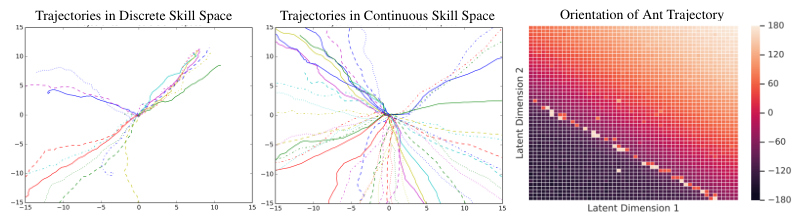

# 第 79 天｜DADS：技能不仅要不同，还要让下一步容易预测

[系列首页](README.md) · [上一篇](78-hac.md) · [下一篇](80-uvfa.md)

**原论文与版本**：Archit Sharma、Shixiang Gu、Sergey Levine、Vikash Kumar、Karol Hausman，*Dynamics-Aware Unsupervised Discovery of Skills*，ICLR 2020。本文核读 [arXiv:1907.01657v2](https://arxiv.org/abs/1907.01657v2) 正文及附录 A、C，图据同版本 PDF；不把后来 off-DADS 的离策略或实体机器人结果算作本文结果。

### 先接住前作的问题

[DIAYN](33-diayn.md)用“从状态能否认出技能”来鼓励差异，[HAC](78-hac.md)用后见经验帮助多层目标共同学习。DADS 换一个问题：如果已经学出一批互不相同的行为，却无法预测执行后会落在哪里，高层还能稳定组合它们吗？

一个技能每次都走向不同方向，可能很有探索性，却未必适合“先向东，再绕过障碍”的计划。DADS 同时学习技能与技能动力学，让它们互相配合：行为应当产生可区别的状态变化，同时这些变化对模型来说应当容易预测。

## 一、问题设定：先无任务地学技能，再用任务奖励做规划

预训练环境只有状态、动作和转移，不提供下游任务奖励。技能 $z$ 从人为指定的先验 $p(z)$ 采样；策略 $\pi(a\mid s,z)$ 在技能条件下控制身体；模型 $q_\phi(s'\mid s,z)$ 预测这个技能引起的下一状态。注意模型条件是技能，不是原始动作。

测试时，状态空间、动作空间和动力学与预训练一致，新增任务奖励，例如导航到指定位置。控制器冻结已学技能及模型，在技能空间里搜索计划。论文所谓 zero-shot 指**下游任务不再训练参数**，不表示预训练免费、无需知道奖励，或测试时完全不计算、不与环境交互。

### 五个前置概念

1. **条件互信息**：$I(S';Z\mid S)$ 衡量知道当前状态后，技能还能解释多少下一状态的不确定性。
2. **概率密度与似然**：连续变量的密度可以大于1；不能把密度值直接读成事件概率。
3. **变分近似**：用可训练模型替代难以计算的分布；替代后的目标是否保留下界，要逐项检查。
4. **技能时间尺度**：一个 $z$ 可以固定执行多步，但不自动意味着模型一次预测整个技能终点。
5. **模型预测控制（MPC）**：规划一段未来，只执行开头部分，再根据实际状态重新规划。

论文默认每个预训练回合采样一次 $z$ 并保持不变；附录讨论回合内重采样的可能性。连续技能先验是有界均匀分布，离散技能也可使用。连续参数提供丰富的控制接口，但“连续无穷多个 $z$”不等于已经验证了无穷多个可靠、语义各异的行为。

## 二、从互信息到可计算的内在奖励

### 可预测与多样性为何要一起出现

用随机变量表示当前状态、下一状态和技能，有

$$I(S';Z\mid S)=H(S'\mid S)-H(S'\mid S,Z).$$

第一项希望从同一状态出发，不同技能能带来丰富变化；第二项希望指定技能之后，结果的不确定性降低。只有第一项，可能得到混乱行为；只有第二项，所有技能原地不动也可能很容易预测。

给定当前策略，技能条件转移是

$$p_\pi(s'\mid s,z)=\int p(s'\mid s,a)\pi(a\mid s,z)\,da.$$

未知环境使它难以直接计算。互信息可写成

$$I=\mathbb E_{p(z,s,s')}\left[\log p_\pi(s'\mid s,z)-\log p_\pi(s'\mid s)\right].$$

将分子换成 $q_\phi$ 后，差值是非负 KL 的平均，因此

$$I\ge\mathbb E\left[\log q_\phi(s'\mid s,z)-\log p_\pi(s'\mid s)\right].$$

在固定数据分布时，最大化 $\log q_\phi$ 等价于拟合真实的技能条件转移。这一步有明确的变分下界解释。模型训练损失是

$$L_q(\phi)=-\mathbb E_{(s,z,s')}\log q_\phi(s'\mid s,z).$$

### 分母近似是重要边界，不可跳过

真实边缘分布是

$$p_\pi(s'\mid s)=\int p_\pi(s'\mid s,z)p(z\mid s)\,dz.$$

因为不同技能会访问不同状态，$p(z\mid s)$ 一般不等于采样技能的先验 $p(z)$。DADS 的实际奖励进一步用先验及模型近似分母：

$$r_z(s,a,s')=\log q_\phi(s'\mid s,z)-\log\left[\frac1L\sum_{\ell=1}^Lq_\phi(s'\mid s,z_\ell)\right],\quad z_\ell\sim p(z).$$

这等价于原文式(6)的“对数分子减对数求和，再加 $\log L$”。虽然奖励的参数列表含动作 $a$，显式公式通过实际转移 $s'$ 评价动作后果，并没有再另训一个动作判别器。

**必须区分：前面的理想目标有变分下界，实际分母近似后的奖励不再自动保证是严格下界。** 附录 C 专门讨论了不等式方向及用先验代替条件技能分布的粗糙性。再加上有限样本进入对数，Monte Carlo 平均还会引入估计偏差。把式(6)直接叫作“精确互信息”会掩盖这些假设。

计算时应使用 log-sum-exp：先得到 $\ell_j=\log q_\phi(s'\mid s,z_j)$，再算 $\ell_{\mathrm{true}}-\operatorname{logsumexp}(\ell_1,\ldots,\ell_L)+\log L$。这与公式等价，却避免极小密度求和下溢。连续状态密度的单位会在同一表示下的比值中抵消；随意给不同技能使用不同归一化尺度则破坏比较。

### 手算：可预测但不可区别，奖励仍然不高

以下是固定状态下的离散教学模型，不是论文实验。技能 $z\in\{L,R\}$ 均匀分布，下一变化 $\Delta\in\{-1,+1\}$。模型给出

$$q(+1\mid R)=0.9,\quad q(+1\mid L)=0.1,\quad q(-1\mid R)=0.1,\quad q(-1\mid L)=0.9.$$

用全部两个技能精确边缘化，任意方向的平均概率都是0.5。执行 $R$ 后若向右，奖励为 $\log(0.9/0.5)=\log1.8\approx0.5878$；若向左，奖励为 $\log(0.1/0.5)=\log0.2\approx-1.6094$。该技能的期望奖励是

$$0.9\log1.8+0.1\log0.2\approx0.3681\ \text{nats}.$$

若两个技能都以0.9概率向右，向右很可预测，但分子和分母相同，每个结果的奖励都为0。若两个技能都均匀左右走，同样为0。奖励需要的是“结果能帮助区分技能”，而不是“任何模型容易预测的动作都值得奖励”。

此例特别固定了状态分布，且边缘化精确，才可把期望与互信息对应。真实 DADS 的状态访问依赖技能、连续密度与采样近似，不满足这个玩具例子的全部简化条件。

## 三、训练模型和训练技能，为什么要交替进行

Algorithm 1 的一轮流程是：采样技能并收集当前策略的若干回合；先拟合技能动力学；用更新后的模型计算内在奖励；再更新技能策略，循环往复。策略变好后数据分布也改变，因此预测器不能只在训练开头拟合一次。

附录 A 使用 SAC 更新策略与 critic，并加入动作熵正则化。这里容易出现一个名称陷阱：**用了 SAC 组件，不代表原始 DADS 整体就采用跨很久的离策略回放。** 附录 A.4 明确把其优化方案描述为 on-policy，并按当前策略收集批次再多次利用该批次；后来的 off-DADS 专门扩展了离策略训练。

技能动力学实际预测状态增量 $\Delta s=s'-s$。作者使用四个高斯分量的混合模型，分量协方差固定为单位阵，预测均值与混合权重，并对数据做归一化。策略与动力学输入通常去掉全局平面位置，使技能不至于只记住“在地图坐标几处执行”；模型仍能预测 $\Delta x,\Delta y$，据此累加位置。

所谓 **x-y prior** 在这里指只让技能动力学关注平面位置相关输出的归纳偏置，不是把 $p(z)$ 换成某个位置概率分布。它让“技能应当在哪些变化上不同”带上人为选择，不能因为未用外部奖励就声称没有任何任务相关先验。

附录 A.4 给出连续技能计算奖励时 $L=500$，离散技能可对所有类别求和。模型拟合充分程度影响奖励质量：若 $q_\phi$ 一开始严重错误，策略可能追逐模型比值的异常区域。增加模型更新数并不能普遍保证校准；应监测留出转移似然、不同技能的覆盖与实际重复执行方差。

## 四、测试时怎样用技能动力学规划

一个计划是 $P=(z_1,\ldots,z_{H_P})$，每个技能保持 $H_Z$ 个原始步，总预测长度为 $H_P H_Z$。论文的 $q_\phi(s'\mid s,z)$ 是下一状态模型，因此保持同一个 $z$ 时仍要逐步向前展开，不能凭符号把它变成零误差的 $H_Z$ 步终点预测器。

对候选计划模拟轨迹，计算任务回报 $R_k$。用 MPPI 风格权重

$$w_k=\frac{\exp(\eta R_k)}{\sum_j\exp(\eta R_j)},\qquad
\mu_i\leftarrow\sum_kw_kz_{k,i}$$

更新各技能位置的采样均值。这里用 $\eta$ 表示规划温度，避免与 RL 折扣混淆；原文式(7)用 $\gamma$。作者保持采样协方差固定，多轮细化后执行开头技能，再从真实状态重规划。正文有“最佳计划”的直观说法，Algorithm 2 则从细化后的首个技能分布采样；不能把两者都硬写成唯一确定的 argmax 执行规则。

### 手算：回报加权不是把所有技能等权平均

两个候选计划第一项分别为−1和+1，回报分别为0和 $\log3$，取 $\eta=1$，权重是 $1/4$ 与 $3/4$，新均值为0.5。第二个候选更好，但均值没有直接跳到+1。这是连续技能空间平滑插值有用的一个理由。

反过来，均值0.5未必真是安全、有效的技能。若潜空间中间有未训练区域，平均两个好计划也可能得到坏计划；更长 rollout 还会累积模型误差。滚动重规划能用实际状态纠正预测，但不能补出技能库根本不会的动作。

## 五、原始证据：图中的平滑，证明了什么

<figure class="reading-evidence-figure" id="rl-79-figure-5"><figcaption>Sharma等，ICLR 2020，arXiv:1907.01657v2，Figure 5，PDF第7页；保留三面板、标题、轴与色标，图注另述。<a href="https://arxiv.org/pdf/1907.01657v2#page=7">原图及上下文</a>。原作者保留版权，限于本文技术评论摘引。</figcaption></figure>

左图是20个离散技能的 Ant 平面轨迹，中图是二维连续技能产生的轨迹，右图将技能坐标映射到轨迹方向。连续方案在这里展示了更丰富的方向覆盖，颜色随潜变量变化有结构。应把它读成所展示技能和状态分布上的经验现象，不是“所有潜空间点都光滑”或“所有新起点都可靠”的定理。

§6.2 的方差分析比较 DADS 与 DIAYN，并讨论 x-y prior 的影响。后续导航定量比较对两者都使用这种先验，不能把受约束的导航版本写成完全不加选择的全状态无监督学习。论文同时展示 Half-Cheetah、Ant、Humanoid 的技能，但不能把 Ant 的导航数值直接推广给所有身体。

§6.3 的模型控制基线分为随机数据模型、训练目标分布与测试一致的弱 oracle，以及直接在指定测试目标训练的强 oracle。三者获得的任务信息不同，应先解释再比较。导航指标是平均到目标距离相对于初始距离的归一化量，越小越好；若机器人远离目标，它也可超过1，文中“0到1”附带“靠近目标”的条件。

§6.4 还区分“用模型规划技能”和“冻结技能后另训高层 RL”；§6.5 讨论稀疏奖励。原文支持其设置中的预训练技能可被下游组合使用，不支持零成本获得通用机器人。本文未从曲线估读精确提升倍数，也未把后续现实机器人研究作为本论文的验证。

## 六、方法关系与失效边界

DIAYN 更直接地从状态判别技能，DADS 用当前状态条件下的转移可辨识性，同时产出可供规划的前向模型。两者都依赖技能先验、状态表示及探索分布；不同目标可能让不同方法更合适，不能从一组导航实验断言谁在所有任务上占优。

HAC 训练目标条件的多层控制，用事后重标记处理同时学习；DADS 先形成技能库，再由测试奖励驱动模型规划。前者对目标到达的结构更直接，后者把可预测性作为预训练偏好。与 PETS 相比，DADS 不只被动学习原始动作动力学，还让策略主动产生更易建模的技能后果。

如果下游需要在狭窄位置突然翻滚，而预训练偏好稳定行走，技能库可能根本不包含所需行为。如果改变地面摩擦、身体或观测，测试 MDP 与训练一致的假设也被破坏。模型给出的高似然不是经过校准的安全置信度；随机性、部分可观测性和复合技能的分布外状态都会增加风险。

## 七、三个追问

**问1：可预测性会不会让技能越来越无聊？**

答：单独最小化条件熵确实可能偏好停住；互信息的另一项鼓励技能间有不同后果。但这种平衡只能在数据覆盖和模型表达允许的范围内起作用，不保证发现所有有用技能。高风险但必要的动作仍可能被排除。

**问2：为什么不直接学习一个高层策略？**

答：可以，论文也做了这种比较。模型规划的优势是下游奖励改变时可马上重新评价计划，无须再训练高层；代价是每次行动要做候选模拟，而且模型误差会影响选择。高层策略把计算更多地移到训练阶段，两者成本结构不同。

**问3：分母用了先验，为什么还可能有效？**

答：它廉价，并要求某技能造成的变化相对于许多其他技能具有辨识度。对于希望技能在各种状态都能使用的运动问题，这是有意义的工程偏好；但不是证明 $p(z\mid s)=p(z)$。作者主动讨论了近似的不足，复述时也应保留。

## 八、两道自测（含答案）

**自测1。** 三个均匀技能对某转移给出密度0.6、0.3、0.3，当前执行第一个技能。用全量边缘化算奖励；若三个密度全部翻倍，奖励变吗？

**答案：** 平均密度0.4，奖励 $\log(0.6/0.4)=\log1.5\approx0.4055$。全部翻倍后比值仍为1.5，因此不变。这说明奖励比较相对可辨识性，不是单独追求高密度。

**自测2。** $H_P=4,H_Z=25$，是否表示模型直接输出100步后的状态，而且测试没有训练所以计算量为零？

**答案：** 都不对。一次计划覆盖100个原始步量级，但要沿模型逐步展开并比较候选计划；只先执行一个25步技能，再重规划。zero-shot 排除下游参数学习，并不排除环境交互与大量规划计算。

## 参考与核读边界

- [DADS arXiv v2 正文与附录](https://arxiv.org/pdf/1907.01657v2)：§2–4、§6、附录 A 与 C；图5已核读实际像素。
- [作者项目页](https://sites.google.com/view/dads-skill/home/dads-iclr2020)与[实现仓库](https://github.com/google-research/dads)：复现入口。本文未运行代码；仓库后续 off-DADS 扩展不混入本篇实验。
- 所有离散概率、MPPI两候选与自测计算均为本文教学构造；没有声称复现训练、测量实际规划延迟或核实全部视频行为。

[系列首页](README.md) · [上一篇](78-hac.md) · [下一篇](80-uvfa.md)
