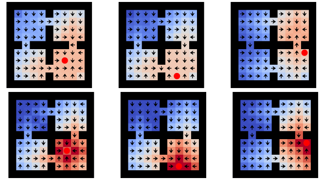

# 第 80 天｜UVFA：价值函数不仅认识状态，还要认识你想去哪里

[系列首页](README.md) · [上一篇](79-dads.md) · [下一篇](81-successor-features.md)

**原论文与版本**：Tom Schaul、Dan Horgan、Karol Gregor、David Silver，*Universal Value Function Approximators*，ICML 2015，PMLR 37。本文以[会议版PDF](https://proceedings.mlr.press/v37/schaul15.pdf)为核读版本，以下页码按PDF的九页文件顺序计数。文中独立教学例不是作者实验。

### 先接住前作的问题

一个导航代理学会去厨房，后来又要去书房。若分别训练两个价值网络，两个网络可能各自重新学习同一条走廊；若把目标拿掉，只训练一个V(s)，又无法表达同一位置对不同目的地的价值差别。

UVFA将任务描述放进函数输入：V(s,g)或Q(s,a,g)。它最值得学习的地方，是把“沿着状态泛化”扩展为“沿着状态与目标的组合泛化”，以及为这种共享提出可训练的表示。Universal描述目标族的表示范围，不承诺见到任何新目标都能可靠完成。

## 一、问题设定：共享转移，目标改变奖励和终止

令环境状态、动作与转移规律为S、A、P。每个目标g定义一个伪奖励R_g(s,a,s′)，还可定义目标相关折扣或终止。到达厨房对“去厨房”可能已经结束，但对“去书房”只是途经。同一物理转移的训练标签由任务定义决定。

### 五个前置概念

1. **价值函数**：V_g^π(s)评价从s按π行动的未来回报；Q_g^π(s,a)再固定第一步动作。
2. **目标条件化**：g作为模型输入，让共享参数区分不同任务，而不是把目标文字当作网络外的备注。
3. **最优与固定策略价值**：Q_g^*允许每个g有自己的最优策略，Q_g^π则始终评价指定π。
4. **低秩分解**：状态—目标价值表可能用较少的共同因素近似，减少逐格独立学习的需求。
5. **插值与外推**：见过分布内的新目标和完全新的目标区域不是同一种泛化，评估应分别留出。

为避免终止下标混淆，本文统一将一步备份写为

$$Q_g^*(s,a)=\mathbb E_{s'\sim P}\left[R_g(s,a,s')+\gamma(1-d_g(s'))\max_bQ_g^*(s',b)\right].$$

这里d_g(s′)表示抵达s′后是否按目标g终止，是本文采用的明确约定。原文§2使用伪折扣γ_g；把它解释为抵达后的有效折扣，便能对应这个写法。不同代码若把终止标志记在当前时刻，应整体调整索引，不能只改一处。

若任务还改变动力学，单纯给奖励换标签不够。例如同一坐标目标下，地面摩擦不同会改变动作结果。可以扩展任务输入描述动力学，但需要相应数据与训练设定，不能把原论文共享环境中的目标迁移直接当成未知动力学迁移保证。

## 二、把大价值表变成两个可学习映射

最直接的结构是拼接输入：

$$\hat V(s,g)=F_\theta([s,g]).$$

双流结构则分别处理状态和目标，再合并：

$$\hat V(s,g)=h(\phi_\theta(s),\psi_\theta(g)).$$

原文讨论内积等组合方式。采用内积时，对有限状态集合与目标集合形成矩阵M，便有

$$M_{ij}\approx\phi(s_i)^\top\psi(g_j),\qquad M\approx\Phi\Psi^\top.$$

内积形式使近似矩阵秩不超过嵌入维数k。k小，压缩强，但可表达的任务差异也受限。某些地形、单向门和危险区域会使价值表很难由极低秩表示；“神经网络很深”不能突破输出层强制的有限秩上限。

### 两阶段训练究竟把什么拆开

原文§3.1先对已知或估计出的价值表做低秩分解，得到每行与每列的目标嵌入；再训练从原始s到行嵌入、从原始g到列嵌入的映射。前一阶段暂时不关心图像或坐标长什么样，后一阶段学习输入与嵌入的对应关系。还可以端到端微调，但不是所有架构都有同样的分解过程。

这里存在一个容易忽略的可识别性问题。对任意可逆矩阵A，

$$\phi'(s)=A\phi(s),\qquad\psi'(g)=A^{-\top}\psi(g)$$

保留同一个内积价值。某一维嵌入看起来像“房间编号”，不能仅凭这个数轴就认定网络发现了唯一的物理概念。比较不同训练运行的嵌入，也不能默认各维一一对应。

如果状态与目标用相同特征表示，可以共享部分网络，鼓励迁移；若进一步完全共享并使用对称合并，就会约束V(s,g)=V(g,s)。有单向通道或不对称动作代价时，这种约束未必正确。结构先验应该来自任务，而非仅为减少参数。

## 三、独立手算：一个简单目标族，完整价值表也可能满秩

考虑三格走廊A—B—C，动作每次沿走廊移动一格。进入目标得到1，随后终止；其他转移奖励0；折扣γ=1/2。已处在目标时不再获得奖励，终止价值为0。最优状态价值表为

$$M=\begin{pmatrix}
0&1&1/2\\
1&0&1\\
1/2&1&0
\end{pmatrix},$$

行与列依次为起点A、B、C以及目标A、B、C。例如A到C需两步，第一步奖励0、第二步奖励1，因此V_C^*(A)=0+(1/2)×1=1/2。B到C一步到达，价值为1。终止对角线不能错误填成1。

这个小表的行列式为1，因此秩为3，不能用一维或二维内积嵌入**精确**表示。它当然可以近似，但要承认误差。这个反例说明，共享几何结构不等于任何价值定义下都严格低秩，尤其终止语义本身会改变矩阵结构。

再做一次目标条件TD更新。记录转移A→B，目标g=C，当前Q(A,右,C)=0.2，下一状态最优值估计为1，则

$$y_C=0+0.5\times1=0.5.$$

学习率α=0.4时，标量表格更新得到0.2+0.4×(0.5−0.2)=0.32。

若将**同一真实转移**用于目标g=B，它是成功终止，y_B=1。设对应旧Q也为0.2，则更新到0.2+0.4×0.8=0.52。不同目标共享数据不意味着共享同一个奖励或终止标志。若错把B目标的终止继承给C，就会把C的正确目标0.5错误压成0。

这里对两个表格条目分别更新只是为了精确手算。神经网络共享参数时，一次更新还可能改变其他(s,a,g)预测。这种耦合既可能加快迁移，也可能造成相互干扰。

## 四、从监督表到真实强化学习：有两条训练路线

### 路线一：先由一组目标价值估计提供监督

原文§5.1及Algorithm 1用Horde中的多个目标价值函数，从共享交互流离策略学习，然后把这些估计组织成训练表，分解并训练UVFA。表格的每一行在动作价值版本中对应历史中的(s_t,a_t)，不是抽象地保证每个环境状态都出现一次。

这条路线有三个误差来源：源目标价值还没学准；矩阵低秩近似不足；输入到嵌入的回归不准。即使第三步训练损失很低，也可能只是在忠实复制第一步的系统性错误。反过来，压缩和平滑有时能减少噪声，但这需要实际验证，不是分解的必然属性。

### 路线二：直接用UVFA自举

原文§5.3、式(1)从随机选择的转移和目标构造Q-learning更新。现代记法可写为

$$y_g=R_g(s,a,s')+\gamma(1-d_g(s'))\max_b\hat Q^-(s',b,g),$$

$$\mathcal L(\theta)=\mathbb E[(\hat Q_\theta(s,a,g)-\operatorname{stopgrad}(y_g))^2].$$

目标网络上标“−”和stopgrad在此用于解释常见稳定化实现，不声称原论文伪代码逐项包含这两个符号。核心是同一个目标g同时进入当前值、奖励、终止与后继值。若在后继max时顺便对目标也取max，学到的就会是“挑一个最容易的任务”，而不是解决当前指定任务。

离策略、自举和函数逼近同时存在，稳定性风险并未因为多了g而消失。论文直接自举实验还利用奖励范围先验选择距离型合并函数。把UVFA当成一个输入接口是合理的；把它当成不依赖训练细节的稳定算法则不合理。

### 三种测试划分，分别回答三个问题

- 留出部分(s,g)组合，但各个s与g单独都出现过：检验组合补全。
- 留出整组目标g，但训练目标覆盖相同区域：检验目标插值。
- 留出整个目标区域：检验更难的外推。

另有一种更严格测试：连该区域的转移都未见过。它同时要求环境知识与目标泛化，不能和“去过第四个房间，但没以它为目标训练”混为一谈。报告只写“未见目标”而不交代状态覆盖，会让迁移难度变得不可比较。

## 五、读原始实验：表示能力、泛化与控制质量要分开

<figure class="reading-evidence-figure" id="rl-80-figure-8"><figcaption>原论文图形摘引｜Schaul等，ICML 2015会议版PDF第6页Figure 8。上排为UVFA预测，下排为真实值，红点标示目标。<a href="https://proceedings.mlr.press/v37/schaul15.pdf#page=6" target="_blank" rel="noopener noreferrer">核对原文</a>。原版权保留。</figcaption></figure>

已实际查看原图8及本地摘图。三列代表第四个房间中的三个测试目标，上下并非两个算法的训练曲线。颜色表示价值，箭头表示动作选择；预测图与真实值有可见差异。因此这幅图展示“能产生有用外推”，不是证明整个价值地形已被精确恢复。

原文§4.1讨论表格补全；§4.2讨论未见目标的插值；§4.3与Figure 8讨论第四房间的目标外推。它们主要是监督设定，不能用来单独证明智能体仅凭稀疏环境奖励就学会探索。监督目标的来源与交互数据需求要另外核查。

会议版第6页§5.1和Algorithm 1转向由Horde目标学习；第7页§5.2讨论Ms. Pacman中的物体目标，目标由屏幕上豆子的位置表示。这里演示的是目标价值知识的泛化，不应改写成UVFA已经在完整游戏总分上超越其他控制算法。第7—8页§5.3则给出直接自举方法与其稳定性限制。

本文不转录未经核查的性能百分比，不从图中手工估计学习速度倍数。也应同时考察价值均方误差与实际策略质量：若两个动作价值只差0.01，一次很小的估计误差就可能换掉最优动作；相反，所有动作一起偏移0.1，MSE变大但贪心动作可能完全不变。

## 六、和SF、USFA、层级控制的关系

[Successor Features](81-successor-features.md)把固定策略的未来特征期望与奖励权重分开，有显式的重新计价结构。UVFA的内积嵌入一般只是函数逼近结构，不能自动解释为“未来会经历哪些物体的次数”。两者都出现内积，并不意味着两者的向量具有相同语义。

[USFA](82-usfa.md)进一步区分评价奖励w与被评价策略z，表达Q(s,a,w,z)。普通UVFA通常直接近似每个目标自己的最优价值，任务输入同时关联奖励与相应策略。它没有自动提供“沿旧策略走，但按新奖励计价”的所有交叉项。

[HIRO](77-hiro.md)可以用目标条件低层控制，但目标条件化本身不决定高层怎样提出目标，也不解决低层更新导致高层回放过时。类似地，UVFA和目标重标记可以配合，前者是共享表示，后者是生成额外训练任务标签的机制。

### 一个可复核的实验方案

先在小网格枚举精确Q_g^*，固定奖励与终止规则；分别留出组合、目标和目标区域。对每种划分同时测MSE、贪心动作准确率与真实执行回报。再限制嵌入秩，观察压缩误差与动作错误是否一起变化。最后去掉精确监督，改为真实采样与自举，单独统计交互预算。

这样可以辨认失败发生在哪一层：表示容量不足、目标编码没有结构、采样未覆盖路径、还是自举训练不稳定。若上来只跑一个复杂环境、只报告平均回报，就很难解释UVFA到底共享了什么。

### 继续追问

1. 把目标做成one-hot，就能对全新目标泛化吗？

对已出现目标之间的缺失组合可以做补全，但一个训练中完全没有信息的one-hot维度，并不提供它与其他目标的关系。要泛化到新目标，通常需要目标坐标、图像、属性或其他可共享结构；网络不会仅凭新编号知道目的地在哪。

2. 状态和目标都是坐标，能否把两个编码器完全共享？

可以作为待验证的设计，但完全共享加对称合并会强加对称性。可逆、代价对称的任务可能适合，单向门、坡度或目标相关风险则未必。相同输入类型不是价值对称的证明。

3. UVFA是否在测试时完全不用学习？

可以冻结网络直接查询未见目标，这叫零样本评估；也可以在新目标继续训练，测迁移速度。两者都是合理使用方式，但应分别报告，不能拿微调后的结果称作零样本泛化。

## 自测两题

**问题1**：三格走廊中γ=1/2，进入目标得1并终止，为什么V_C(A)=1/2而V_C(C)=0？这个价值矩阵能否由二维内积精确表示？

**参考答案**：A到C的奖励在第二个动作后才出现，折扣一次；已经在C则终止，无未来奖励。矩阵行列式为1，秩为3，二维内积只能近似。

**问题2**：对A→B转移，Q旧值0.2、α=0.4，目标C的后继最大值1，目标B在到达后终止，两个新Q各是多少？

**参考答案**：目标C的备份0.5，新Q为0.32；目标B的备份1，新Q为0.52。两者区别来自目标相关奖励与终止，不是观测到不同物理转移。

**核读与复现边界**：已下载会议版PDF，核读§2—§5相关定义、两阶段算法与实验设置，查看PDF第6页及Figure 8摘图。没有运行作者代码、复现训练、数字化曲线或核对全部附录。伪代码式目标网络、手算走廊、秩反例与测试方案均为本文教学补充，不冒充原论文实测。

[系列首页](README.md) · [上一篇](79-dads.md) · [下一篇](81-successor-features.md)
