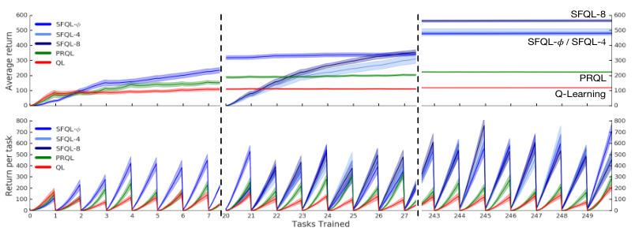
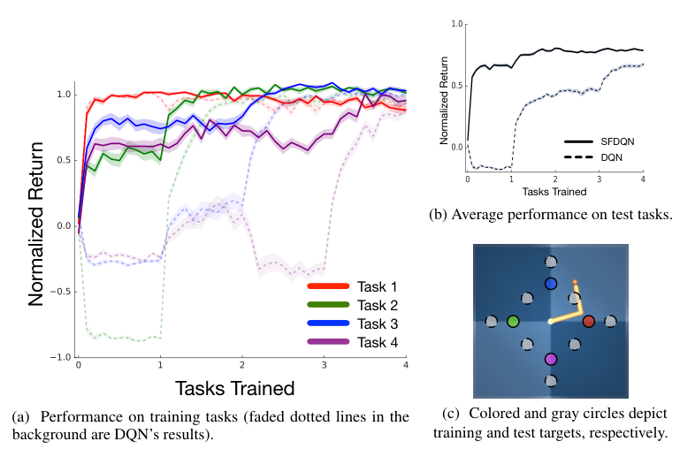

# 第 81 天｜Successor Features：把“将来会发生什么”与“现在想要什么”拆开

[系列首页](README.md) · [上一篇](80-uvfa.md) · [下一篇](82-usfa.md)

**原论文与版本**：André Barreto等，*Successor Features for Transfer in Reinforcement Learning*，NIPS 2017。本文核读[arXiv:1606.05312v2](https://arxiv.org/pdf/1606.05312v2)，PDF页边标注2018-04-12，含正文及实验附录。会议年份与此次阅读的修订年份不同，不把它们混成同一日期。

### 先接住前作的问题

[UVFA](80-uvfa.md)把目标作为价值网络的输入，让参数在任务之间共享。但“见过目标A和B”并不自动保证网络能回答新目标C。另一条思路是先记住：执行已有策略，各类事情将来会发生多少次；等偏好变化，只替换每类事情的价格。

Successor Features（SF）负责快速重新评价旧策略，Generalized Policy Improvement（GPI）负责把这些评价组合成新行为。少了后者，SF只是一套预测；少了前者，对每个新奖励重新评价所有旧策略又可能非常昂贵。

## 一、问题设定：动力学不变、奖励改变时，哪些经验还能继续用

考虑任务族\(\mathcal M_\phi\)：状态空间、动作空间、转移概率和折扣因子相同，不同任务只由奖励权重\(w\)区分。对一次转移，期望奖励满足

$$r_w(s,a,s')=\phi(s,a,s')^\top w.$$

φ可以表示拾取不同物体、到达目标、消耗能源等事件。它描述发生了什么；w规定当前任务怎样评价这些事件。机器人换目的地但机械结构不变，比机器人突然换了一套关节动力学更符合这里的设定。

| 要素 | 本文必须明确的范围 |
|---|---|
| 状态／动作 | 理论MDP；实验包括连续位置导航、离散化转矩控制 |
| 学习信号 | 转移特征φ与实际奖励，前者可以给定或另行学习 |
| 迁移时已知什么 | 理论先假设新w已知；实际可通过奖励监督估计w |
| 可复用对象 | 固定策略在共享动力学中的折扣特征累计量 |
| 主要变化 | 奖励权重变化；转移改变不属于本文主要保证 |

### 五个前置概念

1. **线性奖励模型**：线性发生在特征空间，不要求状态到φ是线性函数；固定低维φ仍然限制了可表示的任务。
2. **策略评价**：Qᵖ(s,a)固定第一步动作后，后续按π行动；它不等于直接预测最优价值。
3. **Successor Representation**：用未来状态的折扣访问次数表示当前状态；SF将预测对象推广到任意转移特征。
4. **策略改进**：按一个策略的准确Q贪心，得到不差于它的新策略；GPI把一个Q推广成多个Q的上包络。
5. **离策略学习**：采样动作来自行为策略，但更新目标可以对应另一策略；数据可复用不代表任意未覆盖动作都能准确估计。

这里“奖励线性并不限制一般性”应谨慎理解：如果允许把所有奖励函数都塞进无限丰富的特征，形式上可以表示许多任务；真正部署时选择了固定、有限的φ，表示误差、可学习性和存储成本就都出现了。

## 二、从回报展开到向量Bellman方程

固定策略π，令\(\phi_{t+1}=\phi(S_t,A_t,S_{t+1})\)，定义

$$\psi^\pi(s,a)=\mathbb E_\pi\!\left[\sum_{k=0}^{\infty}\gamma^k\phi_{t+k+1}\mid S_t=s,A_t=a\right].$$

当特征有界且γ<1，折扣和可积。把线性奖励代入回报并交换有限维内积与期望，得到

$$Q_w^\pi(s,a)=\mathbb E_\pi\left[\sum_{k\ge0}\gamma^k\phi_{t+k+1}^\top w\right]=\psi^\pi(s,a)^\top w.$$

ψ的每个分量是一类事件的折扣累计预测，不是“最终落到该状态的概率”。它可以大于1，分量和也不必等于1。若φ包含常数1，持续任务对应分量就为1/(1−γ)。

把第一步从和式分离，可得

$$\psi^\pi(s,a)=\mathbb E\left[\phi(s,a,S')+\gamma\psi^\pi(S',\pi(S'))\mid s,a\right].$$

随机策略时把π(S′)替换为后继动作的条件期望。原文式(4)把第一步特征写得比较紧凑；随机转移下应把它与后继项一起置于条件期望内，不能把一次采样的φ误当确定期望。

实际可用向量TD残差

$$\delta_\psi=\phi+\gamma(1-d)\tilde\psi(s',a')-\tilde\psi(s,a)$$

训练ψ，另以\((r-\phi^\top\tilde w)^2\)拟合w。d表示任务语义上的终止，不能不加区分地把所有时间截断都当吸收态。目标动作a′必须对应要评价的策略；若改成当前任务的贪心动作，学到的就是另一个对象。

这也解释“拆开动力学与奖励”的准确意思：ψ同时依赖动力学、特征和π。它不是与策略无关的完整世界模型，不能任意回答没训练过的控制序列。换w时固定旧π的ψ仍有意义；若π随新w改变，需要评价新的π。

## 三、GPI怎样把策略库变成逐状态的动作选择

给定策略库\(\{\pi_1,\ldots,\pi_n\}\)，先用新w评价每个旧策略：\(\tilde Q_w^{\pi_i}=\tilde\psi^{\pi_i\top}w\)。然后执行

$$\pi_{\mathrm{GPI}}(s)\in\arg\max_a\max_i\tilde Q_w^{\pi_i}(s,a).$$

里面的max找出“如果先执行a，再跟随哪个旧策略最有希望”；外面的max才选实际动作。下一状态重新计算，因而不必整回合锁定一个旧策略。它也不是先分别求各策略最优动作、再平均动作。

原文Theorem 1要求在**同一目标MDP**中，对全部状态、动作和库内策略都有统一误差界\(|Q_w^{\pi_i}-\tilde Q_w^{\pi_i}|\le\epsilon\)，于是

$$Q_w^{\pi_{\mathrm{GPI}}}(s,a)\ge\max_iQ_w^{\pi_i}(s,a)-\frac{2\epsilon}{1-\gamma}.$$

直觉是近似上包络最多在比较时损失两次ε，后续误差通过折扣累积。ε=0时不差于库中任意策略；并非保证等于全局最优。共享网络的平均训练误差很小，也不能直接代替“所有s、a、i”的一致误差界。

### 一次独立手算：组合为什么可能超过每个旧策略

以下是教学构造，不是论文环境。只有s₀、s₁两步，第一步后总到s₁，第二步后终止，γ=1/2。s₀的动作A、B分别产生φ=(2,0)、(0,1)；s₁的A、B分别产生(1,0)、(0,2)。源任务w₁=(1,0)的最优策略π₁始终选A；w₂=(0,1)的最优策略π₂始终选B。

目标任务w=(1,1)。在s₀先选A，随后跟π₁的SF为(5/2,0)，跟π₂为(2,1)；先选B，两者分别是(1/2,1)、(0,2)。内积后，动作A的上包络为max(2.5,3)=3，B为max(1.5,2)=2，所以GPI先选A。在s₁，A得1、B得2，GPI选择B。

直接执行π₁回报2.5，执行π₂回报2，组合策略回报2+0.5×2=3。源策略都曾在自己的任务上最优，而新任务上最好的组合不必等于任何完整源策略。这里所有值均可从两步轨迹独立枚举，不能只把表中四个数字当成随意指定的Q。

若估计统一误差ε=0.1，定理的惩罚为2×0.1/(1−0.5)=0.4。这是最坏情形下的保证，不是实际一定损失0.4。若只在已访问轨迹上测过误差，更不能把0.4当成经过实验认证的界。

### 与最优目标策略的距离界又多用了什么

原文Theorem 2进一步要求库中πⱼ是各自源任务wⱼ的最优策略，并共享同一个φ、转移和γ。定义\(\phi_{\max}=\max_{s,a}\|\mathbb E[\phi(s,a,S')\mid s,a]\|\)，则相应界为

$$Q_w^*(s,a)-Q_w^{\pi_{\mathrm{GPI}}}(s,a)\le\frac{2}{1-\gamma}\left(\phi_{\max}\min_j\|w-w_j\|+\epsilon\right).$$

内积使用匹配的欧氏范数；更一般的范数需要对偶范数。第一项来自目标与最近源奖励的差异，第二项来自重新评价误差。源策略若只是近似最优，必须再纳入源策略误差，不能仍原样引用该界。

此外，缩放φ会反向缩放w，距离必须和特征尺度一起解释。单看w空间里“相距0.1”没有绝对难度含义；γ接近1也会放大保证中的误差。定理给出了覆盖任务空间的思路，却没给神经网络的ε提供免费证书。

## 四、原始实验：持续改奖励，与未见目标迁移分别检查

### 四房间任务中的累计收益

<figure class="reading-evidence-figure" id="rl-81-figure-2"><figcaption>原论文图形摘引｜André Barreto等，arXiv:1606.05312v2, 2018-04-12; NIPS 2017 paper，PDF第7页Figure 2。<a href="https://arxiv.org/pdf/1606.05312v2#page=7" target="_blank" rel="noopener noreferrer">核对原文</a> · 点图放大。原版权保留。</figcaption></figure>

原图2上排比较跨任务平均回报，下排展示各任务内累计回报；虚线把早期、中期与末期横轴截段分开，不能把整个拼接图当连续等间距时间。阴影是30次运行的一个标准误，不是标准差或95%置信区间。

连续二维四房间中，有三类可收集物体及终点。每20000次转移更换三类物体奖励，权重从[−1,1]³采样，共250个任务。比较Q-learning、概率策略复用PRQL与SFQL。SFQL-φ使用能准确预测奖励的特征；SFQL-h先用前20个任务的数据学习特征，图注明确这段期间不计其奖励收益，不能将它说成毫无预训练成本的零样本方法。

SFQL整体优于比较对象，学习特征版本也能取得较好收益。作者将学习特征更稠密、可能使向量伪奖励更易学作为解释，而非通过单独干预已证实的因果结论。图中比较涉及特征学习、策略库存储与GPI多个因素，不能只归因于换了一个输出层。

### 机械臂：训练过的目标与测试目标分开

<figure class="reading-evidence-figure" id="rl-81-figure-3"><figcaption>原论文图形摘引｜André Barreto等，arXiv:1606.05312v2, 2018-04-12; NIPS 2017 paper，PDF第8页Figure 3。<a href="https://arxiv.org/pdf/1606.05312v2#page=8" target="_blank" rel="noopener noreferrer">核对原文</a> · 点图放大。原版权保留。</figcaption></figure>

原图3左边是四个训练目标的曲线，右上是八个保留测试目标的平均表现，右下标出两组目标位置。黑实线SFDQN在未训练目标上的提升，是本文迁移主张的重要证据；但“归一化成绩1”不是解析最优解。

附录B.2给出更具体协议：两关节角度和角速度构成四维状态，连续转矩每维取三个值，组合成九个离散动作，γ=0.9。每回合500步，每个训练目标收集200000次转移。SFDQN同时训练四套SF网络，每次转移对所有源任务更新；DQN以目标坐标为额外输入。测试目标没有专用策略，但全部12个目标的距离被用于构造SF特征，因此也不能称作从无目标结构的像素中自然发现迁移规律。

训练ε=0.1，评估ε=0.03，评估回报来自两个固定起始状态的回合。归一化为\((G-\bar G_b)/(\bar G_a-\bar G_b)\)，其中\(\bar G_b,\bar G_a\)是另行运行单任务DQN前后的30次平均成绩。超过1意味着超过这个DQN参照，低于0意味着低于初始化参照，均不违反定义。

还有两个容易遗漏的实现事实。附录说明实际使用1−距离而不是单纯负距离，使奖励为正，以减少随机初始化预测主导max的情况；训练中去除固定回合长度的终止转移，学习持续型策略。二者都属于原协议，不能机械替换成任意环境通用的“最佳实践”。本文核读了这些说明，未运行作者代码、未复算曲线原始数据，也未独立训练。

## 五、迁移的边界，以及与相关路线的关系

SF的优势来自可复用结构。如果转移变化，旧ψ预测的未来事件就可能失真；只重新学习w不能修正一扇被封住的门。若新奖励需要φ里没有的信息，即便ψ完全准确也无法表达。若数据集中没有支持某个动作的转移，则离策略更新可能只是在外推。

策略库也有成本。每个新任务存一套ψ会使内存和GPI查询随库大小增长；在近似情形下，往库里加入误差很大的策略头还可能因max选到过高估计。精确理论的“增加可比较选项有利”，不能简化成任意神经策略头越多越好。下一篇USFA正要将离散策略库变成带策略描述输入的共享函数。

- [Q-learning](04-q-learning.md)：SF更新可以沿用自举，但标量奖励被替换为向量特征，控制与评价目标仍须分清。
- [DQN](16-dqn.md)：SFDQN组合回放、目标网络与神经函数逼近；这些稳定化部件不来自GPI定理。
- [UVFA](80-uvfa.md)：以任务作为网络输入的参数泛化，与固定策略在新奖励下的代数重评价，依赖不同信息。
- [Options](07-options.md)：SF库可以帮助讨论技能复用，但GPI通常逐步重新选择，不自动等价于有持续时间与终止条件的option执行。
- [USFA](82-usfa.md)：直接后继，保留目标奖励w与源策略描述z两个角色，尝试同时进行任务和策略泛化。

### 继续追问：三个不能省掉的条件

1. 新w已知，是否意味着新任务完全不需要交互？

只是在已有ψ和可观测任务描述下，可以不采集新数据就重新评价旧策略并执行GPI。如果新w未知，要先从奖励反馈估计它；若任务需要未覆盖行为，后续交互仍可能带来明显改善。“即时重评价”是条件性的计算性质，不是对任意新环境的零样本能力承诺。

2. 能否把maxᵢQᵖⁱ直接称作某个策略的准确价值函数？

一般不能。不同状态动作的最大值可能来自不同策略，整体上包络不必满足任何一个固定策略的Bellman方程。GPI保证的是由它诱导的贪心策略的实际回报下界，不是说上包络本身已等于执行后得到的Q。教学例中，策略组合之所以更好，正体现重新选择后续动作会改变行为。

3. 为什么原来的标量Q不能同样乘上新奖励权重？

标量Q已把各类事件按旧w加总，通常丢失了分量信息。同样旧总回报可能来自完全不同的事件组合，新w下价值会不同。SF在压缩时保留任务族所需的向量预测，因此能重加权；但保留多少维、是否足以覆盖未来任务，仍是设计和学习问题。

**原文定位**：[v2 PDF](https://arxiv.org/pdf/1606.05312v2)第3页式(2)—(4)，第4—6页任务族、Theorem 1/2，第7—8页实验与原图2/3，第20—22页附录B.2的机械臂协议。完整附录证明、所有超参数搜索与代码一致性不在本文验证范围内。

## 自测两题

**问题1**：教学例中，目标w=(1,1)，γ=1/2，直接执行两个源策略和执行GPI各得多少？为什么GPI无需整回合选定一个源策略？

**参考答案**：π₁为2+0.5×1=2.5，π₂为1+0.5×2=2，GPI为2+0.5×2=3。它在s₀根据各策略评价的上包络选A，到s₁重新比较后选B，因此组合出的行为可不同于任意完整源策略。

**问题2**：新环境封住一条通道，但保持奖励w不变。是否可以仅凭GPI定理保证旧SF仍然有效？

**参考答案**：不能。旧SF依赖原转移与策略，通道变化改变未来特征累计量；必须重新检查评价误差或学习新SF。GPI可以在同一新MDP中对可靠评价发挥作用，却不能使错误的旧动力学预测自动正确。

[系列首页](README.md) · [上一篇](80-uvfa.md) · [下一篇](82-usfa.md)
