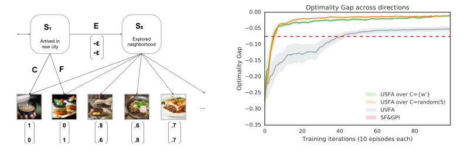
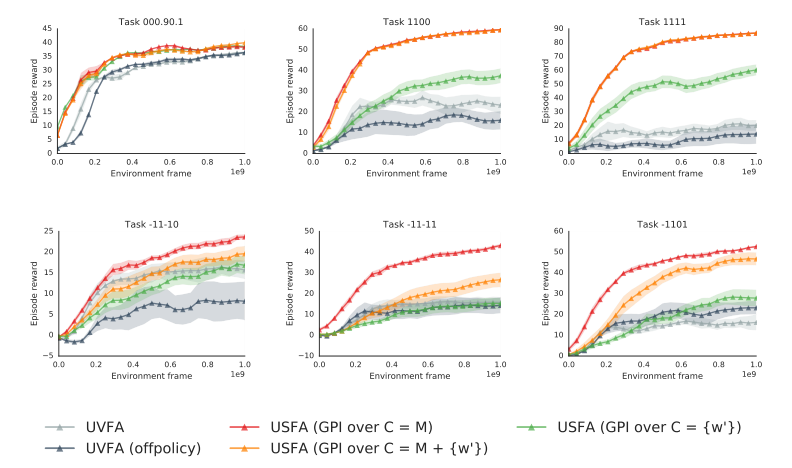
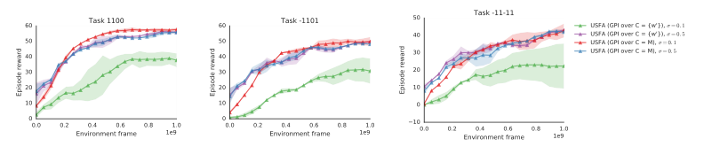

# 第 82 天｜USFA：任务权重w决定价值，策略编码z决定未来

[系列首页](README.md) · [上一篇](81-successor-features.md) · [下一篇](83-rl2.md)

**原论文与版本**：Diana Borsa等，*Universal Successor Features Approximators*。本文核读[arXiv:1812.07626v1](https://arxiv.org/pdf/1812.07626v1)，2018-12-18，页眉为“Submitted as a conference paper to ICLR 2019”。下文图号、页码和公式口径均指该版，不以其他排版的页码替换，也不由投稿页眉推断接收状态。

### 先接住前作的问题

[SF与GPI](81-successor-features.md)让旧策略在新奖励下迅速重新计价，但需要储存一组策略的SF。库太小，可能没有适合新偏好的行为；每来一个任务就增加网络，成本又不断增长。[UVFA](80-uvfa.md)可以把任务描述喂给共享网络，却把“评价什么任务”和“跟随什么策略”绑在一起。

USFA把两者分开：用z指向要评价的策略，以w指定评价它的奖励。这样，同一个策略可以在不同奖励下重估，同一个奖励也可以比较不同策略。全文最应记住的不是缩写，而是这两个输入的语义不能交换。

## 一、问题设定：在同一环境中，泛化奖励也泛化策略

任务族共享转移P、动作空间和折扣因子，期望奖励为\(r_w=\phi^\top w\)。本文主要设定中，转移特征φ可观测。一个w可以让电视成为正奖励、球成为负奖励，另一个w则改变物体偏好；两者不会改变物理世界本身。

理论以MDP状态为基础；大型实验用第一人称图像加LSTM形成历史表征，不能把有限记忆网络自动视为完全可观测状态。训练任务集合记为M，测试任务为未见w′。测试时冻结参数，利用已训练模型选动作，因而“零样本”指不在测试任务更新参数，而非模型从未见过相关物体与转移。

### 五个前置概念

1. **SF分解**：\(Q_w^\pi=\psi^\pi{}^\top w\)，让同一策略在新奖励下立即重新评价。
2. **UVFA**：\(Q(s,a,w)\)常近似任务w的最优价值；w同时暗示奖励和最优策略。
3. **策略编码**：以向量z描述π_z。本文选择“以z为奖励权重的任务所诱导的策略”，而不是任意神经网络参数向量。
4. **GPI候选集合**：C是推理时愿意比较哪些z；它不是训练环境集合M的同义词。
5. **离任务与离策略**：同一转移可按其他奖励重计价，也可用于学习其他目标策略；这两种复用的条件与偏差来源不同。

一个奖励可能对应多个最优策略，多个奖励也可能产生同一策略，因此z不是天然一一对应的唯一标识。理论需选定一致的π_z；固定低维φ还会限制能由某个z诱导的策略族。不能从“任意确定策略可由某种奖励诱导”，跳到“任意策略都可由当前有限特征线性表示”。

## 二、四参数价值怎样化成一个向量函数

先定义更一般的交叉评价：

$$Q(s,a,w,z)=Q_w^{\pi_z}(s,a)=\psi(s,a,z)^\top w.$$

ψ接收s、a、z，输出d维未来特征累计；w只在最后做内积。若z=w，就回到“在任务w上评价其对应策略”的对角线上。但整张函数还包含w≠z的交叉项，这些项正是GPI和迁移所需的信息。

假设已经学到\(\tilde\psi\)，新任务w′的动作选择是

$$a\in\arg\max_a\max_{z\in C}\tilde\psi(s,a,z)^\top w'.$$

三种C各有含义：

- C={w′}：直接查询新任务的策略编码，依赖网络在z方向的泛化，类似利用已知线性结构的UVFA。
- C=M：只评价训练任务对应策略，以结构化重计价和GPI迁移，接近前篇SF&GPI。
- C=M∪{w′}：把熟悉的源策略与对新策略的外推一起比较。

也可以采样额外z作为候选，但候选数增加会提高推理成本。更重要的是，网络不准确的候选可能给出过高价值并赢得max。C越大并不意味着实际新策略回报单调变高。即使准确评价时GPI对库内策略的下界更好，也不能把“下界变强”直接当成两个不同GPI策略之间的逐状态大小关系。

### 用一个交叉评价例说明为什么不能混用w和z

独立构造：设某状态动作下，对编码z₁、z₂预测的SF分别为(3,1)、(1,4)。目标w=(2,−1)。两个策略在当前奖励下价值分别为3×2−1=5、1×2−4=−2，应该偏好第一个。

若误把评价权重换成z₂=(0,1)，第二个策略会看起来有价值4，但那回答的是另一个任务。负奖励尤其能暴露这个错误：预测“将来会捡到四个某物体”本身不是好坏结论，需要由当前w决定。实现中，行为任务w、用于构造后继策略的z，以及评价目标的w′应当分别命名。

## 三、训练信号：w影响采到什么，z影响后继怎么走

对样本(s,a,φ,s′)，固定编码z。用当前估计诱导的策略选择

$$a'_z\in\arg\max_b\tilde\psi(s',b,z)^\top z,$$

向量一步目标是

$$y_z=\phi+\gamma(1-d)\tilde\psi^-(s',a'_z,z),\qquad \mathcal L_z=\|y_z-\tilde\psi(s,a,z)\|_2^2.$$

这里的负号表示目标副本，是常见稳定化表述；是否使用该副本以及更新频率要以具体实现为准。核心是a′按z选，而不是按正在收集数据的w选。否则更新的“策略编码z”便没有一致含义。

将向量残差乘任意w，正好得到该策略在奖励w下的标量TD残差：

$$\delta_{w,z}=\left[\phi+\gamma\tilde\psi(s',a'_z,z)-\tilde\psi(s,a,z)\right]^\top w.$$

所以向量监督能够服务多个奖励任务，不必为每个w重新采样。但行为策略仍影响状态动作覆盖：只在咖啡店附近采数据，不能无中生有地知道远处餐馆路线。原文Algorithm 1分别采w与多个z，允许\(D_z(\cdot\mid w)\)围绕当前任务采样，并对这些z同时更新。

### 多步目标并没有消除离策略问题

原文式(5)把n步累计特征加上后继SF，写成\(\delta_{w,z}^{t,n}=\delta_z^{t,n\top}w\)。代数分解始终成立，但中间动作若来自另一行为策略，未经修正的多步回报一般不是π_z的无偏样本。本文大型实验采用Watkins Q(λ)式轨迹处理，而不是宣称任意多步轨迹都能直接当任意策略的正确目标。

实现时应同时保存终止语义与必要行为信息，分清首次动作可离策略的一步Q更新、跨多步中间动作造成的偏差，以及共享网络引入的外推。把φ完整记录下来可以重算奖励，不能重写实际发生过的转移。

### 两个误差来源，使用保守界时必须补全条件

令\(e_z=\|Q_{w'}^{\pi_z}-\tilde\psi(\cdot,\cdot,z)^\top w'\|_\infty\)。由Cauchy–Schwarz，若向量误差采用兼容范数，则

$$e_z\le\|w'\|_2\sup_{s,a}\|\psi^{\pi_z}(s,a)-\tilde\psi(s,a,z)\|_2.$$

若π_z确为源任务z的最优策略、任务共享转移与有界特征、γ<1，而且C上所有评价误差都有一致上界，可从前篇GPI结果得到一个保守结论：

$$\|Q_{w'}^*-Q_{w'}^{\pi_{\mathrm{GPI}}}\|_\infty\le\frac{2}{1-\gamma}\left[\phi_{\max}\min_{z\in C}\|w'-z\|_2+\max_{z\in C}e_z\right].$$

本文明确采用这个可追溯到前作的保守形式，不将v1第5页式(4)紧凑排版中的系数位置直接当成更强保证。两项分别是候选策略的任务覆盖距离与最差评价误差。不能偷换成\(\min_z[\text{距离}+e_z]\)：做GPI时，一个非常不准的其他候选仍能误导动作选择。

例如γ=0.9，φ_max=1，原候选最近距离0.2、最大价值误差0.05，保守界为20×0.25=5。新增恰好z=w′的候选把距离降到0，但若其误差为0.4，界反而为8。这不是预测真实性能从5跌到8，而是在说明新候选覆盖更近与最坏误差更大可以同时发生。实际源策略只近似最优时，还必须额外控制源策略次优项。

## 四、从小MDP理解缺失策略，而非只看网络规模

<figure class="reading-evidence-figure" id="rl-82-figure-2"><figcaption>原论文图形摘引｜Diana Borsa等，arXiv:1812.07626v1, 2018-12-18, submitted to ICLR 2019，PDF第8页Figure 2。<a href="https://arxiv.org/pdf/1812.07626v1#page=8" target="_blank" rel="noopener noreferrer">核对原文</a> · 点图放大。原版权保留。</figcaption></figure>

v1原图2位于PDF第8页，左侧是Trip MDP，右侧是测试偏好上的曲线。原图纵轴由负数升到零，越接近零越接近最优；不把图上的负值当成本文上式非负的最优性损失。横轴一次训练迭代包含十回合。

源任务只喜欢咖啡或只喜欢食物，对应(1,0)、(0,1)。先做探索动作E要支付两项小代价，然后才能选择兼有两者的其他地点。源策略都不愿为中间偏好地点支付代价，所以准确的源SF库也可能无法在组合偏好上达到最优。这里的短板并非SF估计误差，而是库里的后续策略缺少所需行为。

做一个与原设定同机制、数值另选的教学例：γ=1的有限两步任务，E特征为(−0.05,−0.05)，某中间地点P为(0.8,0.6)，目标w=(0.8,0.6)。直接咖啡价值0.8，直接食物0.6。E后到P的价值为−0.05×1.4+0.8²+0.6²=0.93，优于0.8。

但E后跟“总去咖啡”的源策略只有−0.07+0.8=0.73，跟“总去食物”的策略为0.53；对这两个源策略做GPI仍会直接去咖啡。若学习到z=w对应的后续策略，才可能准确评价E后去P并选择E。这个有限回合例使用γ=1不影响直接枚举，但不能代入上一节含1/(1−γ)的无限折扣定理。

论文小实验在两个源任务上训练，以五个采样z更新，展示共享策略函数和更丰富候选可减小差距。这支持特定环境中存在互补收益，不说明任意复杂任务的策略空间都足够平滑，也不说明新增z无需相关转移覆盖。

## 五、大型实验：冻结测试、负奖励和候选误差一起读

<figure class="reading-evidence-figure" id="rl-82-figure-4"><figcaption>原论文图形摘引｜Diana Borsa等，arXiv:1812.07626v1, 2018-12-18, submitted to ICLR 2019，PDF第9页Figure 4。<a href="https://arxiv.org/pdf/1812.07626v1#page=9" target="_blank" rel="noopener noreferrer">核对原文</a> · 点图放大。原版权保留。</figcaption></figure>

原图4在PDF第9页，共六个示例测试任务。横轴是训练环境帧，数量级到10⁹；每个检查点评估冻结参数后的测试回报。因此这不是“在测试任务经历十亿帧适应”的曲线。阴影为10次运行的一个标准差，不能当作标准误。

DeepMind Lab第一人称环境含电视、球、帽子与气球四类物体，φ表示拾取事件，四个训练任务为四维单位向量。测试任务包含多个正奖励组合及负奖励：训练中没拿到负奖励，不代表没有得到“碰到哪类物体”的结构信息。线性分解正是把该信息用于改变符号后的任务。

主配置\(z\sim\mathcal N(w,0.1I)\)，网络包含卷积、LSTM及策略条件化模块，用Q(λ)训练，并采用类似IMPALA的异步数据收集。比较对象包括常规UVFA及离策略UVFA，USFA则分别用C=M、C={w′}与并集。架构、目标结构与训练方式都不同，不能把所有差距归结为“多做了一次max”。

图中在部分含负奖励任务上，C=M的曲线优于并集，说明加入对未见z的外推未必有利。只使用C={w′}的结构化UVFA也不总能赶上熟悉策略库的GPI。应同时看训练奖励覆盖、z空间覆盖、测试候选以及估计可靠性，不应将一个候选集写成跨任务无条件最佳。

<figure class="reading-evidence-figure" id="rl-82-figure-5"><figcaption>原论文图形摘引｜Diana Borsa等，arXiv:1812.07626v1, 2018-12-18, submitted to ICLR 2019，PDF第9页Figure 5。<a href="https://arxiv.org/pdf/1812.07626v1#page=9" target="_blank" rel="noopener noreferrer">核对原文</a> · 点图放大。原版权保留。</figcaption></figure>

原图5继续比较策略编码采样分布：将\(D_z=\mathcal N(w,\sigma I)\)中的σ从0.1增至0.5，在三个示例任务上，直接查询新z的表现明显改善。图注的σ乘在协方差矩阵上，不应未经说明就称为每维标准差；采样实现若需要标准差，应取平方根。

这组图为三次运行平均，不能套用原图4的十次运行误差说明。更宽z覆盖不等于环境中真实执行了所有目标策略；它利用已有转移做更多离策略学习。也不保证无限扩大σ持续受益，因为远离支持区域会增加不可靠监督、函数逼近负担与候选选择风险。本文没有作者代码审计、曲线数字化或训练复现，图上趋势不转写成未经统计的显著性结论。

## 六、适用边界与阅读路线

USFA保留了SF的任务族假设：相同动力学、可表示的奖励和足够信息的φ。它减少分立网络，不消除任务表示的设计成本。z只是一种方便的策略坐标，策略会随训练改变，故训练早期同一个z对应的实际贪心策略还不稳定。

两个常见误读也需分开。第一，零样本迁移不等于元学习中的任务识别：本篇通常把新w明确给代理，下一篇[RL²](83-rl2.md)则要从交互历史辨认隐藏任务。第二，SF预测的是未来事件期望，不是参数后验；候选间价值分歧不能未经校准直接当作探索不确定性。

- [UVFA](80-uvfa.md)：平行比较，把奖励与策略绑在一个任务输入上，会遗漏哪些交叉评价。
- [SF与GPI](81-successor-features.md)：直接基础，USFA保留分解与改进算子，改变策略库的表示和训练。
- [Q(λ)](02-td-lambda.md)：教学联系，理解多步信息与迹截断为何影响离策略目标；不能将TD(λ)与Watkins Q(λ)视为同一算法。
- [RL²](83-rl2.md)：转入隐藏任务的历史适应，不再默认显式提供w。

### 继续追问：候选、监督与“泛化”的三个层次

1. C={w′}时，是否已经知道了新任务的最优策略？

没有。这里只是查询网络在新编码w′处的SF，再按相应评价贪心。理论中的π_z是理想源策略，实际网络预测可能不准、策略也可能次优。令候选编码等于目标只是消除形式上的任务距离项，不能让函数逼近误差归零。

2. 为什么向量TD可以不含w，训练结果却仍取决于训练任务？

向量残差的代数表达只依赖φ、z及转移，但转移不是凭空生成的。训练w影响行为策略、到达的状态和收集的动作，进而决定数据支持。奖励重标记不改变物理经历，没看过的转移仍需要探索、模型或额外数据。

3. 更大的C能否作为一个免费的保险机制？

不能。准确评价下GPI提供对库内策略的保证；近似评价下，新候选可能被严重高估。实际还需检验候选的覆盖、稳定性和计算预算。用错误候选的最大误差替代每个候选自身误差是保守但诚实的做法，不能只保留有利的最近距离变化。

**原文定位**：[v1 PDF](https://arxiv.org/pdf/1812.07626v1)第4—6页§3、式(3)—(5)、Algorithm 1，第7—10页§4；原图2在第8页，原图4/5在第9页。本文核读正文这些章节；未逐项审计全部附录或作者代码。

## 自测两题

**问题1**：在教学Trip任务中，直接咖啡、E后跟咖啡源策略、E后到中间地点P的价值分别是多少？仅用两个源策略为什么会错过P？

**参考答案**：分别是0.8、0.73、0.93。两个源策略在探索后仍选择咖啡或食物，不包含到P的后续行为，因此其准确SF也不会把E评价成0.93。需要引入并学准合适的候选策略。

**问题2**：γ=0.9时，候选最近距离0.2且最大价值误差0.05，φ_max=1，保守界是多少？加入距离为0但误差0.4的候选后呢？

**参考答案**：原界为2/(1−0.9)×(0.2+0.05)=5，新界为20×0.4=8。它比较的是最坏保证，不是实际回报的预测；源策略最优、共享转移及一致误差等前提仍必须成立。

[系列首页](README.md) · [上一篇](81-successor-features.md) · [下一篇](83-rl2.md)
