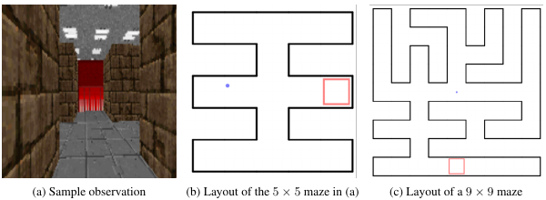

# 第 83 天｜RL²：把快速学习写进记忆，而不是每次重新更新权重

[系列首页](README.md) · [上一篇](82-usfa.md) · [下一篇](84-maml.md)

**原论文与版本**：Yan Duan、John Schulman、Xi Chen、Peter L. Bartlett、Ilya Sutskever、Pieter Abbeel，*RL²: Fast Reinforcement Learning via Slow Reinforcement Learning*。本文核读[arXiv:1611.02779v2，2016-11-10](https://arxiv.org/pdf/1611.02779v2)。该版页眉写“Under review as a conference paper at ICLR 2017”，本文不据此声称其已被该会议接收。以下页码均指此版PDF。

### 先接住前作的问题

[UVFA](80-uvfa.md)、[SF](81-successor-features.md)和[USFA](82-usfa.md)主要讨论已知任务描述后的泛化。给出目标或奖励权重，代理就知道该评价什么。但现实中，当前任务可能是隐藏的：哪个按钮更容易得奖、门后通向哪里、这张地图的出口在哪，需要通过交互才能判断。

RL²将“怎样从交互经验适应任务”本身作为训练目标。慢过程在很多任务上训练一个循环策略；快过程在新任务上更新循环隐藏状态。测试时权重可以冻结，行为仍随经验改变。快速适应并不等于没有学习过程，只是学习状态保存在激活里。

## 一、问题设定：一个trial包含同一任务的多个episode

每次从任务分布ρ(M)抽取一个MDP，在该MDP中连续经历n个episode，合称一个trial。episode结束时环境重置起点；trial结束时才换任务。代理可以保留同一trial内的历史，不能把上一个随机任务的信息当作当前任务证据。

### 五个前置概念

1. **元学习**：在任务分布上优化适应机制，目标是让新任务上的少量交互更有效。
2. **循环隐藏状态**：h是依赖历史的可变记忆，和跨任务共享的网络参数θ不同。
3. **任务不确定性**：观察当前状态未必知道自己处在哪个MDP，奖励和动作结果可以提供辨认任务的信息。
4. **trial与episode**：前者界定同一任务的适应预算，后者界定一次环境运行；两个边界不一定同时重置记忆。
5. **探索的未来价值**：当前动作不仅产生奖励，也改变以后可利用的信息。跨episode目标才能给某些先探索后利用的行为记账。

将所有episode串联，用统一时间下标t。一个清晰的教学记法是

$$x_t=(o_t,a_{t-1},r_{t-1},d_{t-1}),\qquad h_t=f_\theta(h_{t-1},x_t),\qquad a_t\sim\pi_\theta(\cdot\mid h_t).$$

o可以是完整状态，也可以是图像观测；d告诉代理上一段episode是否结束。首次输入用约定的占位动作、奖励与标记。论文§2.2—2.3使用这一类信息流，并以GRU构造循环策略；时间下标只要一致，可以与此写法相差一位。

最重要的实现约定是：**同一任务的episode之间保留h，更换任务时重置h。** 如果每个episode都清空h，模型就不能利用前一次探索结果；如果换任务时不清空h，又可能把过期经验带到新任务，甚至让评估发生跨样本污染。

## 二、固定参数的网络，为什么仍能执行学习算法

普通算法可能维护每个动作的成功与失败次数，然后据此更新奖励均值估计。循环网络可以用h近似存储这些量，也可以学习其他更适合任务分布的摘要。输入奖励让网络知道发生了什么；输入上一动作让它知道这份奖励该归给哪个选择；输入终止信号让它区别“地图重新开始”与“同一段路线继续”。

这不是声称某个隐藏单元必然等于一个精确计数器。没有表示分析时，只能说网络具备利用历史实现适应的能力，不能把h直接称作经过校准的贝叶斯后验。

### 从隐藏任务看成部分可观测控制

若完整历史记为H_t，理论上可以维护任务信念

$$b_t(M)=P(M\mid H_t).$$

观察新转移后按贝叶斯法则更新：

$$b_{t+1}(M)\propto P_M(o_{t+1},r_t\mid H_t,a_t)b_t(M).$$

这是教学解释，并非RL²显式计算的更新式。理想控制器在环境状态和任务信念上做决策；RL²用可训练的h压缩历史，近似完成推断与控制。因此它可能学到实用的探索规则，但不会自动继承精确Bayes-adaptive规划的最优性。

压缩也可能失败。两个历史若需要不同的后续行动，却被网络压到相同h，代理就无法再区分它们。长trial、复杂地图和较多任务自由度会增加记忆与优化难度，不能只凭“RNN能记忆”便断言这些问题消失了。

## 三、慢训练优化的是整个适应过程

用K表示一个trial总交互步数。简化为有限长度、统一折扣β的教学目标：

$$J(\theta)=\mathbb E_{M\sim\rho}\mathbb E_{\tau\sim\pi_\theta,M}\left[\sum_{t=0}^{K-1}\beta^t r_t\right].$$

原文§2.2强调trial而非单个episode的累计回报。具体实现还需说明时间截断、episode间折扣及终止处理；不能只写一个通用公式就假定所有实现细节已经固定。

历史条件策略梯度可写为

$$\nabla_\theta J=\mathbb E\left[\sum_t\beta^t\nabla_\theta\log\pi_\theta(a_t\mid H_t)\,\widehat A_t\right],$$

其中对θ求导包含循环状态沿历史的依赖。优势估计要能反映后续episode的收益，否则第一次episode为第二次搜集信息的动作会被低估。原论文§2.4使用一阶实现的TRPO，循环价值baseline，并可用GAE；RL²本身是任务组织与策略表示方式，不等同于某一种唯一优化器。

### 两个“停止”不能用同一个mask糊在一起

实现通常至少要区分：

- **环境episode结束**：重置环境，但同一任务下保留循环记忆。
- **任务trial结束**：结束当前任务的适应目标，重新抽任务并清空记忆。

还可能有训练批次截断，它只是计算预算边界。若为省内存截断反向传播，跨截断的信用分配会变弱；若在episode结束时也截断价值回报，优化目标可能从“主动探索以帮助下个episode”退化成仅看本次表现。保留隐藏状态与保留梯度路径是两件不同的事，应分别说明。

## 四、独立手算：一次试探为什么值得承担即时风险

构造一个两次选择的未知任务，β=1。安全动作S每次给确定奖励0.6；未知动作U的成功概率p在trial开始时从Uniform[0,1]抽取，并在两次选择中保持不变。选U得Bernoulli(p)奖励。两个动作之外没有状态变化。

初始U的期望收益为1/2，低于S的0.6。一个只看当前回报的贪心策略会始终选S，总期望为1.2。现在考虑“先U，再根据结果选”的策略。

Uniform[0,1]等价于Beta(1,1)先验。首次U成功的边际概率为1/2，此时后验为Beta(2,1)，均值2/3；第二次应选U，因为2/3>0.6。首次失败时后验为Beta(1,2)，均值1/3，第二次选S。

于是总期望为

$$\mathbb E[R]=\frac12+\frac12\times\frac23+\frac12\times\frac35=\frac{17}{15}\approx1.1333.$$

这个计算看起来像探索有益，实际却**低于1.2**。它说明“信息有价值”并不等于任何探索都值得做，短预算下探索成本可能更大。

把安全收益改为0.5，其他条件完全不变。始终安全的总回报为1；先U后的总期望变成

$$\frac12+\frac12\times\frac23+\frac12\times\frac12=\frac{13}{12}\approx1.0833.$$

此时首次动作即时收益打平，但获取信息让总价值提高1/12。更一般地，安全收益q位于1/2到2/3之间，先U的两步价值为5/6+q/2，始终安全价值为2q。探索更优的条件是q<5/9；q=0.6不满足，q=0.5满足。

这里没有训练RNN，也没有验证RL²学到了精确后验，只是给它应当优化的行为提供一个可枚举标准。若把两次选择放在同任务的两个单步episode中，代理必须跨episode记住“上次试了U，以及得到什么奖励”。若中途重新抽p，第一次的信息就不再适用于第二次，这也是trial边界重要的原因。

### 这个例子揭示的三个评估问题

第一，适应预算改变，合理探索策略也会改变。两步与二百步任务不能默认使用同一种最优试探程度。第二，网络看到的奖励尺度影响历史推断，测试时随意缩放奖励可能改变它对任务的理解。第三，比较时要给传统算法相同的先验与交互预算，不能让元学习模型提前见过任务分布，却让基线从完全错误的先验开始。

## 五、论文实验支持哪些结论

### 多臂老虎机与表格MDP

v2第4页§3.1用随机生成的Bernoulli老虎机，臂参数从均匀分布抽样；第5页Table 1报告测试问题上的累计奖励。作者比较了Gittins近似、UCB1、Thompson sampling等，并向贝叶斯基线提供真实任务先验。Gittins指数在相应无限折扣设定的理论性质，不能直接变成当前有限预算实验中所有基线的精确最优保证。

第6页§3.2、Table 2及Figure 3讨论随机表格MDP。阅读表格可以看到不同trial长度下排序发生变化，不能概括成RL²在所有预算均领先。它支持在所研究分布和预算上学习快速适应机制的可行性，没有证明循环网络学出了对任意MDP最优的通用RL算法。

论文将总奖励作为主要比较对象。若只报告最后一个episode，很可能掩盖前面付出的探索代价。相反，只报告第一个episode又会漏掉适应带来的后续收益。应同时看总回报与逐episode曲线。

### 视觉导航：先找到，再利用记忆走得更好

<figure class="reading-evidence-figure" id="rl-83-figure-4"><figcaption>原论文图形摘引｜Duan等，arXiv:1611.02779v2，PDF第7页Figure 4。<a href="https://arxiv.org/pdf/1611.02779v2#page=7" target="_blank" rel="noopener noreferrer">核对原文</a>。原版权保留。</figcaption></figure>

已实际查看原图4。左图是代理收到的第一人称画面，右侧两图是用于说明任务的地图布局，不能把论文展示的俯视图误认为策略输入。红色区域是目标；图本身说明观测和空间结构，不是性能曲线。

v2第7页§3.3使用ViZDoom导航，同一trial保持地图与目标位置不变。训练使用小迷宫和两次episode，测试额外考察较大迷宫及更多episode。因而“跨episode记住出口在哪里”具有清晰的任务意义，而不只是重复看到同一静态图片。

第7页Table 3必须带着选样口径阅读：它使用Figure 5所示多次训练中表现最好的那一次。成功轨迹平均长度只对成功轨迹统计，和所有轨迹的平均成本不同；表3c的改善定义为第二次长度**不超过**第一次，包含持平，不等于严格变短。本文没有将该表改写成全随机种子平均性能，也不推算统计显著性。

测试更多episode不保证持续提高。网络按训练预算学到的探索与记忆习惯，超出预算后可能不再匹配；地图更大也会增加记忆负担。原研究的外推结果是特定任务族下的证据，不是对任意更大环境的保证。

## 六、与普通RNN、MAML和显式任务推断的区别

[DRQN](72-drqn.md)利用记忆帮助部分可观测状态判断。RL²还刻意保留跨episode记忆，并在任务分布上优化完整适应过程。两者都可以使用RNN，但普通RNN策略如果每个episode都重置，并不因此自动成为RL²。

下一篇[MAML](84-maml.md)将适应写为少量参数梯度更新；RL²的标准测试方式主要更新h而非θ。区别不在于谁才“真正学习”，而在于学习状态存在哪里、怎样训练以及如何适应不同预算。

[PEARL](85-pearl.md)等方法会更明确地引入任务潜变量或后验近似。RL²不要求h有可解释的概率语义，表示灵活，但不确定性与任务识别难以直接审计。不能把策略熵大当成“任务后验很不确定”，二者回答的问题不同。

### 一个合理的最小复现检查表

先实现上面的两步任务，比较网络策略与精确枚举值，检查它是否依据首次奖励改变第二步行为。然后做三个对照：每episode重置记忆、跨episode保留记忆、错误地跨任务保留记忆。最后将训练与测试任务采样随机源分开，记录是否冻结参数以及每个任务给了多少交互。

扩大实验时，至少报告多训练种子总回报、逐episode回报、测试任务数量、预算外测试和推理成本。若声称学会记忆，可做受控消融，例如第二个episode前将h清零；若声称学到贝叶斯推断，还需要额外比较后验或决策，不能由行为变好直接推出。

### 继续追问

1. 测试不更新参数，为什么不叫普通推理？

计算操作确实是前向推理，但前向过程的隐藏状态在执行经验依赖的更新规则，下一步行为会随奖励历史改变。从任务层面看，它在适应；从参数层面看，慢训练权重没有变化。两种描述并不矛盾。

2. 为什么必须输入上一动作，只输入奖励够不够？

奖励需要和产生它的选择关联。同样观察到奖励1，如果来自不同臂，对未知任务的证据不同。在某些特殊环境中网络能从其他信息推断动作，但显式提供动作避免把这种推断当成隐藏前提。

3. 在训练分布上适应得快，是否也会发现完全不同的新任务规律？

没有这种保证。元训练压缩了特定先验与预算下有用的规则；测试奖励分布、动力学结构、动作语义或时间尺度改变，都可能让旧规则失效。应将同分布新实例与分布外适应分开报告。

## 自测两题

**问题1**：两步教学任务中，安全收益0.6时，先U再依据反馈选择的期望是多少？它比始终选安全动作好吗？

**参考答案**：17/15，约1.1333；始终安全为1.2，因此探索更差。后续信息收益未抵消当前机会成本。

**问题2**：安全收益0.5时，先U后的期望是多少？若每个单步episode都清空记忆，还能执行同样的反馈策略吗？

**参考答案**：13/12，优于始终安全的1。若清空记忆且不另行提供历史，就无法区分上一次U成功或失败，不能执行同样的条件选择。清空记忆与是否更新网络权重是不同问题。

**核读与复现边界**：已下载v2原PDF，核读§2、§3及Table 1—3相关设置与口径，实际查看PDF第7页及原图4摘图。未训练RL²、未审计作者代码、未逐项核对附录超参数、未将原图曲线数字化。贝叶斯教学例、梯度记法与最小检查表属于本文独立推导，不声称作者逐项采用。

[系列首页](README.md) · [上一篇](82-usfa.md) · [下一篇](84-maml.md)
