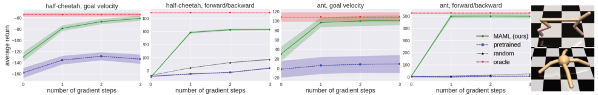

# 第 84 天｜MAML：学一个容易改变的起点，而不是所有任务的折中答案

[系列首页](README.md) · [上一篇](83-rl2.md) · [下一篇](85-pearl.md)

**原论文与版本**：Chelsea Finn、Pieter Abbeel、Sergey Levine，*Model-Agnostic Meta-Learning for Fast Adaptation of Deep Networks*，ICML 2017，PMLR 70:1126–1135。本文以 [PMLR正式正文](https://proceedings.mlr.press/v70/finn17a/finn17a.pdf)和[单独补充材料](https://proceedings.mlr.press/v70/finn17a/finn17a-supp.pdf)为依据，重点解释 RL 适应，不用图像分类结果替代控制实验。

### 先接住前作的问题

普通策略优化问“在当前任务怎样提高回报”，多任务训练问“一个策略怎样兼顾所有任务”。MAML 多问一步：**给我少量新任务经验以后，我能否迅速变成适合那个任务的策略？**

两个任务分别要求机器人向前跑、向后跑。平均任务上的好策略可能只学会不动，而一个方便适应的起点可以保留两种行动能力，让少量奖励反馈决定下一步朝哪边调整。最终输出依然是一组网络参数，但训练时评价的对象是这些参数经过学习之后的表现。

## 一、问题设定：一次新任务适应包含数据采集和参数更新

任务 $\mathcal T\sim p(\mathcal T)$ 是一个 MDP，可在奖励、初始分布或动力学上不同。训练阶段能反复接触多个任务；测试阶段遇到同类分布中的新任务，只允许少量适应轨迹。策略为 $\pi_\theta(a\mid s)$，并非一开始就把隐藏的任务身份作为输入。

“新任务”不等于任意新世界。原论文 RL 实验主要变化导航目标、运动方向和目标速度。框架允许动力学变化，不代表每一种变化都已通过这些实验验证。跨任务的状态动作接口也必须足够兼容，不能把一套网络不加改造地交给维度不同的机器人。

### 五个前置概念

1. **任务分布**：元训练的归纳偏好来自反复看到哪些任务，测试分布改变会影响适应。
2. **内层更新**：使用某个任务的适应经验，把共享参数变成任务特定参数。
3. **外层更新**：比较内层更新后的表现，再修改共享起点。
4. **策略梯度**：通过轨迹的对数概率估计奖励对参数的影响，不要求环境可微。
5. **训练数据与评估数据分开**：用来决定怎么更新的轨迹，和用来检查更新效果的轨迹承担不同角色。

这里的 few-shot 在 RL 中通常按**轨迹**计，不是按单个状态或一个动作计。一次轨迹又可长达数百步，所以“一步梯度适应”既不是“一次交互学会”，也不一定是很低的墙钟成本。

## 二、双层目标到底优化了什么

令任务损失是负的有限时域期望回报：

$$L_{\mathcal T}(\theta)=-\mathbb E_{\tau\sim\pi_\theta,\mathcal T}\left[\sum_{t=1}^{H}r_{\mathcal T}(s_t,a_t)\right].$$

在教学层面先假定能算精确期望。一轮内层梯度下降为

$$\theta'_{\mathcal T}=\theta-\alpha\nabla_\theta L_{\mathcal T}(\theta).$$

普通多任务学习最小化 $\mathbb E_{\mathcal T}L_{\mathcal T}(\theta)$；MAML 则最小化

$$F(\theta)=\mathbb E_{\mathcal T}L_{\mathcal T}\left(\theta-\alpha\nabla_\theta L_{\mathcal T}(\theta)\right).$$

优化变量仍然是 $\theta$，不是每个任务永久存一套独立参数。训练时产生的 $\theta'_{\mathcal T}$ 是临时适应结果，外层结束后下一批任务又从更新后的共享起点出发。若不断沿某一个任务的 $\theta'$ 往下训练，就变成顺序微调，而不是这里的元优化。

### 为什么外层会出现二阶项

记 $H_{\mathcal T}=\nabla^2L_{\mathcal T}(\theta)$，链式法则给出

$$\nabla_\theta F=\mathbb E_{\mathcal T}\left[(I-\alpha H_{\mathcal T})^\top\nabla_{\theta'}L_{\mathcal T}(\theta')\right].$$

右边首先看适应后还缺什么，再问初始参数的变化怎样影响适应后的参数。$I-\alpha H$ 是内层学习步骤的 Jacobian，不是另加一个惩罚项。实际无需显式保存完整 Hessian 矩阵，可计算 Hessian-vector product。

若内层有多步更新，就出现多个更新 Jacobian 的连乘。它们可能放大或缩小梯度，因此内层步长、步数和归一化很重要。可微不等于稳定，元目标降低也不保证任意新任务都只需一步。

一阶 MAML 近似忽略内层梯度对 $\theta$ 的导数，把外层梯度近似为适应后的损失梯度。但它仍需先适应，再在适应后的参数处评估；不能把它说成普通多任务训练。原论文一阶近似的主要对比在 MiniImageNet，不能把该分类结论直接变成 RL 中“一阶一定同样好”的证据。

## 三、手算：元最优起点可以远离普通多任务最优点

考虑一轮动作后结束的教学控制任务。动作是实数 $a$，策略为均值 $\theta$、固定方差的高斯；两个任务的奖励分别是 $-\tfrac12(a+2)^2$ 与 $-(a-2)^2$。期望负回报相对 $\theta$ 的变化等价于

$$L_1(\theta)=\tfrac12(\theta+2)^2,\qquad L_2(\theta)=(\theta-2)^2.$$

固定动作方差只增加与 $\theta$ 无关的常数，此处省略。以下使用精确期望梯度，不模拟有限轨迹估计误差。

两任务等概率，普通平均损失的梯度为

$$\tfrac12[(\theta+2)+2(\theta-2)]=\tfrac32\theta-1,$$

所以最优共享点是 $\theta=2/3$，向曲率较大的第二个任务倾斜。取内层步长 $\alpha=1/4$，适应后参数变为

$$\theta'_1=\tfrac34\theta-\tfrac12,\qquad\theta'_2=\tfrac12\theta+1.$$

代回损失并平均：

$$F(\theta)=\frac9{64}(\theta+2)^2+\frac18(\theta-2)^2,$$

$$F'(\theta)=\frac{17}{32}\theta+\frac1{16},\qquad\theta^*_{\mathrm{MAML}}=-\frac2{17}.$$

在 $\theta=0$，普通多任务梯度是−1，下降会向右；元梯度是 $1/16$，下降却向左。两者不是“同一答案收敛速度不同”，而是学习目标不同。第二个任务曲率更大，一步更新也更有效，因此外层不必像普通平均损失那样强烈向它靠拢。

在元最优点，一步后的参数是 $\theta'_1=-10/17$、$\theta'_2=16/17$，没有任何一个恰好达到−2或2。MAML 不是要求少量数据就完美解决每个任务，而是在给定更新规则下优化平均适应结果。如果改变 $\alpha$，最佳起点也会改变。

这还说明“把各任务最优权重平均”一般不等于元学习。两个任务最优点平均为0，普通多任务最优点为2/3，元最优点为−2/17，三者已经在一维例子中分开。

## 四、到了 RL，采样分布也会随参数改变

### 一次元训练不能只采一批轨迹

原文 Algorithm 3 的流程是：

1. 从任务分布采样若干任务，各自从同一共享初始化 $\theta$ 开始。
2. 用 $\pi_\theta$ 在任务 $\mathcal T_i$ 中采集适应轨迹 $D_i$。
3. 用这些轨迹估计策略梯度，得到 $\theta'_i$。
4. 用适应后的 $\pi_{\theta'_i}$ 再采一批轨迹 $D'_i$，评估适应结果。
5. 汇总各任务适应后的信号，更新共享初始化，再开始下一轮。

内层的常用估计形状为

$$\widehat{\nabla L}_{\mathcal T}=-\frac1K\sum_{k=1}^{K}\sum_t\nabla_\theta\log\pi_\theta(a_t^k\mid s_t^k)\,\widehat A_t^k.$$

优势或 baseline 用于降低方差，但不应凭空引入真实任务身份。只把同一批旧动作重新输入更新后的网络，没有让环境真的按新策略执行，因此不是第4步的等价替代。重要性修正可以形成别的算法设计，但不能无说明地当作论文原流程。

### 自动微分不能替代对随机数据来源的理解

前面的 Hessian 公式假定精确期望梯度。实际内层依赖随机轨迹 $D$，且这些轨迹由 $\theta$ 控制。把完整目标写成

$$\mathcal F(\theta)=\mathbb E_{D\sim p_\theta}[\ell(\theta'(\theta,D))],$$

其中 $\ell$ 已代表适应后新轨迹上的期望损失，则在通常可交换求导与积分的条件下，有

$$\nabla\mathcal F=\mathbb E_D\left[\nabla_\theta\ell(\theta'(\theta,D))+\ell(\theta')\nabla_\theta\log p_\theta(D)\right].$$

这是本文用于说明采样依赖的恒等式，不是宣称原文实现逐项使用了这个形式。第一项包含穿过更新步骤的链式导数，第二项来自“初始策略影响会采到什么适应数据”。如果把采到的动作、回报全部当固定常数，只对某个 surrogate loss 连续求两次导数，并不能据此自动宣布得到了完整无偏的元策略梯度。

这一区分很实用：MAML 的概念是优化适应后表现，具体 RL 估计器还要处理采样、baseline、信赖域和高阶导数。原文 §5.3 用 REINFORCE 做内层，TRPO 做元优化，并用有限差分处理 TRPO 所需 Hessian-vector product，以避免计算三阶导数。不能把它简化成“内外层都是任意 Adam，结果完全相同”。

## 五、原始实验：少量梯度步不等于少量环境步

<figure class="reading-evidence-figure" id="rl-84-figure-5"><figcaption>Finn等，ICML 2017，PMLR正式正文 Figure 5，PDF第8页；保留四组曲线、坐标、图例和任务示意，不含原图注。<a href="https://proceedings.mlr.press/v70/finn17a/finn17a.pdf#page=8">原图上下文</a>。版权归原作者，作本篇技术评论所需的有限摘引。</figcaption></figure>

图5横轴是适应梯度步数，纵轴是平均回报；绿色 MAML 与普通预训练、随机初始化及获得任务信息的 oracle 比较。MAML 在这些运动任务上较快提高回报，但每一梯度步都需要新环境样本。图注还说明，目标速度任务的随机基线太差而没有画在图内，不能把缺失曲线当作与某条曲线重合。

正文 §5.3 中，Half-Cheetah 和 Ant 的目标速度分别从 $[0,2]$ 与 $[0,3]$ 取样；方向任务要求向前或向后。运动任务时域为200，每次梯度更新通常用20条轨迹，Ant 前后方向任务用40条。若每条都跑满，20条对应4000步，40条对应8000步。这是依据时域得到的预算换算，实际有提前终止时需按日志计数；更不是包括元训练在内的总样本成本。

二维导航任务训练时优化“一步、20条轨迹”的适应效果，评估时每步使用40条样本轨迹，最多继续多步更新。训练和评估预算不同，报告时要分开。它支持元学习的起点可以继续微调，并不证明训练步数之外的任意多次更新都保持单调提升。

补充材料 A.2 写明 RL 元训练采用一步内层更新，初始步长0.1；评估首步0.1，后续0.05；导航元批次20个任务，运动元批次40个任务。模型训练至多500次元迭代，并按训练平均回报选择评估模型。这些都是结果的上下文，不应把最佳模型曲线说成每次运行都必然达到。

oracle 直接知道目标参数，所以它与需要从奖励中推断任务的策略信息条件不同；它是参考上界式比较，不是同等输入预算的算法替代。分类一阶近似、正弦回归的少样本表现也不能用来填补 RL 稀疏探索或分布外适应的证据空白。

## 六、怎样理解优势、代价和关系

MAML 不要求额外的循环记忆结构，也不额外学习一套梯度优化器；它利用已有网络和可求导更新，把“容易适应”写进训练目标。model-agnostic 意味着不绑定某个特定模型架构，绝不是不依赖可优化参数、损失设计、任务分布或梯度估计。

与普通预训练相比，MAML 明确考核少量更新后的效果；与循环式元 RL 相比，它通过参数更新表达适应，而循环方法往往通过隐藏状态变化表达适应。两者都要从经验中辨识任务，是否显式更新权重并不直接决定谁更会探索。

下一篇 PEARL 将把任务推断做成概率潜变量，测试时主要更新上下文后验而不是整网梯度；后面的 MB-MPO 则把多个学得动力学模型当作元任务。那是双层适应思想的不同使用方式，不能因为都叫 meta 就把训练任务来源混在一起。

MAML 的成本包括元训练任务数量、内外层轨迹、保存更新图的内存与高阶导数。极稀疏奖励时，适应轨迹可能根本不给出有效梯度；任务分布外的梯度可能把参数推坏；少量轨迹的高方差也可能让一次更新比不更新更差。良好的初始化减少学习难度，不替代信息获取。

## 七、三个追问

**问1：是不是只要把网络初始化换成 MAML 参数，任何任务都会快？**

答：不是。它优化的是某个任务分布、数据预算和内层规则。改变奖励尺度、可用样本、更新步长或观测结构，都可能改变适合的起点。至少要用独立测试任务比较随机初始化、普通预训练和相同交互预算的元学习。

**问2：把内层步长设为0会怎样？**

答：此时 $\theta'=\theta$，适应后目标退化成普通跨任务平均损失。数学上仍可运行外层，但已经没有“通过一次学习改变自己”的内容。这是检查双层实现的好边界测试。

**问3：MAML 能学会主动试探任务吗？**

答：初始策略影响适应时看到的数据，所以完整元目标确实存在选择有信息行为的空间。但实际算法的探索效果取决于估计器和任务反馈，原文快速适应曲线不等于最优信息收集证明。若所有试探都没有奖励差异，仅靠梯度未必能辨认任务。

## 八、两道自测（含答案）

**自测1。** $L(\theta)=\tfrac12(\theta-3)^2$，$\alpha=0.5$，在 $\theta=1$ 做一步适应。适应后参数、外层精确梯度和一阶近似梯度分别是多少？

**答案：** 内层梯度−2，$\theta'=2$。适应后损失梯度−1，内层 Jacobian 是0.5，因此精确元梯度−0.5，一阶近似为−1。它们在此例方向相同、大小不同；这不是一般情况下差异只能体现在大小上的证明。

**自测2。** 两种算法都“适应两步”，A每步20条200步轨迹，B每步5条200步轨迹。只比较两步后的回报公平吗？

**答案：** 不足够。假定轨迹跑满，A使用8000步，B使用2000步，应同时报告交互预算、实际终止长度、元训练成本及计算时间。还要确认任务划分和奖励信息相同，不能仅用梯度步数衡量样本效率。

## 参考与核读边界

- [正式正文](https://proceedings.mlr.press/v70/finn17a/finn17a.pdf)：§2、§3.2、Algorithm 3、§5.3及图5；已查看所引图的实际像素。
- [正式补充材料](https://proceedings.mlr.press/v70/finn17a/finn17a-supp.pdf)：A.2的 RL 更新与任务批次设置；监督学习部分仅用于区分证据范围。
- [作者RL实现入口](https://github.com/cbfinn/maml_rl)：本文未运行或逐行审计。二次控制例子和随机数据依赖恒等式是本文教学推导，不是声称论文给出了同一例子或完整梯度估计证明。

[系列首页](README.md) · [上一篇](83-rl2.md) · [下一篇](85-pearl.md)
