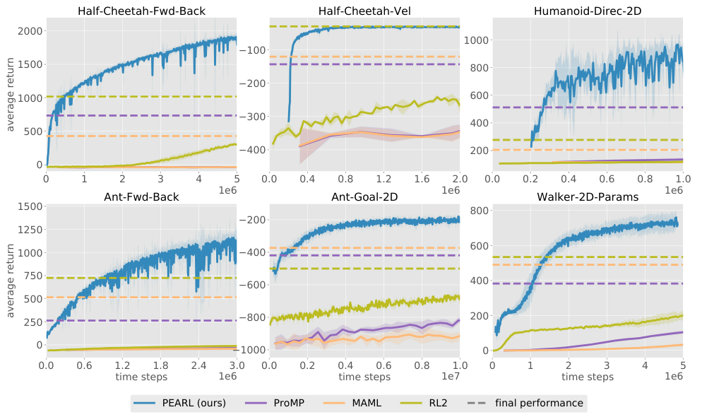

# 第 85 天｜PEARL：把新任务适应变成推断，并让不确定性指导探索

[系列首页](README.md) · [上一篇](84-maml.md) · [下一篇](86-varibad.md)

**原论文与版本**：Kate Rakelly、Aurick Zhou、Deirdre Quillen、Chelsea Finn、Sergey Levine，*Efficient Off-Policy Meta-Reinforcement Learning via Probabilistic Context Variables*，ICML 2019，PMLR 97:5331–5340。本文核读 [PMLR正式正文](https://proceedings.mlr.press/v97/rakelly19a/rakelly19a.pdf)及[补充材料](https://proceedings.mlr.press/v97/rakelly19a/rakelly19a-supp.pdf)。作者排序按正文首页列出。

### 先接住前作的问题

[MAML](84-maml.md)把策略初始化训练成“少量梯度更新后能解决新任务”。但如果每次适应和元训练都需要新轨迹，积累的大量旧数据很难充分复用。还有一个问题：目前不确定目标在左边还是右边，策略应该怎样行动？直接平均两种答案，可能只会站在中间。

PEARL 将两件事拆开：**用经验推断当前任务，再让策略在这个任务假设下行动。** 任务推断输出概率分布，不只输出一个向量；每次从分布中采样一个任务表示，并在一段轨迹里维持这个假设，探索因而具有连续意图。

## 一、问题设定：训练任务有身份，测试策略靠经验辨认

任务 $\mathcal T$ 来自分布 $p(\mathcal T)$，其奖励或动力学可以不同。训练时有多个任务，每个任务维护自己的 replay buffer。策略不是直接得到任务标签，而是接收由该任务经历推断出的潜变量 $z$。

一条上下文经验写作 $c_n=(s_n,a_n,r_n,s'_n)$，上下文集合 $c_{1:N}$ 聚合已观察的转移。三个主要网络是推断器 $q_\phi(z\mid c)$、策略 $\pi_\theta(a\mid s,z)$、价值函数 $Q_\psi(s,a,z)$。训练时更新这些网络；测试时固定参数，用不断增加的上下文更新 $z$ 的分布。

### 五个前置概念

1. **摊销推断**：用训练好的网络直接把数据映射成分布参数，避免每个新任务重新优化一套网络。
2. **任务不确定性**：尚未确定奖励或动力学属于哪一类，和环境本身的随机噪声不是同一件事。
3. **高斯乘积**：多个高斯因子相乘并归一化仍是高斯，精度相加。
4. **后验采样**：按当前信念抽一个假设，再按它行动，而不是每一步取所有假设的平均动作。
5. **离策略学习**：actor-critic 可从旧经验更新，但用于推断任务的数据不一定应和 RL 训练批次相同。

原论文的集合编码依据是：在完全观测、任务内动力学固定的 MDP 中，转移集合可携带任务信息，不必保留时间顺序。若观测本身不满足马尔可夫性，或任务在轨迹中途变化，抹掉顺序可能丢失关键证据，不能把置换不变当成适合所有序列问题的定律。

## 二、概率上下文怎样把经历压缩成任务表示

### 从每条转移到一个可合并的因子

每条 $c_n$ 经过共享网络，输出高斯因子

$$\Psi_\phi(z\mid c_n)=\mathcal N(z;\mu_n,\Sigma_n),\qquad
q_\phi(z\mid c_{1:N})\propto\prod_{n=1}^N\Psi_\phi(z\mid c_n).$$

这是原文式(2)的形式，通常使用对角协方差，因此可按维度合并。对于一个维度，令精度 $\tau_n=1/\sigma_n^2$，有

$$\sigma^2=\left(\sum_n\tau_n\right)^{-1},\qquad
\mu=\sigma^2\sum_n\tau_n\mu_n.$$

交换上下文顺序不改变乘积。更明确、方差更小的因子得到更高权重。空上下文使用标准高斯先验；非空上下文按因子乘积编码。不要在每个已包含学习信息的因子之外随意重复乘先验，然后仍声称得到论文同一个后验参数化。

这些因子是学出来的“有利于控制的证据表示”，不必等于已知物理生成模型的精确似然。因此概率输出不自动等于经过频率校准的真实贝叶斯任务后验。$z$ 也不必能逐维解释为摩擦、质量、目标方向。

### 手算：谁的证据更确定，谁的权重更大

两条教学证据分别给出 $\mathcal N(-1,4)$ 和 $\mathcal N(2,1)$，第二个参数表示方差。精度是 $1/4$ 与1，所以

$$\sigma^2=\frac1{1.25}=0.8,\qquad
\mu=0.8\left[\frac14(-1)+1\cdot2\right]=1.4.$$

结果不是简单平均0.5，而是靠近更确定的第二条证据。若把两个因子顺序交换，结果不变；若把同一对证据复制一遍，均值仍为1.4，方差降到0.4。这正好提示风险：高度重复或相关的上下文可能导致过度自信，置换不变并不等于自动识别证据重复。

### 信息瓶颈约束潜变量装进多少内容

训练中加入

$$L_{\mathrm{KL}}=\beta D_{\mathrm{KL}}\bigl(q_\phi(z\mid c)\|\mathcal N(0,I)\bigr).$$

对角高斯时可逐维计算：

$$D_{\mathrm{KL}}=\frac12\sum_j\left(\mu_j^2+\sigma_j^2-1-\log\sigma_j^2\right).$$

它限制上下文被编码得过于任意，降低在训练任务上记忆细枝末节的倾向。过强的 KL 会把不同任务挤到一起，过弱又可能过拟合。不是“KL 越小任务越容易识别”，而是辨别能力与压缩之间的权衡。

原文正文式(1)把抽象任务目标与 KL 放在同一个式子里，其符号必须结合优化方向解释。本文采用 Algorithm 1 明确的**最小化 critic loss 加正 KL 惩罚**，不把“最大化正 KL”说成信息瓶颈。

## 三、编码器到底由谁训练：不是重建一切

论文讨论过重建奖励／动力学、最大化策略收益等可能目标，但实际 PEARL 主要用 **critic 的 Bellman 误差加 KL** 更新推断器。这个选择让 $z$ 保留有助于预测控制价值的信息，而不强求还原全部环境细节。

为避免原文简写省略折扣与终止掩码造成误读，下面显式补出通常的折扣形式：

$$z=\mu_\phi(c)+\sigma_\phi(c)\odot\epsilon,\quad\epsilon\sim\mathcal N(0,I),$$

$$y=r+\gamma(1-d)\bar V(s',\operatorname{sg}(z)),\qquad
L_Q=\mathbb E[(Q_\psi(s,a,z)-\operatorname{sg}(y))^2].$$

$\bar V$ 是 target value，$d$ 表示真实终止，$\operatorname{sg}$ 表示停止梯度。critic 预测端通过 $z$ 把梯度传给编码器，target 端不通过 $z$ 回传；否则编码器可通过移动目标来掩盖误差。原文式(3)为了简洁未显式写这些常规折扣／终止因子，本文没有声称它们逐字出现在该式中。

actor 使用 SAC 风格目标。写成常见损失记号是

$$L_\pi=\mathbb E\left[\alpha\log\pi_\theta(a\mid s,\operatorname{sg}(z))-Q_\psi(s,a,\operatorname{sg}(z))\right].$$

这里 $\alpha$ 表示熵权重。原文式(4)以策略到指数 Q 分布的 KL 表达同一类优化思想。actor 梯度不更新编码器；编码器优化 $L_Q+L_{\mathrm{KL}}$，critic 优化 $L_Q$，actor 优化 $L_\pi$。三个更新路径分清楚，才算理解“推断与控制分离”。

### 两种采样器承担不同工作

RL 批次 $b_i$ 从任务 $i$ 的整个 replay buffer 抽取，用于 actor-critic。上下文批次 $c_i$ 则从**最近收集的数据**中另行采样，用于模拟测试时在线适应会看到的经验。

为什么不能都从全部历史里任取？测试新任务时不会凭空拥有该任务多年前、各种成熟策略留下的大量经验。上下文若过度依赖这种分布，编码器可能在元训练表现很好，面对少量新策略轨迹却失效。另一方面，critic 为了学习 Q，复用历史样本恰恰有价值。

正文 §5.1 说明，最近一批上下文数据每1000个元训练优化步重新收集；actor-critic 始终可使用整个回放。这个做法不是严格要求上下文每次都来自眼下完全相同策略，而是在完全离策略与严格 on-policy 之间做折中。图6显示，把上下文改成全历史，或直接与 RL 使用同一个批次，效果会下降。

## 四、测试时不改权重，也仍然是在适应

Algorithm 2 的测试过程如下：

1. 清空新任务上下文，令 $q(z\mid\varnothing)=p(z)$。
2. 从当前分布抽一个 $z$，让策略在该 $z$ 下采一条轨迹。
3. 把新经历并入上下文，再计算后验。
4. 从更新后的分布抽新的 $z$，继续交互。

改变的是任务信念及条件行为，不是网络权重。它仍需要真实反馈，也可能需要多条探索轨迹。没有辨识信息时，后验不会凭空知道答案。

### 为什么沿一个假设走，比每步抖动更有用

设教学导航问题的目标只可能在左端或右端，每个方向至少连续走5步才会遇到奖励。若每一步独立以一半概率左右走，很容易来回抵消；若一回合先采“目标在右”的假设，再连续向右，就能真正检查右端。

PEARL 的固定 $z$ 提供这种时间上连贯的探索。它类似 posterior sampling，但并不显式维护所有 MDP 的精确后验，也没有为每个抽到的 MDP 重新求精确最优策略。因此这里只能说借鉴后验采样的机制，不能直接套用精确贝叶斯算法的遗憾界。

把后验均值喂给策略也不等于采样。即使均值位于两个任务之间，任务本身可能根本不存在“中间目标”。但高斯潜变量经非线性策略映射仍可表达多种行为，不能只看潜空间单峰就断言行为分布只能单峰；是否足以表示复杂多模态任务信念，需要额外检验。

## 五、原始证据：元训练效率与测试适应要分开看

<figure class="reading-evidence-figure" id="rl-85-figure-3"><figcaption>Rakelly等，ICML 2019，PMLR正式正文 Figure 3，PDF第6页；截取六面板、坐标与公共图例。<a href="https://proceedings.mlr.press/v97/rakelly19a/rakelly19a.pdf#page=6">原图与图注</a>。原作者保留版权，作为技术评论的有限摘引。</figcaption></figure>

图3横轴是**元训练收集的环境步数**，纵轴是在测试任务适应后测得的回报，不是同一个新任务从零训练的曲线。评估时先收集两条轨迹形成上下文，再统计之后轨迹的回报。所有这些连续控制任务的时域为200，结果平均三个随机种子。

六类设置包括 Half-Cheetah 前后方向与目标速度、Ant 前后方向与二维目标、Humanoid 方向，以及改变系统参数的 Walker。前五类主要变化奖励，Walker 变化动力学。补充材料明确前后方向只有两个任务，不能把所有六类都笼统说成“测试未见过的新目标身份”；有些设置考查的是已知任务集合中的在线辨认。

原文报告20–100倍元训练样本效率提升。这是作者对所测基准与指定基线的报告，不是本文重新计算的普遍加速倍数。正文图截断了基线的训练时间范围，虚线表示它们训练到 $10^8$ 步后的最高回报；补充图9给出完整对数时间轴。虚线不是某个较早时刻实际达到的分数，更不能读成该基线一开始就有那个水平。

稀疏二维导航实验是另一项证据。目标位于半圆边缘，训练100个目标、测试20个目标；测试奖励只在目标半径内出现，半径比较0.2和0.8，时域20。**元训练使用稠密奖励，测试适应才使用稀疏奖励。** 这是正文 §6.2 明说的条件，不能省略成“全程只用稀疏反馈就学会探索”。

图5–7 分别检验循环编码器、上下文采样和确定性潜变量。它们支持数据解耦与概率上下文在相应设置中的作用，不说明全部性能收益都只来自某个单一模块。尤其不要把“off-policy 提高效率”误写成“不需要在线收集新任务经验”。

## 六、与相邻方法的关系及边界

MAML 在测试任务上做梯度更新，PEARL 主要更新潜变量信念；二者都是利用任务间共享结构降低适应成本。PEARL 的条件策略与 critic 可以用 SAC 离策略训练，但不等于拿固定离线数据就能解决全部元 RL；原文仍持续在训练任务中采集环境经验。

循环式元 RL 可用隐藏状态保存时间信息，PEARL 用集合编码提高可解耦性与采样灵活性。完全观测任务中后者很自然，部分可观测情境可能更需要时序结构。之后的 Bayes-adaptive 方法还会进一步问：动作是否应该为未来获取信息，即使它当前奖励较低？后验采样提供有效启发，但不是对所有信息价值的精确规划。

当新任务与训练分布差异很大，编码器可能把它硬解释成已知任务；当上下文只覆盖无信息区域，任何推断器都难辨别任务；当 replay 混入别的任务，价值学习会得到自相矛盾的监督。实现中的任务分桶、终止处理、上下文清空以及 latent 梯度路径，通常比“再加宽一个网络”更先值得检查。

## 七、三个追问

**问1：测试不更新参数，算不算真正的学习？**

答：广义适应看行为是否利用新经验发生改变。PEARL 的网络参数固定，但上下文后验更新，并影响之后的行为，因此确实在适应。它与梯度学习的不同应说明清楚，不必用是否执行反向传播来判断是否利用了信息。

**问2：方差变小就能相信任务已经确定了吗？**

答：不能。方差来自训练过的模型，重复证据、分布外输入或过强压缩都可能让它虚假自信。应检查后验预测的实际效果、对重复数据的敏感性及测试分布，而不是把数值小直接当可靠概率保证。

**问3：为什么 actor 的梯度不直接训练编码器？**

答：论文比较过相关选项，实际选用 critic 信号效果更好。这个目标要求表示解释状态动作价值，避免编码器只为当前策略短期偏好服务；但这是算法设计与经验选择，不是 actor 信号在所有任务上都无用的定理。

## 八、两道自测（含答案）

**自测1。** 两条高斯因子为 $\mathcal N(0,1)$ 和 $\mathcal N(4,1)$，乘积归一化后的均值和方差是多少？能否称其为“以一半概率在0、一半概率在4”？

**答案：** 精度相加为2，方差0.5，均值2。不能，它是高斯乘积得到的单个分布，不是两个高斯的等权混合。把 product of experts 与 mixture 混淆会把任务推断机制完全解释反。

**自测2。** 工程师为了省事，让上下文和 critic 使用全部历史回放中的同一批样本，并允许 actor loss 更新编码器。这还是原始 PEARL 吗？

**答案：** 不是。它同时改变上下文数据分布、两个批次的解耦，以及编码器的训练信号。论文的上下文从最近数据另采，编码器主要由 critic loss 与 KL 更新；这些变化应作为变体单独评估。

## 参考与核读边界

- [PEARL正式正文](https://proceedings.mlr.press/v97/rakelly19a/rakelly19a.pdf)：§3–6、式(2)–(4)、Algorithms 1–2、Figures 3–7；本篇摘引图3实际像素已核读。
- [补充材料](https://proceedings.mlr.press/v97/rakelly19a/rakelly19a-supp.pdf)：任务划分、时域和全时间范围图9。
- [作者实现](https://github.com/katerakelly/oyster)：复现入口，本文未运行或逐行审计。高斯计算及两端导航为教学构造；不宣称后验严格校准、训练复现或一般最优探索保证。

[系列首页](README.md) · [上一篇](84-maml.md) · [下一篇](86-varibad.md)
