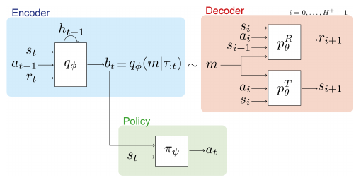

# 第 86 天｜VariBAD：把“还不知道什么”交给策略，而不是先猜一个任务

[系列首页](README.md) · [上一篇](85-pearl.md) · [下一篇](87-mb-mpo.md)

**原论文与版本**：Luisa Zintgraf、Kyriacos Shiarlis、Maximilian Igl、Sebastian Schulze、Yarin Gal、Katja Hofmann、Shimon Whiteson，*VariBAD: A Very Good Method for Bayes-Adaptive Deep RL via Meta-Learning*，ICLR 2020。本文核读 [arXiv:1910.08348v2，2020-02-27](https://arxiv.org/pdf/1910.08348v2) 的 §2–3、§5，以及图1、图2的上下文。不要把这版与后来扩展的 JMLR 论文混成同一实验协议。

### 从“适应得快”走向“适应过程也要有收益”

元强化学习经常用适应几轮之后的回报评估方法。如果第一轮纯粹探索、第二轮才开始得分，这种评估可能很好看；但在交互昂贵的任务中，第一轮损失也是真实成本。VariBAD关心新任务中的**整个在线学习过程**：动作既改变环境，也改变我们对任务的认识，怎样把这两种后果一起计入收益？

答案不是给所有新鲜状态一份探索奖励，而是把当前任务的近似后验作为策略输入。在相关任务上训练之后，策略学会在有必要时获取信息，在信息已经足够时直接利用。这里“在线”指测试任务内持续利用新观测，不表示测试时必须更新网络权重。

## 一、问题设定：学习新任务时也计算收益

从任务分布 $p(M)$ 中采样 MDP。任务共享状态与动作空间，奖励或动力学随任务变化；当前任务身份不直接告诉智能体。同一任务内潜在的奖励、转移机制保持固定。训练时可从任务分布反复采样并交互，测试时在新抽取的任务中评价学习期间累计收益。这不是只拿一份固定日志训练的离线RL，也不等同于任意分布外任务适应。

### 五个前置概念

- **任务先验**：交互前，哪些环境可能出现以及相对可能性。
- **信念／后验**：已有历史条件下对任务的分布，不只是某个猜测。
- **BAMDP**：把物理状态和任务信念一起作为状态的 Bayes-adaptive MDP。
- **摊销推断**：用跨任务学得的编码器快速输出后验近似，免去每次从头求解推断问题。
- **信息价值**：信息本身不算回报；只有帮助未来决策时才值得为它付出代价。

记历史 $h_t=(s_0,a_0,r_1,\ldots,s_t)$，精确信念为 $b_t(M)=p(M\mid h_t)$。普通策略只见 $s_t$，Bayes自适应策略见 $(s_t,b_t)$。同一个位置、同一组身体关节，在“目标大概率向左”和“尚无方向信息”时应该采取不同动作，这不是环境状态不一致，而是知识状态不同。

MDP单回合时域 $H$ 与跨若干回合的适应时域 $H^+$ 要区分。身体重置到起点未必代表任务重置；同一任务的记忆可以跨回合保留。若任务已重新采样却不重置信念，则会把旧任务证据错误带入新任务。

## 二、为什么完整信念比一个任务样本更有用

理想的信念状态 Bellman 方程可写为

$$V_t(s,b)=\max_a\mathbb E_{M\sim b,\,r,s'\sim M}[r+\gamma V_{t+1}(s',B(b,s,a,r,s'))],$$

其中 $B$ 是贝叶斯更新。这个期望是对**下一状态分布**做混合，不是把下一状态取平均后当成确定状态。第二项同时考虑到物理状态变化和信念变化，因此无需额外添加“减少熵”的奖励。

后验采样则先抽一个任务，再执行针对它的策略。它可以产生有结构的探索，但单个样本不告诉策略“我对这个猜测有多不确定”，也不必然选出对多个候选任务都最有诊断力的动作。VariBAD试图把后验分布的信息直接交给策略；论文使用高斯分布的参数来表示后验，而不是保证神经网络真的求出了精确贝叶斯后验。

### 手算：什么时候应该为信息付钱

这是本文构造的有限时域任务，不是论文实验。隐藏目标 $m\in\{L,R\}$，先验各为 $1/2$，最多两次行动，不折扣。动作“打开L”或“打开R”在猜中时奖励2，否则0，**无论成功失败都会结束任务**。另有传感动作，奖励为 $-c$，能完美揭示目标，但占用一次行动。

立刻打开任一门的期望收益为 $\tfrac12\times2+\tfrac12\times0=1$。先传感再打开正确的门，收益是 $2-c$。所以 $c<1$ 时应该先传感；例如 $c=0.2$，总收益1.8，比直接开门高0.8。若先验改成 $p(L)=0.95$，直接开L收益1.9，传感仍是1.8，便不值得获取这份额外信息。

只剩一次行动时，传感后没有机会开门，其收益为−0.2；均匀先验下直接开门仍有期望1。因此同一物理状态、同一信念，剩余时域不同就可能改变最优动作。把剩余步数纳入状态可以得到标准有限时域MDP描述；信息动作的成本和终止规则都是本例明示的环境规则。

后验采样在均匀先验下先猜一扇门，再执行“任务已知时”的最优行为，会直接开门，期望为1。信念状态决策则比较信息的未来收益，得到1.8。这个例子说明两种目标可能不同，不是说所有后验采样算法都在所有任务上差0.8。尤其不能把“探索”固定为每回合前几步，忽略信念和剩余时间。

## 三、VariBAD怎样近似这个过程

用低维随机潜变量 $m$ 表示任务，跨任务共享奖励和转移解码器：

$$p_\theta(s_{i+1}\mid s_i,a_i,m),\qquad p_\theta(r_{i+1}\mid s_i,a_i,s_{i+1},m).$$

循环编码器读取历史前缀，输出 $q_\phi(m\mid h_t)$。策略输入当前状态和该分布的参数：

$$a_t\sim\pi_\psi(\cdot\mid s_t,q_\phi(m\mid h_t)).$$

<figure class="reading-evidence-figure" id="rl-86-figure-2"><figcaption>原论文 Figure 2，arXiv v2 PDF第5页；裁取图形，已核看原页及裁图像素。<a href="https://arxiv.org/pdf/1910.08348v2#page=5">原图与上下文</a>。原作者保留版权，限量摘引用于本节技术评论；未核得独立开放图片许可。</figcaption></figure>

蓝色模块是带历史的推断器，红色模块通过任务样本重建转移和奖励，绿色模块才是行动策略。图里策略接收的是分布信息，解码器接收的是从分布抽取的 $m$。不能据此把部署流程写成“每一步在解码器里搜索未来动作”。原文测试只前向运行编码器与策略，不使用解码器，也不做梯度适应。

### 从似然到ELBO

固定一个任务先验 $p(m)$，对训练完整轨迹 $\tau$，插入任意变分分布 $q_t=q_\phi(m\mid h_t)$，应用 Jensen 不等式：

$$\log p_\theta(\tau)=\log\mathbb E_{q_t}\frac{p_\theta(\tau\mid m)p(m)}{q_t(m)}\ge\mathbb E_{q_t}\log p_\theta(\tau\mid m)-D_{\mathrm{KL}}(q_t\|p).$$

关键区别是：编码器只看前缀，重建项却可以使用该任务训练轨迹中**过去和未来**的转移。这促使早期信念对尚未见到的情况也有预测意义。训练记录已经包含未来，不等于测试策略偷看未来。评估时只能向编码器喂入已经发生的交互。

原文 §3.1随后把先验设为前一时刻后验，初始为标准正态。这里要区分上述固定先验 Jensen 推导与实际连续后验正则：若把先验改成依赖历史的 $q_{t-1}$，不能不说明条件模型就断言所有时间步仍是同一个固定先验边际似然的下界。本文保留论文训练设定，不把这段简写扩展为额外理论保证。

联合形式最大化策略回报加各前缀ELBO之和：

$$\mathbb E_{M\sim p(M)}[J(\psi,\phi)+\lambda\sum_t\mathrm{ELBO}_t(\phi,\theta)].$$

但实际实验通常**不让RL梯度穿过编码器**。策略和VAE分别使用优化器与学习率，策略用较新的on-policy数据，VAE用更大的历史轨迹缓冲区。这既减少计算，也避免辅助预测梯度与回报梯度冲突。只背下“端到端联合训练”会漏掉这个重要实现区别。

## 四、实验应该支持哪一种结论

§5.1的网格任务是5×5，目标隐藏，动作确定；每15步物理重置。论文展示排除已访问非目标格、找到目标后集中信念的探索行为。图1比较知晓目标的oracle、Bayes最优搜索、后验采样与VariBAD，图注说明VariBAD为20个种子平均。这支持小型教学任务中的近似表现，不是任意任务分布的Bayes最优证明。

**原文算术歧义**：v2 §5.1写出 $H^+=4\times H=45$，同时说明4个MDP回合；在 $H=15$ 下二者不相容。图1又展示6个回合的评估。本文不把45、60或90擅自统一成“确认的训练时域”，复现者应再核对对应配置与代码版本。正文核读可以发现矛盾，但不能靠猜测消除它。

§5.2包含AntDir、HalfCheetahDir、HalfCheetahVel和动力学随机化Walker。图4报告5个种子的前5轮测试回报，论文特别关注第一轮内适应。与PEARL等方法对比时，应承认目标口径差异：有些方法着重若干探索回合后的表现，VariBAD着重学习中的累计收益。第一轮更好并不自动证明训练总样本、墙钟、最终任务性能全部更好。

五个局限值得保留：训练任务先验可能失配；高斯潜变量可能无法充分表达多峰不确定性；预测准确不等于信念校准；共享表示可能舍弃对探索重要的差异；神经RL优化并不保证求出全局最优。特别是潜变量方差变小，只是模型的内部状态，不能直接当成现实环境风险已经消失。

下一篇 [MB-MPO](87-mb-mpo.md)也使用元学习，但任务来自同一环境的多个学得模型，并通过策略梯度适应处理模型分歧。VariBAD的测试适应发生在信念和循环状态中；两者不能仅凭“meta”这个词合并为一种算法。

### 三个继续追问

1. 若后验准确，策略就一定Bayes最优吗？

不一定。后验只解决推断，策略还必须在信念空间优化长期收益。函数逼近、有限训练数据和策略优化误差都可能阻止它学到信息价值。准确的世界认识与最优决策是两个环节。

2. 为什么未来重建不是信息泄漏？

训练标签可以来自后来发生的轨迹，输入不能。检查重点是编码器在时刻t是否只接收前缀，以及测试时是否错误调用完整轨迹编码。未来监督与未来特征输入必须分开。

3. 物理回合结束时应不应该清空循环状态？

取决于任务是否改变。若同一隐藏目标下只是回到起点，清空会丢掉有价值的任务信息；若已采样新目标，保留则污染新任务推断。环境done信号与任务边界应在实现中分别处理。

## 自测两题

**问题1**：两步开门例子中先验均匀，传感成本为1.2，是否应先传感？

**参考答案**：不应。先传感的期望是 $2-1.2=0.8$，直接开门是1。信息有价值，但不足以抵消这次行动的成本。

**问题2**：测试时冻结全部网络参数，后验还会改变吗？

**参考答案**：会。冻结的是映射参数，不是输入历史和循环隐藏状态。新观测经过固定编码器仍可产生不同的后验参数，继而改变动作。

**核读与复现范围**：本文下载并提取上述确切版本PDF，核看图2原页与裁图；未重跑训练、未逐行核对官方实现。教学算例由本文构造，实验叙述来自论文，时域印刷矛盾明确保留。

[系列首页](README.md) · [上一篇](85-pearl.md) · [下一篇](87-mb-mpo.md)
