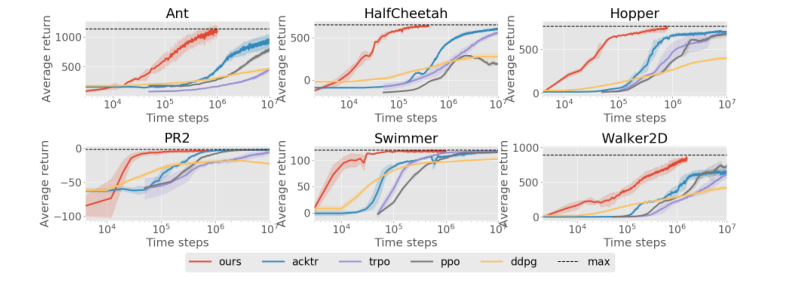
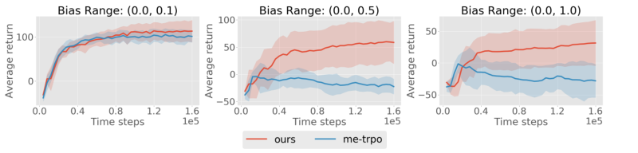
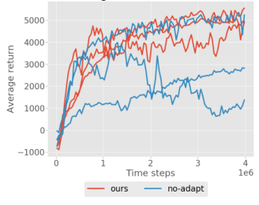

# 第 87 天｜MB-MPO：模型彼此不一致时，先学会适应，再决定怎样行动

[系列首页](README.md) · [上一篇](86-varibad.md) · [下一篇](88-planet.md)

**原论文与版本**：Ignasi Clavera、Jonas Rothfuss、John Schulman、Yasuhiro Fujita、Tamim Asfour、Pieter Abbeel，*Model-Based Reinforcement Learning via Meta-Policy Optimization*，CoRL 2018，PMLR 87:617–629。本文核读[正式论文及其内附附录](https://proceedings.mlr.press/v87/clavera18a/clavera18a.pdf)。这里的 M 是 Meta，不是后来的 MBPO；模型不确定性也不是已经校准的真实环境后验。

### 先接住前作的问题

[PETS](35-pets.md)让多个概率模型参与规划，避免只相信一个预测器；[MBPO](39-mbpo.md)用短模型 rollout 减少误差积累。MB-MPO 从另一个位置切入：如果多个模型对动力学有不同判断，为什么必须逼一个策略立即同时适合所有模型？可以先寻找一个初始化，让它在每个模型里做一步策略梯度之后都表现良好，再用真实交互修正模型。

这是一篇2018年的论文，早于2019年的 MBPO。这里按机制串读，不按编号推断年代，也不把“元学习”误解成在许多真实任务上预训练。它主要面对的是**同一真实环境的多个学得模型**。

## 一、问题设定：具体内容

考虑连续状态、连续动作的有限时域控制问题，真实转移未知，奖励函数可调用。每次真实交互产生 $(s,a,s')$，存入数据集 $D$。模型集成 $\{\hat f_{\phi_k}\}_{k=1}^K$ 根据状态和动作预测下一状态；策略 $\pi_\theta(a\mid s)$ 为高斯策略。目标仍是提高真实环境中的累计奖励，不是把模型预测误差单独降到最低。

论文默认同一组状态空间、动作空间、奖励和初始分布，给每个模型配出一个“想象 MDP”。不同任务之间只换动力学。训练是在线迭代的：获得真实数据、更新模型、在模型内优化策略，再回到真实环境收集数据。因此它不属于只允许固定数据集的离线 RL。理论背景允许一般转移分布，但实验用确定性神经网络预测状态增量，不能把它写成 PETS 那种概率输出模型。

原文主对比采用200步轨迹；另外有100步噪声模型实验及1000步长时域实验。它们的累计奖励不能跨设置直接比较。“真实数据”指相对于学得模型而言的 MuJoCo 环境数据，不表示论文已经在实体机器人上完成了同样实验。

### 五个前置概念

1. **模型偏差**：策略会主动寻找预测器的漏洞；验证集一步误差小，不保证被优化后的策略访问区仍准确。
2. **模型集成**：不同初始化和不同训练子集产生多组预测，可提供分歧信号，但共同犯错时也会一致。
3. **MAML式双层优化**：内层在某个任务上更新参数，外层优化“更新后的表现”，学习的是容易适应的起点。
4. **策略梯度**：从轨迹的动作对数概率与回报或优势估计方向，无须把真实动力学写成可微函数。
5. **适应前／适应后策略**：共享初始化 $\theta$ 与模型特定参数 $\theta'_k$ 是不同对象，采集、训练、评估时不能互换。

## 二、从预测模型走到适应后的收益目标

### 模型学习：训练目标没有直接要求梯度正确

模型预测 $\Delta s=s'-s$，再加回输入状态；本文统一记最终预测为 $\hat f_{\phi_k}(s,a)$。每个模型用采样子集 $D_k$ 最小化

$$L_{\mathrm{model},k}=\frac1{|D_k|}\sum_{(s,a,s')\in D_k}\|s'-\hat f_{\phi_k}(s,a)\|_2^2.$$

实际还采用输入输出归一化、weight normalization、验证集与早停，后续轮次从旧权重继续训练。不同模型看到的经验并不是来自多个独立真实世界，而是同一个累计数据池的不同划分。模型之间的方差可用于理解数据不足，却没有由此变成置信区间。

记模型 $k$ 下的有限时域收益为

$$J_k(\theta)=\mathbb E_{a_t\sim\pi_\theta,\ s_{t+1}=\hat f_{\phi_k}(s_t,a_t)}\left[\sum_{t=0}^{H-1}r(s_t,a_t)\right].$$

此处沿正文式(4)写未显式折扣的有限和；实验优势估计另使用 $\gamma=0.99$，不能把这两个层次悄悄混成同一严格定义。内层和外层为

$$\theta'_k=\theta+\alpha\nabla_\theta J_k(\theta),\qquad F(\theta)=\frac1K\sum_{k=1}^KJ_k(\theta'_k).$$

外层最大化 $F$，而非平均 $J_k(\theta)$。同一个初始化可以在不同模型中迈向不同方向，不必先把模型分歧平均掉。

### 链式法则为何改变优化方向

在光滑、精确梯度的教学形式下，固定本轮模型参数，有

$$\nabla_\theta F=\frac1K\sum_k\left(I+\alpha\nabla_\theta^2J_k(\theta)\right)^\top\nabla_{\theta'_k}J_k(\theta'_k).$$

外层既看适应后的收益梯度，也看内层更新对初始化的敏感度。丢掉 Hessian 项是一阶近似，不是原目标自然没有二阶信息。实际轨迹梯度还涉及采样分布，不能直接拿普通监督学习自动微分图就声称得到了无偏元策略梯度。

作者用 VPG 做内层，TRPO 做外层，并以线性 baseline、GAE 降低方差。这里的模型主要提供轨迹，并不要求对长串动力学预测反向传播到策略。因此“模型只在训练中提供样本”和“通过模型导数优化策略”应分开理解。

**符号核对**：正文式(3)明确最大化收益，但第5页 Algorithm 1 的外层伪代码印成减去收益梯度。本文按最大化目标解释；若实现采用最小化损失，必须先定义 $L=-F$，再做下降。不能同时使用正收益和梯度下降却宣称是在改善收益。TRPO 的实际约束求解也不是随意乘一个固定外层步长。

### 手算：适应能力如何重新分配模型权重

下面是可精确计算的教学二次问题，不是论文环境。令两个模型收益分别为

$$J_1(\theta)=-\tfrac12(\theta-1)^2,\qquad J_2(\theta)=-2(\theta+1)^2,\qquad\alpha=\tfrac14.$$

直接最大化平均收益，梯度为 $[-(\theta-1)-4(\theta+1)]/2$，最优点为 $\theta=-3/5$。它更接近第二个模型的峰值，因为第二个收益曲面曲率更大。

一步适应给出

$$\theta'_1=\tfrac34\theta+\tfrac14,\qquad\theta'_2=-1.$$

第二个模型无论从哪出发，一步都恰好到峰值；它不再要求初始化向自己倾斜。于是

$$F(\theta)=-\frac9{64}(\theta-1)^2,\qquad\theta^*_{\mathrm{meta}}=1.$$

在 $\theta=0$，普通平均收益梯度为 $-3/2$，元梯度为 $9/32$，两者方向相反。元最优点在模型1上无需改变，在模型2上一步从1到−1，适应后平均收益为0；直接平均收益最优点适应后平均收益为 $-9/25=-0.36$。

这不是“元学习总能两全”的证明，而是说明目标真的变了。如果真实系统更像第二个模型，而测试时完全不适应，$\theta=1$ 的真实表现可能很差。论文最后评估适应前策略仍较好是实验现象及训练正则化效果，不能仅由双层目标推导出一般保证。内层步长若太大，一步也可能越过峰值甚至发散。

## 三、一轮算法必须分清三种轨迹

按 §4.3 和 Algorithm 1，一轮包括以下环节：

1. 第一轮以均匀随机控制器采集真实数据；此后用各模型的**适应后策略**收集真实轨迹，并汇入累计数据。
2. 用真实转移重新训练各模型。真实数据不断扩张，模型并非只在开头拟合一次。
3. 在模型 $k$ 中用适应前策略采样内层轨迹 $T_k$，估计梯度并得到 $\theta'_k$。
4. 再在同一模型中用 $\pi_{\theta'_k}$ 采样外层轨迹 $T'_k$，用适应后表现更新共享初始化。
5. 多次元更新后重新收集真实数据；最后返回并评估**适应前策略**。

适应后策略去真实环境采集，可能暴露各自模型容易被利用的区域，为下一轮纠错提供数据。这个 tailored exploration 机制没有要求先在真实环境中再执行一次梯度更新。相反，主实验明确用 pre-update policy 报告回报。说“测试前必然在真实环境适应一步”或“真实采集始终用共享策略”都不符合本文流程。

附录 A.3 默认 $K=5$，内层步长0.001，外层 KL预算0.01，每轮30次元更新；每轮真实采集4000步，即20条200步轨迹，元优化使用100,000个想象转移。应把这项想象采样规模按附录原描述报告，不能在没有明确实现计数的情况下擅自乘出全训练总量。策略均值网络为两层32单元，模型容量随任务变化。

## 四、原始证据：样本少，计算也一定少吗

### 主对比看环境步数，不看横向图片宽度

<figure id="rl-87-figure-1" class="reading-evidence-figure"><figcaption>原论文图形摘引；Clavera等，2018，Figure 1，正式PMLR版PDF第6页，裁取完整图形、不含图注。<a href="https://proceedings.mlr.press/v87/clavera18a/clavera18a.pdf#page=6">原图与上下文</a>。原作者及出版方保留版权，供本段技术评论。</figcaption></figure>

原图1六个面板分别是 Ant、HalfCheetah、Hopper、PR2、Swimmer、Walker2D。横轴为环境时间步且是对数刻度，纵轴为各环境的平均累计奖励，任务之间尺度不同。灰黑虚线标出比较所用的最大表现水平，不是所有策略共享的理论最优值证明。

§6报告至少3个随机种子，主图轨迹长度200。正文概括运动任务达到同等表现所需真实样本减少10–100倍，在较复杂任务上接近两个数量级；不能把这个区间改写成每个任务都恰好快100倍，更不能称为墙钟100倍。图内阴影没有在这里核读到统一置信区间定义，本文不据阴影重叠与否判断统计显著性。

附录 A.4 在 AWS c4.4xlarge 上比较 HalfCheetah 达到最大表现的墙钟：MB-MPO约7小时，TRPO约5.5小时，样本量约减少70倍。直接相除，7/5.5约1.273，即该报告数字对应约27%的时间增加；原文另概括为约20%，这是近似口径，不能把两者当成精确相等。节约交互并不自动节约全部计算，训练多个动力学模型正是额外成本。

### 人工偏差与长时域消融分别回答不同问题

<figure id="rl-87-figure-4" class="reading-evidence-figure"><figcaption>原论文Figure 4，正式PMLR版PDF第8页。<a href="https://proceedings.mlr.press/v87/clavera18a/clavera18a.pdf#page=8">原图与上下文</a>。原作者保留版权，限量摘引作方法比较。</figcaption></figure>

原图4横轴是训练环境步，纵轴为平均回报，三个面板逐步扩大模型偏置采样区间。§6.4正文明确写预测噪声 $\mathcal N(b,0.1^2)$，每轮为各模型重采样 $b\sim U(0,b_{\max})$；图注缩写 $\mathcal N(b,0.1)$ 在方差／标准差上含糊，本文以正文为准。任务时域只有100步。较大偏置时 MB-MPO仍能取得正向运动回报，ME-TRPO出现明显退化；这只验证这组人为扰动，不是对任意模型错误的鲁棒保证。

<figure id="rl-87-figure-5" class="reading-evidence-figure"><figcaption>原论文Figure 5，正式PMLR版PDF第8页。<a href="https://proceedings.mlr.press/v87/clavera18a/clavera18a.pdf#page=8">原图与上下文</a>。原作者保留版权，供本段消融讨论。</figcaption></figure>

原图5换成1000步时域，红蓝细线是三个不同种子的训练轨迹，不是三条置信区间边界。蓝色无适应设置对应 $\alpha=0$，有种子停在较低回报或失去已学行为；红色适应版本整体更稳。它支持“在该设置中内层适应有用”，但不能剥离所有超参数、计算量与采样策略因素后宣称一般因果定律。

## 五、边界与继续阅读的路线

第一，模型集成可能共同偏离真实动力学。元学习只能针对训练时出现的差异学适应性，真实环境不在其覆盖范围内时，没有神奇纠偏能力。策略变化大的区域与模型分歧相关，属于论文在二维点环境中的经验分析，不是分歧大就一定安全探索的定理。

第二，已知奖励函数是关键便利条件。若奖励也要从图像或离线数据估计，会出现额外误差，不能直接援引本文实验效果。第三，探索模型漏洞在机器人上可能危险；本文没有硬约束安全控制器，不能把 tailored exploration 当作无风险机制。

第四，有限真实数据、有限模型容量、随机元梯度都使“最终模型准确后趋于最优”的直觉依赖强前提。论文没有给出整个神经系统的普遍全局收敛保证。计算和调参也是真实代价，不能只报交互步数。

- **模块组合**：[TRPO](14-trpo.md)负责外层受限更新，[GAE](15-gae.md)负责优势估计；两者不单独产生元适应目标。
- **平行方法**：[PETS](35-pets.md)用集成直接规划；MB-MPO用集成训练易适应的策略，部署接口不同。
- **平行方法**：[MBPO](39-mbpo.md)把短模型轨迹送入无模型优化器，不显式形成这里的双层适应目标。
- **教学连接**：[PlaNet](88-planet.md)继续问状态不可直接观测时，如何建立用于决策的潜变量模型，而不是把“世界模型”都等同于全状态预测。

### 三个继续追问

1. 内层步长设为零，为什么不是普通模型预测控制？

因为 $\alpha=0$ 让外层目标退成多个模型上的平均策略收益，仍然是在学习参数化策略，没有每个真实时间步重新搜索整串动作。模型预测控制是行动时规划的决策方式；是否存在内层元适应是策略训练目标的选择。两者属于不同维度，不能互相替代定义。

2. 模型只用于采样，为什么还需要担心模型偏差？

策略梯度虽然不经过动力学导数，但它使用的轨迹分布和奖励仍由模型生成。错误状态转移会使某些行为看起来收益很高，优化器仍会利用它。MB-MPO通过跨模型适应目标和真实数据回流减轻该问题，不会让模型误差失去影响；不反传模型只是避免另一类导数误差与长链梯度困难。

3. 为什么优化适应后的收益，主实验却评估适应前策略？

外层目标把“经过小幅改变可以做好”作为训练初始化的正则化要求，作者观察到它同时改善共享策略的真实表现。采集时的多个适应后策略又帮助纠正各自模型漏洞。但是双层目标没有逻辑上保证适应前收益必定提高，二次教学例子已经能构造反例。应同时核对实验评估对象与优化对象，不能替作者把测试流程改成额外真实适应。

**核读范围**：正式PDF §3–6、Algorithm 1、附录A.1–A.4及上述原图。本文没有逐行复现作者代码，也未重跑MuJoCo训练；数值教学例子独立复算，实验数值来自原文报告。

## 自测两题

**问题1**：二次例子在 $\theta=0$ 时，普通平均目标与元目标的梯度各是什么？为什么能相反？

**参考答案**：前者为 $-3/2$，后者为 $9/32$。模型2的曲率较大，普通目标被它拉向−1；一步适应却已能从任意初始化准确到达−1，所以元目标只需优先改善模型1的适应后误差。这里改变的是目标，不是同一梯度估计器产生了随机矛盾。

**问题2**：某复现只用适应前策略采集真实数据，再报告适应后的真实测试收益。它与原论文主协议相同吗？

**参考答案**：不同。原流程在初始随机采集之后用各模型适应后策略采集，主实验用适应前策略报告回报。交换两者会同时改变探索分布与评估对象，应作为另一个实验单独标记，不能用原文样本效率结论直接背书。

[系列首页](README.md) · [上一篇](86-varibad.md) · [下一篇](88-planet.md)
