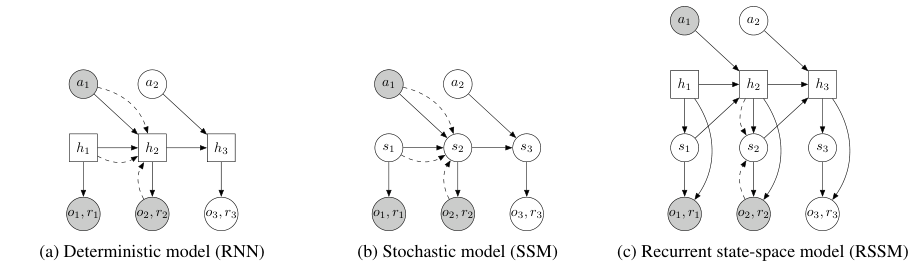
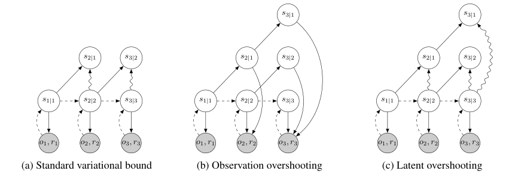
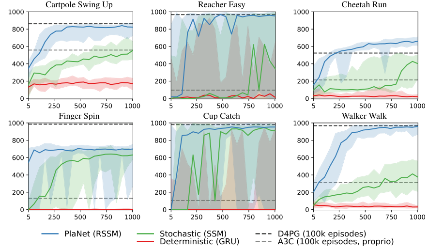

# 第 88 天｜PlaNet：不把未来画出来，也能从像素中规划动作

[系列首页](README.md) · [上一篇](87-mb-mpo.md) · [下一篇](89-td-mpc.md)

**原论文与版本**：Danijar Hafner、Timothy Lillicrap、Ian Fischer、Ruben Villegas、David Ha、Honglak Lee、James Davidson，*Learning Latent Dynamics for Planning from Pixels*，ICML 2019，PMLR 97:2555–2565。本文依据[正式正文](https://proceedings.mlr.press/v97/hafner19a/hafner19a.pdf)与[含附录的补充PDF](https://proceedings.mlr.press/v97/hafner19a/hafner19a-supp.pdf)。PlaNet同时研究RSSM和latent overshooting，但**最终RSSM智能体不使用latent overshooting**；不能把摘要中的两项贡献拼成最终系统的必选配置。

### 先接住前作的问题

[MB-MPO](87-mb-mpo.md)讨论多个全状态模型如何辅助策略学习。如果输入只是一幅图像，状态本身也需要推断：一张小车照片通常看不出速度，画面外的物体也可能仍然影响下一步。PlaNet先把历史压成潜在状态，再在潜在空间里反复模拟动作、预测奖励。它不训练独立的动作策略网络，也不使用价值网络给规划末端补值。

重点不是“能否生成漂亮视频”，而是“模型能否保留做决策所需的信息，并在没有新图像时预测多步奖励”。这也解释了为什么训练时需要图像解码器，规划时却不用它。

## 一、问题设定：具体内容

论文把任务写成POMDP：真实状态不可直接见到，智能体接收图像 $o_t$、奖励 $r_t$，输出连续动作 $a_t$。它必须根据历史 $o_{\le t},a_{<t}$ 推断当前状态信念，然后选择行动。真实环境数据不断增加，不是固定离线日志；初始随机探索之后，数据主要由当前规划器采集。

实验来自DeepMind Control Suite六项任务，输入均为64×64×3第三人称图像。既有需要记忆的小车摆起，也有稀疏奖励的到达与接球，以及接触动力学中的旋转、奔跑、行走。一个合理世界模型不必恢复真实物理坐标的唯一表示，但必须保留预测未来观测与奖励所需的信息。潜变量可辨识性、真正Markov性与模型精度并没有由网络名字自动保证。

规划优化有限时域的预测奖励和。动作重复 $R$ 次，重复区间内奖励相加、使用最后一次观测。于是“一个规划步”不等于一个物理仿真步，跨方法比较需说明动作重复、episode长度和计数单位。论文没有在主规划目标中另加Dreamer式末端价值。

### 五个前置概念

1. **信念状态**：给定历史后对当前隐状态的条件分布；用单帧编码替代历史，可能丢失速度和遮挡信息。
2. **先验与后验**：先验只依赖已有状态和动作，后验还能看当前图像；开放环预测时只能用先验继续走。
3. **RSSM**：确定性循环记忆 $h_t$ 与随机状态 $s_t$ 共同组成模型状态，而非两个互不相干的预测器。
4. **变分下界**：用重建似然和后验到先验的KL训练不可直接积分的潜变量模型。
5. **CEM与MPC**：CEM搜索动作序列，MPC只执行当前动作，收到新观测后再次规划。

## 二、RSSM怎样同时记住历史、保留多种未来

### 从一幅图像到可继续预测的状态

论文式(4)的核心为

$$h_t=f_\theta(h_{t-1},s_{t-1},a_{t-1}),\qquad s_t\sim p_\theta(s_t\mid h_t),$$

$$o_t\sim p_\theta(o_t\mid h_t,s_t),\qquad r_t\sim p_\theta(r_t\mid h_t,s_t).$$

看到当前图像时，使用编码器 $q_\phi(s_t\mid h_t,o_t)$ 替代先验来推断随机状态。$h_t$由上一时刻状态与动作递推，$s_t$则吸收当前观测中的新信息。未来图像不可见时，继续递推 $h$ 并从先验采样 $s$，因此规划不会“偷看”尚未发生的观测。

<figure id="rl-88-figure-2" class="reading-evidence-figure"><figcaption>原论文图形摘引；Hafner等，2019，Figure 2，正式正文PDF第4页。<a href="https://proceedings.mlr.press/v97/hafner19a/hafner19a.pdf#page=4">原图与上下文</a>。原作者保留版权，供结构分析。</figcaption></figure>

原图2中方框为确定性变量、圆圈为随机变量，实线是生成过程、虚线是推断路径；它没有数值横纵轴。右侧RSSM的上层记忆提供稳定的跨时刻信息通道，下层随机状态表达不确定未来。纯随机模型理论上也可能把某些方差压到零实现记忆，但实际优化未必找到这一解。纯确定性模型则容易把多种未来折成一个预测，使规划器利用不真实的平均情形。

一个容易忽略的细节是：观测信息要经过编码器采样才能进入后续状态，不能加一条当前图像直接通向解码重建的确定性捷径。否则训练可以靠复制图像降低重建误差，先验却未学会在没有图像时预测。结构上的约束服务于“可想象”，不只是压缩。

### 下界中的两股力分别训练什么

为突出原理，写 $q_t=q(s_t\mid h_t,o_t)$、$p_t=p(s_t\mid h_t)$。标准单步目标的负下界形式可概括为

$$\mathcal L=\sum_t\left[-\mathbb E_{q_t}\log p(o_t\mid h_t,s_t)-\mathbb E_{q_t}\log p(r_t\mid h_t,s_t)+D_{KL}(q_t\|p_t)\right].$$

省略的是对历史潜状态的期望；实际使用重参数化样本估计。观测项和奖励项要求状态有信息，KL要求只根据过去得到的先验能预测当前后验。训练生成模型时，后验不是外部给定的永恒真值，而是与模型共同学习的近似推断分布。

对角高斯情况下，一维KL为

$$D_{KL}(\mathcal N(\mu_q,\sigma_q^2)\|\mathcal N(\mu_p,\sigma_p^2))=\log\frac{\sigma_p}{\sigma_q}+\frac{\sigma_q^2+(\mu_q-\mu_p)^2}{2\sigma_p^2}-\frac12.$$

先验梯度会推动 $\mu_p$靠近后验均值，也调整预测方差；后验侧梯度则会抑制用过多不可预测信息编码当前图像。不能把KL只解释成“压后验接近零均值单位高斯”，因为这里先验本身是条件动力学网络。

补充PDF附录A给模型3个free nats：把总KL损失在3以下截为常数，即 $\max(3,D_{KL})$。它不是强迫KL至少为3，也不是允许每个维度各用3而后直接相加。在低于阈值的区域，**这个KL项**没有继续压缩的梯度；重建、奖励和其他时刻路径的梯度仍可存在。阈值边界的次梯度由实现选择，不能凭口述指定。

### 一个高斯手算同时检验KL和梯度解释

取 $q=\mathcal N(2,1)$、$p=\mathcal N(0,4)$，第二个参数写方差。则

$$D_{KL}=\log2+\frac{1+4}{8}-\frac12=\log2+\frac18\approx0.818147.$$

不裁剪时对先验均值的导数为 $(\mu_p-\mu_q)/\sigma_p^2=-1/2$，梯度下降会增大 $\mu_p$，朝后验均值移动。加free nats后本例KL项为3，局部导数为0。若误把free nats理解成“KL减3后仍保留负梯度”，便会得到不同训练行为。

再令后验均值变为6，其他量不变：KL为 $\log2+37/8-1/2=\log2+33/8\approx4.818147$，超过阈值，先验均值梯度恢复为−1.5。这里检验的是局部损失，不是在证明一个高KL状态更值得探索，更不代表模型误差的置信度。

## 三、潜在规划：用算力换动作搜索，而非重建未来视频

当前后验给出起点。CEM维护整段动作的时变对角高斯，循环执行“采样候选序列→用模型推进潜状态→累加预测奖励→留下精英→重新拟合均值方差”。完成若干轮后执行第一个动作的均值，下一次收到图像再更新状态并重新搜索。

附录A、B采用规划距离 $H=12$、10轮搜索、每轮1000条候选、100条精英。正文的索引 $a_{t:t+H}$含端点，阅读代码时应核对到底分配多少动作槽，本文不把记号强行改成恰好12个数组元素。作者每条动作序列只采样一条潜状态轨迹，把计算更多分配给候选动作的广度；这不是精确积分所有随机未来。

CEM通常按精英样本的均值与二阶中心矩拟合高斯。补充版Algorithm 2的离散排版中，标准差／方差的表达式存在不够清楚的符号，本文只使用高斯最大似然的一般定义解释机制，不声称逐字转录作者代码。选出精英动作之后，最终执行的是当前分布均值，也不是简单执行单条最高分轨迹。

教学例子中，两个动作位置的三条精英分别为 $(0,1),(1,1),(2,0)$。均值为 $(1,2/3)$，按最大似然分母3得到方差 $(2/3,2/9)$。规划器本轮执行首动作均值1；第二个动作 $2/3$只是当前预测，不是承诺。若下一帧揭示球的位置偏了，下一轮计划可以完全改变。

规划期间只运行潜状态转移和奖励头，不解码每个未来64×64画面。训练阶段的图像似然提供丰富监督，而行动阶段节约计算的原因是跳过图像生成，**不是删除图像训练目标**。每步重新初始化动作搜索为零均值、单位方差也是论文的具体选择，作者希望降低被旧局部最优困住的风险；不要把后继方法的warm start默认搬回这里。

## 四、latent overshooting提出了什么，最终又用了什么

单步训练经常在“上一时刻已经看到真实观测”的后验状态上预测下一步。规划却要连续使用自己预测的状态，误差分布会变。对有限模型，单步拟合最优未必也是多步预测最优，于是论文提出在潜在空间直接训练更远距离的一致性。

<figure id="rl-88-figure-3" class="reading-evidence-figure"><figcaption>原论文Figure 3，正式正文PDF第5页。<a href="https://proceedings.mlr.press/v97/hafner19a/hafner19a.pdf#page=5">原图与上下文</a>。原作者保留版权，供损失路径讨论。</figcaption></figure>

原图3的 $s_{i\mid j}$表示时刻 $i$、只见到截至 $j$ 的观测；波浪箭头是KL约束，指向观测的箭头是似然项。中间方案把每个多步预测都解码成图像，代价较大；右侧直接比较多步预测分布与已有观测得到的后验，不需要额外解码大量图片。

严格地说，正文式(6)–(7)包含对从较早后验出发、经过中间预测状态的**条件KL的期望**。它不应被无条件替换成“把所有路径先混成一个高斯，再算一次KL”；KL是非线性的，混合后的KL与条件KL平均一般不同。省略动作只是为了简化公式，未来预测仍以实际动作序列为条件。

对距离 $d>1$，作者停止后验目标分布的梯度，使多步先验追随较充分观察后的后验，而不让后验反过来迁就不准确的长预测。这个规则不等于标准一步KL也只训练先验，更不等于冻结所有编码器参数。要区分停梯度的具体路径、共享参数以及其他损失仍产生的更新。

“标准目标只训练一步随机转移”也有边界：先验参数会经单步KL更新，RSSM确定性递归路径仍可跨时间反传。原文指出的是不连续穿过多个随机先验采样的训练路径，不是说整个世界模型完全没有长期梯度。

最重要的实验结论在正文第5页及补充附录D：latent overshooting可明显帮助另一种DRNN模型，但对本文RSSM略降表现，所以最终PlaNet使用RSSM而不加该项。作者还把多步分布下界与原始单步数据似然关系的一部分表述为conjecture；不能把整段推广包装成已无条件证明、且必然改善控制的定理。

## 五、读原始实验：200倍样本效率不是六项都赢200倍

<figure id="rl-88-figure-4" class="reading-evidence-figure"><figcaption>原论文Figure 4，正式正文PDF第7页。<a href="https://proceedings.mlr.press/v97/hafner19a/hafner19a.pdf#page=7">原图与Table 1</a>。原作者保留版权，供实验口径比较。</figcaption></figure>

原图4横轴是已采集episode数，纵轴为测试回报。实线表示中位数，阴影为5个种子、10条测试轨迹统计中的第5至95百分位，不是均值±标准差，也不是“95%置信区间”。稀疏奖励任务的宽波动不能因为最后均值不错而忽略。D4PG参考线来自100,000 episodes图像训练，A3C参考线来自同预算本体状态训练，输入条件并不一致。

正文Table 1给出最终**均值**，与曲线中位数不同：

| 任务 | PlaNet，1000 episodes | D4PG，100,000 episodes |
|---|---:|---:|
| Cartpole Swing Up | 821 | 862 |
| Reacher Easy | 832 | 967 |
| Cheetah Run | 662 | 524 |
| Finger Spin | 700 | 985 |
| Cup Catch | 930 | 980 |
| Walker Walk | 951 | 968 |

Cheetah提升 $(662-524)/524\approx26.34\%$，是相对该D4PG成绩的提升，不是26个百分点成功率。Finger仍明显落后，其他任务也不能说最终均值全都超过D4PG。论文强调的是较少交互下达到强表现，结论不等于所有任务的最终性能统治。

表中“数据效率提升”按D4PG达到PlaNet最终水平所需episode估计，六项分别250、40、500+、300、100、90倍；不是简单用100,000除以1000得到统一100倍。Cheetah的500+还有比较范围含义，不能当成精确观测500.000倍。摘要约200倍是汇总说法，不应取代逐项口径。

用真实模拟器规划的对照在Cheetah为656，稍低于学得模型的662，提醒我们所谓“上界”只是有限CEM搜索预算下的经验参考，不是数学上所有学习方法都不能超过的界。论文报告单V100训练约10–20小时，随任务变化，本文没有独立验证硬件吞吐或复现实验。

## 六、边界、后继与三个追问

有限时域规划可能看不到更远奖励，延长搜索又增加算力和模型误差。像素重建容易花容量描述不影响控制的纹理；一条候选只采一条随机轨迹可能低估回报不确定性；模型中的随机性也不等于已校准的认知不确定性。即使MPC每步纠正，现实系统若反应延迟或误差不可逆，重新规划也不自动恢复安全。

- **直接继承**：[Dreamer](40-dreamer.md)沿RSSM世界模型训练想象中的actor-critic，以学习策略减少每个真实步的动作搜索。
- **平行方法**：[PETS](35-pets.md)使用可观测状态上的概率集成与规划，关注的表示与不确定性来源不同。
- **历史对照**：[DreamerV3](48-dreamerv3.md)的离散状态、KL平衡等细节不能倒写为2019年PlaNet原配置。
- **教学连接**：[TD-MPC](89-td-mpc.md)继续探索不重建观测、用任务相关潜空间和末端价值做规划。

1. 既然规划不用解码器，训练时删去图像重建会保持算法不变吗？

不会。原方法用图像似然塑造潜状态，让稀疏奖励之外也有训练信号。删除它就必须重新判断状态表征靠什么避免丢失必要信息，以及是否还能稳定学习动力学。任务导向表示可以是合理后继路线，但需要自己的损失和实验，不能把执行时不解码偷换成训练时从不重建。

2. free nats是否意味着先验不再学习？

只在某个样本的KL低于阈值时，该裁剪项局部不给梯度。其他样本的KL可能更大，模型还共享跨时间参数；奖励与重建路径也仍有作用。因此不能把局部平坦区解释为整个先验网络永久冻结。反过来，阈值以上KL仍会同时影响先验和后验，除非另外明确停止某条梯度路径。

3. 为什么一篇提出overshooting的论文，最终方法却不用它？

论文可以同时提出通用训练想法与一个表现更好的具体架构。实验显示不同架构从多步约束得到的收益不同，RSSM本身已解决部分长期记忆问题，新增正则反而略降控制表现。忠实阅读应保留这个负结果，而不是为了故事整齐把所有贡献都串成必需模块。

**核读范围**：正式正文§2–5、式(3)–(7)、Table 1；补充PDF附录A、B、D及相关梯度说明。没有审计整个代码库、复现训练或逐行证明附录全部推导。高斯KL、CEM均值方差与相对增益例子独立复算。

## 自测两题

**问题1**：$q=\mathcal N(2,1)$、$p=\mathcal N(0,4)$时KL是多少？使用3 free nats后这一项对先验均值的局部梯度是什么？

**参考答案**：KL为 $\log2+1/8\approx0.818147$；裁剪后的KL损失为3，局部梯度为0。不裁剪时对先验均值的导数为−0.5。这里说的是此项，不是所有损失对模型的总梯度。

**问题2**：某报告说“PlaNet靠overshooting在所有六个任务上比D4PG高26%，图中阴影为95%置信区间”。找出三处错误。

**参考答案**：最终RSSM智能体不用overshooting；约26%仅对应Cheetah的662对524相对增益；阴影为第5至95百分位而非95%置信区间。另需说明PlaNet与D4PG训练episode预算不同，并且表格均值和曲线中位数不是同一统计量。

[系列首页](README.md) · [上一篇](87-mb-mpo.md) · [下一篇](89-td-mpc.md)
