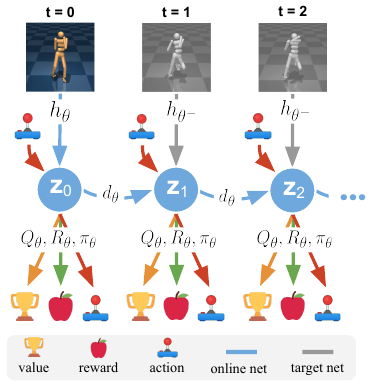

# 第 89 天｜TD-MPC：让短期规划接上长期价值，不必先学会重画世界

[系列首页](README.md) · [上一篇](88-planet.md) · [下一篇](90-td-mpc2.md)

**原论文与版本**：Nicklas Hansen、Xiaolong Wang、Hao Su，*Temporal Difference Learning for Model Predictive Control*，ICML 2022，PMLR 162。本文依据[正式会议PDF](https://proceedings.mlr.press/v162/hansen22a/hansen22a.pdf) §2–5、式(3)–(11)、Algorithms 1–2。讨论的是原始TD-MPC，不把后来的TD-MPC2架构和大规模多任务结果倒灌进来。

### 接住PlaNet的问题

[PlaNet](88-planet.md)让智能体在潜空间中预测并规划，避免每条候选轨迹都在真实环境试错。但如果目标只是让机器人向前走，模型真的需要准确预测每个像素和背景阴影吗？另一个问题是规划时域：搜索太短看不见长期目标，搜索太长既昂贵又积累模型误差。

TD-MPC把这两件事放在一起处理：用任务相关的潜在模型估计短期奖励，再用TD学习的价值函数补上规划窗口之外的收益。模型不以图像重建为训练目标；它必须保留的是对奖励、价值和后续潜状态预测有用的信息。这里“任务相关”是训练约束，不是已经证明找到最小充分状态。

## 一、问题设定：在线连续控制中的模型与价值协作

环境为折扣MDP，状态或图像观测可输入编码器，动作连续。训练过程中允许持续与环境交互、扩大回放缓冲区；每次真实决策都执行规划。因而它既不是固定数据上的离线RL，也不是训练好一个actor后部署时必然只调用actor。

论文把行动时的规划器写成 $\Pi_\theta$，把神经策略写成 $\pi_\theta$。这是阅读全文最重要的符号区别：后者是前者的候选轨迹来源和TD目标辅助，并不自动取代前者。

### 五个前置概念

1. **滚动时域MPC**：每次搜索动作序列，只执行第一个动作，收到新观测再规划。
2. **终端价值**：不是终止状态奖励，而是搜索窗口末端之后尚未展开的回报估计。
3. **TD自举**：当前价值目标由即时奖励加下一步估计组成。
4. **潜状态一致性**：预测潜状态应靠近下一真实观测的编码，不要求重建观测本身。
5. **目标网络**：慢速更新的预测目标，用于降低训练目标随在线网络急剧漂移的问题。

## 二、短期奖励与终端Q怎样拼接

TOLD模型包含五个模块：编码 $z_t=h_\theta(s_t)$，动力学 $z_{t+1}=d_\theta(z_t,a_t)$，奖励 $R_\theta(z_t,a_t)$，价值 $Q_\theta(z_t,a_t)$，策略 $\pi_\theta(z_t)$。对于一条候选序列，评分为

$$\Phi(a_{0:H})=\sum_{t=0}^{H-1}\gamma^t R_\theta(z_t,a_t)+\gamma^H Q_\theta(z_H,a_H).$$

这里展开了H个转移，终端项仍需要动作 $a_H$。若代码只采样H个动作，就应明确定义终端动作来自策略等规则；不能一面写终端Q，一面忘掉动作参数。末端Q已经包含 $a_H$ 的即时奖励，前面的奖励和必须止于 $H-1$，否则会重复计算一次。

如果模型和终端价值都准确，此式把完整回报分成前H步与剩余部分。现实中则在两种误差之间折中：H较小更依赖critic，H较大更依赖模型长程预测和搜索质量。把H加大并不保证性能单调提高。

### 一个可以手算的规划选择

构造 $H=2,\gamma=0.9$ 的教学例子，两个候选序列A、B在模型中的前两步奖励分别为 $(2,2)$ 与 $(1,1)$，终端Q分别为0和5。则

$$\Phi_A=2+0.9\times2+0.9^2\times0=3.8,$$
$$\Phi_B=1+0.9\times1+0.9^2\times5=5.95.$$

纯两步规划选A，接上终端价值后选B。如果B的真实终端价值其实只有1，其真实截断加尾项为2.71，反而输给A。终端估计高估4，恰好放大评分 $0.81\times4=3.24$。这说明短规划不是免费消除模型误差，而是把一部分预测责任交给critic；critic校准同样重要。

TD-MPC通过MPPI式加权采样改进序列分布。只为演示权重，令上述两条均为保留的elite，温度取1，将评分先减去最大值避免指数溢出。归一化权重为

$$w_A=\frac{e^{-2.15}}{1+e^{-2.15}}\approx0.1043,\qquad w_B\approx0.8957.$$

若它们首动作分别为−1和+1，新均值为0.7913，未加方差下限的标准差约0.6114。这是两样本的一轮更新，既不是完整算法超参数，也不是训练结果。实际还包含更多样本、重复优化、动作范围约束和探索方差下限。

## 三、模型为何不需要图像解码器

<figure class="reading-evidence-figure" id="rl-89-figure-2"><figcaption>Hansen等，ICML 2022正式版 Figure 2，PDF第4页，裁取完整图形。<a href="https://proceedings.mlr.press/v162/hansen22a/hansen22a.pdf#page=4">原图与上下文</a>。已核看原页及裁图像素；原作者保留版权，限量摘引用于技术评论，未另行核得图片授权。</figcaption></figure>

图中只有起始观测进入在线编码器，随后沿蓝色潜状态链递推。灰色编码器读取后续真实观测，给一致性项提供目标；不是让规划器在未来每一步偷取环境真实状态。图下奖杯、苹果、手柄分别表示价值、奖励、动作，不能把手柄图标误读成真实环境反馈。

采样真实序列后，训练目标沿模型递推状态计算。用 $\bar\theta$ 表示慢速目标参数，可把主干损失写成

$$L_i=c_r(R_\theta(z_i,a_i)-r_i)^2+c_q(Q_\theta(z_i,a_i)-y_i)^2+c_z\|d_\theta(z_i,a_i)-h_{\bar\theta}(s_{i+1})\|_2^2,$$
$$y_i=\operatorname{sg}[r_i+\gamma Q_{\bar\theta}(z_{i+1},\pi_\theta(z_{i+1}))],\qquad J=\sum_i\lambda^{i-t}L_i.$$

这按原文式(8)–(10)写出计算关系，并显式标记TD目标不作为当前回归目标的反传路径；终止掩码等实际实现细节还需核对代码。$\lambda$ 是序列损失时间权重，$\gamma$ 是回报折扣，不能互换。下一步潜状态来自模型滚动，目标编码来自真实下一观测，这两个来源也不能混用。

奖励误差和TD误差会经多步模型反向传播，促使潜状态保留任务相关特征。一致性约束补充监督：模型不能为了把某一步Q拟合好，就随意把潜空间下一状态放到完全不对应观测的区域。但一致性本身存在全部编码相同的退化解，奖励与价值信号才给表示提供任务区分压力。论文的组合不是对任意数据分布防止坍缩的数学定理。

策略独立优化

$$J_\pi=-\sum_i\lambda^{i-t}Q_\theta(z_i,\pi_\theta(\operatorname{sg}(z_i))).$$

该步骤只更新策略参数，不用这个损失修改critic或编码器。策略近似求最大Q，使TD目标不必每次都调用昂贵的规划器。它生成的轨迹也加入规划候选，若评分低可被淘汰，若评分高则影响新的采样分布。所以“有actor”与“最终决策仍用MPC”没有矛盾。

### 一步训练损失复算

设奖励预测1.2、真实奖励1；当前Q为3，下一目标Q为2；$\gamma=0.9$，则 $y=2.8$，奖励与价值平方误差均为0.04。若预测潜状态 $(0.3,0.4)$，目标编码 $(0,0)$，一致性平方误差是0.25。当三个系数均为1时，这一步主干损失为0.33。若它位于序列第二步、$\lambda=0.5$，对总损失贡献为0.165。该计算检验的是量纲和权重，真实训练中的三个系数不可据此默认全为1。

## 四、一次真实动作前后发生什么

1. 从当前观测编码潜状态，以上一步最优序列均值左移一格暖启动，重新设置较大的初始采样方差。
2. 采样模型轨迹，并加入策略引导轨迹；累计预测奖励和终端Q。
3. 保留高分候选，用回报指数权重更新均值与方差，重复若干轮。
4. 执行首动作，将真实观测转移写入回放缓冲区。新观测可以纠正上一轮模型的预测偏差。
5. 从缓冲区采样连续序列，更新TOLD与策略，并慢速更新目标网络。

原文§5的默认规划时域为5；一般任务用6轮优化，Dog为8轮、Humanoid为12轮；每轮512条采样轨迹，另加约5%的策略轨迹。这里是论文默认与任务例外，不代表所有实现版本完全相同。训练初期逐步增加规划时域，并把探索标准差从0.5退火到0.05，目的是在模型尚不准时避免过度长程规划。

## 五、怎样阅读实验与局限

论文在DMControl与Meta-World v2合计92个任务上评估，覆盖状态输入、图像输入等设置，不能把“92”理解为同一个策略同时掌握92个任务。图1的Humanoid与Dog曲线报告5次运行均值，阴影为95%置信区间；图中模型规划与真实模拟器规划的比较还受到有限搜索预算影响，不能解释为学得模型比真实物理更准确。

一个关键口径是environment steps与decision steps：前者计模拟步，后者计策略查询，动作重复会让二者不同。若只比较横轴数字而不检查action repeat，样本效率结论会失真。再者，神经策略前向一次与MPC评估数千条模型轨迹的推理成本不同；省交互不等于省全部计算。

潜表示依赖训练奖励，新目标可能需要原表示忽略的信息。图像输入也不意味着任意部分可观测问题已解决：本方法的确定性潜模型和具体输入构造不提供一般POMDP信念滤波保证。模型与critic还可能共同高估某条轨迹，搜索越努力，越可能利用这种漏洞。每步重规划只减少开环误差积累，不能保证模型外行为安全。

与PlaNet的区别可概括为训练信号与规划尾项的选择；与[SAC](30-sac.md)的区别是部署决策仍由模型规划参与；与[MBPO](39-mbpo.md)的区别是模型不只生成训练样本，而是直接参与每次动作搜索。三种方式并无“用了模型就一定更好”的统一排名。

### 三个继续追问

1. 不重建像素，会不会丢掉障碍物？

会有这个风险。如果障碍物影响未来奖励与可达性，理想训练应保留它；但数据未覆盖碰撞后果时，损失未必能教出这种关联。任务相关表示是一种归纳偏置，不是自动知道哪些细节重要。

2. 把规划时域设为零是否就是原论文的无模型基线？

目标形式只剩Q，并不自动复原某个完整基线。动作搜索方式、网络训练损失、数据分布和优化预算仍可能不同；应明确消融具体移除了什么，不能只凭公式退化给算法重新命名。

3. 为什么真实下一观测不直接替代预测潜状态用于所有训练步骤？

那会弱化模型多步滚动中误差传播的训练信号。原方案让后续奖励与价值损失经历预测链，训练模型承担实际规划时的递推任务；真实观测编码则保留作一致性目标。

## 自测两题

**问题1**：手算规划例子中B的终端Q至少多大才不输A？

**参考答案**：解 $1.9+0.81Q_B\ge3.8$，得到 $Q_B\ge1.9/0.81\approx2.3457$。该阈值假定两个序列的短期奖励与A的终端值保持不变。

**问题2**：为什么不能用策略损失直接把critic的参数也往更高Q的方向更新？

**参考答案**：策略应改变动作以获得更高的已学价值；若同时让critic随意抬高自身输出，目标可以通过虚增估值而改善，失去Bellman回归约束。原文明确策略目标只优化策略参数。

**核读范围**：正式PDF文本与图2实际像素；教学算例独立复算。未训练模型、未逐行审计代码、未复现论文墙钟结论。图像来自原论文而非AI重绘。

[系列首页](README.md) · [上一篇](88-planet.md) · [下一篇](90-td-mpc2.md)
