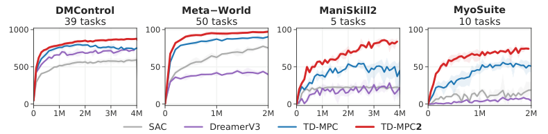

# 第 90 天｜TD-MPC2：让潜在世界模型既能规划，也能承受任务与规模变化

[系列首页](README.md) · [上一篇](89-td-mpc.md) · [下一篇](91-mopo.md)

**原论文与版本**：Nicklas Hansen、Hao Su、Xiaolong Wang，*TD-MPC2: Scalable, Robust World Models for Continuous Control*，ICLR 2024。本文核读 [arXiv:2310.16828v2，2024-03-21](https://arxiv.org/abs/2310.16828v2) 正文及附录 A、H。另对照作者仓库固定提交 `332f19e4aba4bffe2dc736f45ea7f7bdc585903a` 的两个函数文件，核对数值变换与策略损失；该代码提交晚于论文，不把新增行为当作2024年实验设置。

### 先接住前作的问题

[PlaNet](88-planet.md)在潜空间里规划，[Dreamer](40-dreamer.md)在想象轨迹中学习策略。TD-MPC 把短程模型预测和长程价值估计拼在一起：前几步用模型看，后面用 Q 补。TD-MPC2 延续这条路线，重点解决另一个现实问题：换一种奖励尺度、身体或任务，甚至只是把网络加大，训练能不能继续稳定？

它的贡献是一组彼此配合的设计，包括潜状态归一化、奖励／价值的离散回归、Q 集成、最大熵策略先验和多任务接口。不能把标题中的“2”理解为只把 TD-MPC 网络加宽，也不能把“世界模型”默认理解成能生成逼真视频的模型。

## 一、问题设定：控制需要的预测，不必等于观测重建

考虑连续动作 MDP。在线学习时，系统反复收集环境转移、放入 replay、更新模型，并用模型规划下一动作。多任务预训练则使用来自多个已训练单任务智能体的混合质量数据，包含奖励及任务身份；它不是从无标签互联网视频自动学出任务意义。

任务嵌入记为 $e$，状态潜表示记为 $z$。模型有五个组件：

$$z=h(s,e),\qquad z^+=d(z,a,e),\qquad\hat r=R(z,a,e),$$

$$\hat q=Q(z,a,e),\qquad a\sim p(\cdot\mid z,e).$$

$h$ 编码观测，$d$ 推进潜状态，$R$ 预测奖励，$Q$ 估计未来回报，$p$ 提供候选动作及 TD 目标动作。这里的 $p$ 是策略先验，不是环境转移概率，也不是唯一负责实际控制的策略。

### 五个前置概念

1. **隐式世界模型**：学习足够支持奖励、价值和控制的潜在动力学，不必解码未来观测。
2. **模型预测控制**：优化有限动作序列，先执行首个动作，然后根据新观测再规划。
3. **终端价值补偿**：用 Q 估计短规划视野以外的回报，不等于环境已经终止。
4. **离散回归**：把连续标量映射到若干数值区间上的软标签，再用交叉熵学习。
5. **尺度与稳定性**：表示范数、奖励幅度、动作维度和网络大小都会改变优化难度。

论文主要实验将任务视为固定回合长度的无限时域控制。时间截断与任务真终止不能随意混同。若实现扩展到有死亡、失败吸收态的任务，必须重新检查 TD 掩码，不能把有限数据片段末尾自动当作零未来回报。

## 二、训练一个不需要解码器的模型

### 多步潜状态一致性、奖励和价值共同约束表示

从 replay 抽取连续片段 $(s_t,a_t,r_t,s_{t+1})$。先编码片段起点，再沿真实记录的动作递归预测潜状态。训练损失的结构为

$$L_{\mathrm{model}}=\mathbb E\sum_{t=0}^{H-1}\lambda^t\left[
 c_z\|d(z_t,a_t)-\operatorname{sg}(h(s_{t+1}))\|^2
 +c_r\operatorname{CE}(\hat r_t,\mathcal B(r_t))
 +c_q\operatorname{CE}(\hat q_t,\mathcal B(y_t))\right].$$

这里为清楚省略 $e$；$z_{t+1}=d(z_t,a_t)$，$\operatorname{sg}$ 停止目标端梯度，$\mathcal B$ 是标量的分桶软编码，$c_z,c_r,c_q$ 为损失权重。本文把片段写成 $H$ 个转移，原文求和下标写法略有不同，机制不变。$\lambda$ 是远端训练项的权重，不是环境回报折扣 $\gamma$。

一致性项要求预测结果接近真实下一观测的编码，奖励和价值项则让这个编码对任务有用。不设解码器节省了重建纹理等细节的负担，但也意味着模型不能直接用来输出未来画面，或保证保留任意新任务所需的信息。

只看一致性项，所有状态变成同一个常量也可能使误差很小；奖励和价值监督、数据分布及优化设计一起防止这种无用解。停止梯度是训练构造的一部分，不能单独当作“绝无表示坍塌”的证明。

### TD 目标：五个 Q，不是每次都取五个最小值

基准配置使用五个 Q 网络，各自有指数移动平均目标网络。随机选两个目标 Q 后取较小值：

$$a'\sim p(\cdot\mid z'),\qquad
 y=r+\gamma\min_{j\in\mathcal I}\bar Q_j(z',a'),\quad|\mathcal I|=2.$$

这是论文固定时域、非吸收终止设定下的简化表达。不同模型规模的 Q 数量也可不同，但目标仍随机取两个。取最小值用于抑制过估计，不是精确后验置信下界；如果所有 Q 都共享同一种错误，集成仍可一起错。

目标中的 Q 要先解码为原始回报尺度，和 $r$ 相加后再编码为分类目标。若直接把对数空间预测值当原始奖励相加，就不再是在做同一个 Bellman 更新。目标参数与目标张量要停止梯度，避免网络通过修改监督端逃避误差。

## 三、三个使规模化更稳定的关键设计

### 1. SimNorm：分组 softmax，而非把潜变量离散化

把潜状态分成长度 $V$ 的小组，对每组做

$$\tilde z_{g,j}=\frac{\exp(z_{g,j}/\tau)}{\sum_{k=1}^{V}\exp(z_{g,k}/\tau)}.$$

每组分量非负、和为1；有限 logits 与正温度下通常严格为正，没有变成硬 one-hot。默认 $V=8,\tau=1$。这限制各组范数和数值尺度，同时保留可微的软表示；不能据此宣称整个神经网络所有梯度都有全局上界。

教学例子：一组只有两个 logits $(0,\log3)$，$\tau=1$ 时变成 $(1/4,3/4)$。若温度趋近0且最大值唯一，结果趋近 one-hot；温度趋向无穷则趋近均匀分布。**v2 附录 H 对温度极限的文字描述方向相反，本文按正文式(5)的 $z/\tau$ 与 softmax 的数学定义解释。** 实验固定温度1，所以这个文字问题不直接改变其所报实验设置。

### 2. 奖励和价值：对数压缩后做软分类

正文把奖励和价值预测改为对数变换空间中的离散回归。为展示具体运算，作者固定提交的 `common/math.py` 中使用

$$\operatorname{symlog}(x)=\operatorname{sign}(x)\log(1+|x|),\qquad
\operatorname{symexp}(u)=\operatorname{sign}(u)(e^{|u|}-1).$$

将变换后的目标夹到支持区间，再把它分配给邻近两个桶。例如变换目标1.25位于桶中心1和2之间，软标签为 $(0.75,0.25)$。若预测概率是 $(0.6,0.4)$，交叉熵为

$$-0.75\log0.6-0.25\log0.4\approx0.6122.$$

桶中心加权值为1.25时，逆变换得到 $e^{1.25}-1\approx2.4903$。解码是“先在变换空间求期望，再逆变换”，一般不等于“先对每个桶逆变换，再求期望”。这一顺序在非线性变换下不能交换。

这种参数化降低大幅奖励直接支配平方误差的风险，但支持区间有限、超界会截断，也有分辨率折中。分类输出用于稳定回归一个标量目标，不应自动解读成已精确学到完整的随机回报分布或可靠的不确定性估计。默认奖励／价值各101个桶。

### 3. 最大熵策略先验与 Q 尺度平衡

策略先验既为规划提供候选序列，也为 TD 目标提供下一动作。其设计意图是提高 Q，同时维持动作熵。以标准熵 $\mathcal H=-\mathbb E\log p$ 记，可写为最大化

$$J_p=\mathbb E\sum_t\lambda^t[\alpha\,Q(z_t,a_t)+\beta\,\mathcal H(p(\cdot\mid z_t))].$$

更新只作用于策略参数，不同时用这个目标修改整个世界模型。Q 项的权重根据移动分位数调整，使奖励尺度变化不至于迅速淹没熵项。附录 H 写明使用移动的5%与95%分位数。

**符号核对：** v2 正文式(4)在“最大化”描述下写了减去 $\beta\mathcal H$，却把 $\mathcal H$ 定义为熵，与“maximum entropy”意图不一致。本文采用增加标准熵的方向；核读的作者固定提交 `tdmpc2.py` 第226行也是最小化“Q 加熵”的负值。它支持符号解释，但代码日期晚于论文，不能当成原始实验二进制的复现证明。

## 四、规划怎样把短模型与长价值拼起来

设当前潜状态 $z_0=h(s_0)$，候选动作序列经模型展开。用统一的相对时间下标写候选得分：

$$G=\sum_{t=0}^{H-1}\gamma^t\hat r(z_t,a_t)+\gamma^H Q(z_H,a_H).$$

终端 Q 不是“最后一个奖励再算一次”。前面累计到 $H-1$，Q 从状态 $z_H$ 和动作 $a_H$ 开始评价后续，时间区间正好衔接。若模型和 Q 都准确，这接近长期回报；实际两者都有误差，仍然没有全局最优保证。

MPPI 风格规划维护每个时间位置的高斯均值与方差，采样多组动作序列、模拟评分，再偏向高分候选更新分布。部分候选来自策略先验；下一环境步把上一计划向前移一格做 warm start。最终只执行第一个动作，重新编码真实观测后再次规划，因此模型误差不会在真实控制中无限开环累积。

### 手算：短期吃亏的计划为何可能胜出

下面是教学数字，取 $H=2,\gamma=0.9$。计划A前两步奖励为3、3，终端价值0；计划B前两步为1、1，终端价值8：

$$G_A=3+0.9\cdot3+0.9^2\cdot0=5.7,$$

$$G_B=1+0.9\cdot1+0.9^2\cdot8=8.38.$$

纯两步奖励会选A，加入尾部价值则选B。但如果B的终端 Q 从8高估而真实只有2，其真实对应值为 $1+0.9+0.81\cdot2=3.52$，反而不如A。Q 补长视野同时也引入另一种误差来源，不能理解成加上 Q 就自动解决所有规划短视。

附录表8默认规划长度3、候选512、精英64、策略先验候选24、规划迭代6；动作维度至少20时再加2次。短视野不等于只关心三步，因为尾部 Q 仍估计远期。但若长程稀疏奖励从未被探索到，Q 同样没有信息，短规划也不会凭空发现它。

## 五、一个模型面对不同身体，接口要怎样统一

多任务模型将 $e$ 输入全部五个组件；任务嵌入联合训练，范数限制不超过1。它是训练任务身份对应的学习表示，不是 PEARL 那样从少量未知任务经验推断出来的后验。新任务微调可随机初始化嵌入，或从相近任务嵌入开始。

观测和动作补零到共同尺寸，动作无效维度必须 mask。这个 mask 不只用于最终发给环境的向量，还要用于策略采样、熵计算、价值目标与规划。否则一个只有两个有效动作维度的任务，可以通过另外一堆无效维度制造高熵，却完全不增加真实探索。

“一组超参数”也有准确含义。作者尽量使用统一配方，但折扣与初始随机采集步数按回合长度启发式设定，规划迭代按动作维度调整，多任务训练批次由256增至1024。它不是所有任务所有数值绝对相同。附录定义

$$\gamma=\operatorname{clip}(1-5/T,0.95,0.995),\qquad S=\max(5T,1000),$$

其中 $T$ 是动作重复之后的预期回合长度。例如 $T=500$ 得 $\gamma=0.99,S=2500$。启发式减少人工逐任务调参，但仍需对环境时间尺度作正确设定。

## 六、原始证据：104个单任务与80任务模型是两组实验

<figure class="reading-evidence-figure" id="rl-90-figure-4"><figcaption>Hansen等，ICLR 2024，arXiv:2310.16828v2，Figure 4，PDF第5页；保留四面板、任务数、轴及图例，未改曲线。<a href="https://arxiv.org/pdf/2310.16828v2#page=5">原图上下文</a>。来源版本标注CC BY 4.0，版权归原作者；本图注明来源并仅作裁剪。</figcaption></figure>

图4汇总104个连续控制任务：DMControl 39、Meta-World 50、ManiSkill2 5、MyoSuite 10。横轴是环境步数，DMControl 纵轴是回合回报，其他三个是成功率，不能直接把四个纵轴数值平均。图注说明为三个种子的均值与95%置信区间。红色 TD-MPC2 在这些汇总中优于基线，但汇总结果不等于每一个具体任务、每一时刻都占优。

这些是分别训练单任务模型的实验，默认约5M参数，不能写成“同一个5M智能体同时掌握104项任务”。论文另有视觉观测实验，也不能把状态输入主结果说成全部来自像素。

大规模多任务实验使用80项任务，来自50项 Meta-World 与30项 DMControl。训练数据为240个单任务 TD-MPC2 智能体回放组成的545M转移，含从随机到专家的行为。最大317M参数模型的归一化分数为70.6；表1给出在单张RTX3090上的约33 GPU天训练成本。这是模型预训练成本描述，不包括先前收集全部数据的完整代价。

作者观察模型规模增加时能力改善，但明确没有提出严格 scaling law。任务嵌入的 t-SNE 聚类是可视化证据，不是证明发现了唯一正确的任务语义。少样本迁移另用19M模型在70任务上预训练，对10个留出任务各在线微调20k环境步；不能把它改写成未知任务零样本解决。

与 SAC、DreamerV3、TD-MPC 的比较还涉及网络大小、更新次数和规划计算差异。环境步数更少不自动等于GPU时间更少。实际部署还应测每动作延迟、规划批量与硬件，本文没有把论文的数据效率曲线转写成未测量的实时性能承诺。

## 七、方法关系与适用边界

相较原始 TD-MPC，TD-MPC2 保留短程潜空间规划加终端 Q 的骨架，主要提升数值鲁棒性与多任务扩展。与 DreamerV3 相比，它不训练观测解码器，并在行动时做局部规划；两者都使用世界模型，却把训练目标和测试时计算分配在不同位置。

它也不是“训练数据混杂，所以自动属于保守离线 RL”。大规模模型确实从固定的多任务数据训练，但普通离线数据分布外动作的过估计风险仍在。论文附录另讨论测试时离线正则化，不能把主算法直接当作对任意固定数据安全的解决方案。

表示越偏向已有任务价值，越可能忽略未来新任务才重要的细节；Q错误和动力学错误也会被规划器主动利用。奖励失配、分布外状态和身体变化都可能造成失败。原文风险讨论明确说真实物理系统仍需额外安全检查，模型规模不是安全认证。

## 八、三个追问

**问1：没有解码器，还能叫世界模型吗？**

答：可以。它预测潜状态及控制后果，是用于决策的动力学模型；只是不能据此声称能生成或准确重建所有观测。“模型是否有用”在这里主要看控制效果，而非图像重建质量。

**问2：已有策略先验，为何还要规划？**

答：先验给出快速候选，规划利用当前状态、奖励模型和价值估计进一步选择动作。直接只执行先验是另一个计算／性能取舍，论文专门比较了规划贡献；不能把带规划的结果算给纯策略前向推理。

**问3：SimNorm 是否已经消除了训练不稳定？**

答：没有。它限制潜表示的尺度并在消融中有帮助，但 Q目标、任务数据、优化器、奖励表示也影响稳定性。即使潜状态每组和为1，后续权重和价值预测仍可能错误或发散。

## 九、两道自测（含答案）

**自测1。** SimNorm 的一组 logits 为 $(0,0)$。温度从1降到0.1，输出会不会变成 $(1,0)$？

**答案：** 不会，两个值始终相等，softmax仍为 $(0.5,0.5)$。“低温趋向 one-hot”需要唯一最大值；并列最大值的极限在最大项间均分。实际默认组长8，但原理相同。

**自测2。** 数据集里某任务只有2个有效动作维度，却补零到8维。如果只在环境执行前截断额外6维，训练是否已经正确？

**答案：** 没有。策略可能在无效维度获取虚假的熵收益，价值输入与规划采样也可能利用这些维度。应在相关训练目标、动作采样和规划中一致 mask，而不是只改最后的输出长度。

## 参考与核读边界

- [论文v2](https://arxiv.org/pdf/2310.16828v2)：§3–5、图4、图7–8、表1、附录 A 与 H、表8–9。摘引图4已检查源页和最终裁剪像素。
- [固定提交的数值函数](https://github.com/nicklashansen/tdmpc2/blob/332f19e4aba4bffe2dc736f45ea7f7bdc585903a/tdmpc2/common/math.py#L42-L83)：核对 symlog、two-hot、逆变换顺序。
- [固定提交的策略更新](https://github.com/nicklashansen/tdmpc2/blob/332f19e4aba4bffe2dc736f45ea7f7bdc585903a/tdmpc2/tdmpc2.py#L219-L229)：核对最大熵损失符号。这是2026-10-20提交，不是论文原始代码版本，也未作完整仓库审计。
- 所有小规模数值例子为本文教学计算。未训练模型、未验证全部任务、未实测GPU延迟；不把代码后续终止处理等新增功能混入v2实验描述。

[系列首页](README.md) · [上一篇](89-td-mpc.md) · [下一篇](91-mopo.md)
