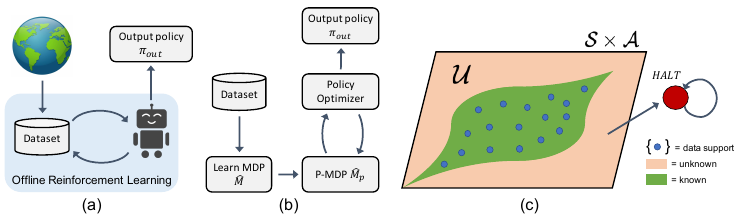

# 第 92 天｜MOReL：模型不认识的地方，先在想象中按下停止键

[系列首页](README.md) · [上一篇](91-mopo.md) · [下一篇](93-edac.md)

**原论文与版本**：Rahul Kidambi、Aravind Rajeswaran、Praneeth Netrapalli、Thorsten Joachims，*MOReL: Model-Based Offline Reinforcement Learning*，初版工作发表于NeurIPS 2020。本文核读 [arXiv:2005.05951v3，2021-03-02](https://arxiv.org/pdf/2005.05951v3)。这版明确扩展了会议结果，加入D4RL实验并扩大Lemma 3范围；不要把扩展版的所有结果都称为2020会议原版结果。

### 从扣分到改造想象环境

[MOPO](91-mopo.md)给不可靠模型转移扣奖励，仍允许策略在想象中继续走下去。MOReL采用另一种处理：把状态动作分成“可认为模型准确”与“尚不能保证”两类；一旦尝试未知转移，就在学得环境里进入低回报吸收状态HALT。

这个停止键首先是一种**训练模型构造**。它不是已经安装在真实机器人上的急停装置，也不能根据离线理论就宣称部署时一定不会进入危险区。其作用是让优化器在模型里看到：通向不可靠区域的道路可能很糟，从而倾向于在已知区域寻找更好的行为。

## 一、问题设定：在不完整覆盖下学习悲观MDP

输入为固定历史轨迹，包含状态、动作、奖励与下一状态。训练策略时不能收集新环境经验来纠正模型。学习动力学 $\hat P$ 与初始分布 $\hat\rho_0$，再构造悲观MDP $\hat M_p$，最后在其中优化策略。理论允许抽象规划oracle，具体实验采用模型驱动的自然策略梯度；不要把MOReL等同于必须使用某一种critic或MPC搜索器。

数据支持集与已知区域并不一样。若模型能借助平滑性或其他结构准确泛化，一个从未逐点出现的状态动作也可以属于已知区域。反之，一个有少量观测的点未必足够确定。判断核心是**能否保证模型精度**，而不是有没有精确匹配的数据行。

### 五个前置概念

1. **未知状态动作检测器USAD**：判断当前模型在一个查询处是否有足够可靠的误差控制。
2. **吸收状态**：进入之后永久留在其中；其价值取决于后续每步奖励。
3. **悲观MDP**：对无法可靠评估的行为赋予较差前景，降低利用模型漏洞的诱因。
4. **首次到达时间**：策略第一次触及未知区域的时间，永不触及记作无穷。
5. **覆盖缺口**：最优行为需要的区域没有足够数据或可证明泛化，任何离线方法都可能受它限制。

## 二、从USAD到HALT：定义必须精确

理论上的 $\alpha$-USAD在能够保证

$$D_{\rm TV}(\hat P(\cdot\mid s,a),P(\cdot\mid s,a))\le\alpha$$

时输出“已知”，否则输出“未知”。未知不等于已经证明模型错了，它也包括模型可能正确但缺少保证的情况。这里使用通常半L1形式的总变差约定，与其他论文比较时应先核对常数定义。

加入新状态HALT，已知处按 $\hat P$ 转移，未知处强制转移到HALT，HALT自身保持吸收。v3 Definition 2显示的奖励分段式是：在HALT给 $-\kappa$，其他状态给 $r(s,a)$。因此按**显示公式**，在未知 $(s,a)$ 当步先得原奖励，再从下一步起持续承受负奖励。

**原文存在表述差异**：紧随公式的文字却说“未知状态动作奖励为 $-\kappa$”。这与上述分段条件并非完全一致。本文后面的手算明确采用显示公式，不悄悄把当步负奖、下一步负奖和单次终止惩罚混为一谈。复现需要核对具体实现的时序与惩罚大小；若改成进入未知立即终止并给一次负奖，必须重新对齐该负奖与吸收尾项，才可能等价。

按持续每步负奖的定义，HALT价值为

$$V(\mathrm{HALT})=-\kappa+\gamma V(\mathrm{HALT})=-\frac{\kappa}{1-\gamma}.$$

一个未知动作在显示公式下价值为

$$Q_p(s,a)=r(s,a)-\frac{\gamma\kappa}{1-\gamma}.$$

可见只要把done设成true、然后奖励保持零，就完全不是同一种悲观程度。折扣越接近1，吸收负奖励尾项越大，任何代码中的奖励缩放与终止处理都必须统一。

## 三、手算：一次错误的“停止”会差多少

这是本文构造的教学MDP，$\gamma=0.9,\kappa=1$。在起点有两个动作：A进入一个已知自环，每步奖励0.2，且起点这一动作也奖励0.2；B是未知动作，当步奖励1。

按上述定义，A总价值为 $0.2/(1-0.9)=2$。HALT价值为−10，所以B价值为 $1+0.9\times(-10)=-8$，选择A。若实现把B解释为“当步扣1后终止”，其价值可能被写成−1；若还保留原奖励再扣1，则成0；若当步只保留原奖励再终止，则为1。它们恰好仍小于A，但回报目标已经不一致，换一组奖励就可能改变策略。

再构造一个单独的教学变体，不沿用下节定理的 $R_{\max}=1$ 奖励界：已知动作C当步奖励3，下一状态 $s_1$ 只剩一个未知动作，其当步奖励也是1。则 $V_p(s_1)=-8$，$Q_p(s_0,C)=3+0.9\times(-8)=-4.2$。悲观性通过Bellman回传，在**进入未知区之前**就能影响选择，而不只是局部给检测到的动作贴标签。

如果把C的第一步奖励改成10，价值变为2.8，就会超过A的2。C的两种奖励设置都超出了若 $R_{\max}=\kappa=1$ 时的理论奖励界，因此不能拿它反驳对应定理；它提醒我们惩罚规模必须与奖励范围匹配。工程上只调阈值而忽略奖励缩放，可能使所谓悲观模型仍鼓励冒险。

## 四、性能界真正告诉了我们什么

令 $U$ 为未知状态动作集合，$T_U^\pi$ 为真实MDP中策略首次访问U的时间，约定 $\gamma^\infty=0$。v3 Theorem 1在 $|r|\le R_{\max}$、$\kappa=R_{\max}$ 等条件下，把性能偏差分解为

$$A=\frac{2R_{\max}}{1-\gamma}D_{\rm TV}(\rho_0,\hat\rho_0),\qquad B=\frac{2\gamma R_{\max}}{(1-\gamma)^2}\alpha,$$

并给出

$$J_{\hat\rho_0}(\pi,\hat M_p)\le J_{\rho_0}(\pi,M)+A+B,$$
$$J_{\hat\rho_0}(\pi,\hat M_p)\ge J_{\rho_0}(\pi,M)-A-B-\frac{2R_{\max}}{1-\gamma}\mathbb E[\gamma^{T_U^\pi}].$$

第一条说明悲观模型至多在受控误差内高估真实性能；它不是无条件严格下界。第二条说明它也可能过于保守，代价与触及未知区有关。已知模型误差、初始分布误差、未知区覆盖，这三项要分开；只训练一个很准的一步预测器并不能让后两项自动消失。

如果规划误差为 $\varepsilon_\pi$，Corollary 2给出的最优策略差距还包括

$$J(\pi^*,M)-J(\pi_{\rm out},M)\le\varepsilon_\pi+2A+2B+\frac{2R_{\max}}{1-\gamma}\mathbb E[\gamma^{T_U^{\pi^*}}].$$

注意最后一项用**真实最优策略**的首次到达时间，不是只看输出策略是否谨慎。输出策略永不离开已知区，也可能因为最优收益恰在未知区而离最优很远。没有覆盖或可验证泛化的信息，离线学习无法保证恢复那里隐藏的高收益行为。

例如同样以概率0.2触及未知区，若发生在第0步，折扣命中量为0.2；若确定在第10步才可能触及，则为 $0.2\times0.9^{10}\approx0.0697$。首次到达时间把“多久以后才需要冒险”放进分析，比只记录是否覆盖更细。但这仍是理论误差项，不是实际机器人事故概率的校准输出。

论文还给出有限样本改进与近似minimax最优分析，依赖独立轨迹、最小非零概率等条件。不能把它简化成“任意神经网络MOReL在任意日志上都保证优于行为策略”，更不能忽略USAD本身的保证如何获得。

## 五、实际检测器靠什么，图又说明什么

<figure class="reading-evidence-figure" id="rl-92-figure-1"><figcaption>Kidambi等，arXiv:2005.05951v3，Figure 1，PDF第2页；原页与裁图均已实际核看。<a href="https://arxiv.org/pdf/2005.05951v3#page=2">原图与上下文</a>。原作者保留版权，限量摘引用于算法评论，未核得独立开放图片许可。</figcaption></figure>

图中蓝点是数据支持，绿色已知区并不只包含蓝点，所以“数据外一律HALT”不是原意。右侧红色HALT带自环，正对应持续低回报的吸收状态。左侧离线循环表示从已有数据学习策略，不应误读成训练时机器人不断采新环境样本。

实际§4.2用不同初始化与小批次训练顺序的模型集成，计算

$$\operatorname{disc}(s,a)=\max_{i,j}\|f_i(s,a)-f_j(s,a)\|_2,$$

超过阈值则判未知。这是模型均值之间的最大欧氏距离，区别于MOPO的输出尺度惩罚。动力学预测归一化后的状态增量，再还原到状态；各维尺度是否处理妥当，会影响距离与阈值含义。论文实验使用4个模型，并以模型驱动自然策略梯度优化策略。

小分歧不证明小误差：模型可能共享错误归纳偏置。大分歧也未必证明当前动作危险：可能只是数据不足或某些无关坐标预测不一致。因此实际USAD是理论组件的启发式近似。阈值低会收缩已知区，阈值高允许更多模型利用；训练数据上的分歧统计也不自动提供数据外的置信保证。

## 六、实验结果如何不过度解读

v3主实验§5使用Hopper、HalfCheetah、Ant、Walker四类MuJoCo环境和五种数据收集策略，共20组配置；数据包括部分训练策略及其噪声混合。表1报告MOReL五种随机种子的均值与标准差，基线来自既有工作，没有完整对应误差棒。作者按均值称12/20组达到最佳，不能把这句话转换成12组均有统计显著优势。

可核对的一行是Ant-v2 Pure：MOReL为3663±247，表中best baseline为2839。这里是原始任务回报，不是D4RL归一化分数；v3新增D4RL另见表2，不能跨表把数值相减。数据中的行为策略回报与最终策略回报也要区分，本文不由一行数字推断所有噪声级别同样获益。

更重要的实验边界来自附录C.2：作者用真实环境rollout设置超参数并跟踪学习曲线，这些rollout不用于其他训练步骤。因而“没有新真实转移进入模型与策略训练”与“完全不用环境反馈进行选择”不是同一句话。面向真实离线部署时，后者往往才是额外难题，需要离线评估、保守选择或预先固定协议。

MOReL展示了把模型学习、未知检测、规划解耦的价值；任何一环改进都可能改善结果，也任何一环失准都可能破坏承诺。它没有把识别未知这件难事消除，而是把难点变成一个明确可审计的接口。

### 三个继续追问

1. 模型分歧为零，为什么仍可能全部错？

所有模型可能采用相同架构、相似数据和同一种外推偏置。集成只观察成员相互不同，不直接观察成员与真实动力学的距离。应区分“意见一致”与“证据充分”。

2. 可以不用自然策略梯度吗？

可以，框架层面把规划器视为模块，只要求优化悲观MDP到相应精度。替换优化器后需重新测量优化误差与训练稳定性，不能自动继承原实验数值。

3. HALT是否等于真实系统急停？

不是。它是训练时人为添加的状态。真实部署中的急停需要真实传感、控制权限、时延和安全工程验证；论文模型里惩罚一个动作不等于现实里能及时阻止它。

## 自测两题

**问题1**：$\gamma=0.9,\kappa=1$ 时，若按显示公式保留未知动作即时奖励0.5，再进入HALT，价值多少？

**参考答案**：HALT价值−10，未知动作价值 $0.5+0.9(-10)=-8.5$。若只记一次−1终止，则不是同一个目标。

**问题2**：输出策略从不碰未知区，是否说明它接近真实最优？

**参考答案**：不一定。最优策略可能必须经过未知区才能获得高回报。性能差距中的覆盖项涉及最优策略的未知区命中时间；谨慎只是避免某些错误，不是保证没有错失收益。

**核读范围**：v3 §4–5、Definitions 1–3、Theorem 1、Corollary 2、表1及附录C.2，Figure 1原页和裁图像素。未重跑实验或逐行审计代码；原文奖励时序的公式／文字差异已明示。下一篇 [EDAC](93-edac.md)回到无模型路线，研究价值集成如何获得更有用的分歧。

[系列首页](README.md) · [上一篇](91-mopo.md) · [下一篇](93-edac.md)
