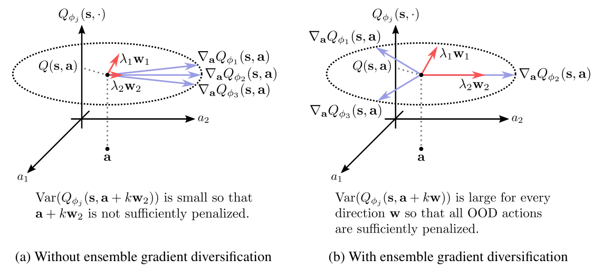
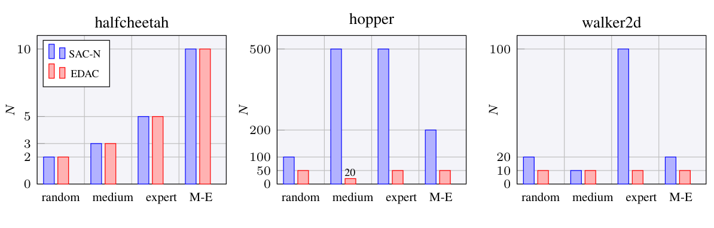

# 第 93 天｜EDAC：让价值网络的动作梯度分开，集成才不只是重复投票

[系列首页](README.md) · [上一篇](92-morel.md) · [下一篇](94-cal-ql.md)

**原论文与版本**：Gaon An、Seungyong Moon、Jang-Hyun Kim、Hyun Oh Song，*Uncertainty-Based Offline Reinforcement Learning with Diversified Q-Ensemble*。首次公开于2021-10-04，arXiv v2为2021-10-05，发表于NeurIPS 2021。本文核读[会议主文](https://proceedings.neurips.cc/paper/2021/file/3d3d286a8d153a4a58156d0e02d8570c-Paper.pdf)第3—9页及[补充材料](https://proceedings.neurips.cc/paper/2021/file/3d3d286a8d153a4a58156d0e02d8570c-Supplemental.pdf)A—D节；日期由[arXiv记录](https://arxiv.org/abs/2110.01548)核对。下文没有独立训练复现。

### 先接住前作的问题

[MOPO](91-mopo.md)与[MOReL](92-morel.md)都要防止策略利用学错的动力学，但一个修改模型奖励，一个构造悲观模型。EDAC回到无模型路线：不预测下一状态，只训练一组价值网络，再用其中最小值评价动作。它与前两篇是处理离线分布偏移的平行方案，不是把它们的理论保证移植过来。

问题是，二十位评审如果看的是同一套材料、沿着同一方向犯错，二十票并不意味着二十份独立证据。EDAC的重点不是“多训练几个critic”，而是数据附近的动作变化能否让不同critic产生真正不同的反应。这个局部几何问题，解释了为何简单集成有时需要五百个网络，也解释了为什么集成分歧仍然不等于经过校准的认知不确定性。

### 五个前置概念

- **行为动作**：来自数据收集过程的动作，与当前策略采样的动作未必相同。
- **外推误差**：网络在缺少数据约束的状态动作处给出错误价值。
- **集成分歧**：多个模型在同一输入上的预测差异，不等于真实估计误差。
- **认知不确定性**：知识不足引起的不确定性，不同于回报本身的随机性。
- **动作梯度**：固定状态后价值对动作的局部敏感度，不是对网络参数的梯度。

## 一、问题设定：固定数据下的集成悲观估计

离线数据集D包含状态s、动作a、奖励r、下一状态s′与终止信息。训练时不能通过新交互纠正错误动作；测试时才执行学到的策略。本文主要讨论连续动作，critic和策略均由神经网络表示。这个设定保留了[SAC](30-sac.md)的随机策略与熵正则，但取消训练中的环境采样。

普通Bellman更新只在数据动作上拟合目标，可是目标中的下一动作由当前策略采样。策略一旦找到未见动作的虚高值，就会把这个值传播到数据动作，继而进一步追逐它。在线学习可以尝试后纠错，离线学习没有这条通道。因此只降低训练误差并不保证策略可靠。

令N个critic为Qᵢ，目标网络为Q̄ᵢ，β是熵温度，d是环境真正终止标记。SAC-N使用共享目标

$$y=r+\gamma(1-d)\left[\min_{j=1,\ldots,N}\bar Q_j(s',a')-\beta\log\pi_\theta(a'|s')\right],\quad a'\sim\pi_\theta(\cdot|s').$$

每个critic拟合E_D[(Qᵢ−y)²]，策略最大化

$$J_\pi=\mathbb E_{s\sim D,a\sim\pi_\theta}[\min_jQ_j(s,a)-\beta\log\pi_\theta(a|s)].$$

最低值既进入目标，也进入actor。只修改目标、却让actor追逐所有头的平均高估，不是论文式(2)的SAC-N。多个网络也不是多个不同环境，每个critic共享数据和目标，主要依靠初始化及优化轨迹产生差别。N=2且没有后文的多样性项时，回到论文所用的SAC骨架。

### 最小值是隐式惩罚，但不是置信区间证书

定义平均值m̂与截断惩罚p=m̂−minᵢQᵢ。对同一组预测，min=m̂−p是恒等式；不需要高斯假设。把p进一步解释为“标准差乘某个系数”则需要分布假设。原文式(3)在高斯抽样近似下给出

$$\mathbb E[\min_j Q_j]\approx m-\Phi^{-1}\!\left(\frac{N-\pi/8}{N-\pi/4+1}\right)\sigma.$$

这里Φ为标准正态分布函数，公式里的π是圆周率，不是策略。N增大倾向于提高隐式惩罚力度；但是共享训练造成强相关，真实预测未必高斯，更未必围绕真实Q无偏。这不能直接被称为95%下置信界，也不能由N反推出一个可靠风险概率。

教学例：数据动作A的三个估计为(4.8,5.0,5.2)，未见动作B为(3,6,9)。两者均值分别5和6，最小值分别4.8和3，平均策略会偏向B，而最低值策略偏向A。按总体分母N计算，A的方差为0.08/3≈0.02667，B为18/3=6。可是假如三个网络都错误地输出B=9，分歧为零、最低值仍是9。增加一百个完全相同的头也不能修复共同偏差。

## 二、为什么数据附近也可能存在所有critic一起看漏的方向

数据动作a处的价值可以被Bellman损失拉得很接近，但神经网络在a附近如何变化，没有被单点目标完全确定。记动作梯度gᵢ=∇ₐQᵢ(s,a)。它不是参数梯度∇φQ，也不是环境动力学梯度，而是固定状态后，对动作的局部敏感度。

在小位移kw下，w为单位方向、k为距离，一阶展开为

$$Q_i(s,a+kw)\approx Q_i(s,a)+k w^\top g_i.$$

如果各头在数据点恰好一致，Qᵢ(s,a)=q，且局部线性近似适用，则

$$\operatorname{Var}_i[Q_i(s,a+kw)]\approx k^2w^\top Cw,\qquad C=\frac1N\sum_i(g_i-\bar g)(g_i-\bar g)^\top.$$

因此方向w上的分歧由梯度协方差决定。最小特征值λmin对应最难区分的方向；若该特征值接近零，沿该方向移动仍可能让所有critic同意。数据点预测一致、局部线性、小位移都是推导条件，不能把公式当成任意远处动作的可靠不确定性估计。

原文为了分析把梯度归一化为单位向量。在这个条件下，协方差迹满足

$$\operatorname{tr}(C)=\frac1N\sum_i\|g_i\|^2-\|\bar g\|^2=1-\|\bar g\|^2.$$

这条等式来自展开平方，不是强化学习专属定理：每项都有1的长度，平均向量越短，围绕平均向量的总离散程度越大。若所有方向相同，平均向量长度为1，总方差为零；方向互相抵消，平均向量接近零，总方差接近1。

原文Proposition 1进一步说明：若任意两梯度的最小内积仍高达1−ε，则在最弱方向上，邻近Q方差上界为k²(N−1)ε/(N|A|)，其中|A|是动作维数。注意它是“存在薄弱方向，方差至多多小”的上界，不是“外推误差至多多大”。价值网络仍可能整齐地犯错。

### 原图3：箭头方向，而不是动作访问密度

<figure class="reading-evidence-figure" id="rl-93-figure-3"><a href="/rl/assets/papers/93-edac-figure-3.png" target="_blank" rel="noopener noreferrer"></a><figcaption>原论文图形摘引｜正式会议正文，PDF第5页Figure 3。<a href="https://proceedings.neurips.cc/paper/2021/file/3d3d286a8d153a4a58156d0e02d8570c-Paper.pdf#page=5" target="_blank" rel="noopener noreferrer">核对原文与版本</a> · 点图放大。原作者及相关权利人保留版权；未确认通用再利用许可，限量摘引用于紧邻技术评论。</figcaption></figure>

图片摘自会议主文第5页Figure 3，保留完整双面板图形与图内说明，版权归原作者及出版方；未确认通用再利用许可，此处限量引用以直接讨论方法。左图横向是两个动作坐标，竖向为Q的局部变化，蓝箭头是不同critic的动作梯度，红箭头为λᵢwᵢ。左图存在方差很小的方向，右图画出作者希望获得的较分散结构。

这是一幅机制示意图，不是训练结果散点图，也没有测量“真实误差与预测方差是否对应”。右图中的“所有OOD动作”应在上下文中的局部几何目标下理解，不能扩展成任意状态动作都已经得到充分惩罚的保证。实际优化用的是总方差替代项，而不是逐方向把最小特征值抬高。

## 三、EDAC优化什么：余弦相似度，而不是直接奖励输出不同

如果直接最大化Q输出方差，数据动作上的监督拟合也会被破坏，网络可以靠任意拉开数值作弊。EDAC保留数据点的TD拟合，转而在这些点惩罚动作梯度的相似性。设

$$u_i=\frac{\nabla_aQ_i(s,a)}{\|\nabla_aQ_i(s,a)\|_2},\quad J_{ES}=\mathbb E_D\left[\frac1{N-1}\sum_{i\ne j}u_i^\top u_j\right].$$

实现必须处理零范数，通常在分母使用数值稳定项；理论中单位向量的等式不能原封不动用于真正零梯度。上式使用有序对，且分母是N−1，不是N(N−1)。原文整体critic目标可组织为各头TD损失之和加ηJ_ES。若改成各头平均损失，正则也应相应重标定，否则同一个η已不表示相同强度。

η=0得到SAC-N；η>0才加入EDAC的梯度多样性。最小化内积允许负相关，而不只是让内积趋近零。它也不是强制任意两个向量两两正交：当网络头数大于动作维数时，这个要求本来就不可能普遍满足。

利用平方和恒等式，有

$$\sum_{i\ne j}u_i^\top u_j=\left\|\sum_i u_i\right\|_2^2-\sum_i\|u_i\|_2^2.$$

因此不必显式构造N×N的全部相似度矩阵。已获得各动作梯度后，可以用向量求和计算正则，使这一部分关于头数呈线性扩展。不过训练正则需要从动作梯度继续对网络参数求导，即混合二阶导数路径。只算出梯度再detach，会让正则对critic没有作用；这种实现即使打印出“多样性损失”，也不等于训练了多样性。

### 关键边界：最大总方差，不等于最大最小方差

原文先提出最大化λmin，因求特征值及其反传开销而转为最大化trace。这个替代很合理，却不能把两者说成无条件等价。考虑二维单位梯度(1,0)、(−1,0)、(1,0)、(−1,0)。平均为零，trace已达1，但协方差为diag(1,0)，最小特征值仍为零；竖直动作方向完全没有分歧。

相比之下，用(1,0)、(−1,0)、(0,1)、(0,−1)，平均也为零、trace也是1，协方差却是diag(0.5,0.5)。这组方向对所有单位方向都提供相同局部方差。两组的EDAC余弦和目标相同，因此目标自身不能区分它们。补充材料A.2关于均匀球面分布的说明提供动机，但“总方差最大”不足以单独推出“分布均匀”。

这也是理解论文最值得保留的保留意见：EDAC在实验中改善了集成的有效多样性，不等于它求解了一个严格的全方向不确定性覆盖问题。尤其在高维动作中，样本协方差秩至多N−1，N小于等于动作维数时必有零特征方向；非线性和跨训练点变化可以缓解实际表现，却不能取消这条局部线性代数事实。

## 四、把一轮更新完整走一遍

用独立教学数字核对，不把它冒充论文训练记录。设r=1、γ=0.9、d=0，下一状态三个目标估计为(3,4,5)，β=0.2，logπ(a′|s′)=−0.5。共享目标是1+0.9×[3−0.2×(−0.5)]=3.79。当前三个Q为(4,5,6)，平方残差分别0.0441、1.4641、4.8841，和6.3923，平均2.13077。

若动作梯度方向都相同，N=3时有六个有序内积都为1，J_ES=6/2=3。若三个单位方向在平面上相隔120度，六个内积均为−0.5，J_ES=−1.5。η为正时后一种结构的正则更小；损失为负并不异常，它是相似度惩罚，不是概率或平方误差。实际TD拟合也会改变，不能把这项改善直接当作策略回报增加4.5。

再看二维四头例子：数据点Q都等于5，位移k=0.2，方向为竖直。集中在水平轴的四头预测仍是(5,5,5,5)，方差零、最小值5；沿两个坐标轴分布的四头预测为(5,5,5.2,4.8)，总体方差0.02、最小值4.8。计算验证k²λ=0.04×0.5=0.02，但只有在假定的局部线性模型中成立。真实环境价值并没有由这些数字给出。

```text
输入固定数据D、N个独立初始化critic、随机actor、目标网络
重复：
  从D采样(s,a,r,s_next,terminal)
  用actor在s_next采样动作，用全部目标critic的最小值构造y
  对y停止梯度
  在数据动作a计算每个critic的动作梯度，保留其参数求导图
  归一化动作梯度，计算有序非对角余弦和
  最小化各头TD平方损失之和 + eta * 多样性项
  在数据状态上重参数采样actor动作
  最大化最小critic值减去熵温度乘log概率
  软更新全部目标网络；按SAC配置更新熵温度
结束；评估时执行actor，不用环境反馈训练
```

这段是主文Algorithm 1的骨架，不替代所有实验配置。补充材料指出部分Adroit设置采用max-Q backup等变体；把主文伪代码逐字实现后直接宣称复现全部表格，会漏掉这些协议差别。时间上限截断与真正终止也必须区分，否则目标中人为少掉未来奖励，与方法优劣无关。

## 五、原始实验：性能、头数与计算预算分别判断

主文表1的MuJoCo Gym覆盖halfcheetah、hopper、walker2d，分别使用random、medium、expert、medium-expert、medium-replay、full-replay六类数据。补充材料C明确使用D4RL v2，训练三百万梯度步。表中结果跨四个随机种子平均；归一化分数把随机策略定为0、在线专家定为100，所以超过100不是成功率超过百分之百。

这和只看最终最优策略的数据有很大差别。medium-expert混合有不同质量的动作，medium-replay来自学习过程的回放，random只提供低质量但可能较广的覆盖。一个能改进medium的方法未必能从极窄的人类数据中推断未知动作。论文在不同来源上比较，才使“不只是模仿行为策略”的解释有意义。

选取同一张表的同一行核对：hopper-medium中，作者复现CQL为61.9±6.4，SAC-N为100.3±0.3，EDAC为101.6±0.6；halfcheetah-medium则为46.9±0.4、67.5±1.2、65.9±0.6。前者支持EDAC可用较少头维持高分，后者也提醒EDAC并非每个任务都胜过SAC-N。不能只挑一个任务写“梯度正则统一提高回报”。

表1平均为CQL复现73.7、SAC-N 84.5、EDAC85.2。EDAC较CQL高11.5个归一化分数点。若用距专家100的差距计算，相对差距缩小(26.3−14.8)/26.3≈43.7%；若用CQL分数为分母，则约15.6%。两者问题不同，不能把前一个百分比写成“回报提高43.7%”。论文原始CQL报告列与作者复现列也必须分开，因为数据版本与三百万步预算不同。

<figure class="reading-evidence-figure" id="rl-93-figure-5"><a href="/rl/assets/papers/93-edac-figure-5.png" target="_blank" rel="noopener noreferrer"></a><figcaption>原论文图形摘引｜NeurIPS 2021正式会议主文，PDF第8页Figure 5。<a href="https://proceedings.neurips.cc/paper/2021/file/3d3d286a8d153a4a58156d0e02d8570c-Paper.pdf#page=8" target="_blank" rel="noopener noreferrer">核对原文</a> · 点图放大。保留图形、坐标与图例；版权归原作者及相关权利人，未确认通用再利用许可，此处为直接技术评论的有限摘引。</figcaption></figure>

补充材料B表1中，hopper-medium的SAC-N使用N=500，EDAC使用N=50、η=1；这正是“十分之一头数”的一个具体来源，不是所有环境都自动节省十倍。halfcheetah的两者都常用10头。主文图5另外搜索“达到类似性能所需最小头数”，其口径不等于固定实验配置表；读到不同N时，应先核对是哪一个问题。

Adroit使用v1数据，二十万训练步、四种子。人类数据含25条演示，cloned混合人类与行为克隆轨迹。表2的pen-human中EDAC为52.1±8.6，SAC-N为9.5±1.1，作者复现CQL为35.2±6.6，但原CQL报告为55.8。作者明确承认未完全复现CQL；因此不能据复现列断言超过原报告。hammer与relocate多项仍接近零，说明集成并没有解决所有稀疏数据问题。

计算成本来自主文表3：在单张RTX 3090、hopper-medium-v2、每epoch一千次梯度更新下，SAC为21.4秒/1.3GB，CQL为38.2秒/1.4GB，SAC-500为44.1秒/5.1GB，EDAC为30.8秒/1.8GB。EDAC比SAC-500减少约30.2%单epoch时间，并非减少90%；GPU并行使头数与墙钟时间不成正比。EDAC仍比SAC慢，也比CQL占用更多显存。这是指定硬件和实现结果，不是跨设备复杂度保证。

### 一个更严格的复现检查表

首先应把训练交互预算与评估交互预算分开。三百万“训练步”在这里是从固定数据做梯度更新，不是又收集了三百万真实环境转移。评估要运行策略才能得到回报，但评估轨迹不应流回训练集。若开发者不断根据真实测试成绩挑选η或N，即使网络训练本身只看离线数据，也应报告调参使用的在线评估成本，不能声称整个研究流程完全没有接触环境。

其次，数据版本是算法比较的组成部分。论文补充材料解释Gym使用修正过问题的v2，Adroit使用v1；同名任务不等于相同数据。由旧版本论文抄来的成绩、在新版本重跑的成绩、当前库默认环境的成绩，应放在不同栏。只有奖励定义、终止处理、轨迹长度及归一化参考一致，跨行或跨论文的数值才有可比性。这里选取作者自己的复现栏作同协议对照，是为了避免混用这些口径。

第三，选择头数的代价不能藏进最终结果。补充材料针对最小头数实验搜索从2到1000的候选集合，再找达到类似回报的最小配置。这支持“达到这份性能需要的头更少”，却不是事先无调参就知道最优头数。对于新任务，若EDAC搜索三个N和多个η，SAC-N搜索很多N，比较总研究成本还要加上所有失败实验，而不仅是最终一条曲线的单epoch耗时。

第四，均值与误差条并不构成自动显著性检验。四种子给出的是较小的重复样本集合，不覆盖所有实现随机性、数据采集随机性与超参数选择偏差。表中小于一个点的差异要结合波动和任务一致性理解。本文不自行把±数字改称置信区间，也没有用这些四次运行重新做统计检验。将EDAC定位为一种很有解释力的集成设计，比把每个微小优势都写成普遍定律更忠于证据。

### 部署时究竟需要运行多少网络

训练actor时，最低Q需要多个critic参与；部署已经训练好的actor时，通常只需actor前向，不需要每个动作都查询五十个critic。因而“训练集成大”不必等于“机器人控制延迟也扩大五十倍”。但如果工程系统额外用critic做在线风险筛查、动作重排或监控，那是不同部署方案，必须重新测量推理开销，也要验证筛查规则本身。

对于内存受限设备，训练与部署分离是实用优势，却不会取消离线训练阶段的显存峰值。除了参数及优化器状态，梯度正则要保留动作梯度的求导图，中间激活也占内存。向量化并行可以降低墙钟时间，但同时可能增加峰值占用；分批处理头又会改变吞吐。原文RTX 3090结果说明一个实现可以高效，并没有承诺所有框架都有相同比例。

### 三种“更保守”不能混成一个旋钮

提高N是在固定集成机制中取更极端的最低值；提高η是改变各头局部方向；提高熵温度β则鼓励策略分布更分散。这三个动作都可能改变actor访问的数据外区域，却通过不同路径工作。η大并不意味着所有Q统一下降；它可能主要让某些方向产生低值头。β大也不等于更安全，策略随机性增大可能使它采样更多陌生动作。调参时应按机制观察，而不是把它们统称为保守程度。

此外，最低值的梯度在每个状态动作通常只经过取得最小值的头。不同动作处最小头可以变化，形成非光滑拼接的价值表面。在几乎相等处框架使用某个次梯度约定，这与平均所有头梯度的actor更新不同。EDAC鼓励方向分散后，这种“哪一个头负责限制动作”的切换更加值得监控。它可能改善外推约束，也可能造成局部优化困难，不能仅凭多样性增大就判断策略优化必然更顺畅。

## 六、应该带走哪些判断，而不是带走一个万能不确定性分数

第一，训练误差低只证明数据上的拟合，不能证明邻近动作方向得到足够约束。动作梯度给出了检查局部结构的入口。第二，随机初始化并不保证独立误差；共享目标可让大量头高度相关。第三，多样性正则改变的是估计器的几何性质，不是增加了真实数据。真正缺失的知识仍需数据、合理结构或额外假设支持。

EDAC的实验价值在于用较少critic改善若干离线任务的性能与计算开销，而非提供一个任意分布下可靠的误差证书。它与[CQL](42-cql.md)的显式下压项不同，也不自动继承模型方法的理论界。下一篇[Cal-QL](94-cal-ql.md)会继续追问：如果悲观的离线价值要作为在线微调的初始化，估计尺度过低又会发生什么？

<details><summary>追问一：critic之间没有分歧，是不是说明动作可靠？</summary>

不是。共享数据、相似网络与共享目标可能导致所有critic共同高估。零方差只说明模型之间同意，不说明它们与真实回报一致。本文未见动作B的共同输出9就是反例。
</details>

<details><summary>追问二：为什么不直接最大化最小特征值？</summary>

那更直接对应最弱方向的局部方差，但求特征值及反向传播增加计算负担。EDAC用迹作为替代；替代目标在实践中有效，却没有消除所有低方差方向。四个水平梯度的例子中迹为1，最小特征值仍为0。
</details>

<details><summary>追问三：提高η能否替代更多离线数据？</summary>

不能。η改变动作梯度的对齐程度，并未增加环境证据。过强正则还可能干扰TD拟合；即使几何分散，网络也可能在远离数据的区域共同错误。需要分别监控拟合、多样性与真实评估回报。
</details>

## 自测两题

**题一：四个二维单位梯度为(1,0)、(−1,0)、(1,0)、(−1,0)。迹、最小特征值及竖直位移的局部分歧分别是什么？**

答案：平均为零，协方差diag(1,0)，迹为1、最小特征值为0。竖直方向的二次型为0，所以在数据点Q一致且局部线性时，该方向的小位移不产生集成方差。最大迹不保证全方向覆盖。

**题二：r=1、γ=0.9、最低目标Q=3、β=0.2、logπ=−0.5，非终止目标是多少？若误删熵项会怎样？**

答案：目标为1+0.9×(3+0.1)=3.79。误删熵项得到3.7，少0.09；这改变了SAC式目标，不只是格式不同。真正终止时目标仅为奖励1。

[系列首页](README.md) · [上一篇](92-morel.md) · [下一篇](94-cal-ql.md)
