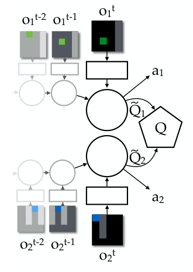
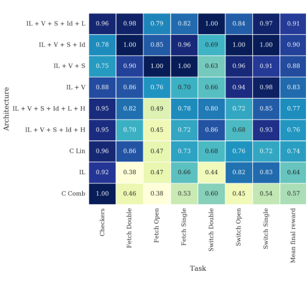

# 第 95 天｜VDN：只给团队奖励，怎样学出可以各自贪心的价值分解

[系列首页](README.md) · [上一篇](94-cal-ql.md) · [下一篇](96-coma.md)

**原论文与版本**：Peter Sunehag、Guy Lever、Audrunas Gruslys、Wojciech Marian Czarnecki、Vinicius Zambaldi、Max Jaderberg、Marc Lanctot、Nicolas Sonnerat、Joel Z. Leibo、Karl Tuyls、Thore Graepel，*Value-Decomposition Networks For Cooperative Multi-Agent Learning*。[arXiv记录](https://arxiv.org/abs/1706.05296)首发于2017-06-16；本文核读[同日v1完整预印本](https://arxiv.org/pdf/1706.05296v1)，以其第3—9页的方法和实验为准。AAMAS 2018的[三页扩展摘要](https://aamas.csc.liv.ac.uk/Proceedings/aamas2018/pdfs/p2085.pdf)标题多了 *Based On Team Reward*，会议日期为2018年7月10—15日。这里不把两个长度、标题不同的版本当成同一份正文，也不把2018年当成首次公开年份。

### 先接住前作的问题

[Cal-QL](94-cal-ql.md)讨论离线价值在在线微调时如何保留有用的尺度。这篇切换到另一个困难：一个团队只收到一个奖励，但每个成员只能根据自己的观察做决定。训练时能汇总信息，不代表执行时也能让一个中央大脑决定所有人的动作。

[第34天QMIX](34-qmix.md)已经介绍过单调混合网络。现在回到它的重要前置问题：如果混合器只做加法，这个简单约束究竟帮了什么忙，又牺牲了什么？VDN最有价值的地方不是“多个Q相加”这个外观，而是把**联合训练损失、局部决策信息和可分解的最大化**接到一起。它没有要求环境事先告诉我们谁贡献了多少奖励。

### 五个前置概念

1. s是环境状态，包含世界的实际配置；智能体未必直接看得到。
2. hᵢ是第i个成员自己的动作—观测历史，循环网络用隐藏态压缩它。它不自动等于完整状态。
3. r是每一步唯一的团队奖励。VDN不需要rᵢ这种真实个人奖励标签。
4. Q_tot是团队联合动作价值的近似；它评价一组成员动作带来的未来团队回报。
5. qᵢ是局部网络的效用输出。本文用小写q强调：它不必是某个个人奖励函数下的真实Q值。

这个区别决定了怎样读论文。把qᵢ画出来，可以研究网络学到的结构；但不能仅凭数值就宣布“甲创造了六成收益”。训练任务只约束它们如何一起预测团队目标。

## 一、问题设定：团队只有一个分数，为何不能人人各学一遍

考虑两台仓库机器人。两者都能搬货，但窄通道里需要相互让路，任何一台送达都会增加团队得分。机器人甲看不见乙送货，自己的观测几乎没变化，团队奖励却突然增加。若甲拿这个奖励直接更新自己的动作价值，就必须从看不见的事件中学习关联；乙的探索策略不断变化，这个关联还在漂移。

这不是说团队奖励“错误”。目标本来就是最大化整个仓库的效率。困难在于：甲的局部输入不足以解释所有回报波动。把同一个奖励复制两份，不能自动变成两份正确的个人监督。

另一个极端是把两者的观察拼起来，直接输出所有联合动作的价值。如果每人有m个动作，n个人就有m的n次方种联合动作。除此之外，即使规模很小，探索也可能出现论文所说的lazy agent：一个成员先学会有效行为，另一个成员的随机尝试暂时干扰它，于是系统收敛到“一个干活、另一个不动”的较差分工。这个问题不等于人类意义的懒惰，也不是所有集中式方法必然失败的定理。

VDN走第三条路：训练时用团队回报约束多个局部网络输出之和，执行时只留下每个局部网络。它属于集中训练、分散执行，但这里的“集中”主要指共同的损失和经验对齐，不必要求一个额外的全局状态向量进入基础版网络。

## 二、加法假设：既是优化接口，也是表示限制

基础VDN用如下函数族：

$$Q_{\rm tot}(\mathbf h,\mathbf a;\theta)=\sum_{i=1}^{n}q_i(h_i,a_i;\theta_i).$$

这里粗体h和a分别是所有人的历史和动作。等号定义网络结构，而不是宣称真实环境的最优Q一定可以精确分解。原文第4页使用近似号描述真实联合价值与局部成分之间的关系，正是为了保留这一边界。

### 为什么局部贪心等于联合贪心

固定当前联合历史，假设允许的联合动作集合是各人可选动作集合的笛卡尔积。为每人选择

$$a_i^*\in\arg\max_{a_i}q_i(h_i,a_i).$$

对任何另一组联合动作b，都有qᵢ(hᵢ,bᵢ)≤qᵢ(hᵢ,aᵢ*)。逐项相加得到

$$\sum_iq_i(h_i,b_i)\leq\sum_iq_i(h_i,a_i^*),\qquad
\max_{\mathbf a}Q_{\rm tot}(\mathbf h,\mathbf a)=\sum_i\max_{a_i}q_i(h_i,a_i).$$

因此，单独求n个小最大值就能得到这个网络的联合最大值，不必枚举mⁿ个组合。若某人有并列最优，任何局部最优组合的和都是最大值；但执行时仍应处理动作掩码和一致的有效动作定义。

证明保证的是“对当前近似网络贪心”，不是“对真实世界最优”。还要有足够准确的表示、正确训练以及允许的分散策略类，才能进一步谈环境中的性能。如果联合动作存在不可分的硬限制，例如同一资源每次只能被一个成员申请，那么每人各自最大的动作可能组成非法组合；此时笛卡尔积假设已经破坏，不能原样应用结论。

### 原图2：梯度在上面汇合，动作在下面分开

<figure class="reading-evidence-figure" id="rl-95-figure-2"><a href="/rl/assets/papers/95-vdn-figure-2.png" target="_blank" rel="noopener noreferrer"></a><figcaption>原论文图形摘引｜Sunehag等，arXiv:1706.05296v1，PDF第4页Figure 2。<a href="https://arxiv.org/pdf/1706.05296v1#page=4" target="_blank" rel="noopener noreferrer">核对原文</a>。保留完整图形区域，未包含旁边的Figure 1；原版权保留，限量摘引用于技术评论。</figcaption></figure>

图中从左到右的灰色到黑色观测代表历史展开，不是三名不同成员。上下两条路径分别属于两人，圆形表示循环部分，局部输出以带波浪线的Q标记，右侧多边形汇总成团队Q。动作a₁、a₂分别从自己的分支产生；它们不是由这个多边形再次联合挑选的。

这是一张信息流图，没有性能横纵轴。它支持“求和训练、局部执行”的结构解释，不提供任何精确分解或收敛的实验保证。尤其不能把旁边另一个成员的原始观察，误读成基础版执行时可用的输入。论文还研究通信变体，但那要额外声明部署时的通信条件。

### 即时奖励可加，不等于局部Q就精确可加

原文第5页从r=r₁+r₂出发，用期望的线性性分开累计回报：

$$Q^\pi(s,\mathbf a)=\mathbb E_\pi\!\left[\sum_{t\ge0}\gamma^t r_{1,t}\mid s,\mathbf a\right]+\mathbb E_\pi\!\left[\sum_{t\ge0}\gamma^t r_{2,t}\mid s,\mathbf a\right].$$

这个等式没有问题，但右侧两个期望仍以**完整状态和联合动作**为条件。乙挡住通道，就可能改变甲未来所有送货收益。因此，把第一项进一步压缩成q₁(h₁,a₁)，才是新的近似假设。局部记忆可以缓解信息不足，却不能无中生有地恢复从未观察过的信息；通信可以增加信息，但改变了执行接口。

更进一步，即使真实奖励没有显式可加形式，VDN仍能拿团队样本训练一个加性近似。它需要的是这种近似有助于排序和决策，而不是环境必须提供一个已知分解。不要倒过来把论文的动机例子当成算法的输入要求。

## 三、一个团队TD误差怎样训练所有分支

为解释清楚更新，先写一阶目标网络版本。对同步经验(h,a,r,h′,d)，d指真终止，θ⁻是固定一段时间的目标参数：

$$y=r+\gamma(1-d)\sum_i\max_{a_i'}q_i(h_i',a_i';\theta_i^-),\qquad
L=\frac12\left(y-\sum_iq_i(h_i,a_i;\theta_i)\right)^2.$$

这里只算一次团队奖励，没有在求和内部给每个人再加r。目标中的最大值之和来自前一节的可分解性。若采用在线网络选动作、目标网络评价的Double Q做法，那是需要单独注明的实现选项，不要悄悄把它塞进“求和”的定义。

令δ=y−Q_tot，停止对y反向传播，则

$$\nabla_{\theta_i}L=-\delta\nabla_{\theta_i}q_i(h_i,a_i;\theta_i).$$

同一个残差经过不同分支的特征和参数雅可比，产生不同参数更新。它不是先计算“甲应分到多少r”，再用个人Bellman目标训练甲。如果参数共享，则总梯度是所有成员分支贡献之和；一个参数会同时受多个人的样本影响。

对比独立Q学习：若每人分别拟合yᵢ=r+γmax qᵢ′，那么每个人都在估计整个团队回报，并且忽略其他人的当前动作变化。把这些独立Q再加起来，通常会重复计数团队收益。VDN则从第一步就让**和**拟合一次团队回报，所以局部数值的语义不同。

### 独立手算：局部输出不是“各拿一半奖励”

以下是教学例，不是论文训练结果。两人各有L、R两种动作。当前输出为q₁(L)=1、q₁(R)=3，q₂(L)=2、q₂(R)=0。四种联合估值依次为(L,L)=3、(L,R)=1、(R,L)=5、(R,R)=3；各自贪心得到(R,L)，恰好达到联合最大值5。

现在经验中实际采取的是(L,L)，得到r=1，γ=0.9，目标网络在下一步的两个局部最大值是4和2，且没有终止。目标为1+0.9×(4+2)=6.4，当前和为3，δ=3.4，半平方损失为5.78。

若暂时把两个被选中的输出当成互不共享的表格参数，学习率0.1，那么二者都增加0.34，联合估值从3变为3.68。它并不是把奖励1均分后各学0.5，而是在让团队预测靠近6.4。神经网络中实际输出变化还由特征、共享参数和优化器决定，不能照搬这个表格更新量。

这个算例也揭示规模效应：在同样步长下，多个自由分量同时向上移动，和的移动幅度可能随成员数改变。把损失从求和改成求平均、改变梯度裁剪或增大团队人数，都可能改变有效更新尺度。结构可分解不代表超参数无需调整。

### 分解并不唯一

在任何输入下给q₁加常数c、给q₂减去同一个c，所有联合Q和动作排序都不变。教学例中取c=7，新分量可以是q₁(L)=8、q₁(R)=10，q₂(L)=−5、q₂(R)=−7，但团队预测完全相同。

所以局部效用为负，不意味着这个人“损害团队”；局部效用更大，也不说明它的真实贡献更大。还可通过观察动作间差值研究局部偏好，不过那仍是模型内部的决策结构，不是得到唯一、真实或公平的贡献账本。信用分配作为训练问题与贡献解释作为因果问题，应当分开。

## 四、表示反例：相加究竟丢掉了什么

固定历史，考虑如下单步团队收益矩阵，行是甲的动作，列是乙的动作：

| 甲／乙 | L | R |
|---|---:|---:|
| L | 4 | 0 |
| R | 0 | 3 |

若存在精确分解f(a₁)+g(a₂)，那么任意这样的二乘二矩阵都必须满足

$$Q(L,L)+Q(R,R)-Q(L,R)-Q(R,L)=0.$$

原因是展开后每个f和g各出现一次正号和负号。这里却是4+3−0−0=7，所以不可能精确表示。错误不是网络层数不够：再大的局部网络也改变不了加法恒等式。

还可以更具体地看最小二乘投影。若四个格子等权拟合，加性投影为“所在行均值+所在列均值−总均值”。行均值为2、1.5，列均值也为2、1.5，总均值1.75，得到矩阵[[2.25,1.75],[1.75,1.25]]。四个残差分别为1.75、−1.75、−1.75、1.75，平方误差和12.25，均方误差3.0625。

它虽然不能拟合协同收益，却仍把(L,L)排在最前。因此必须区分两件事：**精确表示所有联合价值**比**保留一个最佳动作组合**更强。表示有误差，不等于这个例子的策略一定错误；但换一个数据分布、增加重要状态或改变收益差距，就可能损害关键排序。低总体均方误差也不保证罕见但高风险状态选对动作。

该反例还说明动作效果依赖队友：当乙选L，甲应选L；当乙选R，甲应选R。加性网络中q₁(L)−q₁(R)不能随着乙当前动作变化。在固定局部历史下，它无法表达这种条件反转。若执行时甲本来就不知道乙同时选择什么，困难又有信息层面的来源；不能把所有失败都归因于混合器太简单。

[QMIX](34-qmix.md)用单调非线性混合放宽加性数值约束，但也保留局部偏好与联合偏好的某种一致性，并非任意相互作用都能表示。[QTRAN](97-qtran.md)进一步讨论保持贪心一致性的变换条件。比较这些路线时，应分别检查函数可表示性、分散可执行性，以及实际优化有没有满足理论条件。

## 五、从公式到原始实现：不要把通信和权重共享混为一谈

原文第6页的网络不是现代工具包里任意一份“VDN默认配置”。它使用32单元的输入线性层、32隐藏单元LSTM以及32单元的dueling层，配合经验重放、目标网络、截断反向传播和多步前向资格迹。轨迹长度为8，λ=0.9，Adam初始学习率为0.0001。前文的一步式是讲清损失耦合的简化版本，不是声称原实验只用一步TD。

下面的流程保持原始机制，但省略论文没有在主文逐项固定的重放和同步工程参数。它不是作者代码逐行复刻。

```text
初始化每个成员的循环效用网络、目标网络和联合序列重放池
可选：共享网络参数；若需要不同角色，把成员身份作为局部输入
重复收集交互：
    各成员更新自己的循环状态，依据局部效用做 epsilon-greedy
    同步执行联合动作，记录唯一团队奖励及所有成员的历史信息
    将对齐的联合序列加入重放池
重复训练：
    采样联合片段，保留真实终止标记和有效时间步掩码
    展开各分支循环网络，计算每步被选动作效用的和
    用目标网络的局部贪心之和构造多步／资格迹团队目标
    对一个团队TD损失反传，更新所有相关分支或共享参数
    按预设日程同步目标网络
执行基础无通信版本：只运行各自局部网络，不需要求和节点
```

**共享参数不是共享观察。** 两个成员可以用同一套权重，仍各自只看自己的历史。如果角色相同，这提高数据复用和置换对称性：某人学到“看到货物就拾取”，经验可以帮助另一个人。若两人应该专门化，则可以加身份或角色编码；同样的观测加不同身份允许不同动作。

**通信也不是训练期有公共损失。** 原文另外试验在输入线性层之后或LSTM之后拼接其他成员的特征。只要局部动作计算依赖这些特征，部署时也必须有相应信息通道，不能训练后无条件删掉。这些变体在论文中的成功，不能被归功于“完全无通信基础VDN”一个因素。

**循环状态需要与采样片段对应。** 独立抽乱甲、乙的transition，会让求和对应根本没发生过的联合行动。把每段随机序列都从零隐藏态开始，也可能让训练历史与实际执行历史不一致。实现者应明确状态重建、片段起点与截断边界；这些是从循环重放机制推出的工程检查，不是论文额外给出的通用收敛保证。

## 六、原始实验告诉了什么，又没告诉什么

v1第6—8页使用两人二维网格世界，不是后来的StarCraft多智能体标准套件。每人只有3×5×5 RGB局部观察，窗口朝前延伸4格、左右各2格，共8个动作，包括移动、转向、beam和静止；beam在这些游戏里不承担攻击功能。训练轨迹为5000步，测试为2000步。论文设计了七个任务：Switch与Fetch各有开放地图、单通道、双通道三个版本，另加Checkers。

Switch每当一个成员到达对面目标就给1分，两人都到达后重置。窄通道中的碰撞迫使它们学会让路。Fetch拾取给团队3分，送达再给5分，关键是形成循环分工而不是互相卡住。Checkers让第一人吃苹果得10分、吃柠檬扣10分，第二人分别得1分或扣1分；理想分工是低敏感者清理柠檬，高敏感者吃苹果。

这些数值不是给训练器的个人奖励分解标签，而是定义环境如何生成**同一个团队奖励**。作者在解释行为时知道事件来自谁，不代表算法在训练时拿到了相同的逐人监督。这正是“环境有可解释结构”与“学习器获知该结构”的区别。

### 哪些比较支持加法结构

每种配置运行10个随机种子，改变初始位置和网络初始化，学习曲线覆盖50000个episode。论文分别汇总归一化曲线下面积和最终性能：前者更关心整个学习过程，后者更关心训练结束时效果。归一化数值跨任务可比较，却不应被解释成所有任务使用相同原始奖励单位。

结果总体支持价值分解配置优于文中的独立学习和集中式基线，也显示其他模块并非可有可无。单通道Fetch中，不共享参数的局部VDN仍会出现lazy agent，权重共享帮助很大；Switch中加入角色信息更有助于打破对称性；Checkers的两个角色奖励尺度相差十倍，盲目强迫同样行为不合适，额外信息通道也可能带来收益。这些观察支持“结构、共享、角色、通信各有作用”，不支持“只加一个求和层就普遍解决合作”。

<figure class="reading-evidence-figure" id="rl-95-figure-5"><a href="/rl/assets/papers/95-vdn-figure-5.png" target="_blank" rel="noopener noreferrer"></a><figcaption>原论文图形摘引｜arXiv:1706.05296v1，2017-06-16完整预印本，PDF第8页Figure 5。<a href="https://arxiv.org/pdf/1706.05296v1#page=8" target="_blank" rel="noopener noreferrer">核对原文</a> · 点图放大。保留图形、坐标与图例；版权归原作者及相关权利人，未确认通用再利用许可，此处为直接技术评论的有限摘引。</figcaption></figure>

这里保留两个原稿口径问题：第7页正文说最终性能取最后1000个episode，而第8页Figure 5图注写最后5000个；第7页正文说八种配置，第6页Table 1列出九行，附录曲线图注也写九种。本文不替作者选择一个说法，不从图中抄出带虚假精度的百分点改善，也不将这些协议矛盾隐藏掉。若要精确复现实验，必须继续核对作者代码或原始实验记录。

原文第8页§4.4还解释了Fetch中的局部价值波动：某个成员即将送达时，它对应的分量会提前变化。作者为可视化把奖励事件按来源区分，并明确说这只是解释用途。这个例子可说明网络学到了有用分工，却不是个体价值可识别性的证明；前面的常数平移反例依然成立。

### 三个没有被原实验消除的限制

第一，两人、短视野、小离散动作空间的成功，不能外推成任意规模团队的可靠性。输出规模避免指数增长，不代表探索、协调或学习难度也线性增长。

第二，结构约束压低方差的同时引入偏差。对强互补、条件反转或需要相关随机策略的任务，简单求和可能无法准确评价。更强的集中式critic能拟合交互，也不一定能让缺少信息的局部策略实现最优行为。

第三，团队奖励优化不包含公平、安全或个人激励保证。Checkers中某人承担负即时收益恰好有利于团队，是目标设计使然；把同样方法部署到真实人机系统前，必须另行明确谁的成本可以被牺牲，不能把训练出的效用当作伦理或分配依据。

## 七、把VDN放回多智能体方法地图

与[第25天MADDPG](25-maddpg.md)相比，VDN通过限制联合价值函数形状让贪心动作可分解；MADDPG使用集中式动作价值来训练分散actor，并不要求联合价值是简单和。二者都能利用训练期信息，但动作选择与优化接口不同，不能只因为都使用集中训练就说其中一个是另一个的特例。

[下一篇COMA](96-coma.md)同样只需团队奖励，却为每个actor计算一个“固定别人动作、重新平均自己动作”的基线。它不把团队Q拆成局部Q的和，而是改变策略梯度的参照。VDN的首发时间还晚于COMA首个预印本，因此此处的前后顺序只是教学安排，不是历史继承。

读完这篇应该能准确说出：VDN学的是可供分散决策的局部效用分解，而不是获得真实个人奖励；它的最大化可分解性是严格代数性质，真实团队价值可加则是需要检验的建模近似。

### 三个继续追问

<details><summary>1. 如果每个人都拿到同样的TD误差，信用分配究竟在哪里？</summary>

在共同目标与局部输入结构的组合里。和必须解释一次团队回报，而每个分支只能通过自己的历史和动作去拟合可预测部分，长期数据会推动不同分支形成有用分工。它不是在单个样本上精确计算个人贡献比例，更不保证分解唯一。共同残差仍可能把噪声传给所有分支，结构只提供归纳偏置。
</details>

<details><summary>2. 加性矩阵拟合不了，是不是一定要放弃分散执行？</summary>

不是。精确价值表示与找到可执行的好策略是不同要求，本文矩阵投影就保留了最佳联合动作。还可以考虑单调混合、带变换约束的分解或集中critic加局部actor。但如果最优动作确实依赖执行时拿不到的信息，仅增强critic也无法消除信息限制，可能需要记忆、通信或改变任务接口。
</details>

<details><summary>3. 参数共享能否从根本上杜绝lazy agent？</summary>

不能。共享能让成功经验在成员之间复用，减少由初始化和样本差异导致的学习不平衡；但不创造未被探索的合作轨迹，也不能代替必要的角色区分。原文把共享、身份信息和通信分别组合比较，正说明效果依赖任务结构。异质成员还需要确保输入、动作与能力的语义兼容。
</details>

## 自测两题

<details><summary>自测1：把团队奖励r放进每个局部目标，再把目标求和，会得到原来的VDN目标吗？</summary>

不会。非终止时得到nr+γΣmax qᵢ′，团队即时奖励被重复n次。原目标是r+γΣmax qᵢ′。除非明确改变奖励归一化和整个价值尺度，否则这已经是不同学习目标。VDN的团队奖励只加入一次。
</details>

<details><summary>自测2：矩阵[[2,4],[1,3]]能否精确加性分解？局部贪心结果是什么？</summary>

能，因为2+3−4−1=0。可取甲的效用为[1,0]，乙为[1,3]，相加得到原矩阵。甲选第一行，乙选第二列，联合值4最大。也可以给甲整体加任意常数，再从乙减去同一常数，分解数值变了而团队价值和策略不变。
</details>

[系列首页](README.md) · [上一篇](94-cal-ql.md) · [下一篇](96-coma.md)
