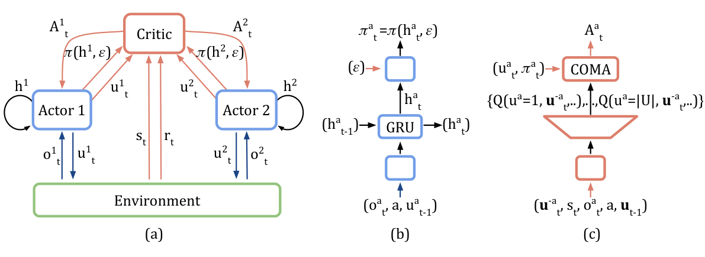

# 第 96 天｜COMA：固定队友动作，怎样为每个成员构造反事实基线

[系列首页](README.md) · [上一篇](95-vdn.md) · [下一篇](97-qtran.md)

**原论文与版本**：Jakob N. Foerster、Gregory Farquhar、Triantafyllos Afouras、Nantas Nardelli、Shimon Whiteson，*Counterfactual Multi-Agent Policy Gradients*。前两位作者在预印本标记为同等贡献。[arXiv记录](https://arxiv.org/abs/1705.08926)首发于2017-05-24；本文技术与实验依据[2017-05-24的v1 PDF](https://arxiv.org/pdf/1705.08926v1)，特别是第4—8页与附录A、B。[作者所在牛津大学的出版记录](https://www.cs.ox.ac.uk/publications/publication11394-abstract.html)确认发表于AAAI 2018，月份为2018年2月。arXiv后来存在2017年12月v2和2024年12月v3，本文没有把它们的改动混入v1实验；AAAI出版入口访问受限，也不将其当作已经核读的正式正文。

### 先接住前作的问题

[VDN](95-vdn.md)限制团队价值等于局部效用之和，以换取各自贪心的可执行性。COMA不要求这个加法结构。它保留一个能够看联合动作的集中式critic，再让每个成员的actor从自己的局部历史输出动作分布。

这样做仍有一个问题：团队赢了一场战斗，所有人的策略都用同一个好消息更新，但究竟哪些动作值得增加概率？如果甲已经选得很好，而乙因为探索碰巧拖了后腿，统一的团队优势会把两种角色混在一起。COMA问的是更具体的局部比较：**在此刻其他人的动作保持不变时，我实际选的动作，比按自己当前策略重新抽一个动作好多少？**

这里的“反事实”是价值模型中的动作替换参照，不是自动获得因果解释。我们会分别推导它为何是合法策略梯度基线、怎样高效计算，以及为何模型误差和执行信息限制仍然存在。章节排序是教学顺序；COMA的首个预印本实际早于VDN，不能反过来讲成其历史后继。

### 五个前置概念

1. **联合策略**：在给定所有局部历史后，各actor独立采样动作，联合概率是局部概率的乘积。
2. **集中式critic**：训练时可读取状态和联合动作的评价器，不负责执行时替成员选择动作。
3. **策略梯度基线**：从回报或Q中减去一个不依赖该成员本次采样动作的参照，适当条件下不改变期望梯度。
4. **反事实边际化**：固定队友实际动作，只对一个成员的候选动作按其策略概率求平均。
5. **信用分配**：为学习提供更有区分度的信号，不等于找到唯一、真实、公平的贡献分摊。

## 一、问题设定：能联合评价，为什么还需要个人参照

完全合作任务中，所有成员共享r(s,u)。状态s包含环境实际情况，第i个成员只能根据局部动作—观测历史τᵢ做决定，输出πᵢ(uᵢ|τᵢ)。训练期如果可获得全局状态，可以把它交给critic；如果没有，原文也讨论使用联合历史。部署时则只保留actor及它所需的局部记忆。

为了避免下标混淆，本文用i表示成员，uᵢ表示它的动作，u⁻ⁱ表示其他所有人的动作。Q^π(s,u)表示先执行这组联合动作，随后按当前联合策略行动的预期累计团队奖励。在循环策略的部分可观测问题中，严格的价值条件还应包含决定未来行为的历史或记忆；沿用原文Q(s,u)简写，不代表当前物理状态总能充分概括有记忆策略。

独立actor-critic让每人用自己的局部critic评价团队回报，遇到两个困难。其一，局部观察解释不了其他成员引起的回报波动。其二，队友一直学习，同样的局部行为在不同训练阶段可能遇到不同伙伴。这些都使评价更困难。集中critic能把队友动作和更多状态纳入条件，减少不可解释的混合，却仍不自动产生适合每个人的训练参照。

最简单的集中状态价值基线是r+γV(s′)−V(s)。所有actor使用同一个TD误差。这在适当条件下是合法的策略梯度估计，不能说它“理论错误”；问题是方差和信用辨别能力。COMA把参照进一步条件化到**其他人这一次实际做了什么**，试图从更新中扣除与本人动作无关的团队差异。

## 二、反事实优势：只平均自己，不重新抽整个团队

对成员i定义

$$b_i(s,\mathbf u^{-i},\tau_i)=\sum_{v\in\mathcal U_i}\pi_i(v\mid\tau_i)Q^\pi(s,(\mathbf u^{-i},v)),$$

$$A_i(s,\mathbf u)=Q^\pi(s,\mathbf u)-b_i(s,\mathbf u^{-i},\tau_i).$$

v是被枚举的候选动作，不是原来实际采样的uᵢ。它替换联合动作中第i个位置，其他位置始终使用同一组u⁻ⁱ。权重是当前成员策略πᵢ，不是均匀分布，不是对全部联合动作求平均，也不是选一个“什么都不做”的固定动作。

这与普通状态价值基线有一个关键区别。V^π(s)会把所有成员的行为变化一起平均；bᵢ保留其他人的已采样动作作为条件。比如队友这次刚好发动了强攻击，bᵢ也在这一强攻击背景下评价自己的替代动作，不会只因队友表现好就给自己过大的正优势。

但bᵢ不是把第i个成员从环境里删去。候选动作仍来自原动作空间，后续价值也仍按当前策略展开。它不会重新模拟一个“没有甲加入”的世界，更不是Shapley value那样遍历不同成员联盟。因此不能把Aᵢ解释成某人对最终胜利的完整因果贡献。

### 与difference reward的距离

原文以difference reward作动机：Dᵢ=r(s,u)−r(s,(u⁻ⁱ,cᵢ))，其中cᵢ是固定参考动作。这种方法需要知道替换动作后的环境奖励，实际系统不一定可以重置和重演，参考动作也不容易选。

COMA用学习到的长期Q代替额外环境试验，并对策略里的候选动作求期望，避免人工挑一个默认动作。收益是计算与采样负担更小，代价是依赖critic对未执行动作的预测。如果某个候选动作很少出现，那个“如果我换一种动作”的数可能只是外推。这个代价必须与反事实一词同时记住。

### 原图1：哪些箭头执行时可以删除

<figure class="reading-evidence-figure" id="rl-96-figure-1"><a href="/rl/assets/papers/96-coma-figure-1.png" target="_blank" rel="noopener noreferrer"></a><figcaption>原论文图形摘引｜Foerster等，arXiv:1705.08926v1，PDF第5页Figure 1，完整保留(a)(b)(c)三部分。<a href="https://arxiv.org/pdf/1705.08926v1#page=5" target="_blank" rel="noopener noreferrer">核对原文</a>。原版权保留，限量摘引用于直接技术评论。</figcaption></figure>

(a)的红色路径和critic只为训练所需，actor与环境间的观察、动作路径继续存在。(b)的actor接收本地观察、身份和自己的上一步动作，经GRU保留历史；它不是偷偷使用全局状态。(c)的critic把其他人的当前动作作为输入，一次输出“自己可选每个动作”的Q向量，再结合actor的概率得到基线。

这张图没有实验坐标轴，而是在划定信息边界。它说明全局状态为何不必在部署时可得，也说明一次前向为什么能得到一名成员全部替代动作的评价。它不能证明这些评价已经准确，更不能证明一个仅凭局部信息的actor可实现任意全局最优策略。

## 三、基线为何不改变期望策略梯度

下面给出按原方法展开的教学推导，不将它冒充v1中独立列出的收敛定理。设策略可微、支持与求和操作满足通常的策略梯度条件，给定联合历史后动作独立采样：

$$\pi_\theta(\mathbf u\mid\boldsymbol\tau)=\prod_i\pi_{i,\theta}(u_i\mid\tau_i).$$

对团队回报J使用联合策略的对数导数，可将梯度写成各actor贡献之和：

$$\nabla_\theta J=\mathbb E\!\left[\sum_i\nabla_\theta\log\pi_{i,\theta}(u_i\mid\tau_i)Q^\pi(s,\mathbf u)\right].$$

期望包含相应的轨迹或折扣访问分布；这里把它收进记号，不能脱离采样分布把任意旧轨迹都当作无偏数据。若参数不共享，各个梯度只作用到自己的参数；若共享，求和仍然成立，同一个θ收到多个成员的梯度。

固定状态、历史和队友动作，bᵢ在对本人的采样动作uᵢ求和时不变，因此

$$\begin{aligned}
\mathbb E_{u_i\sim\pi_i}[\nabla_\theta\log\pi_i(u_i\mid\tau_i)b_i]
&=b_i\sum_{u_i}\pi_i(u_i\mid\tau_i)\nabla_\theta\log\pi_i(u_i\mid\tau_i)\\
&=b_i\nabla_\theta\sum_{u_i}\pi_i(u_i\mid\tau_i)=0.
\end{aligned}$$

于是可以用Aᵢ代替Q而不改变这个期望。基线可以依赖状态、队友动作，甚至在数值上依赖策略参数；要点是它在该条件下不依赖本人这次实际采样的动作，而且actor更新把优势作为停止梯度的权重。

### 为什么stop-gradient不是小细节

常用actor损失写成−logπᵢ(uᵢ|τᵢ)×stop_gradient(Aᵢ)。若直接对Aᵢ里用π计算的基线一起反向传播，会额外产生logπ乘以∇bᵢ的项；前面的零期望证明没有给这项授权。共享参数时尤其容易误把critic路径或基线概率路径接回actor。

另一个常见错误是把本人**实际当前动作**作为critic的普通输入，同时又声称输出整个候选Q向量。如果输入中的实际动作泄漏到基线，表面上求和，bᵢ却可能随被采样动作改变，零期望条件就不成立。原图的表示用u⁻ⁱ作为当前联合动作输入，排除或遮蔽本人这一槽位；本人上一步动作属于历史，性质不同。

### 零偏不等于最小方差，也不等于学习无偏

即便Q是真实值，按π平均的bᵢ通常也不是所有可能基线里方差最小的那个。对固定条件下的梯度向量g=∇logπ，最小化E[||g||²(Q−b)²]得到的标量参照为

$$b^*=\frac{\mathbb E[\|g\|^2Q]}{\mathbb E[\|g\|^2]},$$

当分母非零时成立。COMA的策略平均没有这个梯度范数权重，所以更准确的说法是“合法且针对信用分配设计的基线”，不是普遍最优方差基线。

实际还要用学习到的Q_φ替代Q^π。基线部分的零期望性质在不泄漏动作等条件下仍成立，但所选动作Q_φ的误差会进入梯度。多步自举、有限数据、部分可观测压缩和未访问动作的外推都会影响它。不能从“减基线不引入偏差”跳到“整个深度actor-critic训练无偏并收敛”。

## 四、手算一次反事实优势与真实梯度

以下是独立构造的单步教学例，收益矩阵不是论文实验。甲、乙各有L、R两动作，团队Q为：

| 甲／乙 | L | R |
|---|---:|---:|
| L | 8 | 1 |
| R | 2 | 6 |

令甲选L的概率p=0.75，乙选L的概率q=0.4。实际采样到(甲L，乙R)，共同Q=1。

对甲，固定乙R，候选列是[1,6]，基线b₁=0.75×1+0.25×6=2.25，所以A₁=−1.25。对乙，固定甲L，候选行是[8,1]，基线b₂=0.4×8+0.6×1=3.8，所以A₂=−2.8。两人收到不同的负优势：在这次队友动作背景下，实际动作都不如自己的随机策略平均。

若甲和乙分别用一个logit控制选L的概率，采到L的对数导数为1−p，采到R则为−q。因此这次样本对甲logit的梯度贡献是0.25×(−1.25)=−0.3125，对乙是(−0.4)×(−2.8)=1.12。梯度上升使甲略少选L、乙更多选L。它们是在同一团队目标下按各自替代动作比较更新，不是在瓜分奖励1。

### 把所有四种采样都算完

四格采样概率分别是0.30、0.45、0.10、0.15，期望团队Q为

$$J=0.30\times8+0.45\times1+0.10\times2+0.15\times6=3.95.$$

对甲求条件平均，选L时的期望为0.4×8+0.6×1=3.8；选R时为0.4×2+0.6×6=4.4。因此甲logit的真实梯度为p(1−p)×(3.8−4.4)=−0.1125。

再用COMA逐格计算甲的优势：乙L时基线6.5，对应优势1.5和−4.5；乙R时基线2.25，对应优势−1.25和3.75。按四格概率与score相乘再相加：

$$0.30(0.25)(1.5)+0.45(0.25)(-1.25)+0.10(-0.75)(-4.5)+0.15(-0.75)(3.75)=-0.1125.$$

结果与直接求导相同。乙选L和R的条件平均分别为6.5和2.25，故真实logit梯度为0.4×0.6×4.25=1.02；同样逐格计算COMA也得到1.02。这验证的是例子中的期望等式，不是每一次随机更新方向都必须与真实梯度一致。

### 一个容易漏掉的结论

在固定队友动作下，Σᵤᵢπᵢ(uᵢ)Aᵢ=0。于是优势可以有正有负，并且其策略平均为零。不同成员的Aᵢ之和没有必要等于Q、即时奖励或总回报。这里采样(甲L，乙R)时优势之和是−4.05，并不等于团队Q=1；这不构成错误，因为COMA从未提出“贡献守恒分账”的目标。

## 五、一个前向怎样评价多个替代动作

假如把联合Q做成一个枚举所有联合动作的输出头，n人每人m动作，就要mⁿ个输出。COMA改用条件向量：输入状态、其他人已选动作以及所评估成员的身份等信息，输出该成员m个候选动作的Q。

对每人一次前向，理论上可用n次网络评价得到全部反事实基线，实践中可把成员维度并入batch并行处理。输出数量的尺度为nm，而不是mⁿ。不过网络必须学习如何概括庞大的联合输入空间，计算接口线性化不等于统计难度线性化。团队人数、异质动作空间、稀疏配合轨迹都仍然影响泛化。

原文第6—7页的critic输入还包括全局状态、当前所评估成员的局部观察、身份和前一步联合动作；状态中的全局信息并没有被直接塞到actor。actor则是128隐藏单元GRU，输入包含局部观察、身份、上一步自己的动作。参数共享提高样本利用率，身份与不同循环状态允许不同行为。

下面是忠实于v1附录训练顺序的说明性伪代码。使用有限轨迹TD(λ)，没有加入后来的PPO裁剪或任意长期离策略重放。

```text
初始化共享actor参数θ、集中critic参数φ及目标critic参数φ-
每轮：
    使用当前局部actor收集一批完整联合轨迹
    记录团队奖励、训练可见状态、局部观察、动作和终止标记
    展开actor循环状态，计算当轮使用的动作概率
    用目标critic和实际后继轨迹构造TD(lambda)目标
    从轨迹末端向前更新critic，使所选动作Q拟合团队目标
    按既定日程同步目标critic
    对每个有效时间步和每个成员i：
        将其他人当前动作作为critic输入，遮蔽本人的当前动作槽位
        一次得到该成员全部候选动作的Q向量
        b_i = 当前策略概率与Q向量的内积
        A_i = 所选动作Q - b_i
        累计 log π_i(所选动作) × stop_gradient(A_i) 的梯度
    汇总时间步及成员梯度，更新actor
部署时：只更新局部循环状态并运行actor
```

附录A写明batch size为30，数据收集步骤是30/n个完整团队episode，n为智能体数；合并成员维度后，对应batch size为30。这里的分数需按PDF版面读取，不能把上下标式的文本抽取误读为乘积30n。附录又明确把一次完整的数据收集、critic更新与actor更新循环称为图上的一个episode，因此训练横轴计数不等同于单场战斗数，不能直接拿它换算跨论文环境样本效率。附录还使用RMSprop学习率0.0005、alpha=0.99、折扣γ=0.99；集中式前馈critic目标网络每150个训练步更新，独立循环critic每50步更新。不同critic每轮实际梯度步数不同，这也是为何不能只比较同步周期数字。

原文探索采用混合softmax：π=(1−ε)softmax(z)+ε/m，ε从0.5在750个训练episode内降至0.02。基线应对应实际采样的策略概率，而不是只取尚未混合的softmax；否则actor score、采样分布和求平均的策略语义不再一致。终止、自举和无效时间步掩码同样要明确，不能让死亡成员的填充动作贡献任意梯度。

## 六、原始StarCraft实验：均值、最好一次和信息条件分开读

v1研究的是StarCraft: Brood War微操，通过TorchCraft与Torch 7训练，不是后来的StarCraft II SMAC排行榜。四个场景是3个marine、5个marine、5个wraith，以及2个dragoon加3个zealot，敌我单位配置对称，对手由游戏AI控制。

作者刻意限制视野，并去除利用内置寻路完成攻击移动的强宏动作：局部视野约等于远程单位射程，成员只能在范围内攻击，看不见的敌人可能是死亡也可能只是离开视野。无效攻击可能导致不行动。这些改变使“人数不多”也不意味着任务简单。局部actor必须用记忆处理信息缺失，学习站位、集火和行动协调。

团队奖励包括对敌造成伤害减去己方所受伤害的一半，击杀额外10分，获胜额外获得剩余团队生命值加200分。它不是纯终局胜负奖励。论文最终主要报告胜率，但训练优化的是这套塑形奖励下的折扣回报；不同奖励口径的后续系统不能只比较最后一个胜率数字。

### 同一受限视野协议里的数值

以下摘录自v1第7页Table 1，均为作者报告的末尾1000个evaluation episode平均胜率，不是本文重跑。列中的central-V使用集中状态价值基线，central-QV分别学习Q与V并用Q−V；COMA使用反事实基线。

| 场景 | IAC-V | IAC-Q | central-V | central-QV | COMA均值 | COMA最好 |
|---|---:|---:|---:|---:|---:|---:|
| 3m | 0.47 | 0.56 | 0.83 | 0.83 | 0.87 | 0.98 |
| 5m | 0.63 | 0.58 | 0.67 | 0.71 | 0.81 | 0.95 |
| 5w | 0.18 | 0.57 | 0.65 | 0.76 | 0.82 | 0.98 |
| 2d_3z | 0.27 | 0.19 | 0.36 | 0.39 | 0.47 | 0.65 |

每个方法进行35次独立试验，每100个训练episode冻结学习、评价200个episode，原文曲线画跨episode及试验的平均值和一个标准差。标准差不是均值的置信区间，不应把带宽当成显著性检验。不同场景的训练长度也不同，不能忽略横轴范围来比较收敛快慢。

在5m上，COMA均值0.81与central-QV的0.71相差0.10，即10个百分点；相对于0.71的提升约14.1%，二者不能混写。2d_3z的0.47与0.39相差8个百分点，但绝对胜率仍不足一半。这支持“在论文协议下有改善”，不支持“已经可靠解决所有微操合作”。

central-V相比独立critic通常更强，说明训练期额外信息本身重要；COMA再优于central-QV，支持基线设计的贡献。不过central-QV还要同时估计V，并不是只改一行公式、完全相同参数和计算预算的理想实验。应把它读作有说服力的架构消融，而不是单独测得基线对一切任务的普适因果效应。

### 与集中控制器比较为什么需要另一把尺

同一Table 1还列了全视野、集中控制的heuristic、DQN和GMEZO。这些方法的信息与动作权限不同。5m上全视野heuristic为0.98，受限视野版本为0.66；这是32个百分点差距，直观说明协议变更有多大，而不是COMA的提升幅度。

COMA的“最好”5m为0.95，而均值为0.81；不能拿0.95对别人的平均值，再宣称更稳健。原文与已发表集中控制器的比较使用最好成绩口径，并在5w脚注提示DQN与GMEZO在更大地图训练后测试到此地图。这些结果可以提供能力参照，但不能构成统一信息、预算与迁移条件下的公平排名。

这也是本文锁定v1的原因：没有核读其他修订版，就不把新版图表、后来的SMAC地图名或常用代码库配置补入原始实验。真正复现还需检查随机种子、游戏版本、训练episode计数、动作可用性和无效命令处理。本文只核对来源和独立算例，没有独立训练复现。

## 七、反事实参照的边界，以及与其他路线的关系

**连续动作不直接享受精确枚举。** 原方法为离散动作输出完整Q向量。换成连续控制时要对动作积分，可能用采样近似或其他基线，但计算代价与方差性质都改变，不能照搬“一次前向精确边际化”的说法。

**集中critic会成为瓶颈。** 虽然没有指数输出头，它仍要预测大量不同联合动作背景下的价值；局部探索产生的数据可能不足以覆盖关键协同动作。参数共享不能保证所有反事实候选都有足够支持。

**局部改进信号不能替代联合探索。** 某种高回报策略可能要求多人同时改变动作，任何单人改变都暂时变差。固定队友动作的基线会清楚地反映这种局部不利，但不会自行创造多人协调探索。策略梯度仍可能陷入局部解。

**critic知道不等于actor知道。** 训练时用状态区分两种局面，不代表局部actor执行时能区分。如果两个状态对某人产生完全相同历史，却要求不同动作，最优可分散策略本来就受限。把全局状态加进actor可以改任务，但不能继续声称相同分散执行条件。

与[VDN](95-vdn.md)相比，COMA不用把Q限制为加性，因此能在critic里描述非加性交互；代价是另训actor，并不能通过代数恒等式保证局部贪心最大化联合Q。两者的信用分配都服务训练，都不等于真实贡献标签。前者约束价值结构，后者改造梯度参照。

与[第25天MADDPG](25-maddpg.md)相比，两者都有训练期集中critic和执行期局部actor，但MADDPG的确定性策略梯度通过动作方向导数训练actor，COMA使用离散随机策略的score-function梯度并枚举动作构造基线。不要把“counterfactual”当成MADDPG的默认模块，也不要把COMA当成连续动作算法直接替代。

[QMIX](34-qmix.md)和[下一篇QTRAN](97-qtran.md)则继续探索“联合评价与局部贪心一致”这条价值分解路线。读者此时可以把两条主线分开：一条限制或变换价值结构，让执行动作从局部价值直接得到；另一条让集中critic尽量表达交互，再用策略优化训练可执行的局部actor。它们共享问题设定，但关键承诺不同。

### 三个继续追问

<details><summary>1. 基线依赖策略概率，也依赖共享参数，为什么还能称为合法基线？</summary>

合法性关心的是：固定历史和队友动作时，基线不随本人这次采样动作变化。对动作求期望，score的和为零。参数依赖并不破坏这个数值恒等式，但actor计算图要把优势停止梯度，否则新增的导数项不属于所推导的策略梯度。共享参数只意味着把所有成员的score贡献加到同一参数上。
</details>

<details><summary>2. 策略越来越确定，优势会趋近零，是不是说明已经找到最优解？</summary>

不是。当πᵢ几乎只选一个动作，基线也几乎只平均到同一个Q，实际动作优势自然接近零。这是构造本身的性质，错误但确定的策略也会如此。需要探索和准确critic才能发现替代方案；原文保留混合softmax的概率下界，正是避免过早失去探索的一种做法，而不是全局最优保证。
</details>

<details><summary>3. 能不能用反事实优势给成员发奖金，作为真实贡献分数？</summary>

不能仅凭COMA公式这样推断。优势依赖当前策略、队友这次动作、critic误差和候选动作集合，不是唯一可识别的真实因果贡献。不同成员优势之和也不守恒为团队回报。若要做实际利益分配，必须另行定义公平、责任和可验证的因果或制度标准，不能把训练信号直接当成分配依据。
</details>

## 自测两题

<details><summary>自测1：固定队友动作后，候选Q为[4,10]，本人策略为[0.8,0.2]，这次选第二个动作。优势是多少？</summary>

基线是0.8×4+0.2×10=5.2，实际Q为10，所以优势4.8。若错用均匀平均，会算成3；若把队友动作也重新采样，则参照条件已改变，不是COMA定义。第一个动作的优势为−1.2，策略加权平均0.8×(−1.2)+0.2×4.8=0。
</details>

<details><summary>自测2：一个集中critic对同一组队友动作输出自己的所有动作Q，却把自己实际当前动作也作为未遮蔽输入，有何风险？</summary>

基线可能通过这个输入依赖本人实际采样动作，无法在对uᵢ求和时提到求和号外，零期望证明失效。应排除或遮蔽本人当前动作槽位，以候选输出维度表达它；历史里的上一步动作则可以保留，因为它在当前采样前已经确定。仅仅有一个多动作输出头不足以确保反事实基线正确。
</details>

[系列首页](README.md) · [上一篇](95-vdn.md) · [下一篇](97-qtran.md)
