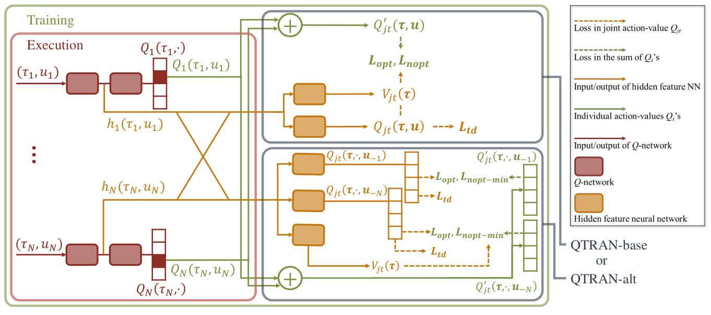
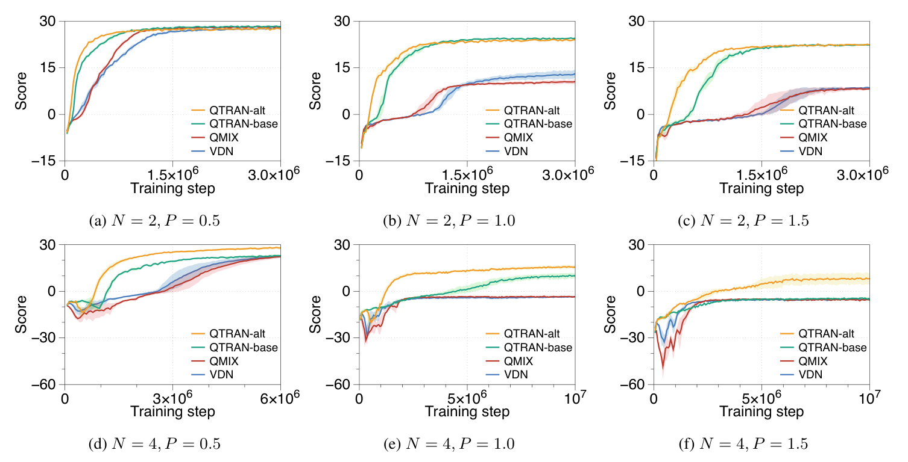

# 第 97 天｜QTRAN：不必保留整张价值表，也能让局部最优与团队最优对齐

[系列首页](README.md) · [上一篇](96-coma.md) · [下一篇](98-mappo.md)

**原论文与版本**：Kyunghwan Son、Daewoo Kim、Wan Ju Kang、David Earl Hostallero、Yung Yi，*QTRAN: Learning to Factorize with Transformation for Cooperative Multi-Agent Reinforcement Learning*，ICML 2019，PMLR 97。本文依据[正式主文](https://proceedings.mlr.press/v97/son19a/son19a.pdf)及[补充材料](https://proceedings.mlr.press/v97/son19a/son19a-supp.pdf)，重点核读定义1、定理1、式(4)–(7)、算法与实验协议。没有独立训练复现。

### 先接住前作的问题

[VDN](95-vdn.md)让团队价值等于个体效用的和，[QMIX](34-qmix.md)放宽成对个体效用单调的混合函数。这两条路共同追求一件事：每个人只用自己的历史选最优动作，拼起来仍是团队最优。问题在于，为了保住这个性质，是否必须把整张联合价值表都限制成加性或单调结构？

QTRAN的回答是“不必”。训练时保留一个能够描述复杂交互的联合价值，再学另一个易于分解的函数；二者数值可以不同，只要求最优动作对齐。[COMA](96-coma.md)用反事实基线解释策略梯度的信用分配，这里转回价值分解。两者都可能固定其他人的动作再考察一人的替代动作，但优化目标并不相同。

### 五个前置概念

- **联合动作价值**：给定所有人的历史与动作，对后续团队回报的估计。
- **局部效用**：只依赖本人的历史和动作，用于分散选择的评分，不必是真实个人回报。
- **IGM**：各人的局部贪心组合与团队价值最大化相容。
- **集中训练、分散执行**：训练可使用联合信息，部署选动作仍受局部信息限制。
- **正仿射变换**：对效用正缩放并平移，改变数值尺度而保持动作排序。

## 一、问题设定：IGM约束动作选择，而非整张价值表

考虑共享奖励的合作式部分可观测任务。第 $i$ 个智能体执行时能访问自己的动作—观测历史 $\tau_i$，不能偷看其他人的私有信息。训练阶段可以访问联合历史 $\boldsymbol\tau$ 和联合动作 $\mathbf u=(u_1,\ldots,u_N)$。联合动作价值记作 $Q_{\rm jt}(\boldsymbol\tau,\mathbf u)$，用于分散决策的局部效用记作 $Q_i(\tau_i,u_i)$。

这里的 $Q_i$ 不是“智能体自己的真实奖励回报”。环境只给团队奖励，局部效用是为了产生正确排序而学习的中间变量。给某个局部效用加常数通常不改变执行策略；因此不能看到一个智能体效用较大，就声称它创造了更多团队收入。

Individual-Global-Max（IGM）要求联合最大化和各人独立最大化相容。先假定最优动作唯一，或固定一致的并列选择规则，写成：

$$\bar u_i=\arg\max_{u_i}Q_i(\tau_i,u_i),\qquad \bar{\mathbf u}=(\bar u_1,\ldots,\bar u_N),\qquad \bar{\mathbf u}\in\arg\max_{\mathbf u}Q_{\rm jt}(\boldsymbol\tau,\mathbf u).$$

这是原文定义1的决策含义。若把所有 argmax 都理解成集合，则需要额外认真处理并列：个体最优集合的笛卡尔积不能产生非最优联合动作；若还要求两边集合完全相等，则更强。下文证明保证的是按局部贪心选出的联合动作最优，不借非严格不等式宣称所有并列最优解逐一完全对应。

VDN的精确加法表示足以实现这一目标，因为对和式最大化可逐项进行。QMIX的单调性也足够，因为提高任一局部效用不会让团队价值下降。但反过来不成立：只要各人选对最高点即可，联合价值在其他格子中的大小关系未必也要保持一致。QTRAN正是把“最高点可分散实现”和“整张表可由受限混合器精确重建”分开。

还要区分固定联合历史与整个任务。单看一个状态，我们很容易为某个团队最优动作各写一个局部偏好；跨状态时，同一个 $\tau_i$ 必须对应同一局部决策。假如两种全局情境对智能体完全不可区分，却分别强制它选择相反动作，任何仅依赖该历史的确定性策略都不能同时实现两个集中最优。QTRAN不创造缺失的信息，也不声称所有Dec-POMDP都可无损分解。

## 二、变换条件：用一个上界在贪心点接触原函数

定义加性变换函数与差值：

$$Q'_{\rm jt}(\boldsymbol\tau,\mathbf u)=\sum_i Q_i(\tau_i,u_i),\qquad D(\mathbf u)=Q'_{\rm jt}(\boldsymbol\tau,\mathbf u)-Q_{\rm jt}(\boldsymbol\tau,\mathbf u)+V_{\rm jt}(\boldsymbol\tau).$$

$V_{\rm jt}$ 是与当前联合动作无关的标量校正项。原文定理1、式(4)给出充分条件：

$$D(\bar{\mathbf u})=0,\qquad D(\mathbf u)\ge0\quad\text{对所有 }\mathbf u\ne\bar{\mathbf u}.$$

几何上，$Q'_{\rm jt}+V_{\rm jt}$ 是原联合价值的一个上界，在局部贪心组成的动作处恰好接触。因为加性函数的最高点已经由各个局部最大值得到，原函数不可能在别处超越这个接触点。证明只需三步：

$$Q_{\rm jt}(\bar{\mathbf u})=Q'_{\rm jt}(\bar{\mathbf u})+V_{\rm jt}\ge Q'_{\rm jt}(\mathbf u)+V_{\rm jt}\ge Q_{\rm jt}(\mathbf u).$$

第一步来自接触等式；第二步来自局部贪心；第三步来自上界条件。这串不等式比“通过变换获得更强表达能力”更值得记住，因为它准确指出了每个损失在维护哪一环。

定理中的理论定义是 $V_{\rm jt}=\max_{\mathbf u}Q_{\rm jt}-\sum_iQ_i(\tau_i,\bar u_i)$，但算法不在每一步枚举全部联合动作求这个量，而是训练一个校正网络逼近它。这不是普通策略价值 $V^\pi$ 的Bellman回归目标；名称含有state-value，不代表它就等于某个策略的期望回报。

原文也讨论必要性，但表述是**在保持局部最优动作的正仿射变换之后**。它不是说任何已经满足IGM、尺度任意的局部效用，都自动满足上面不等式。直观地，把局部效用差距缩小，可以使加性上界在不改变其最高点的同时，容纳原函数不同的次优差距。平移能被校正项抵消，正缩放不翻转排序。补充证明B.2是在给定联合历史的条件下讨论这种构造；神经网络跨大量历史共享参数时，还需统一的表示和训练解，不能把逐点存在性当成工程收敛定理。

因此，“QTRAN更一般”有一个精确范围：它摆脱直接用加性或单调混合器拟合原联合价值的要求，可以表示其中一些无法精确拟合的可分解任务。它没有证明任意有限网络、任意样本覆盖或梯度下降轨迹，都能找到这样的分解。

## 三、手算最小矩阵：数值不保真，最优动作仍保真

以下是本文自行构造的单步、双智能体、双动作任务。动作均为 $A,B$，奖励就是联合价值。矩阵行属于智能体1，列属于智能体2：

| 联合奖励 | 对方A | 对方B |
|---|---:|---:|
| 自己A | 8 | 0 |
| 自己B | 0 | 7 |

唯一团队最优是 $(A,A)$。可是，当对方选A时自己偏好A，当对方选B时自己偏好B，所以联合价值对某个固定局部排序不是单调的。若两个局部网络都偏好A，单调混合器就不可能在对方选B时把自己的B评价得比A更高。加性分解也不可能精确拟合，因为必要的矩形恒等式 $Q(A,A)+Q(B,B)=Q(A,B)+Q(B,A)$ 在这里变成 $15=0$。

注意，“不能精确拟合”并不意味着QMIX或VDN必然选错这个矩阵的最高点。损失权重、采样频率、近似误差都会影响最终策略；这里证明的是表示限制，不能替代运行一个优化器的结果。

为QTRAN选取两人的相同局部效用 $Q_i(A)=0,Q_i(B)=-0.5$，再令 $V_{\rm jt}=8$，则：

| 量 | AA | AB | BA | BB |
|---|---:|---:|---:|---:|
| 原联合价值 $Q_{\rm jt}$ | 8 | 0 | 0 | 7 |
| 加性函数 $Q'_{\rm jt}$ | 0 | -0.5 | -0.5 | -1 |
| 加性上界 $Q'_{\rm jt}+V_{\rm jt}$ | 8 | 7.5 | 7.5 | 7 |
| 差值 $D$ | 0 | 7.5 | 7.5 | 0 |

四个格子逐个代入均符合条件；两人各自贪心选A，团队得到8。变换后的AB、BA高于BB，而原函数中BB高于AB、BA，说明QTRAN确实没有保留非最优动作的全部排序。

再把局部B效用都改成 $-1$，仍然各自贪心选A，但BB处差值变为 $-2-7+8=-1$，违反充分条件。这个例子直接说明IGM成立不代表当前尺度已经满足变换约束；缩放回 $-0.5$ 后才重新可行。

这里 $D(BB)=0$ 也不意味着BB是最优动作。最优点的判断还需要比较加性函数最高值；BB处加性上界7低于AA处8。这是读等式约束时常见的混淆：接触原函数的点可以不止一个，只有最高的接触点才给出团队最优。

## 四、三项损失如何把存在性条件变成训练信号

QTRAN-base保留三类网络：局部效用网络、联合价值网络、校正网络。训练使用经验回放与周期复制的目标网络。以单个样本为例，原文式(6)写为：

$$L=L_{\rm td}+\lambda_{\rm opt}L_{\rm opt}+\lambda_{\rm nopt}L_{\rm nopt}.$$

第一项学习真实联合价值。下一时刻的动作由目标局部网络分别选出，再交给目标联合网络评价：

$$y=r+\gamma(1-d)Q^-_{\rm jt}(\boldsymbol\tau',\bar{\mathbf u}'),\quad \bar u_i'=\arg\max_{u_i}Q_i^-(\tau_i',u_i),\quad L_{\rm td}=(Q_{\rm jt}(\boldsymbol\tau,\mathbf u)-y)^2.$$

$d$ 表示真正终止，公式显式加上了终止处理以方便实现；原文算法用未写终止标记的DQN式目标。这里不能把动作选择器任意换成当前网络并仍称为原文完全相同的算法。目标局部网络若尚未与联合网络对齐，这个目标动作也不保证就是联合网络的最大点；训练中两个目标需要共同改善。

第二项把当前局部贪心动作的差值拉到零，第三项只惩罚样本动作处的负差值：

$$L_{\rm opt}=\left[Q'_{\rm jt}(\boldsymbol\tau,\bar{\mathbf u})-\widehat Q_{\rm jt}(\boldsymbol\tau,\bar{\mathbf u})+V_{\rm jt}(\boldsymbol\tau)\right]^2,$$

$$L_{\rm nopt}=\left[\min\left(Q'_{\rm jt}(\boldsymbol\tau,\mathbf u)-\widehat Q_{\rm jt}(\boldsymbol\tau,\mathbf u)+V_{\rm jt}(\boldsymbol\tau),0\right)\right]^2.$$

帽子表示在分解约束的该项计算中将联合价值输出停止梯度。否则优化器可能直接移动被拟合的联合价值来“满足约束”，而不是让局部效用去追踪它。联合网络仍从TD项学习；如果底层表示共享参数，也不能把这个停止梯度误解成所有相关参数在整个更新中彻底冻结。

为什么不是把所有 $D$ 都平方？因为这会重新要求整个联合价值等于加性函数加一个常数，刚刚放宽的表示空间又被关上。上面例子中两个7.5正差值合法，base不会因为它们远离零而惩罚；若误用全平方，两项就各贡献56.25，错误地要求拟合不可加的整张表。

为什么贪心动作单独生成？因为回放中的动作可能来自早期探索，当前贪心组合未必出现过。只检查样本动作，会漏掉最重要的接触条件。反过来，只检查贪心等式也不够：其他联合动作如果落到上界之上，整个证明最后一环就断了。

```text
初始化局部网络、联合网络、校正网络、目标副本和回放池
重复收集回合：
  各智能体只根据局部历史，用epsilon-greedy选择动作
  保存联合历史、动作、团队奖励、后继历史和终止标记
  从回放取样；循环网络需用一致的历史或序列重建隐藏态
  用目标局部网络选后继贪心动作，目标联合网络给TD目标
  用当前局部网络生成当前贪心组合
  计算TD损失、贪心点等式损失、样本点负差值损失
  在后两项中停止联合价值输出的梯度
  最小化三项加权和，定期复制目标网络
执行：仅保留每人的局部网络，各自取argmax
```

这段伪代码对应base的核心，而非涵盖作者每个环境的优化器细节。要可靠复现，还需记录探索衰减、回放分布、各损失量纲、共享表示、序列边界和目标复制周期。尤其不能只报告总损失：TD误差很小而约束误差大，与约束满足但联合价值本身估错，是完全不同的失败。

## 五、base与alt：满足不等式，为什么仍可能难学

<figure class="reading-evidence-figure" id="rl-97-figure-1"><a href="/rl/assets/papers/97-qtran-figure-1.png" target="_blank" rel="noopener noreferrer"></a><figcaption>原论文图形摘引｜正式会议正文，PDF第4页Figure 1。<a href="https://proceedings.mlr.press/v97/son19a/son19a.pdf#page=4" target="_blank" rel="noopener noreferrer">核对原文与版本</a> · 点图放大。原作者及相关权利人保留版权；未确认通用再利用许可，限量摘引用于紧邻技术评论。</figcaption></figure>

*原图1，PMLR正式版PDF第4页。保留完整图形与图例，裁去正文和外部图注；版权归原作者，作为方法分析的有限摘引，未确认通用再利用许可。*

图左红框是执行阶段仍保留的局部网络；绿色求和路径构成 $Q'_{\rm jt}$；橙色联合价值和校正网络服务于集中训练。右上是base，右下是alt：后者一次输出固定其他人动作时，某个智能体各个动作的联合价值。图是信息流和损失结构图，没有性能坐标轴；它能证明作者区分了两种架构，不能证明神经优化已经满足所有动作上的约束。

base只要差值非负就满意，结果可能出现大量次优动作在变换后非常靠近最优动作，局部排序对估计噪声敏感。alt试图让约束更紧：固定其他人的动作 $\mathbf u_{-i}$，沿第 $i$ 个动作方向的最小差值应为零。原文式(7)为：

$$\min_{u_i}\left[Q'_{\rm jt}(\boldsymbol\tau,u_i,\mathbf u_{-i})-Q_{\rm jt}(\boldsymbol\tau,u_i,\mathbf u_{-i})+V_{\rm jt}(\boldsymbol\tau)\right]=0.$$

这意味着每条被检查的单智能体动作切片都至少有一个接触点，而不只是要求整片位于上方。最小值为零同时排除了切片内负差值。算法把每个智能体的切片最小差值平方后取平均，替换base的非最优惩罚；不要把它误写成先对所有智能体取平均再平方，这会让正负误差抵消。

在教学矩阵中，每行每列都恰有一个零差值，因此选取的构造也满足这些切片条件。但一般任务不能简单对所有格子强制等于零，那又会回到加性限制。alt输出每个智能体的动作向量，避免逐个联合动作枚举；训练查询更多替代动作，并没有把指数规模的所有动作组合全部检查一遍。

这一“反事实”与COMA的区别很关键。COMA对当前策略的候选动作做概率加权求基线，以降低策略梯度方差；QTRAN-alt取差值的最小值并构造表示约束。一个是策略梯度估计，一个是价值分解训练，不能把二者的基线无偏性或实验结论相互套用。

## 六、原始实验到底检验了什么

原文先用小矩阵说明表示限制，再在§4测试Multi-domain Gaussian Squeeze（MGS）与改造后的predator-prey（MPP）。这些是有意强调非单调协作结构的任务，不是一个包含所有主流多智能体环境的普遍排名。

MGS有10个智能体，每人选择0到9的离散资源水平，资源系数决定总使用量。奖励随总用量呈高斯形状；多域版本增加多个峰，使某个容易到达但较差的团队配置形成陷阱。实验还改变探索方式：在普通GS中，多种方法能收敛到较好解，而保持完全探索、不做epsilon衰减时，受限价值拟合更容易受到全动作分布影响。这个控制实验强调数据分布与表示限制的交互，不能把所有性能差距只归给网络容量。

MPP中，两名或更多捕食者同时捕获猎物才得到团队奖励1；只有一名捕获则受罚 $-P$。作者测试 $N=2,4$，$P=0.5,1.0,1.5$，每回合固定100步，4名捕食者配置两只猎物，2名配置一只。提高单独行动惩罚，使“主动接近猎物但队友未到”更危险，也更容易出现保守逃避的次优行为。

<figure class="reading-evidence-figure" id="rl-97-figure-4"><a href="/rl/assets/papers/97-qtran-figure-4.png" target="_blank" rel="noopener noreferrer"></a><figcaption>原论文图形摘引｜ICML 2019正式主文，PMLR 97，PDF第8页Figure 4。<a href="https://proceedings.mlr.press/v97/son19a/son19a.pdf#page=8" target="_blank" rel="noopener noreferrer">核对原文</a> · 点图放大。保留图形、坐标与图例；版权归原作者及相关权利人，未确认通用再利用许可，此处为直接技术评论的有限摘引。</figcaption></figure>

正式正文图4的纵轴是每回合平均奖励，横轴是训练步数，图注给出95%置信区间；不同子图横轴预算并不相同。作者报告，困难配置中QTRAN-alt比base稳定、更快，尤其 $N=4,P=1.5$ 时base到图中训练结束仍未获得正回报，而alt改善。这是非常重要的反例：即使共享同一理论动机，实际损失构造也会决定是否学得动。本文仅核读原文叙述与图注，不由曲线读出伪精确终值，也没有重新计算统计区间或训练复现。核读范围未找到对应重复实验的种子数，不能推定完整重复协议。

与[MADDPG](25-maddpg.md)相比，QTRAN针对离散动作的价值型分散贪心，把大量压力放在正确分解上；MADDPG用集中critic训练显式actor，不要求相同IGM结构。与[MAPPO](98-mappo.md)相比，QTRAN有长期回放和目标网络，但还要平衡TD与分解约束；MAPPO依赖较新轨迹和受控策略更新。这些是设计取舍，不构成哪个方法在所有任务都更优的结论。

## 七、把表示结论和部署承诺分开

实际应用至少有四层误差。第一层是联合价值是否真实，离策略自举和覆盖不足都可能让它错误；第二层是局部函数是否能在全体历史上统一实现所需动作；第三层是有限样本上的软约束是否接近理想条件；第四层是部署时观测、隐藏态、可行动作和训练协议是否一致。单独降低其中一层损失，不会自动消除其余层。

一个有诊断价值的实验应分别记录局部贪心动作在集中critic下的排名、贪心等式残差、采样与额外枚举小任务上的负差值比例、实际团队回报。小矩阵可以遍历全部动作，因此能检验约束是否真的成立；大任务只能抽查时，就必须承认检查覆盖有限。不要用训练batch约束为零替代全空间保证。

还有一个容易被“更强表达”掩盖的成本：联合网络不受单调结构限制，就需要更多数据判断复杂交互；约束权重太小可能无法分解，太大可能与尚不准确的TD目标互相牵制。限制更强的QMIX有时反而提供更好归纳偏置。QTRAN的价值不是宣告约束越少越好，而是把哪个约束真正必要的问题说清楚。

<details>
<summary>追问一：如果变换后价值不等于真实回报，还能用它报告策略质量吗？</summary>

不能直接用局部效用和当作真实回报估计。它的任务是支持分散动作选择，正缩放和平移即可改变其数值而不改变策略。策略质量应通过真实环境评价，或独立校准的联合价值估计报告。对变换函数使用跨任务统一阈值也没有自然意义。
</details>

<details>
<summary>追问二：非最优惩罚只在回放动作上算，会不会漏掉危险动作？</summary>

会。理论要求全部相关动作满足不等式，算法只在采样支持上施加软约束。未访问组合可能违反条件，局部网络又可能把它组合成贪心动作。显式检查当前贪心点能补一部分，但不等于完整覆盖；alt的一维切片查询也没有枚举所有联合动作。
</details>

<details>
<summary>追问三：集中训练看到全状态，为什么还会有无法分解的任务？</summary>

因为执行者不能使用集中训练时才有的信息。训练能告诉网络哪些情境需要不同动作，却不能让同一个局部历史同时产生两个确定选择。若必须消除这种冲突，需要改善观测、加入允许的通信或改变策略信息结构，而不只是更换损失。
</details>

## 自测两题

**题一：教学矩阵保持 $Q_i(A)=0$，把两人的 $Q_i(B)$ 都设为 $-0.75$，取 $V=8$。贪心动作与非最优损失怎样变化？**

答案：贪心仍是AA，贪心等式残差仍为0。BB差值为 $-1.5-7+8=-0.5$，base在该样本的非最优损失为0.25；AB、BA的差值均为7.25，不受惩罚。可见动作暂时选对和充分条件成立是两件事。

**题二：若所有差值都非负，但贪心点差值为2，能否照搬定理证明？**

答案：不能。第一步的等式不成立，原联合价值在贪心点比加性上界低2，别处可能超过它。例如加性上界在AA为8、BB为7，原价值分别为6、7，则所有差值非负而局部贪心AA不是原函数最优。接触等式不是可有可无的装饰。

[系列首页](README.md) · [上一篇](96-coma.md) · [下一篇](98-mappo.md)
