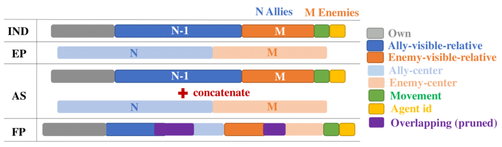
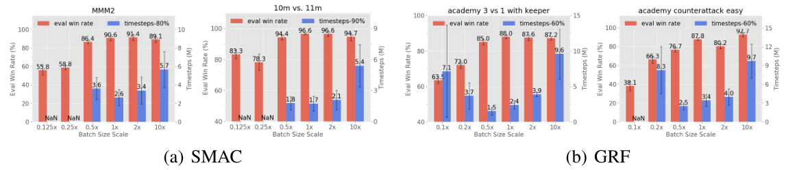

# 第 98 天｜MAPPO：多智能体PPO为什么能成为强基线，公平比较又要控制什么

[系列首页](README.md) · [上一篇](97-qtran.md) · [下一篇](99-apprenticeship-irl.md)

**原论文与版本**：Chao Yu、Akash Velu、Eugene Vinitsky、Jiaxuan Gao、Yu Wang、Alexandre Bayen、Yi Wu，*The Surprising Effectiveness of PPO in Cooperative Multi-Agent Games*。首次预印本公开于 [2021-03-02](https://arxiv.org/abs/2103.01955)，正式发表于 **NeurIPS 2022 Datasets and Benchmarks Track**。arXiv页面最新修订为v4，2022-11-04；本文实际核读的是[正式会议正文](https://proceedings.neurips.cc/paper_files/paper/2022/file/9c1535a02f0ce079433344e14d910597-Paper-Datasets_and_Benchmarks.pdf) §3–5、表1–3，以及[正式补充材料](https://proceedings.neurips.cc/paper_files/paper/2022/file/9c1535a02f0ce079433344e14d910597-Supplemental-Datasets_and_Benchmarks.pdf) §A、§C.3。目录年份按首次公开记2021，不把正式版的四类基准结果反写成最早预印本已完整包含的结果。

### 先接住前作的问题

[QTRAN](97-qtran.md)把难点放在联合价值如何分解，使局部贪心仍能实现团队最优。[VDN](95-vdn.md)与[QMIX](34-qmix.md)也在这条价值分解线上推进。MAPPO转到另一条路线：不分解整个联合动作价值，而是直接训练分散策略，再用集中价值网络改善梯度估计。

这篇论文的重点不是发明一个复杂的新目标。作者明确把贡献定位为系统经验研究：当PPO以合理的集中critic、更新次数、归一化、裁剪和批大小运行时，它在合作式多智能体任务中究竟能有多强？这个问题看似朴素，却能避免一种昂贵误判：拿一个实现细节不匹配的弱PPO作基线，然后把所有差距都解释成新算法的贡献。

### 五个前置概念

- **On-policy数据**：主要由当前或刚刚冻结的策略采集，有限复用后重新收集，而非无限期从历史回放池学习。
- **集中critic**：训练时使用联合信息预测团队回报，部署时不承担动作选择。
- **分散actor**：每个智能体仅根据允许的局部观测或历史产生动作分布。
- **GAE**：把多步时间差分残差加权相加，调节优势估计的偏差与方差。
- **PPO裁剪**：在代理目标中限制部分概率比收益，抑制过大的更新激励，但不是严格信赖域保证。

## 一、问题设定：共享奖励不等于大家看见同一个世界

任务是合作式Dec-POMDP：所有智能体共享团队奖励，但每人看到的局部观测不同。给定策略参数 $\theta$，第 $i$ 个智能体的动作从 $\pi_\theta(a_i\mid o_i)$ 采样；若使用循环网络，就把历史压缩进隐藏态，实际条件包括该隐藏态。团队目标仍然是最大化折扣累计奖励。

集中训练允许critic输入额外信息 $x_i$，例如环境全局状态加上智能体身份和局部可行动作信息。记价值估计为 $V_\phi(x_i)$。MAPPO与IPPO的核心区别在这里：MAPPO使用集中价值输入，IPPO的actor与critic都只使用局部输入。两者都可以用PPO目标，也都不因名字含“独立”或“多智能体”就天然具有某种通信机制。

对于同质智能体，论文共享actor和critic参数；但共享参数不等于共享当前观测。相同网络收到不同局部输入、身份或隐藏态，仍会产生不同动作。异质的MPE通信任务是作者不共享参数的例外。部署时还必须核查网络调用链：不能训练时说只有critic使用全状态，实际actor预处理却偷偷拼入了全局信息。

为什么集中critic有用？局部观测可能把“队友快要成功”和“队友已经失败”的情境混在一起，使局部价值预测方差很大；全局信息能帮助解释同一动作之后的回报。但更全的输入不自动等于更好的拟合。冗余、维度、身份缺失，以及少见的死亡状态，都可能使集中critic比一个简单局部模型更难训练。

和[COMA](96-coma.md)相比，MAPPO这里主要使用状态价值构成优势，并不逐智能体对替代动作边际化出反事实基线。和[MADDPG](25-maddpg.md)相比，它通过随机策略的PPO代理目标更新actor，不是在集中动作价值上应用同样的确定性策略梯度。集中训练只是共同的信息框架，不能把框架名当作相同算法。

## 二、从单智能体PPO到多智能体目标：哪些量共享，哪些量逐人计算

冻结本轮采样策略 $\theta_{\rm old}$ 后，每条智能体动作记录都有自己的概率比：

$$\rho_{t,i}(\theta)=\frac{\pi_\theta(a_{t,i}\mid o_{t,i})}{\pi_{\theta_{\rm old}}(a_{t,i}\mid o_{t,i})}.$$

原文补充§A对样本和智能体求平均，使用逐人比率而非把所有人的比率乘成一个联合比率。actor最大化：

$$L_{\rm actor}=\mathbb E_{t,i}\!\left[\min\left(\rho_{t,i}\widehat A_{t,i},\operatorname{clip}(\rho_{t,i},1-\epsilon,1+\epsilon)\widehat A_{t,i}\right)+c_H H(\pi_\theta(\cdot\mid o_{t,i}))\right].$$

$H$ 是熵，$c_H$ 控制探索激励。共享参数意味着这些逐人梯度汇入同一网络，但不意味着本轮团队回报应重复加总成原来的 $N$ 倍。论文损失采用平均，实际实现也应统一样本、时间和智能体维度的归一化。

对于未归一化的价值，TD残差与GAE可写成：

$$\delta_{t,i}=r_t+\gamma m_t V_{\phi_{\rm old}}(x_{t+1,i})-V_{\phi_{\rm old}}(x_{t,i}),\qquad \widehat A_{t,i}=\sum_{l\ge0}(\gamma\lambda)^l\delta_{t+l,i}.$$

求和在有效轨迹边界停止，$m_t$ 用于真正终止的自举控制。有限rollout截断并不总等于环境终止，要按任务语义保留bootstrap；循环隐藏态的重置也要跟真实回合边界一致。优势归一化通常在构成策略目标前完成，但它与价值目标归一化是两道不同操作。

补充材料给出的critic损失是未裁剪平方误差与裁剪平方误差取较大者。令回报目标为 $\widehat R$，并定义：

$$V_{\rm clip}=V_{\phi_{\rm old}}+\operatorname{clip}(V_\phi-V_{\phi_{\rm old}},-\epsilon,\epsilon),\qquad L_V=\mathbb E\left[\max\left((V_\phi-\widehat R)^2,(V_{\rm clip}-\widehat R)^2\right)\right].$$

这是论文目标层面的表达。实际实验还有归一化和其他实现配置，不应把这条式子视作全部代码。特别是比较或裁剪价值时，新预测、旧预测和目标必须处于同一尺度；若统计量在迭代间改变，旧值对应哪个归一化坐标需要明确处理。

PPO常被称为on-policy，但它确实用概率比允许同一批数据有限次复用。论文脚注明确承认这种校正；区别在于它不像典型off-policy算法那样长期保留整个训练过程中采集的历史回放。因此，“PPO完全不复用数据”和“有重要性比就可以无限复用旧数据”都不准确。

## 三、手算一次更新：裁剪约束了什么，没有约束什么

构造一个两步教学轨迹，$\gamma=0.9,\lambda=0.8$，团队奖励依次是1和2，第二步后真正终止。某个智能体的集中价值预测为 $V_0=1,V_1=1.5,V_2=0$。这不是原论文环境数据。

第二步残差为 $\delta_1=2-1.5=0.5$；第一步为 $\delta_0=1+0.9\times1.5-1=1.35$。因此 $\widehat A_1=0.5$，$\widehat A_0=1.35+0.9\times0.8\times0.5=1.71$。若以优势加旧价值形成相应的lambda-return训练目标，则第一步为2.71；完整蒙特卡洛回报是 $1+0.9\times2=2.8$。差异来自 $\lambda<1$ 混入价值估计，不是算术错误，也不是奖励消失。

再独立考察PPO裁剪，暂用两个未做优势标准化的教学样本。样本一优势为2，旧动作概率0.5，新概率0.65，因此 $\rho=1.3$。取 $\epsilon=0.2$，未裁剪项为2.6，裁剪项为2.4，目标贡献取2.4。继续增加该动作概率时，正优势样本不再提供同样的增益激励。

样本二优势为 $-1$，旧概率0.5，新概率0.35，因此 $\rho=0.7$。未裁剪项为 $-0.7$，裁剪项为 $-0.8$，最小值是 $-0.8$。两样本平均贡献为 $(2.4-0.8)/2=0.8$，未裁剪平均是0.95。负优势时不要误以为“取min”会自动取绝对值更小的一项，符号决定了裁剪方向。

现在令两名智能体在某个联合动作上的概率比都为1.2。在条件独立采样且给定相应观测的情境下，联合动作概率比是 $1.2^2=1.44$。即使每个局部比率恰在裁剪边缘，该联合动作的概率可相对增加44%；智能体更多时乘积变化还会扩大。实际PPO裁剪甚至不是对所有局部比率的硬约束，只是在所采样动作上的目标截断，因此更不能把它称作团队联合KL的严格上界。

这个例子解释了论文关于少做几个epoch和更小裁剪范围的直觉：所有队友都在更新，局部看似温和的改变叠加后，训练环境可能已经明显变化。但这是机制解释，不是原文证明的多智能体单调改进定理。

## 四、集中critic的输入：全局信息要完整，也要知道“正在评价谁”

<figure class="reading-evidence-figure" id="rl-98-figure-4"><a href="/rl/assets/papers/98-mappo-figure-4.png" target="_blank" rel="noopener noreferrer"></a><figcaption>原论文图形摘引｜正式会议正文，PDF第8页Figure 4。<a href="https://proceedings.neurips.cc/paper_files/paper/2022/file/9c1535a02f0ce079433344e14d910597-Paper-Datasets_and_Benchmarks.pdf#page=8" target="_blank" rel="noopener noreferrer">核对原文与版本</a> · 点图放大。原作者及相关权利人保留版权；未确认通用再利用许可，限量摘引用于紧邻技术评论。</figcaption></figure>

*原图4，NeurIPS 2022正式正文PDF第8页。保留完整图形与右侧图例；版权归原作者及相关权利人，用于直接技术评论的有限摘引，未确认可任意再分发的通用许可证。*

这不是学习曲线，而是输入表示示意图。IND是智能体局部观测；EP是环境提供的全局状态；AS将二者拼接，FP再删掉重复特征。颜色区分自身、友军、敌军、移动能力和身份等信息，紫色标出被删去的重复部分。横向条形不是奖励大小，也不是精确的特征数量统计。

在SMAC中，EP描述队伍全貌，但可能遗漏当前智能体身份、相对距离和可行动作等局部信息。直接把“全局”理解成所有信息的严格超集，会忽略这些坐标系和角色差异。把局部观测接回去可以帮助critic解释当前样本属于哪个主体、有哪些可行行为。

另一种输入是CL，即拼接所有人的局部观测。它看似完整，实际上可能同时有两个问题：大量相同对象被重复编码，维度随人数增加；如果某个事件没人看见，拼接仍然不会凭空补出该信息。论文§5.2比较这些方案，结论是信息种类、主体特征与维度都重要，而不是越长的输入向量越好。

FP只在部分地图胜过AS，说明“去冗余一定提升”也不是无条件规律。去重还要求开发者理解字段含义：同一敌人的绝对位置和不同智能体视角下的相对位置，可能是不同信息而不只是重复列。先做数据字典再剪枝，比凭相关性随意删除输入更可靠。

执行端的信息边界不因critic输入更丰富而放宽。例如Hanabi中，critic训练时可看到本人的隐藏手牌，actor仍不能看到。若评估脚本把critic使用的牌面特征传进actor，得到的是不同任务而不是更强MAPPO。

## 五、归一化与mask：三个相似名字不能混为一谈

价值目标随策略改进而变化，某些任务奖励尺度很大。论文§5.1用运行中的均值和标准差标准化critic目标。若统计量为 $\mu,\sigma$，则训练目标与反变换是：

$$\widetilde R=\frac{\widehat R-\mu}{\sigma},\qquad V_{\rm raw}=\sigma\widetilde V+\mu.$$

实现要给标准差加适当数值稳定处理。计算GAE时必须先恢复真实奖励尺度，否则例如原始奖励10与归一化价值0.2直接相减，得到的优势没有一致单位。补充算法提到PopArt；这里需要分清“标准化目标”这一原则与是否同时对输出层做统计变化补偿的具体实现，不能把所有运行均值方差操作都自动叫作完整PopArt。

**可行动作mask**处理环境此刻禁止的动作，通常在分布归一化前排除无效logit。旧策略概率与新策略概率必须针对同一合法动作支持计算，否则比率可能不再可比。它决定actor能选什么。

**回合边界mask**决定价值自举、GAE递推和循环隐藏态何时停止或重置。真正终止和时间上限截断不能不加区分地处理。它决定未来回报是否仍属于当前估计对象。

**死亡mask**是论文补充§C.3重点研究的critic输入处理：在SMAC中，某个单位死亡后，团队回合仍可能继续，其他单位还在获得奖励。作者把死去单位的价值输入替换成零向量加该单位身份，而不是直接沿用杂有无效局部特征的全局向量。这是压缩某类难拟合输入的工程选择，既不是把预测价值强制置零，也不是把后续团队奖励删除。

为什么还保留身份？不同单位可能承担不同角色，死亡后的剩余团队回报分布不必相同。作者的消融比较了带身份零向量、无身份全零向量、原全局输入和丢弃死亡后样本等选项。带身份方案在所测设置总体更好，但机制解释仍主要是拟合分布变化和方差的经验分析，并未给出普适最优性证明。

若真的要删掉死亡后的训练步，必须把后续折扣团队回报正确折回死亡边界，才能维持回报对象；补充材料明确讨论这样做可能提高优势估计方差。简单设置“单位死亡等于整个团队终止”，会把牺牲自己换取团队成功的行为评价错。训练有效样本mask与上述death mask也不是同一个概念，调试时应分别命名并检查。

## 六、epoch、mini-batch、clip与采样预算需要一起看

论文§5提出五组关键因素：价值归一化、价值输入、训练数据使用、策略/价值裁剪、批大小。它们不是相互独立的魔法开关。

作者建议困难任务使用5或10个epoch，简单任务可用15个；多数场景避免把数据拆成很多mini-batch。这里“一个mini-batch”表示本轮数据作为一个大批更新，不是只用一条样本，也不是整个训练仅更新一次。相比单智能体PPO里常见的多次小批更新，多智能体下过多复用可能放大队友同步变化导致的不稳定。

例如，教学配置有8个并行环境，每个采样128步、5名智能体。本轮产生1024个环境转移，以及5120条智能体—时间记录。10个epoch、每epoch一个batch，会把这些记录读10遍并执行10次批更新；若改成4个mini-batch、仍做10个epoch，每条记录仍读10遍，但优化器走了40步，每步梯度噪声和参数位移都不同。不能只看“每条数据复用次数相同”就认为两种训练等价。

论文建议裁剪范围小于0.2，并在稳定性和速度间调节。其SMAC消融让策略裁剪和价值裁剪使用相同的 $\epsilon$，这是该实验选择，不是理论要求所有实现必须共享一个超参数。更小范围有时训练慢但最终更稳；较大范围则可能停在次优策略。上述现象与epoch数共同作用，不能一次改掉两者后把原因全归给某一个。

<figure class="reading-evidence-figure" id="rl-98-figure-8"><a href="/rl/assets/papers/98-mappo-figure-8.png" target="_blank" rel="noopener noreferrer"></a><figcaption>原论文图形摘引｜NeurIPS 2022 Datasets and Benchmarks正式会议主文，PDF第10页Figure 8。<a href="https://proceedings.neurips.cc/paper_files/paper/2022/file/9c1535a02f0ce079433344e14d910597-Paper-Datasets_and_Benchmarks.pdf#page=10" target="_blank" rel="noopener noreferrer">核对原文</a> · 点图放大。保留图形、坐标与图例；版权归原作者及相关权利人，未确认通用再利用许可，此处为直接技术评论的有限摘引。</figcaption></figure>

批大小也有下限与成本。批太小，优势与梯度估计噪声大；继续增大可能改善最终表现，但超过某点后只会推迟下一次策略更新、消耗更多环境样本和显存。论文图8同时考虑最终成功率和达到某个阈值所需环境步，提醒我们“更大批最终更高”和“更省样本”不是同一命题。

```text
初始化actor、集中critic、运行中的价值统计量
重复直到环境交互预算耗尽：
  冻结本轮旧策略；清空本轮rollout缓冲区
  并行收集轨迹，存局部观测、critic输入、动作、旧log概率
  同时保存真实终止、有效动作、死亡状态及循环隐藏态信息
  为死亡单位构造规定的critic输入，不删除其后团队回报
  用原始奖励尺度上的价值计算GAE与回报目标
  更新价值归一化统计；保持新旧价值和目标尺度一致
  进行少量epoch；默认大批或少量mini-batch
    按序列块重建循环状态，保留时间顺序
    计算逐智能体概率比、PPO裁剪项、熵和critic损失
    更新actor与critic，监控KL、裁剪比例与价值误差
  丢弃本批数据，使用更新后的策略重新采样
```

这是忠于机制的教学伪代码，不声称逐行复刻公开仓库。本文核读的是正式论文与补充材料，没有运行作者代码；重现时还应固定环境版本、随机种子、并行数、回合截断规则和超参数搜索预算。

## 七、四类基准：把强结果读成有边界的证据

正式版在MPE、SMAC、Google Research Football（GRF）和Hanabi上比较PPO与离策略方法。作者重实现并调参的主要基线包括MADDPG与QMIX，网格搜索规模与PPO相当，并测试归一化、目标网络更新和输入表示等实现选择。这比拿未经调参的默认实现公平，但其他最先进方法有些使用引用结果，仍不能声称所有比较都共享同一训练代码与硬件路径。

**MPE**的三个合作任务使用10个随机种子；环境没有专门全局输入时，作者拼接局部观测给集中方法。MAPPO与QMIX整体相近，在部分任务优于MADDPG；IPPO也相当有竞争力。这说明PPO本身值得认真调好，不意味着集中critic在每个简单任务都必然带来大幅收益。

**SMAC**每次评估运行32局，对每个种子取最后10次评估胜率的中位数，再对6个种子报告中位数及标准差。主实验MAPPO、IPPO与QMIX训练至收敛或最多1000万环境步；RODE统计来自被引用论文。表1中带星号的列才是对齐RODE训练步数的列，不能混用另一列的更大预算结果证明相同样本效率。

一个具体核对是表1的MMM2行：普通预算下MAPPO(FP)为90.6，QMIX为87.5，相差3.1个百分点；对齐RODE预算的MAPPO*(FP)为51.6，而RODE*为89.8。它不支持“MAPPO在此地图同预算全面优于RODE”。单行也不推翻论文总体趋势，而是展示为什么表头的星号与正文预算说明比摘取最高数字更重要。这些都是原表汇总值，不是本文重新训练所得，也不是显著性检验。

**GRF**使用六类academy情境、稠密共享奖励，单次成功率评估为100次rollout，最后10次评估再跨6个种子平均。多数情境训练2500万环境步，困难反击和角球为5000万。这里局部观测已含完整状态描述，因此作者标签中的MAPPO与IPPO没有输入层面的区别。TiKick还使用大规模离线预训练，不能只拿在线步数就认定总数据成本完全一致。

**Hanabi**测试2到5人、至多100亿环境步，每个回报估计平均1万局，报告至少3个种子的平均表现与最佳种子表现。MAPPO critic可额外看到本人的隐藏牌，SAD使用的历史贪心动作信息又与PPO不同；论文明确这些差异。因而“相同环境步”不等于“相同训练可见信息”。最佳种子也不能替代平均值：例如2人配置MAPPO平均23.89、最佳24.23（23.77是3人配置的平均值），这两个数字回答的问题不同。

计算资源方面，论文说明在一台256GB内存、64核CPU、RTX 3090 GPU的桌面机器上运行实验。这支持“不需要超大分布式集群也能得到强结果”，但不能改写成“没有计算成本”。环境模拟并行、超参数搜索、10B级Hanabi采样都应计入实际预算。

## 八、怎样把MAPPO用作可信基线，而不是新口号

首先统一问题：奖励、观测、动作空间、允许的训练信息、评估执行信息必须可比。其次统一预算口径：环境转移、智能体动作记录、优化器步数、墙钟时间和搜索试验数分别记录。最后统一统计：不要把一个方法的最好种子与另一个方法的均值放在同一列，也不要把不同终止时点的最高胜率当作同预算结论。

对新任务，合理顺序不是先把所有技巧叠满，而是先建立可复现的IPPO/MAPPO版本，确认回报和mask正确，再检查critic输入与价值尺度，最后调数据复用和clip。若价值误差下降而策略回报不升，需要检查优势符号、动作概率、可行动作mask、数据过期程度和评估随机性；不能只继续增大网络。

论文的核心结论是经过认真实现的PPO能够成为强合作式多智能体基线，不是PPO在所有合作博弈、部分可观测结构、信用分配难题或硬件预算下普遍胜出。它没有解决所有探索困境，也不以集中critic消除所有非平稳性。与QTRAN相对照，二者分别提醒我们：表示假设值得检查，实验协议同样值得检查。方法名很短，决定结论的条件却不能省略。

<details>
<summary>追问一：MAPPO已经用集中critic，为什么还需要更小的epoch数？</summary>

critic可以利用更多信息，但采样时的联合策略仍在有限轮更新后变旧。多个actor同时改变，当前团队行为可能偏离旧轨迹支持的分布。集中输入不能使旧样本永久有效；少量epoch和较温和裁剪是在控制这种偏离，且属于经验选择而非收敛保证。
</details>

<details>
<summary>追问二：死亡mask会不会丢掉还活着的队友信息？</summary>

会，它刻意把死去主体对应的critic输入压缩成零向量加身份，这是有信息损失的近似。作者观察到它降低拟合难度、改善所测SMAC性能；代价是无法区分所有死亡后的全局情境。若新任务的死亡后局势差别特别重要，应重新消融，而不是把它当成普适充分统计量。
</details>

<details>
<summary>追问三：没有长期回放却能样本效率相近，是不是离策略优势不存在？</summary>

不是。数据复用潜力只是效率的一个来源，目标偏差、非平稳性、优化稳定性、函数表示和环境结构都影响最终所需样本。本文的结果说明一些基准上良好PPO实现足以竞争，不能推导任意任务或任意采样成本下离策略方法都没有价值。
</details>

## 自测两题

**题一：价值目标均值10、标准差2，critic归一化输出0.5，对应原尺度价值是多少？如果下一步真正终止且奖励12，TD残差是多少？**

答案：价值为 $2\times0.5+10=11$，终止时不自举，残差为 $12-11=1$。直接用 $12-0.5=11.5$ 混用了两个尺度，会破坏优势计算。若这只是rollout截断而非真正终止，还需按任务规则加入后继价值。

**题二：四名智能体每个环境步各产生一个动作记录，采集100万环境步后做10个epoch，能说算法用了4000万次环境交互吗？**

答案：不能。这里是100万环境转移、400万条智能体动作记录，以及约4000万条记录处理次数；后两者不是新增环境交互。比较样本效率时要用一致的环境步口径，比较计算成本时再报告处理量、优化器步数和墙钟时间。

[系列首页](README.md) · [上一篇](97-qtran.md) · [下一篇](99-apprenticeship-irl.md)
