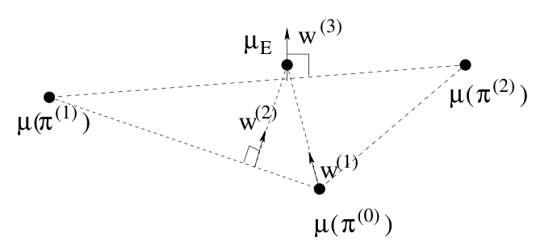
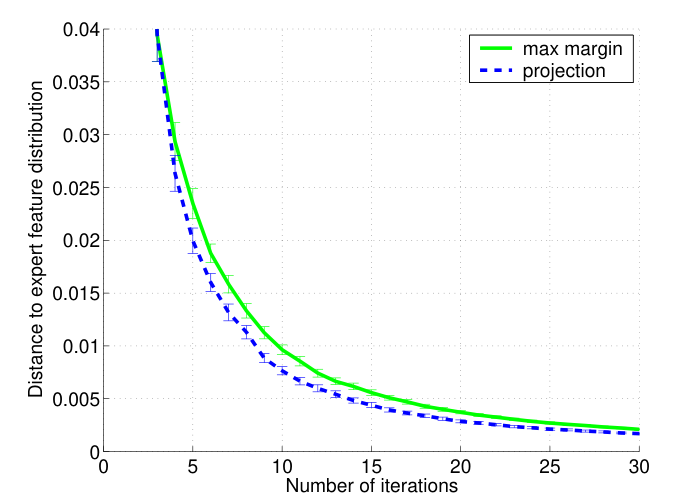
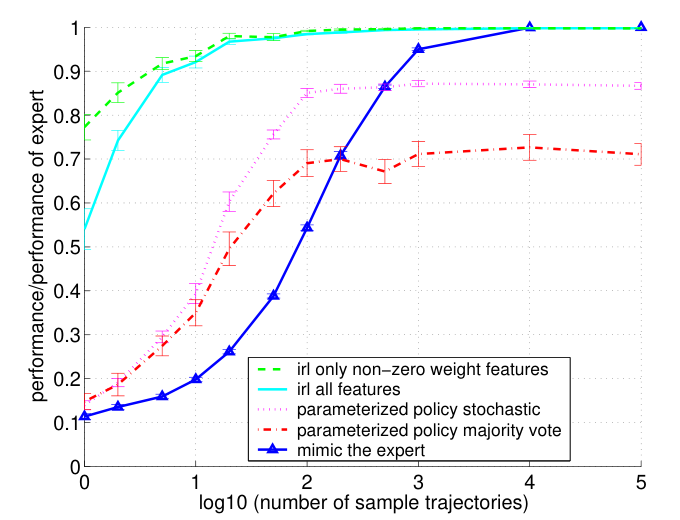

# 第 99 天｜Apprenticeship IRL：不必找回真实奖励，也能逼近专家表现

[系列首页](README.md) · [上一篇](98-mappo.md) · [下一篇](100-maximum-entropy-irl.md)

**原论文与版本**：Pieter Abbeel、Andrew Y. Ng，*Apprenticeship Learning via Inverse Reinforcement Learning*，ICML 2004。[正式出版记录](https://doi.org/10.1145/1015330.1015430)标注出版记录日期为2004-07-04；该日期不等同于已经核实的最早公开日，本文未发现可核定的更早预印本日期。[ICML会议资料](https://icml.cc/Conferences/2004/summary.pdf)给出的会议日期为2004年7月4–8日，地点Banff。本文核读的是[CMU托管的8页会议论文副本](https://www.cs.cmu.edu/~jeanoh/16-785/papers/abbeel-icml2004-apprentice.pdf)，包括§2–5与附录A；未将作者网站提到的扩展证明视为已经核读。以下说的“学徒学习”是这篇论文的具体算法，不泛指全部模仿学习。

### 先把问题从“怎样优化”移到“究竟优化什么”

[上一篇MAPPO](98-mappo.md)仍然假设任务奖励已给定。即便优化器、信用分配和训练协议都处理好了，驾驶任务中的“安全、舒适、效率”该各占多少权重，仍可能很难写清楚。人能够演示一次开车，却未必能提供一套数值奖励。

直接监督学习专家动作是一条路，但专家没有去过的状态怎么办？如果车辆遇到不同交通流，逐帧复读示范也没有意义。本文选择另一条路：保留环境的规划结构，从示范推断足以指导规划的奖励方向。最容易误读的是最后半句。论文并不保证恢复专家脑中的真实奖励；它保证的是，在明确的线性奖励假设下，只要累计特征足够接近，回报也会接近。

这一点与[第23天GAIL](23-gail.md)有很好的教学联系：两者都把“模仿每个动作”转成行为统计的匹配。但本篇用人工指定的有限维特征与反复调用的RL求解器，不能把后来的神经判别器、对抗训练及其实现细节倒写成2004年的方法。

### 五个前置概念

1. **单条轨迹特征**：沿一次经历累计的折扣特征，受随机转移影响。
2. **策略特征期望**：对初态、动作随机性和转移随机性一起求平均。
3. **经验特征期望**：有限条专家轨迹的平均，仍有抽样误差。
4. **候选奖励**：算法为了找到新行为而构造的线性方向，不必是真实心理偏好。
5. **策略混合**：在一条轨迹开始前选择某个完整策略，此后一直执行它。

它们不是五种叫法相近的同一个量。尤其不能把一条长轨迹里的每个时间步都视为独立的专家示范，再直接套用按独立轨迹建立的样本界。

## 一、问题设定：观察示范，已知环境，未知奖励

论文把任务写成有限状态MDP，已知状态集合、动作集合、转移概率、折扣因子γ和初始状态分布D，唯独不知道奖励。这里0≤γ<1。给定任何候选奖励，还需要能够调用一个RL求解器。理论首先把这个求解器当成精确最优求解器；实验网格世界使用价值迭代。

设已知特征映射φ(s)∈[0,1]ᵏ，真实奖励满足

$$R^*(s)=(w^*)^\top\phi(s),\qquad \|w^*\|_1\leq 1.$$

k是特征数，不是状态数。权重可以为负，比如碰撞特征对应负奖励。L₁范数约束和特征范围共同限定奖励绝对值，避免把奖励乘一万之后仍要求同一个绝对误差界。状态动作特征也可使用，原文脚注明确指出这不是本质困难；本文为统一符号继续写状态特征。

专家策略π_E从同一个D出发产生示范，不要求它严格最优。因而学习结果的基准是“专家实际达到的回报”，不是未知最优回报。专家若有系统性坏习惯，这个保证不会自动纠正它，更不代表安全保证。

## 二、核心推导：特征误差怎样变成回报误差

### 从累计奖励抽出未知权重

定义未归一化的折扣特征期望

$$\mu(\pi)=\mathbb E_{s_0\sim D,\pi,T}\left[\sum_{t=0}^{\infty}\gamma^t\phi(s_t)\right].$$

每个坐标位于[0,1/(1−γ)]。由于奖励对特征线性，权重不随时间、状态或轨迹改变，可以移出期望与求和：

$$J_w(\pi)=\mathbb E\left[\sum_{t=0}^{\infty}\gamma^t w^\top\phi(s_t)\right]=w^\top\mu(\pi).$$

这一步是整篇论文的支点。只要μ相同，整个线性奖励族都会给出相同的期望回报；但这并不要求动作序列、访问状态的顺序或每条轨迹的风险相同。特征遗漏的区别，匹配算法根本看不见。

如果某个策略满足‖μ(π)−μ_E‖₂≤ε，由Cauchy–Schwarz不等式，

$$|J_w(\pi)-J_w(\pi_E)|
\leq\|w\|_2\|\mu(\pi)-\mu_E\|_2
\leq\|w\|_1\varepsilon\leq\varepsilon.$$

对应原文§3式(6)–(9)。这是对所有满足范数条件的线性奖励同时成立的误差控制，而非“找到某个奖励使专家看起来很好”。后一种要求极弱：全零奖励会让所有行为同样最优，却完全没有学到任务。

### 折扣归一化不要偷偷省略

有些图或实现使用ν(π)=(1−γ)μ(π)，让坐标回到[0,1]。这可以改善数值尺度，但同一个距离δ此时只推出原始折扣回报误差至多δ/(1−γ)。原文图3就使用了这种归一化。若把图上的0.01直接写成未归一化回报差0.01，γ=0.99时会漏掉100倍的因子。

另一种直接可用的界是L₁与L∞对偶：|wᵀΔμ|≤‖w‖₁‖Δμ‖∞。因此逐坐标误差也能控制回报。本文保留论文的L₂几何算法，不把另一个范数界误写成作者实际求解的目标。

### 有限示范和截断误差必须单列

用m条独立专家轨迹估计

$$\hat\mu_E=\frac1m\sum_{j=1}^{m}\sum_{t=0}^{H-1}\gamma^t\phi(s_t^{(j)}).$$

保留H步时，单坐标遗漏的尾项至多γᴴ/(1−γ)，L₂尾项至多√kγᴴ/(1−γ)。同样的截断若用于学习策略，也要计入相应侧的误差。实践中的“匹配得很好”通常只说训练样本的估计值很近，不等于无限时域真实期望很近。

令算法相对经验目标的匹配误差为η，经验目标与真实专家期望的L₂误差为β，则三角不等式给出回报差不超过η+β。若学习策略的μ也靠模拟估计，其估计误差还要再加一项。这个分账比把所有误差都叫ε更适合调试。

原文Theorem 2给出一个充分条件：在其精确规划、特征有界及相应收敛条件下，为获得总回报容差ε和置信度1−δ，独立示范轨迹数取

$$m\geq\frac{2k}{\varepsilon^2(1-\gamma)^2}\log\frac{2k}{\delta}.$$

附录A的证明先对每个坐标应用Hoeffding界，再做union bound，最后将L∞误差转换为L₂误差，并把抽样与优化各分配ε/2。它是最坏情况的充分上界，不是实践中必须达到的最低样本数，也不包含每轮RL求解所消耗的环境交互。会议版证明还明确限于经验特征目标落在可实现特征凸包的情形，带噪目标可能不在凸包内的处理被指向扩展证明。本文不据会议版简短证明断言任意带噪经验目标都能被精确匹配。

## 三、最大间隔：每轮找一个“还没学会的奖励方向”

假设已找到策略π₀,…,πᵢ₋₁及其特征μ₀,…,μᵢ₋₁。下一轮解

$$t_i=\max_{\|w\|_2\leq1}\min_{0\leq j<i}w^\top(\mu_E-\mu_j).$$

可以写成最大化标量t，约束wᵀμ_E≥wᵀμⱼ+t且‖w‖₂≤1。候选w试图同时证明：专家在这个奖励下比此前所有策略都好。内层最小值让算法不能只击败一个弱候选；外层最大值找出最严重的共同缺口。

得到wᵢ以后，不是直接把它当动作。要把Rᵢ(s)=wᵢᵀφ(s)交给正向RL求解器，得到最大化该奖励的新策略πᵢ，再求其μᵢ。这是反复交替的“找区分方向、规划响应、加入候选集”。每次更新都有一次规划成本，不能因为特征维度小就说整个算法与环境规模无关。


<figure id="rl-99-figure-1" class="reading-evidence-figure"><a href="/rl/assets/papers/99-apprenticeship-irl-figure-1.png" target="_blank" rel="noopener noreferrer"></a><figcaption>原论文图形摘引｜Abbeel、Ng，ICML 2004会议版，PDF第3页Figure 1。<a href="https://www.cs.cmu.edu/~jeanoh/16-785/papers/abbeel-icml2004-apprentice.pdf#page=3">核对原文</a>。保留完整图形与符号，原版权保留。</figcaption></figure>

这张图没有训练步数轴，也没有性能百分比。平面位置代表特征向量，黑点是专家和候选策略；虚线给出候选点的几何关系，箭头w⁽¹⁾、w⁽²⁾、w⁽³⁾是不断变化的奖励方向。新点加入以后，专家到候选凸包的距离缩小，下一轮最容易区分它们的方向也改变。图证明不了实际神经网络训练稳定，但很好地解释了为什么不是对奖励参数做一次监督回归。

### 停机时究竟输出什么

当t≤ε时，原文首先得到的逻辑是：**对每个允许的w，候选集中存在一个策略，在该w下不比专家差超过ε。**量词次序很重要，它不是说存在同一个候选策略，对所有w都好。真实w未知，因此无法仅凭这条结论自动挑出它。

作者给出两条出路。第一条是人工检查候选策略，选择可接受的一个。第二条是求凸包内最接近专家的点：

$$\lambda^*=\arg\min_{\lambda_j\geq0,\,\sum_j\lambda_j=1}
\left\|\mu_E-\sum_j\lambda_j\mu_j\right\|_2^2.$$

然后在每条轨迹开始时，以λⱼ概率选择πⱼ并一直执行。期望的线性性保证该混合策略的特征正好等于Σλⱼμⱼ。这个混合是能同时支撑全奖励族误差界的构造。有限维凸包还允许最多k+1个候选就表示同一个点，但这不是说最初只需训练k+1轮。

每步都独立按同一λ切换策略一般不等价，因为每个策略改变后续访问状态的分布。若想构造等价的平稳随机策略，应从状态动作占用测度计算状态条件动作概率，而不是直接平均策略输出；这属于额外实现，不是原文的回合级混合定义。

## 四、投影法：不用每轮求解完整凸包优化

最大间隔法要处理逐轮扩大的候选约束。投影法只保留一个当前混合特征点μ̄和它的混合系数，令w=μ_E−μ̄，求解这一奖励下的新策略，得到μ_new。沿着当前点与新点之间的直线做投影：

$$d=\mu_{\rm new}-\bar\mu,\qquad
\alpha=\frac{(\mu_E-\bar\mu)^\top d}{d^\top d},\qquad
\bar\mu'=(1-\alpha)\bar\mu+\alpha\mu_{\rm new}.$$

在原文证明的可实现目标与精确oracle条件下，α落在[0,1]，新点仍是合法混合；几何上就是直角投影。它不是对所有历史点重新求最近点，因此可能和最大间隔法走不同路径，却都能持续缩小距离。

原文Theorem 1给出两种算法的多项式迭代上界，正文式(14)写作O(k/((1−γ)²ε²)·log(k/((1−γ)ε)))。理解这个结果的关键是“oracle调用次数有界”，不是每次oracle调用免费。附录证明利用有界特征空间以及新策略在当前方向至少不弱于专家的性质，建立单步几何进展；有限精度RL若不满足该性质，不能原样继承证明。

下面明确区分理论步骤与工程防护：

```text
输入：MDP去掉奖励、特征φ、专家特征目标μ_target、容差ε
初始化任意策略π0，评估μ0；μbar ← μ0；混合权重λ ← [1]
重复：
    若 norm(μ_target - μbar) <= ε：返回回合级混合策略λ
    w ← μ_target - μbar
    πnew ← 求解奖励 wᵀφ 下的最优策略
    μnew ← 评估πnew的折扣特征期望
    d ← μnew - μbar
    若 dᵀd 太小：报告停滞，而不是报告达到理论容差
    α ← ((μ_target - μbar)ᵀd) / (dᵀd)
    理论条件下α在[0,1]；近似实现可裁剪，但需记录近似状态
    μbar ← (1-α)μbar + αμnew
    旧混合权重全部乘(1-α)，追加新权重α
```

用采样估计μ时，训练样本上的“进步”也可能只是噪声。比较新旧残差最好使用独立评估轨迹，并报告规划精度、估计方差及停止原因。裁剪α可以保证混合合法，却不能把失效的理论前提修复回来。

## 五、独立算例：一半左、一半右，比任何单个候选更合适

以下是教学构造，不是论文实验。设某个有限任务的两维累计特征分别计数两类访问，可实现策略A、B的特征为μ_A=(2,0)、μ_B=(0,2)，专家目标μ_E=(1,1)。从A开始：

- 当前差向量w=(-1,1)。在这个奖励下，A回报为−2，B为2，专家为0，所以oracle会选B。
- d=(-2,2)，α=[(-1,1)·(-2,2)]/8=4/8=1/2。
- 投影点为(1/2)(2,0)+(1/2)(0,2)=(1,1)，残差从√2降到0。

于是回合开始时等概率选A或B，能匹配专家特征。若真实w*=(0.6,−0.4)，其L₁范数为1，A、B和专家回报分别是1.2、−0.8、0.2；混合回报也是0.2。A在这项奖励下更好，却在另一项允许奖励w*=(-0.4,0.6)下变差。不存在从这两个候选里不看奖励就选出一个、并对所有奖励同时匹配的办法。

这个例子也说明“逼近专家”不要求每条轨迹表现接近。混合策略每条轨迹可能走完全不同的路线；保证控制的是期望。如果一条路线虽然收益高却会造成灾难，而灾难没有出现在特征里，平均匹配毫无安全含义。即使把灾难写成特征，也只是匹配其累计期望，不自动控制最坏轨迹。

再看误差与尺度。若学习得到μ=(1.03,0.96)，相对目标Δμ=(0.03,−0.04)，L₂误差是0.05。对前面的w*，真实回报差为0.6×0.03+(−0.4)×(−0.04)=0.034，小于0.05。范数界允许最坏方向，通常比某个具体奖励的误差保守。

如果以上坐标其实是归一化ν且γ=0.9，那么未归一化回报差是0.34，L₂界是0.5。再假设η=0.05、β=0.02，两项都按未归一化μ计算，则总误差至多0.07，不能只汇报训练残差0.05。用k=2、γ=0.9、ε=0.1、δ=0.05代入原文充分样本界，得到40000×log80≈175281.1，向上取整175282条。这远比小实验所需的示范多，恰好提醒我们最坏界不是经验样本需求预测器。

## 六、原始实验：学到了什么，评价又知道了什么

### 网格世界检验结构利用，不是只凭示范学习环境

§5.1的网格有128×128个位置，四个方向动作有30%概率失败并变成随机移动。每个16×16区域对应一个宏单元，总计64个指示特征，少量宏单元有正奖励；γ=0.99，初态均匀。这个设计使真实奖励确实位于给定特征张成的空间内，且示范来自已知真实奖励下的最优策略。

论文分开做了两种实验。图3在精确已知μ_E时比较两种优化方法的收敛，40次运行平均、误差条为一个标准误；纵轴特征经过(1−γ)归一化。图4则改变专家轨迹数量，20个实例平均，横轴是轨迹数的常用对数，纵轴是相对专家表现。这两种图不能合并解读为“有噪示范下30次训练就普遍收敛”。


<figure id="rl-99-figure-3" class="reading-evidence-figure"><a href="/rl/assets/papers/99-apprenticeship-irl-figure-3.png" target="_blank" rel="noopener noreferrer"></a><figcaption>原论文图形摘引｜Abbeel、Ng，ICML 2004会议版，PDF第5页Figure 3。<a href="https://www.cs.cmu.edu/~jeanoh/16-785/papers/abbeel-icml2004-apprentice.pdf#page=5">核对原文</a>。保留完整图形、坐标与图例，原版权保留。</figcaption></figure>

图3的横轴是规划迭代轮数，纵轴是到专家特征期望的距离。绿色实线为最大间隔法，蓝色虚线为投影法；两者下降趋势接近，投影法在图中略低。误差条来自40次运行的一个标准误，不能当作任意任务的保证范围。这里专家特征已精确给定，曲线并未测量有限示范的估计误差。


<figure id="rl-99-figure-4" class="reading-evidence-figure"><a href="/rl/assets/papers/99-apprenticeship-irl-figure-4.png" target="_blank" rel="noopener noreferrer"></a><figcaption>原论文图形摘引｜Abbeel、Ng，ICML 2004会议版，PDF第5页Figure 4。<a href="https://www.cs.cmu.edu/~jeanoh/16-785/papers/abbeel-icml2004-apprentice.pdf#page=5">核对原文</a>。保留完整图形、坐标与图例，原版权保留。</figcaption></figure>

图4的横轴标的是log₁₀(轨迹数)，从1到2意味着轨迹数量增加十倍，而不是只多一次示范。纵轴把专家表现设为1；绿色与青色IRL曲线分别使用非零权重特征与全部特征，粉色和红色是受限参数化策略，蓝色为直接模仿基线。曲线支持本实验中特征与规划的样本利用优势；它并未把真奖励选优和已知动力学的成本从评价中消除。

图4有两个特别重要的协议细节。其一，有一种IRL设置提前知道哪些特征的真实权重非零，因此比使用全部64维特征获得了额外信息。其二，性能采用输出候选集合中**最好的策略**，不是无奖励条件下可自动选出的策略。实验者知道生成任务的真奖励，可以评价谁最好；部署者通常不知道。文章对这种oracle选择的展示不应被读成端到端自动选策略的实测成绩。

监督基线包括在见过状态复用专家动作、未见状态随机动作，以及在每个宏单元内学习固定动作概率或多数动作。这些基线的函数类受到限制；实验支持“奖励结构与规划能够有效利用少量示范”，不支持对现代强行为克隆算法的普遍优越性。转移模型也没有从这些少量示范里学出来，环境建模成本在问题设定中已经承担。

### 驾驶模拟检验风格模仿，不是真实道路安全

§5.2把车速固定为25m/s，动作包括驶入三条车道以及驶出道路左右两侧。模拟以10Hz运行，每种风格由作者演示2分钟，对应一条1200步轨迹；算法运行30轮后人工检查选策略。示范包括避免碰撞、偏好右侧，也包括故意碰撞等不安全风格，目的在于检验偏好模仿的能力。

原表1列出专家与学习控制器的特征，以及用于产生策略的权重，但这里没有事先指定真实奖励。比如第一种风格的碰撞特征由0.0000变为0.0001，右车道特征由0.5983变为0.6041；这些是该实验的特征统计，不是通用安全事故率承诺。作者也明确说无法按未知R*报告回报。因此这部分是定性行为与特征一致性的证据，不是“恢复正确奖励”的地面真值验证。

更实际的复现应同时报告训练示范数量、独立评估轨迹数量、特征定义、归一化方式、候选选择办法以及oracle交互预算。只报告“用了两分钟示范”会遮蔽后面大量模拟规划与策略筛选成本。本文核读论文而未重新训练，也未检查作者视频或代码的全部细节。

## 七、奖励不唯一，不代表奖励毫无用途

特征冗余、没访问过的状态以及多种同样最优的行为，都可能使奖励不可识别。相同的μ只约束奖励对这些行为统计的作用，不会确定每个w坐标。算法里的奖励更像寻找行为缺口的探针，而不是专家价值观的可解释测量仪。

若真实奖励还有残差b(s)，即R*(s)=w*ᵀφ(s)+b(s)，则本文可直接推导更明确的界：

$$|J_{R^*}(\pi)-J_{R^*}(\pi_E)|
\leq\varepsilon+\frac{2\|b\|_\infty}{1-\gamma}.$$

两项残差回报各至多‖b‖∞/(1−γ)。这说明原文所说的优雅退化依然依赖折扣尺度。若遗漏的是碰撞这类高影响特征，残差项可能很大，不能用“特征足够丰富”一句话忽略它。

还有一个迁移边界：在固定环境和初态D中获得的匹配保证，不会自动迁移到新的动力学或新的初态分布。学习的候选奖励在新环境中或许有用，但由于奖励本来就不可识别，原环境等价的两个奖励，在新环境可能诱导不同策略。要主张迁移，需要额外假设、覆盖或新的验证。

后来的偏好式奖励学习会询问两段轨迹哪段更好，信息来源不同于这里的专家状态轨迹；GAIL则通过判别学习扩充行为区分能力。这些是对照关系，不是仅凭“都学习奖励”就成立的直接继承链。下一篇[Maximum Entropy IRL](100-maximum-entropy-irl.md)抓住本篇留下的另一个问题：当许多行为分布都能匹配特征时，应该选哪一个？

## 八、三个追问

<details><summary>追问1：专家不是最优的，证明是不是立即失效？</summary>

不一定。特征匹配到回报匹配的代数关系完全不要求专家最优；在可实现专家期望的条件下，正向oracle仍能在当前奖励方向达到至少专家水平。失去的是“模仿等于解决任务”的乐观解释：如果专家离最优很远，匹配它也可能很差。必须区分专家基准、理论最优基准和真实部署要求。

</details>

<details><summary>追问2：既然特征匹配就够了，为何还要学习一轮轮奖励？</summary>

因为不能任意指定一个特征向量就让环境实现它。奖励方向给RL求解器一个可执行的搜索目标，使其返回合法策略和合法特征点。算法实际上通过规划逐步构造可实现集合。它没有用奖励唯一性来支撑最终保证，但奖励是寻找新行为的计算接口。

</details>

<details><summary>追问3：能否训练一个神经网络模仿最终混合策略，直接替换它？</summary>

可以作为额外压缩步骤尝试，但不能无损沿用原保证。蒸馏会改变状态分布，动作预测误差也不直接等于累计特征误差。替换后应独立测量新策略的μ，再用同一个范数界评价；仅仅在混合策略采集的数据上得到很低分类误差不足以证明替换安全。

</details>

## 自测两题

<details><summary>自测1：γ=0.95，归一化特征差的L₂范数为0.02，允许奖励满足‖w‖₁≤1。未归一化折扣回报差上界是多少？</summary>

为0.02/(1−0.95)=0.4。必须先确认0.02来自ν=(1−γ)μ，而非μ。若同时有独立估计误差，应在统一尺度上加入之后再换算。

</details>

<details><summary>自测2：停机条件说明对每个奖励都有一个好候选，能否据此返回最后一轮策略？</summary>

不能。最后一轮策略可能只擅长最后一次区分方向。可以检查候选并选取，或者求凸包最近点并按其权重做回合级混合。要返回单个特定候选，必须提供额外的选择依据或验证，不能交换“每个奖励”和“存在策略”的量词。

</details>

**一句话带走**：这篇论文的力量不是读出专家内心，而是把未知线性奖励下的表现问题，变成可以通过规划逐步逼近的特征几何问题。

[系列首页](README.md) · [上一篇](98-mappo.md) · [下一篇](100-maximum-entropy-irl.md)
