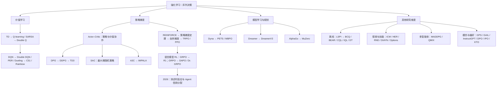

# 强化学习 100 篇论文：从预测、控制到推理与 Agent

强化学习算法看似分支繁多，核心问题却彼此相连：价值如何估计，策略如何更新，经验从哪里来，奖励又如何分配到动作。

本系列以 100 篇代表论文为线索，串联早期控制、深度价值学习、策略梯度、探索与模仿、多智能体、离线学习、世界模型和语言模型强化学习。每篇均可独立阅读，也可以每天一篇，逐步建立知识框架。

**阅读入口**：先用[Day 0导读](00-reading-guide.md)辨认数据、目标和学习信号，再用[强化学习发展时间线总览](00-强化学习发展时间线总览.md)呈现各阶段的问题与方法；下方目录连接逐篇精读，收尾篇提供横向比较和实验设计。

## 100 篇的两种阅读顺序

原 01–60 的编号与链接保持不变，61–100 按专题补齐。扩展篇编号是阅读顺序，不是发表年份：例如第99篇为2004年的学徒学习，第100篇为2008年的最大熵逆强化学习。目录优先标首次公开年份，具体核读版本与正式发表年份在各篇中分列。

## 读每篇时找这几件事

1. **承接哪个问题**：此前方法的瓶颈是什么，本篇真正改变哪个环节，后作又接走什么。
2. **设定与推导**：先说明信息、目标、符号与假设，再展开关键中间步骤和可手算例子。
3. **看得见的证据**：具体图表旁给原页入口、读法及实验条件；[第2天TD(λ)](02-td-lambda.md)还直接展示任务示意、正式勘误图与两张实验图。
4. **带着答案追问**：前置概念先读，进阶问题可展开参考答案；回答区分论文结论、教学推演和仍需实验的判断。

不同论文不强行套同一节标题。伪代码强调采样、梯度和更新顺序，不能仅凭几行教学流程就宣称复现训练结果。

## 全系列架构图

这些维度不是互斥分类。PPO 常与 Critic、GAE 配合；SAC 是无模型 Actor–Critic；Dreamer 同时包含世界模型与 Actor–Critic。DPO 在偏好学习设定下直接优化策略，但不能简单等同于通用在线策略梯度。

## 带着一个问题进入，而不是把目录当升级榜

- **为什么梯度长这样？** [REINFORCE](05-reinforce.md) → [策略梯度定理](08-policy-gradient-theorem.md) → [自然梯度](09-natural-policy-gradient.md) → [TRPO](14-trpo.md) → [PPO](27-ppo.md)。中途单独插入[GAE](15-gae.md)，核对估计器和优化器的分工。
- **固定数据能信多少？** [LSPI](10-lspi.md)给出批量策略迭代入口，再并列读[BCQ](37-bcq.md)、[BEAR](38-bear.md)、[CQL](42-cql.md)、[IQL](46-iql.md)。分别问限制动作、支持、价值还是查询，不把年份当性能顺序。
- **世界模型省了哪种成本？** [Dyna](03-dyna.md) → [PETS](35-pets.md)，再对照[MBPO](39-mbpo.md)、[Dreamer](40-dreamer.md)和[MuZero](41-muzero.md)：模型经验、想象训练和行动时搜索的账本不同。
- **语言反馈怎样进优化？** 从[InstructGPT](47-instructgpt.md)分叉到[DPO](49-dpo.md)/[IPO](50-ipo.md)/[KTO](51-kto.md)的离线反馈目标，或[GRPO](52-grpo.md)/[R1](53-r1.md)的在线采样与奖励。数据接口和优化器不是同一分类轴。
- **一条成功轨迹应该奖给谁？** 先做[Dr. GRPO](55-dr-grpo.md)的分母手算，再比较[FACTOR](58-factor.md)与[DRACO](60-draco.md)的守恒对象，最后看[TTPO](59-ttpo.md)多出的测试时权限。

每篇“一分钟理解”后都有独有路线提示；正文关系明确标为本篇承接、后作承接、模块组合、并行路线或教学对应。上一篇/下一篇只是阅读导航，不作为机制祖先的证据。

## 100 篇目录

| 天 | 年份 | 文章 | 核心阅读问题 |
|---|---|---|---|
| 1 | 1983 | [早期 Actor–Critic：让行动者拥有一个评价者](01-actor-critic.md) | 只有失败信号时怎样学会控制 |
| 2 | 1988 | [TD(λ)：结果还没出现，预测为什么就能学习](02-td-lambda.md) | 长序列中的预测与信用分配 |
| 3 | 1990 | [Dyna：一次真实交互，如何产生多次学习](03-dyna.md) | 昂贵交互下的学习与规划 |
| 4 | 1992 | [Q-learning：从一条经验开始，学会比较未来](04-q-learning.md) | 不知道转移概率，为什么仍能逼近最优 Q？ |
| 5 | 1992 | [REINFORCE：环境不可微，也能沿奖励的梯度学习](05-reinforce.md) | 为什么 log 概率乘回报会产生正确方向？ |
| 6 | 1994 | [SARSA：学习实际会执行的行为，而不只学习贪心目标](06-sarsa.md) | 探索中的行为价值应该如何更新 |
| 7 | 1999 | [Options：把“到达门口”也当作一个动作](07-options.md) | 长期任务如何在多个时间尺度决策 |
| 8 | 1999 | [策略梯度定理：Critic 近似到什么程度才不带偏 Actor](08-policy-gradient-theorem.md) | 带函数逼近的策略如何得到可靠梯度 |
| 9 | 2001 | [自然策略梯度：同样改一个参数，行为变化为什么不同](09-natural-policy-gradient.md) | 普通梯度对参数尺度敏感 |
| 10 | 2003 | [LSPI：反复利用同一批数据进行策略迭代](10-lspi.md) | 有限经验下怎样高效评价并改善策略 |
| 11 | 2010 | [Double Q-learning：为什么取最大值会制造乐观偏差](11-double-q.md) | 噪声价值估计中的最大化偏差 |
| 12 | 2013 | [Guided Policy Search：先找到好轨迹，再让策略学会产生它](12-gps.md) | 复杂连续策略如何绕开低质量局部最优 |
| 13 | 2014 | [DPG：沿价值对动作的梯度，训练连续策略](13-dpg.md) | 高维连续动作的策略更新 |
| 14 | 2015 | [TRPO：策略更新太猛，为什么会毁掉好不容易学会的行为](14-trpo.md) | 策略更新的稳定性 |
| 15 | 2015 | [GAE：把一串 TD 误差变成更好用的策略优势](15-gae.md) | 策略梯度的优势估计噪声 |
| 16 | 2015 | [DQN：让 Q-learning 从像素中学习，先要稳住自举目标](16-dqn.md) | 高维图像输入下的动作价值学习 |
| 17 | 2015 | [DDPG：把确定性策略梯度放进深度网络](17-ddpg.md) | 从复杂观测学习连续控制 |
| 18 | 2015 | [Double DQN：不用加一整套网络，也能分开选动作与打分](18-double-dqn.md) | DQN 的价值高估 |
| 19 | 2015 | [优先经验回放：经验并非都值得同样多次重读](19-per.md) | replay中有限梯度预算怎样分配 |
| 20 | 2015 | [Dueling DQN：先判断处境，再判断动作差别](20-dueling-dqn.md) | 许多状态下各动作价值相近 |
| 21 | 2016 | [AlphaGo：策略、价值与树搜索如何分工](21-alphago.md) | 围棋巨大搜索空间中的决策 |
| 22 | 2016 | [A3C：用多个环境的异步经验稳定深度学习](22-a3c.md) | 深度RL的相关样本与训练吞吐 |
| 23 | 2016 | [GAIL：模仿专家的行为分布，而不只复制单步动作](23-gail.md) | 没有奖励函数时怎样学专家行为 |
| 24 | 2017 | [ICM：好奇心奖励应该预测什么](24-icm.md) | 稀疏奖励下的探索 |
| 25 | 2017 | [MADDPG：训练时看全局，执行时各自行动](25-maddpg.md) | 多个学习者使彼此的环境不断变化 |
| 26 | 2017 | [HER：失败轨迹也能成为另一个目标的成功经验](26-her.md) | 目标条件任务中的稀疏成功信号 |
| 27 | 2017 | [PPO：裁剪替代目标到底限制了什么](27-ppo.md) | 在稳定性与实现成本间折中 |
| 28 | 2017 | [C51：不只预测平均回报，还预测回报分布](28-c51.md) | 价值平均数丢失回报分布结构 |
| 29 | 2017 | [Rainbow：六种DQN改进叠加后，哪些真的重要](29-rainbow.md) | 独立DQN改进能否互补 |
| 30 | 2018 | [SAC：随机性进入目标，而不仅是探索噪声](30-sac.md) | 连续控制的探索与样本效率 |
| 31 | 2018 | [TD3：给 DDPG 的价值误差加三道约束](31-td3.md) | Critic 错误被 Actor 放大的不稳定性 |
| 32 | 2018 | [IMPALA：采样与学习分离后，用V-trace处理策略滞后](32-impala.md) | 大规模分布式RL的吞吐与数据滞后 |
| 33 | 2018 | [DIAYN：没有任务奖励，能否先学会一组不同技能](33-diayn.md) | 无外部任务时的技能发现 |
| 34 | 2018 | [QMIX：用单调混合，让局部贪心与团队价值一致](34-qmix.md) | 合作团队的分散动作选择 |
| 35 | 2018 | [PETS：用模型集成表示不确定性，再进行短期规划](35-pets.md) | 模型驱动控制的误差与过度自信 |
| 36 | 2018 | [RND：预测一个冻结随机网络，也能产生探索奖励](36-rnd.md) | 难探索环境中的新颖性估计 |
| 37 | 2018 | [BCQ：离线学习时，先别选择数据从没支持过的动作](37-bcq.md) | 固定数据上的价值外推错误 |
| 38 | 2019 | [BEAR：限制支持范围，而不必复制行为频率](38-bear.md) | 离线Q的自举误差传播 |
| 39 | 2019 | [MBPO：不要在错误模型里想象太久](39-mbpo.md) | 模型偏差与样本效率的权衡 |
| 40 | 2019 | [Dreamer：把策略训练搬到潜在世界里](40-dreamer.md) | 从像素高效学习长期控制 |
| 41 | 2019 | [MuZero：不用重构世界，也能学出供搜索使用的模型](41-muzero.md) | 未知动力学下如何保留树搜索优势 |
| 42 | 2020 | [CQL：不敢相信未知动作，就直接惩罚乐观估值](42-cql.md) | 离线策略利用分布外高Q |
| 43 | 2020 | [AWAC：先用旧数据起步，再顺利接入在线学习](43-awac.md) | 离线预训练到在线微调的衔接 |
| 44 | 2021 | [Decision Transformer：把控制写成条件序列预测](44-decision-transformer.md) | 离线决策是否必须使用Bellman自举 |
| 45 | 2021 | [TD3+BC：离线学习中，一项模仿损失能走多远](45-td3-bc.md) | 离线方法复杂度与复现敏感性 |
| 46 | 2021 | [IQL：不查询数据外动作，也能向更好价值学习](46-iql.md) | 离线价值学习中的OOD动作查询 |
| 47 | 2022 | [InstructGPT：从预测下一个词，到学习人类更偏好的回答](47-instructgpt.md) | 语言模型的输出与用户意图不一致 |
| 48 | 2023 | [DreamerV3：为什么跨任务稳定，比单个任务高分更难](48-dreamerv3.md) | 世界模型算法跨任务的超参数敏感性 |
| 49 | 2023 | [DPO：为什么偏好分类可以直接更新语言模型](49-dpo.md) | RLHF的多模型与在线训练复杂性 |
| 50 | 2023 | [IPO：偏好胜负差距，是否应该被无限拉大](50-ipo.md) | 直接偏好优化的过拟合与假设问题 |
| 51 | 2024 | [KTO：只有“好／不好”标签，如何进行模型对齐](51-kto.md) | 成对偏好数据的采集要求 |
| 52 | 2024 | [DeepSeekMath／GRPO：用同题多回答，替代独立价值基线](52-grpo.md) | 语言模型RL的Critic成本与评价基线 |
| 53 | 2025 | [DeepSeek-R1：区分纯RL探索、完整训练管线与蒸馏](53-r1.md) | 大模型推理行为能否通过强化学习增强 |
| 54 | 2025 | [DAPO：GRPO训练中的采样、长度与裁剪，如何一起修正](54-dapo.md) | 大规模推理RL的熵塌缩、无效样本与长度问题 |
| 55 | 2025 | [Dr. GRPO：两个归一化分母，怎样改变学习方向的权重](55-dr-grpo.md) | GRPO长度与题目难度相关的梯度偏置 |
| 56 | 2026 | [MBDPO：让世界模型、价值学习与扩散策略更一致](56-mbdpo.md) | 模型搜索与价值训练的策略分布不一致 |
| 57 | 2026 | [WorldSample：合成经验什么时候值得交给真实机器人学习](57-worldsample.md) | 真实机器人交互昂贵，合成数据可能污染Critic |
| 58 | 2026 | [FACTOR：先分配动作信用，再决定哪些token承担它](58-factor.md) | 多轮Agent中轨迹、动作和token三层信用混杂 |
| 59 | 2026 | [TTPO：没有标准答案，测试时还能怎样更新模型](59-ttpo.md) | 无标签测试时推理适应 |
| 60 | 2026 | [DRACO：没有成功验证器时，如何把评分准则分配到步骤](60-draco.md) | 多轮工具任务缺少可靠终局成功标签 |
| 61 | 2017 | [CPO：把约束写进策略更新](61-cpo.md) | 怎样提高回报同时限制期望累计成本 |
| 62 | 2017 | [QR-DQN：用分位数学习回报分布](62-qr-dqn.md) | 从固定支持点转向固定质量的分位数表示 |

| 63 | 2018 | [IQN：把分位数变成网络输入，让回报分布可以按需查询](63-iqn.md) | 学习一条函数，而不是把固定输出头加长 |
| 64 | 2019 | [FQF：分位数值之外，连概率区间也一起学习](64-fqf.md) | 有限个原子，可以同时移动位置与质量 |
| 65 | 2018 | [RCPO：用可自举的惩罚引导策略，用真实约束调节罚价](65-rcpo.md) | 一步代价、轨迹统计与折扣代理不能混写 |
| 66 | 2020 | [PID Lagrangian：把惩罚系数当控制器，减少训练中的违规振荡](66-pid-lagrangian.md) | 控制目标是什么，哪些“安全”尚未获得 |
| 67 | 2016 | [Bootstrapped DQN：一次抽取一种价值判断，让探索走完一段路](67-bootstrapped-dqn.md) | 信息也可能藏在多步以后 |
| 68 | 2017 | [NoisyNet：把探索噪声写进参数，让学习决定扰动有多大](68-noisynet.md) | 让噪声进入函数，而不是只进入动作选择 |
| 69 | 2018 | [Episodic Curiosity：用可达性判断新奇，而不是追逐预测误差](69-episodic-curiosity.md) | 把新奇性的参照系放进当前回合 |
| 70 | 2020 | [Never Give Up：让探索持续存在，也让纯任务策略有自己的位置](70-ngu.md) | 两种新奇性服务于两种时间尺度 |
| 71 | 2020 | [Agent57：让探索策略竞争训练资源，补齐 Atari 的最后几块短板](71-agent57.md) | 目标函数没有统一成一种回报，策略族仍然存在 |
| 72 | 2015 | [DRQN：让Q网络从连续观测中学会记忆](72-drqn.md) | 循环隐状态不是自动得到的真实状态 |
| 73 | 2018 | [R2D2：回放的不只是经验，还有可能过期的记忆](73-r2d2.md) | 参数落后、表示漂移与隐藏状态陈旧 |
| 74 | 2018 | [RUDDER：把结尾的回报，重新分给真正改变预测的事件](74-rudder.md) | 回报相等、最优策略不变与未来奖励为零 |
| 75 | 2016 | [Option-Critic：把“做什么”和“何时停”一起交给回报学习](75-option-critic.md) | 一个技能执行到哪里，继续还是交还控制权 |
| 76 | 2017 | [FeUdal Networks：高层给方向，低层学会把方向走出来](76-feudal-networks.md) | 视觉长程任务里，怎样让高层目标具有稳定含义 |
| 77 | 2018 | [HIRO：低层学会了新走法，旧的高层经验还能怎样使用](77-hiro.md) | 两个策略，两种奖励，一个正在变化的动作接口 |
| 78 | 2017 | [HAC：先承认实际走到了哪里，再让多层目标一起学习](78-hac.md) | 低层变化让高层动作的含义也变化 |
| 79 | 2019 | [DADS：技能不仅要不同，还要让下一步容易预测](79-dads.md) | 先无任务地学技能，再用任务奖励做规划 |
| 80 | 2015 | [UVFA：价值函数不仅认识状态，还要认识你想去哪里](80-uvfa.md) | 共享转移，目标改变奖励和终止 |
| 81 | 2016 | [Successor Features：把“将来会发生什么”与“现在想要什么”拆开](81-successor-features.md) | 动力学不变、奖励改变时，哪些经验还能继续用 |
| 82 | 2018 | [USFA：任务权重w决定价值，策略编码z决定未来](82-usfa.md) | 在同一环境中，泛化奖励也泛化策略 |
| 83 | 2016 | [RL²：把快速学习写进记忆，而不是每次重新更新权重](83-rl2.md) | 一个trial包含同一任务的多个episode |
| 84 | 2017 | [MAML：学一个容易改变的起点，而不是所有任务的折中答案](84-maml.md) | 一次新任务适应包含数据采集和参数更新 |
| 85 | 2019 | [PEARL：把新任务适应变成推断，并让不确定性指导探索](85-pearl.md) | 训练任务有身份，测试策略靠经验辨认 |
| 86 | 2019 | [VariBAD：把“还不知道什么”交给策略，而不是先猜一个任务](86-varibad.md) | 学习新任务时也计算收益 |
| 87 | 2018 | [MB-MPO：模型彼此不一致时，先学会适应，再决定怎样行动](87-mb-mpo.md) | 具体内容 |
| 88 | 2018 | [PlaNet：不把未来画出来，也能从像素中规划动作](88-planet.md) | 具体内容 |
| 89 | 2022 | [TD-MPC：让短期规划接上长期价值，不必先学会重画世界](89-td-mpc.md) | 在线连续控制中的模型与价值协作 |
| 90 | 2023 | [TD-MPC2：让潜在世界模型既能规划，也能承受任务与规模变化](90-td-mpc2.md) | 控制需要的预测，不必等于观测重建 |
| 91 | 2020 | [MOPO：离开数据之前，先把模型的不确定性记进奖励](91-mopo.md) | 固定日志中的模型泛化与风险 |
| 92 | 2020 | [MOReL：模型不认识的地方，先在想象中按下停止键](92-morel.md) | 在不完整覆盖下学习悲观MDP |
| 93 | 2021 | [EDAC：让价值网络的动作梯度分开，集成才不只是重复投票](93-edac.md) | 固定数据下的集成悲观估计 |
| 94 | 2023 | [Cal-QL：给保守价值一个下限，让在线微调不必先忘掉好策略](94-cal-ql.md) | 保守初始化怎样支持在线改善 |
| 95 | 2017 | [VDN：只给团队奖励，怎样学出可以各自贪心的价值分解](95-vdn.md) | 团队只有一个分数，为何不能人人各学一遍 |
| 96 | 2017 | [COMA：固定队友动作，怎样为每个成员构造反事实基线](96-coma.md) | 能联合评价，为什么还需要个人参照 |
| 97 | 2019 | [QTRAN：不必保留整张价值表，也能让局部最优与团队最优对齐](97-qtran.md) | IGM约束动作选择，而非整张价值表 |
| 98 | 2021 | [MAPPO：多智能体PPO为什么能成为强基线，公平比较又要控制什么](98-mappo.md) | 共享奖励不等于大家看见同一个世界 |
| 99 | 2004 | [Apprenticeship IRL：不必找回真实奖励，也能逼近专家表现](99-apprenticeship-irl.md) | 观察示范，已知环境，未知奖励 |
| 100 | 2008 | [Maximum Entropy IRL：匹配专家特征之后，如何选择行为分布](100-maximum-entropy-irl.md) | 特征告诉我们什么，概率还缺什么 |

## 收尾与阅读路线

[系列收尾：三个自构实验、三处具体疑点、统一比较与阅读记录](61-系列收尾.md)

前 60 篇按历史主线通读，61 起按专题补读；需要快速搭建最小基础时，可先走 Q-learning → REINFORCE → DQN → DPG／DDPG → TRPO／GAE／PPO → TD3／SAC，再进入自己的专题。

**进一步阅读的方向**包括约束与安全 RL、风险敏感 RL、部分可观测控制、元强化学习、后悔界、探索复杂度、逆强化学习理论和全部机器人实践。这些专题可以在掌握本系列的基本方法后继续展开。

学习检查：每篇读完，独立画信息流、写一个核心更新、复述一个有条件的证据，并构造一种失败情形。具体评估记录表见收尾篇。

## 按问题选择专题

- **回报分布**：[QR-DQN](62-qr-dqn.md) → [IQN](63-iqn.md) → [FQF](64-fqf.md)。
- **期望约束**：[CPO](61-cpo.md)、[RCPO](65-rcpo.md)、[PID Lagrangian](66-pid-lagrangian.md)，分别比较约束更新、三时间尺度和反馈控制。
- **探索与记忆**：[Bootstrapped DQN](67-bootstrapped-dqn.md) → [NoisyNet](68-noisynet.md) → [EC](69-episodic-curiosity.md) → [NGU](70-ngu.md) → [Agent57](71-agent57.md)，再对照[DRQN](72-drqn.md)、[R2D2](73-r2d2.md)与[RUDDER](74-rudder.md)。
- **时间抽象与迁移**：[Option-Critic](75-option-critic.md)、[FeUdal](76-feudal-networks.md)、[HIRO](77-hiro.md)、[HAC](78-hac.md)、[DADS](79-dads.md)，接到[UVFA](80-uvfa.md)、[SF](81-successor-features.md)与[USFA](82-usfa.md)。
- **未知任务适应**：[RL²](83-rl2.md)、[MAML](84-maml.md)、[PEARL](85-pearl.md)、[VariBAD](86-varibad.md)、[MB-MPO](87-mb-mpo.md)，比较历史、梯度、潜变量和模型适应。
- **模型与离线保守性**：[PlaNet](88-planet.md) → [TD-MPC](89-td-mpc.md) → [TD-MPC2](90-td-mpc2.md)；再对照[MOPO](91-mopo.md)、[MOReL](92-morel.md)、[EDAC](93-edac.md)、[Cal-QL](94-cal-ql.md)。
- **团队与示范**：[VDN](95-vdn.md)、[COMA](96-coma.md)、[QTRAN](97-qtran.md)、[MAPPO](98-mappo.md)比较协作接口；[Apprenticeship IRL](99-apprenticeship-irl.md)与[Maximum Entropy IRL](100-maximum-entropy-irl.md)回到奖励的可识别性。

## 选文与证据说明

前 60 篇按所选论文首次公开或相应历史版本的年份排列，同年兼顾先修关系；新增专题篇不重新编号旧文。DQN 采用 2015 年 Nature 版本，文内另述 2013 年预印本；BCQ 对应 2018 年预印本与 2019 年会议论文。2026年专题选文范围截至9月8日；本轮图表与问答修订日期为10月14日。首发年份与实际阅读修订版分开记录。

文章分别标明作者主张、论文证据与教学分析。论文成绩引自作者报告，教学手算单独标注；本系列未独立运行原论文训练。理论文章以证明及其前提为主要证据。

[早期 Actor–Critic](01-actor-critic.md)和[SARSA](06-sarsa.md)的原始资料获取受限，具体范围在文首说明。本轮仍只能可靠读取摘要或书目信息，其原实验图表与数值尚未全部核实；原系列其余58篇按明确章节核源，不冒称全部全文审计。各篇的引用版本、原图入口与限制可从[逐篇查核记录](../edition-review.html)查看。

[Options](07-options.md)已通过另一份原PDF补齐§2—4核读，原先的摘要级访问限制已更新；尚未逐项审核的intra-option证明和实验重复仍保留说明。

61–100篇均单独记录实际核读版本、章节与实验限制，不并入旧版58篇的历史核源统计。图像核验、公式渲染与链接校验也不等于独立训练复现。
